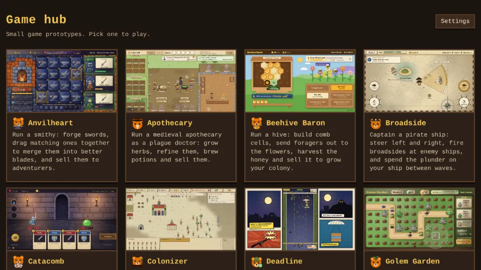

# game-proto

A hub of small game prototypes built with [Phaser 4](https://phaser.io), TypeScript and Vite. The
start page lists the games; each one lives in its own folder under `games/`.



| Game | What it is |
| --- | --- |
| [Apothecary](games/apothecary/README.md) | Run a medieval apothecary as a plague doctor: grow herbs, refine them, brew potions and sell them to customers. |
| [Deadline](games/deadline/README.md) | Hold the bottom of a road against growing waves of zombies: move left and right, shoot automatically, and shoot crates open for upgrades. |
| [Palisade](games/palisade/README.md) | Hold a barricade against waves of goblins, orcs, harpies, shield bearers and shamans as a ranger, picking one of three upgrades each level, hiring guards with coins, with a boss and a choice of road every ten waves. |
| [Tiny Kingdom](games/tiny-kingdom/README.md) | Draw three tiles a turn and place farms, houses, towers and roads on a small island grid, each scoring against its neighbours, join them to the castle, and reach each round's goal before the tiles run out. |
| [Hotfoot](games/hotfoot/README.md) | Run as a knight who never stops: jump spikes and pits, slide under blades, and pick one of two boons at each checkpoint. |
| [Anvilheart](games/anvilheart/README.md) | Run a smithy: forge swords, drag two matching ones together to merge them into a better blade, and sell them to adventurers as their orders come in. |
| [Broadside](games/broadside/README.md) | Captain a pirate ship on an old sea chart: steer left and right, hold a side to aim and charge a broadside at enemy ships, follow each wave's captain's order, sail over their loot, and upgrade hull and cannons at the harbor between waves. |
| [TinctureTinker](games/tincture-tinker/README.md) | A match-3 board of Apothecary's ingredients: swap tiles to gather what each potion order asks for before the moves run out, and sell the potion for coins. |
| [Catacomb](games/catacomb/README.md) | Fight through a short dungeon with a deck of cards: a hand of five each turn against foes who show what they will do next, and a new card after every fight. |
| [Golem Garden](games/golem-garden/README.md) | A tower defense in a garden: plant seeds beside the path that grow into pebble and moss golems, and stop the pests before they eat the Heartwood. Five cleared waves bloom the Heartwood and unlock the Thorn golem; golems combo, a Queen Slug comes every tenth wave, and good runs open forked gardens. |
| [Beehive Baron](games/beehive-baron/README.md) | Run a beehive: build comb cells, send foragers out to the flowers for nectar, harvest the ripened honey and sell it for more bees and upgrades. |
| [Wyrmrail](games/wyrmrail/README.md) | Lay track across a new valley each game, steer a dragon-drawn train with switches to carry cargo between villages before each order's time runs out, keep it fed, feed the workshops and finish with a festival after the eighth village. |
| [Shrine Stack](games/shrine-stack/README.md) | Stack a temple from swinging stones: tap to drop each one, overhangs break off, and every balanced tier of three stones earns a blessing. Spend favor between tiers, take curses for double favor, and climb past the crown into a windy sky. |
| [Mapmaker](games/mapmaker/README.md) | Reveal a fog-covered island tile by tile on a voyage's supplies, climb hills and peaks to see further, and sell your charts at port for upgrades. |
| [Lanternkeep](games/lanternkeep/README.md) | Send moths from their jar to light a castle's lanterns before night falls, keep them burning on scarce oil, and upgrade wicks, oil and the moths between nights. |
| [Space Wars](games/space-wars/README.md) | Command a fleet of 3D ships on a 70s paperback star map: build a base, raise units, work through a chain of contracts, hold the relay beacon and salvage wrecks while you fight rival factions, each with its own buildings and ships. |
| [Lane Brawl](games/lane-brawl/README.md) | Lead a team of five low-poly 3D heroes down the lanes in a MOBA against NPC teams: chase objectives, chain last hits, pick an upgrade each level, build items from parts, fight over a guardian beast, ambush from tall grass, break an inhibitor and destroy the enemy base. |
| [Colonizer](games/colonizer/README.md) | A base-building RTS embroidered like the Bayeux tapestry: gather wood, food and ore, build, research techs and raise armies of three factions, pick an Age II boon, earn Age III with three deeds, then destroy the enemy Town Center. |
| [Riftblade](games/riftblade/README.md) | Hold out five minutes against scrap droids on a dune world as one of three blaster soldiers, then beat the boss; every level-up offers a new skill. |
| [Scrapyard Titans](games/scrapyard-titans/README.md) | Build a squad of junk-built robots on an 8x8 board, bolt on parts and watch them brawl it out against seven rival commanders. |
| [Bramblecrest](games/bramblecrest/README.md) | A small knight explores an overgrown kingdom by lamplight, finding a new tool in every dungeon that opens more of the world. |

## Settings

The hub's **Settings** button opens the settings every game shares. They are saved in the browser
(`shared/settings.ts`) and apply to a game the next time it opens.


- **Difficulty**: Easy, Normal or Hard. Normal is each game as designed; each game picks what it scales:

  | Game | Easy | Hard |
  | --- | --- | --- |
  | Apothecary | customers wait 50% longer | customers wait 30% less |
  | Deadline | zombies have 25% less health | zombies have 30% more health |
  | Palisade | foes have 25% less health | foes have 30% more health |
  | Tiny Kingdom | round goals 20% lower, campaign stars 1% higher | round goals 20% higher, campaign stars 6% lower |
  | Hotfoot | 5 hearts | 2 hearts |
  | Anvilheart | adventurers wait 50% longer | adventurers wait 30% less |
  | Broadside | enemy ships and forts have 25% less health | enemy ships and forts have 30% more health |
  | Lane Brawl | red's champions, minions and towers deal 20% less damage | red's champions, minions and towers deal 25% more damage |
  | TinctureTinker | 5 more moves per order | 3 fewer moves per order |
  | Catacomb | foes have 25% less health | foes have 30% more health |
  | Golem Garden | pests have 25% less health | pests have 30% more health |
  | Beehive Baron | foraging trips 25% shorter | foraging trips 30% longer |
  | Wyrmrail | orders allow 50% more time | orders allow 30% less time |
  | Shrine Stack | stones swing 20% slower | stones swing 25% faster |
  | Mapmaker | 16 supplies a voyage | 9 supplies a voyage |
  | Lanternkeep | lanterns burn 30% longer | lanterns burn 20% shorter |
  | Colonizer | the AI gathers 25% slower | the AI gathers 25% faster |
  | Riftblade | droids have 25% less health and come 25% slower | droids have 35% more health and come 25% faster |

- **Frame rate (FPS)**: the most frames per second a game draws, 30 to 320 (60 by default).
- **Show FPS**: a readout of the frame rate in each game's corner.
- **Reduce motion**: turns off screen shake, flashes and blinking hit effects.
- **Restore defaults** and **Reset all progress**, which erases every game's save and keeps the settings.

Every game also has a full screen button in its bottom left corner, and the **F** key toggles full screen. Browsers that cannot take a page full screen, such as iPhones, don't show the button.

Every game shows a loading screen while its art is drawn, then waits on a start screen until **Start** is pressed (or Enter or Space). The pause button next to full screen, the **P** key or leaving the tab pauses it; Resume, P, Space or Esc play on, and the pause screen links back to all games. Both screens have a **How to play** button (or the **H** key) that shows the game's goal, its controls, how a round goes and a few tips; Back, H or Esc close it.

## Watch AI

Games whose AI can play every side have a watch mode: add `?watch` to the game's URL, such as
`/games/colonizer/?watch` (on `npm run dev` or the published site alike). The AI then
plays your side as well, and a panel in the top right holds the match still while you look round
(its pause button), plays it at 1x, 2x, 4x or 8x (**[** and **]** step the speed) and shows a log of
what each AI decides (**L**).

| Game | What the watch mode does |
| --- | --- |
| Colonizer | two random factions, both run by the planner, on an open map; a click on the end screen starts another match |
| Space Wars | all five factions run by the AI on an open map until one is left; contracts don't run; a tap on the end screen starts another battle |
| Lane Brawl | all ten champions run by the AI, blue's with a random class, with no fog; objectives don't run; the camera follows blue's champion; Watch another on the end screen starts another match |

## Running locally

Needs Node 26 (`.nvmrc`), the version CI and the builds use.

```sh
npm install
npm run dev       # dev server with hot reload; the hub is at /, each game at /games/<name>/
npm run build     # typecheck (games, tests and configs) + production build of the hub and every game into dist/
npm run preview   # serve the production build
```

## Layout

- `index.html`: the hub page, one card per game.
- `games/<name>/`: one game, with its own `index.html`, `src/`, `e2e/` playthrough test, `docs/`
  screenshots and `README.md`. Games don't import from each other.
- `shared/`: the settings every game shares (`settings.ts`), the hub's Settings panel
  (`settingsPanel.ts`), `setupGame.ts`, which each game calls to apply the frame cap, the FPS readout, reduced motion and full screen
  and to add the loading, start and pause screens (`startScreen.ts`) with the game's How to play (`howToPlay.ts`), `watch.ts`, the Watch AI panel and its `?watch` flag,
  `playCount.ts`, the play counters (see Play counts), and `scaling.ts`, which keeps a game sharp from a phone to a 4K screen (`grep -l setupScaling games/*/src/main.ts` lists the games that use it).
- `e2e/hub.spec.ts`: checks that the hub lists every game, that each card opens it, and that the
  settings are saved and reach a game, that a game starts and pauses, and that the cards show play counts. `e2e/screens.spec.ts` opens each game that uses
  `shared/scaling.ts` on an upright and a sideways phone, a tablet, a laptop and a 4K screen.
- `package.json`, `tsconfig.json`, `tsconfig.e2e.json`, `vite.config.ts` and `playwright.config.ts`
  are shared. `tsconfig.json` typechecks the games and `shared/`; `tsconfig.e2e.json` typechecks
  the Playwright tests and the two configs, with Node's types. Vite builds every
  `games/*/index.html` next to the hub; Playwright runs one project per game.

See `AGENTS.md` for adding a game and for the playthrough rules.

## Tests

```sh
npx playwright install chromium        # once
npm run test:e2e                       # the hub test and every game's playthrough
npx playwright test --project apothecary   # one game only
```

One playthrough workflow (`.github/workflows/playthrough.yml`) plays each game whose folder
changed, on pull requests only, under a single required `Playthrough` check, and uploads videos and
screenshots as the `playthrough-<name>` artifact. The Hub workflow runs the hub test, opening each game from its
card in one job per game, on pull requests only for the games whose folder changed. The Screens workflow checks each game that uses `shared/scaling.ts` on five screens,
one job per game, on pull requests only for the games whose folder changed. The Screenshots workflow fails a pull request that adds more than 4
screenshots or images over the size limits (WebP screenshots of at most 200 KB; `npm run screenshots -- <file>` converts one). Each CI run also uploads a `game-build` artifact: download it from
the run's summary page, unzip it and serve the folder (for example with `npx serve`) to play. Dependabot
(`.github/dependabot.yml`) opens update PRs: npm weekly, GitHub Actions and the Docker base image
monthly, with minor and patch updates grouped into one PR. PR Links and the template check skip
Dependabot's PRs, since their descriptions quote release notes from other sites.

## Play counts

Each game counts how often it is played on a public counter at Abacus, a free open source counter
service with no account (`shared/playCount.ts`). `setupGame` adds one to the game's counter
(`chriszly-game-proto/<game folder>`) when a game opens, once per browser tab, and the hub shows
each card's count as "N plays". Only the built site counts: the dev server, browser automation (so
the playthroughs and e2e tests) and `?watch` matches never do. If the service can't be reached, the
games play as usual and the cards simply show no count. Nothing else is sent.

## Play online

Every push to main builds the hub and its games and publishes them on GitHub Pages, at
[chriszly.github.io/game-proto](https://chriszly.github.io/game-proto/), with the hub as the start
page (`.github/workflows/deploy.yml`). Paths in the build are relative, so it works under the
`/game-proto/` subpath.

## Container image

Every push to main also builds the hub and its games into a container image (`Dockerfile`: the
build served by nginx on port 8080) for arm64 and amd64, and publishes it as
`ghcr.io/chriszly/game-proto:latest` (and `:sha-<commit>`). Pull requests only check that the
image builds.
