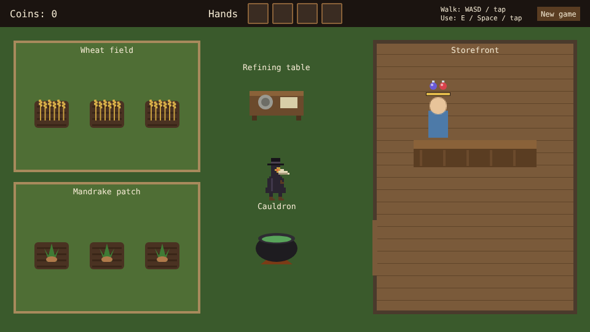

# game-proto

Apothecary: a small automation game prototype built with [Phaser 4](https://phaser.io), TypeScript and Vite.

You play a plague doctor running a medieval apothecary. Grow herbs in the backyard, refine them,
brew potions in the cauldron and sell them to customers at the storefront.



## How to play

| Control | Action |
| --- | --- |
| WASD / arrow keys, or tap | Walk |
| E / Space, or tap a station | Use the plot or station you are standing at |

1. **Gardens**: each garden grows one kind of plant. Harvest ripe wheat in the wheat field and
   mandrake in the mandrake patch. Plots regrow on their own.
2. **Refining table**: drop off plants; wheat becomes wheat flour, mandrake becomes mandrake seeds.
   Come back to collect the finished goods.
3. **Cauldron**: drop in refined goods. Two wheat flour brew a Healing Draught, wheat flour and
   mandrake seeds brew a Sleeping Tonic.
4. **Storefront**: customers show the potions they want and how long they will wait. Serve them at
   the counter for coins.

You can carry four items at a time; they stack up on the doctor's back. Progress is saved in the browser automatically; "New game"
in the top bar starts over.

## Running locally

```sh
npm install
npm run dev       # dev server with hot reload
npm run build     # typecheck + production build into dist/
npm run preview   # serve the production build
```

Each CI run also uploads a `game-build` artifact: download it from the run's summary page,
unzip it and serve the folder (for example with `npx serve`) to play.

## Code layout

- `src/game/`: the rules (items, recipes, state, simulation tick and player actions) in plain
  TypeScript with no Phaser dependency, plus saving.
- `src/scenes/`: Phaser scenes. `BootScene` bakes textures, `GameScene` draws the world and wires
  input to the rules.
- `src/art/`: the pixel-art plague doctor and placeholder art for everything else.
- `src/ui/`: small reusable display pieces (icon rows, progress bars).
