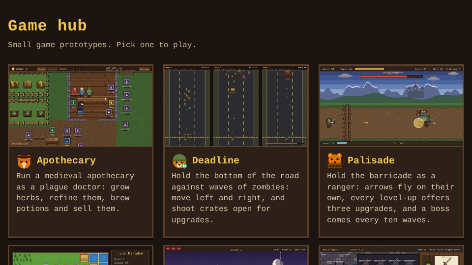
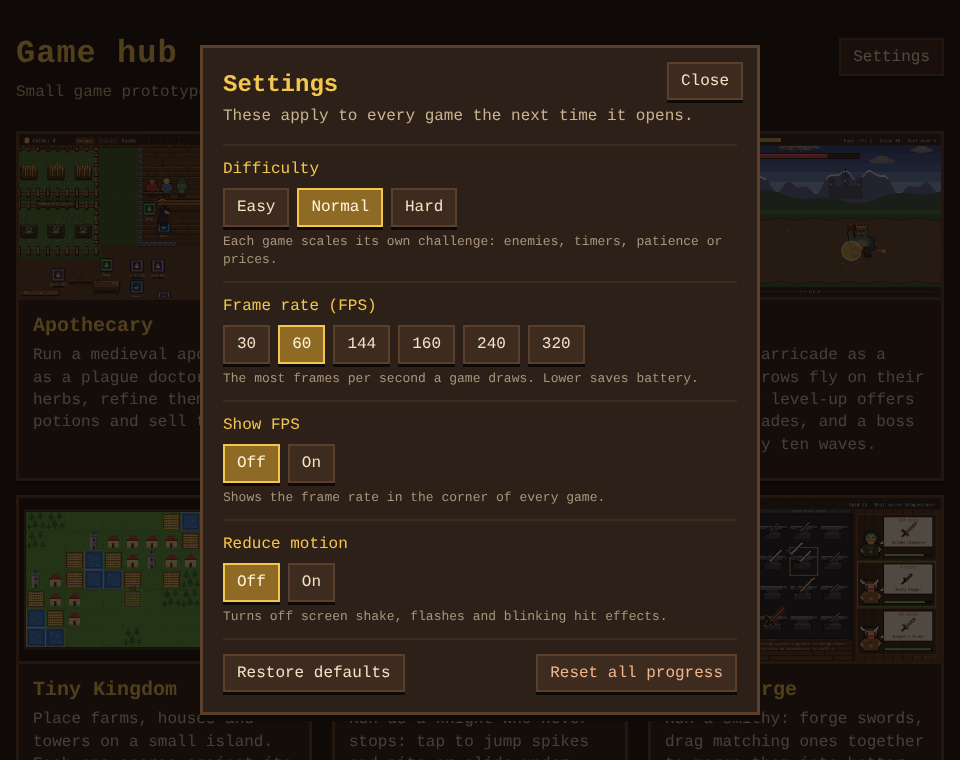

# game-proto

A hub of small game prototypes built with [Phaser 4](https://phaser.io), TypeScript and Vite. The
start page lists the games; each one lives in its own folder under `games/`.



| Game | What it is |
| --- | --- |
| [Apothecary](games/apothecary/README.md) | Run a medieval apothecary as a plague doctor: grow herbs, refine them, brew potions and sell them to customers. |
| [Deadline](games/deadline/README.md) | Hold the bottom of a road against growing waves of zombies: move left and right, shoot automatically, and shoot crates open for upgrades. |
| [Palisade](games/palisade/README.md) | Hold a barricade against waves of goblins, orcs and dark knights as a ranger, picking one of three upgrades each level, with a boss every ten waves. |
| [Tiny Kingdom](games/tiny-kingdom/README.md) | Place farms, houses and towers on a small island grid, each scoring against its neighbours, and reach each round's goal before the tiles run out. |
| [Hotfoot](games/hotfoot/README.md) | Run as a knight who never stops: jump spikes and pits, slide under blades, and pick one of two boons at each checkpoint. |
| [Anvilheart](games/anvilheart/README.md) | Run a smithy: forge swords, drag two matching ones together to merge them into a better blade, and sell them to adventurers as their orders come in. |
| [Broadside](games/broadside/README.md) | Captain a pirate ship on an old sea chart: steer left and right, hold a side to aim and charge a broadside at enemy ships, follow each wave's captain's order, sail over their loot, and upgrade hull and cannons at the harbor between waves. |
| [TinctureTinker](games/tincture-tinker/README.md) | A match-3 board of Apothecary's ingredients: swap tiles to gather what each potion order asks for before the moves run out, and sell the potion for coins. |
| [Catacomb](games/catacomb/README.md) | Fight through a short dungeon with a deck of cards: a hand of five each turn against foes who show what they will do next, and a new card after every fight. |
| [Golem Garden](games/golem-garden/README.md) | A tower defense in a garden: plant seeds beside the path that grow into pebble and moss golems, and stop the pests before they eat the Heartwood. Five cleared waves bloom the Heartwood and unlock the Thorn golem. |
| [Beehive Baron](games/beehive-baron/README.md) | Run a beehive: build comb cells, send foragers out to the flowers for nectar, harvest the ripened honey and sell it for more bees and upgrades. |
| [Wyrmrail](games/wyrmrail/README.md) | Lay track across a valley and send a dragon-drawn train to carry cargo between villages before each order's time runs out, with a new village joining the line each round. |
| [Shrine Stack](games/shrine-stack/README.md) | Stack a temple from swinging stones: tap to drop each one, overhangs break off, and every balanced tier of three stones earns a blessing. |
| [Mapmaker](games/mapmaker/README.md) | Reveal a fog-covered island tile by tile on a voyage's supplies, climb hills and peaks to see further, and sell your charts at port for upgrades. |
| [Lanternkeep](games/lanternkeep/README.md) | Send moths from their jar to light a castle's lanterns before night falls, keep them burning on scarce oil, and upgrade wicks, oil and the moths between nights. |
| [Space Wars](games/space-wars/README.md) | Command a fleet on a random star map: build a base, raise units and fight rival factions, each with its own buildings and ships. |
| [Lane Brawl](games/lane-brawl/README.md) | Lead a team of five low-poly 3D heroes down the lanes in a MOBA against NPC teams: chase objectives, chain last hits, pick an upgrade each level, push the lanes and destroy the enemy base. |
| [Colonizer](games/colonizer/README.md) | An Age-of-Empires-style RTS embroidered like the Bayeux tapestry: gather wood, food and ore, build, research techs and raise armies of three factions, pick an Age II boon, earn Age III with three deeds, then destroy the enemy Town Center. |

## Settings

The hub's **Settings** button opens the settings every game shares. They are saved in the browser
(`shared/settings.ts`) and apply to a game the next time it opens.



- **Difficulty**: Easy, Normal or Hard. Normal is each game as designed; each game picks what it scales:

  | Game | Easy | Hard |
  | --- | --- | --- |
  | Apothecary | customers wait 50% longer | customers wait 30% less |
  | Deadline | zombies have 25% less health | zombies have 30% more health |
  | Palisade | foes have 25% less health | foes have 30% more health |
  | Tiny Kingdom | round goals 20% lower | round goals 20% higher |
  | Hotfoot | 5 hearts | 2 hearts |
  | Anvilheart | adventurers wait 50% longer | adventurers wait 30% less |
  | Broadside | enemy ships have 25% less health | enemy ships have 30% more health |
  | Lane Brawl | red's champions and minions deal 20% less damage | red's champions and minions deal 25% more damage |
  | TinctureTinker | 5 more moves per order | 3 fewer moves per order |
  | Catacomb | foes have 25% less health | foes have 30% more health |
  | Golem Garden | pests have 25% less health | pests have 30% more health |
  | Beehive Baron | foraging trips 25% shorter | foraging trips 30% longer |
  | Wyrmrail | orders allow 50% more time | orders allow 30% less time |
  | Shrine Stack | stones swing 20% slower | stones swing 25% faster |
  | Mapmaker | 16 supplies a voyage | 9 supplies a voyage |
  | Lanternkeep | lanterns burn 30% longer | lanterns burn 20% shorter |
  | Colonizer | the AI gathers 25% slower | the AI gathers 25% faster |

- **Frame rate (FPS)**: the most frames per second a game draws, 30 to 320 (60 by default).
- **Show FPS**: a readout of the frame rate in each game's corner.
- **Reduce motion**: turns off screen shake, flashes and blinking hit effects.
- **Restore defaults** and **Reset all progress**, which erases every game's save and keeps the settings.

## Running locally

```sh
npm install
npm run dev       # dev server with hot reload; the hub is at /, each game at /games/<name>/
npm run build     # typecheck (games, tests and configs) + production build of the hub and every game into dist/
npm run preview   # serve the production build
```

## Layout

- `index.html`: the hub page, one card per game.
- `games/<name>/`: one game, with its own `index.html`, `src/`, `e2e/` playthrough test, `docs/`
  screenshots and `README.md`. Games don't import from each other.
- `shared/`: the settings every game shares (`settings.ts`), the hub's Settings panel
  (`settingsPanel.ts`) and `setupGame.ts`, which each game calls to apply the frame cap, the FPS
  readout and reduced motion.
- `e2e/hub.spec.ts`: checks that the hub lists every game, that each card opens it, and that the
  settings are saved and reach a game.
- `package.json`, `tsconfig.json`, `tsconfig.e2e.json`, `vite.config.ts` and `playwright.config.ts`
  are shared. `tsconfig.json` typechecks the games and `shared/`; `tsconfig.e2e.json` typechecks
  the Playwright tests and the two configs, with Node's types. Vite builds every
  `games/*/index.html` next to the hub; Playwright runs one project per game.

See `AGENTS.md` for adding a game and for the playthrough rules.

## Tests

```sh
npx playwright install chromium        # once
npm run test:e2e                       # the hub test and every game's playthrough
npx playwright test --project apothecary   # one game only
```

One playthrough workflow (`.github/workflows/playthrough.yml`) plays each game whose folder
changed, on pull requests only, under a single required `Playthrough` check, and uploads videos and
screenshots as the `playthrough-<name>` artifact. The Hub workflow runs the hub test when the hub page or a game's
card changes. Each CI run also uploads a `game-build` artifact: download it from
the run's summary page, unzip it and serve the folder (for example with `npx serve`) to play.

## Container image

Every push to main also builds the hub and its games into a container image (`Dockerfile`: the
build served by nginx on port 8080) for arm64 and amd64, and publishes it as
`ghcr.io/chriszly/game-proto:latest` (and `:sha-<commit>`). Pull requests only check that the
image builds.
