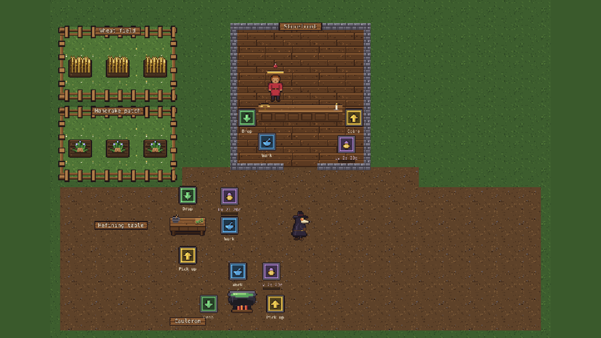
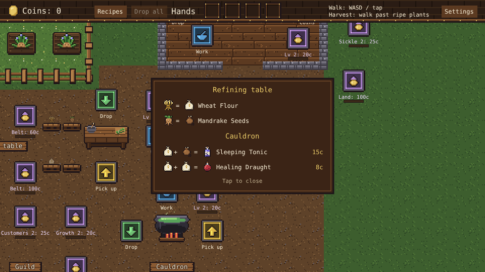
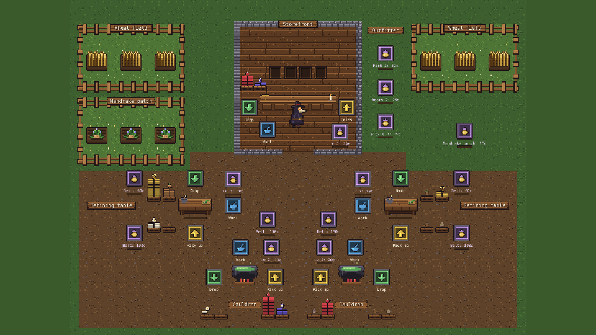
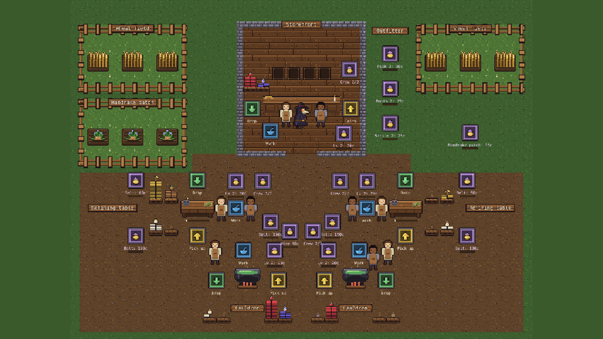
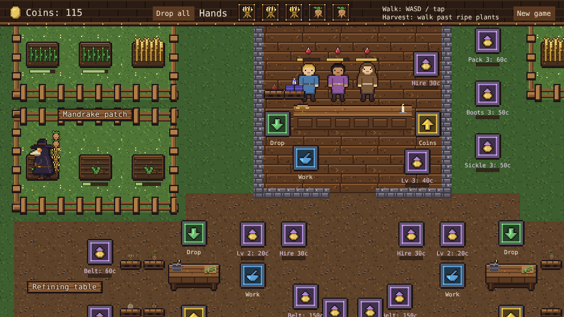
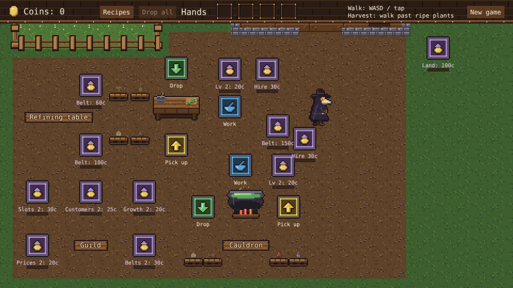
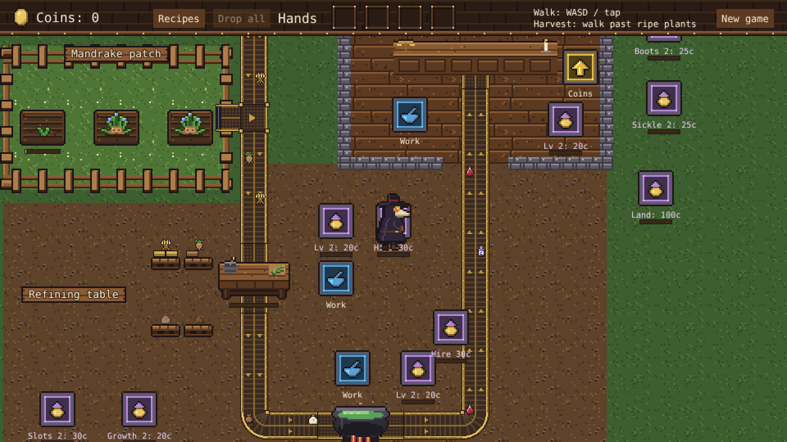
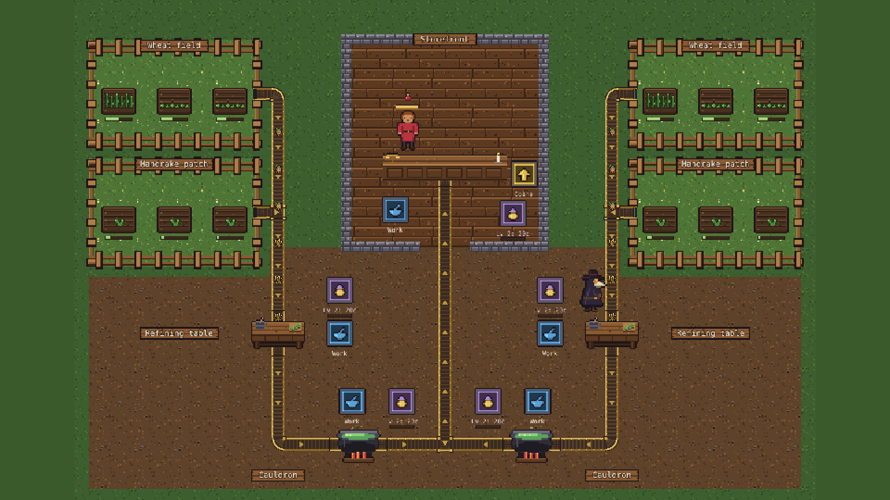

# game-proto

Apothecary: a small automation game prototype built with [Phaser 4](https://phaser.io), TypeScript and Vite.

You play a plague doctor running a medieval apothecary. Grow herbs in the backyard, refine them,
brew potions in the cauldron and sell them to customers at the storefront.



The apothecary is laid out as a U: goods go down the left arm (the wheat field and mandrake patch,
then the refining table), along the bottom (the cauldron) and up the middle into the shop at the
top. The right arm is grass until the expansion is bought, which opens it up for a second
production line that mirrors the left. The courtyard inside the U is where the doctor works. The
map is bigger than the screen, so the camera follows the doctor.

## How to play

| Control | Action |
| --- | --- |
| WASD / arrow keys, or tap | Walk |
| Walk past ripe plants | Harvest every ripe plant within one character height of the doctor; the spinning sickle marks the edge |
| Recipes (top bar) | Show what each station makes from what, and what each potion sells for; tap again to close |
| Drop all (top bar) | Throw away everything the doctor carries |
| Stand on a floor marker | Green: drop off items. Blue: work the station. Gold: pick up products or coins. Purple: pay coins to upgrade or build something |

1. **Gardens**: each garden grows one kind of plant. Harvest ripe wheat in the wheat field and
   mandrake in the mandrake patch. Plots regrow on their own.
2. **Refining table**: drop off plants; wheat becomes wheat flour, mandrake becomes mandrake seeds.
   Stand on the work spot while it refines; pick the finished goods up on the pick-up marker.
3. **Cauldron**: drop in refined goods. Two wheat flour brew a Healing Draught, wheat flour and
   mandrake seeds brew a Sleeping Tonic. Stand on the work spot while it brews. When work starts,
   the cauldron brews whichever potion customers are waiting for that the shop has least of.
4. **Storefront**: customers come in by the street door in the shop's back wall, walk up to the
   counter and show the potions they want and how long they will wait. Drop potions
   on the counter and stand on the work spot behind it; customers pay for each potion as they get
   it and leave the coins on the pick-up marker.



**Pallets**: every station keeps each kind of goods coming in or going out on its own pallet: two
by two on the base, stacked up to ten layers high, so 40 of each kind. The refining table keeps
its pallets on its left (plants above, flour and seeds below), the cauldron below its drop-off and
pick-up, and the counter keeps its potions behind its left end. A full pallet takes nothing more:
the doctor keeps the item and a belt waits until there is room.



**Craftsmen** work a station so the doctor doesn't have to stand on its work spot. Each station
takes up to two, hired one at a time on the purple marker beside it (30, then 60 coins); they
stand by the station once hired, and its work spot goes away. A refining table or cauldron works
as fast again for each craftsman. At the counter
the first craftsman serves customers, a potion every 1.5 seconds where the doctor hands them over
at once, and the second makes that twice as fast and also brings the coins from the till.



Every station has an upgrade marker and goes up to level 5. Upgrades cost 20, 40, 80 and 160
coins: the refining table and cauldron work faster, and customers at an upgraded counter tip more
and wait longer. Once a level is paid off, step off the marker and back on to start on the next.

The **outfitter** on the grass right of the shop kits the doctor out, two levels each: a bigger
pack carries one more item per level (30, then 60 coins), boots walk a fifth faster per level and
a longer sickle harvests from a quarter further away (25, then 50 coins each).



The **guild** in the bottom-left corner of the yard sells upgrades for the rest of the apothecary:
growth makes every garden grow a quarter faster per level (20, then 40 coins), belts run half again
as fast per level, carrying more goods a second (30, then 60), prices make customers pay a quarter
more per potion per level (20, then 40), and an extra order slot lets a fourth customer wait at the
counter (30).



**Conveyor belts** take the walking out of the loop. Three can be bought on their own purple build
markers, a handful of coins at a time: gardens to refining table (60 coins), table to cauldron (100)
and cauldron to counter (150). A belt picks ripe plants or finished goods up at its start and
hands them to the next station when it has room; the drop and pick-up markers it replaces go away,
and the goods it carries are cleared from the doctor's hands when it is built. Each belt has a
narrow lane for every kind of goods it carries (wheat and mandrake, flour and seeds, or the two
potions), so when one kind waits for room at the next station the other keeps moving. The lanes
run at half speed, so a belt carries as many goods a second as a one-lane belt would.
The belts are steampunk machinery, brass rails over leather slats, in an otherwise medieval world.



**The expansion** opens the right arm for a second production line. Its land is bought on a marker
on the grass right of the shop (100 coins), which lays the yard and puts a build marker where each
part will go: a wheat field and a mandrake patch (25 coins each), a refining table (50) and a
cauldron (75). The second line works like the first and has its own belts, buildable once the
stations at both ends stand; its cauldron belt meets the first line's at a T and shares the run up
to the counter. The counter's drop marker stays until every cauldron has its belt.



You can carry four items at a time, more with a bigger pack; they stack up on the doctor's back. Progress is saved in the browser automatically; "New game"
in the top bar starts over.

## Running locally

```sh
npm install
npm run dev       # dev server with hot reload
npm run build     # typecheck + production build into dist/
npm run preview   # serve the production build
```

## Playthrough test

`e2e/playthrough.spec.ts` plays the first round of the loop in headless Chromium with real
clicks: it opens and closes the recipes, harvests both gardens, refines, brews, sells potions to a
customer and collects the coins, checking items, pallets, the recipe the cauldron picks and what
each potion is paid along the way. It plays at 4x speed (`PLAYTHROUGH_SPEED`), so the run takes
under a minute. The Playthrough workflow runs it on every PR
and push to main and uploads a video and milestone screenshots as the `playthrough` artifact.

```sh
npx playwright install chromium   # once
npm run test:e2e                  # starts the dev server and plays; CPU_THROTTLE=4 simulates a slow machine
```

Changes to gameplay, layout or controls update the test in the same PR; see `AGENTS.md` for the
rules and for how to debug a failing run.

Each CI run also uploads a `game-build` artifact: download it from the run's summary page,
unzip it and serve the folder (for example with `npx serve`) to play.

## Container image

Every push to main also builds the game into a container image (`Dockerfile`: the build served
by nginx on port 8080) for arm64 and amd64, and publishes it as `ghcr.io/chriszly/game-proto:latest`
(and `:sha-<commit>`). Pull requests only check that the image builds.

## Code layout

- `src/game/`: the rules (items, recipes, state, simulation tick and player actions) in plain
  TypeScript with no Phaser dependency, plus saving.
- `src/scenes/`: Phaser scenes. `BootScene` bakes textures, `GameScene` draws the world and wires
  input to the rules.
- `src/art/`: all the pixel art, drawn in code on a shared palette and baked into textures at
  startup: the plague doctor, townsfolk, items, gardens, stations, conveyor belts, floor markers, ground tiles and
  interface pieces.
- `src/ui/`: small reusable display pieces (icon rows, progress bars).
