# Anvilheart

A merge game prototype built with [Phaser 4](https://phaser.io), TypeScript and Vite, part of the
[game hub](../../README.md).

You run a smithy, drawn as a stained-glass window. The forge on the left makes Rusty Daggers onto a
board of sixteen anvils (twenty once you buy the fifth column). Drag two matching swords together
and they merge into one sword of the next tier, up to the legendary Anvilheart. Adventurers come to
the counter on the right, each asking for a sword, and you sell them one by dragging it onto them:
the exact sword they asked for earns a tip, and a sword set with a gem pays double to those who
want one. Good sales raise the guild's renown, which brings adventurers sooner. Quick merges chain
into a hammer streak for bonus coins, and royal commissions in the top bar ask you to deliver great
swords to the crown, ending with the Crown Blade, which makes you Royal Smith. The coins buy
upgrades for the forge, a quench barrel and more anvils.

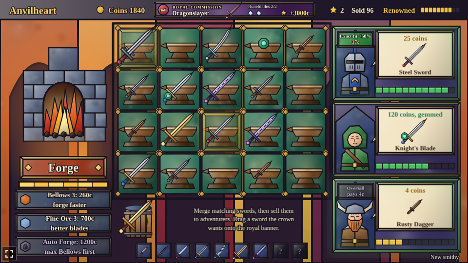

## How to play

| Control | Action |
| --- | --- |
| Tap or click Forge | Make a Rusty Dagger on the first empty anvil, once the forge is hot |
| Drag a sword onto a matching sword | Merge the two into one of the next tier |
| Drag a sword onto an empty anvil or another sword | Move it there, or swap the two |
| Drag a sword onto an adventurer | Sell it, if it is at least as good as the one they asked for; the exact one pays a tip |
| Drag a gem onto a sword | Set the gem in the sword |
| Drag a sword onto the royal banner | Deliver it to the crown, if the commission asks for it |
| Tap a locked anvil or the locked barrel | Buy the fifth column of anvils or the quench barrel |
| Tap an upgrade | Buy its next rank |
| Tap Auto Forge, once bought | Switch the auto forge on or off |
| New smithy (bottom right) | Throw the board, coins and upgrades away and start again |

1. **The forge** makes one sword at a time and then has to heat up again (1.2s), shown by the bar
   under the button.
2. **Merging**: two swords of the same tier make one of the next. While you hold a sword, the
   swords it can merge with are outlined in gold and the adventurers who would buy it in green.
3. **Adventurers** come every 6 seconds while there is room at the counter, three at most. The
   first one always wants an Iron Shortsword; later ones ask for anything up to one tier better
   than your best sword so far. They leave if they wait too long (the jewel bar under their order).
4. **Exact fit pays a tip.** The exact sword an adventurer asked for pays its price and 50% more
   (rounded down: an Iron Shortsword asked for and given pays 15 coins instead of 10). A better
   sword than they asked for is taken but only pays the price they asked, so it is usually worth
   more kept for someone who wants it. While you hold a sword, each adventurer who would buy it
   shows a tag: green "Exact fit +50%" with the tipped price, or grey "Overkill, pays N c".
5. **Hammer streak.** A merge within 4 seconds of the one before chains into a streak. A ring of
   orange glass round the anvil of the last merge drains to show the time left. From the second
   merge on, each one bursts into sparks and pays 5 coins times the streak's length ("Hammer
   streak ×3 +15c"), so a quick run of merges pays 10, then 15, then 20 coins and so on.
6. **Royal commission.** The banner in the top bar names the great sword the crown wants, starting
   with a Golden Claymore, and shows how many of the sword below it (two Silver Sabers make one) are
   on your anvils. Once the sword is made, the banner says "Ready! Drag it here": drag it up onto
   the banner to deliver it (the banner glows while you hold it). A delivered sword leaves your
   board, so a commission costs you an anvil's worth of planning. Completing a commission pays a
   purse and a guild star, counted in the top bar, and the next one takes its place: a Golden
   Claymore (500 coins), a Runeblade (1200), a Dragonslayer (3000), two Dragonslayers (6000) and
   last the Crown Blade, an Anvilheart (10000).
7. **Royal Smith.** Delivering the Crown Blade wins: a panel names you Royal Smith, with your swords
   sold, guild stars and renown, and "Keep smithing" lets you play on with every commission done.
8. **The Anvilheart.** Two Dragonslayers merge into a ninth, legendary sword, the Anvilheart. No
   adventurer asks for one; it is made for the crown's last commission.
9. **Gems.** Once you have made a Knight's Blade, the forge sometimes makes a green gem instead of a
   sword (one time in ten). Drag it onto a sword to set it (a sword holds one gem; a gemmed sword
   keeps it when merged). From then on, one adventurer in four asks for a gemmed sword: their order
   card shows the gem and a doubled price, and they only take a sword set with a gem, paying double
   what it would otherwise pay (an exact fit's tip included).
10. **Renown.** The guild's renown, a meter of ten panes at the right of the top bar, starts at 50
    (Trusted). An exact fit raises it by 4, any other sale by 1, and an adventurer who walks off
    lowers it by 10. Renowned (75 and up) brings adventurers up to 25% sooner and makes them wait
    up to 20% longer; Doubted and Shunned (under 50 and under 25) do the opposite.
11. **A bigger smithy.** Under the board stands a quench barrel (150 coins) that holds one sword or
    gem off the anvils, and to the right a fifth column of four anvils (500 coins for all four).
    Both start locked: tap them to buy them. The forge never fills the barrel, so it is a safe
    place to keep a sword for a later order.
12. **Discovered swords** are shown in a row under the anvils, one frame per tier. A frame shows its
    sword's picture once you have made that sword, and a question mark until then.
13. **The smithy is kept**: the board and its gems, coins, swords sold, upgrades, renown, the
    standing commission and your guild stars are saved in the browser.

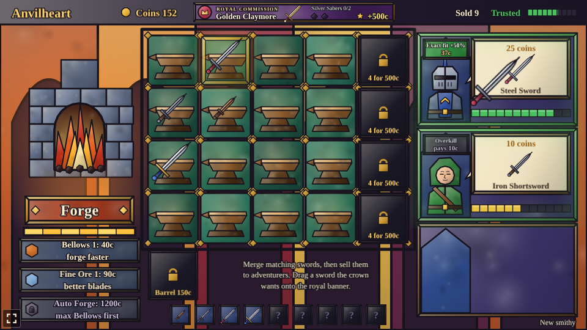

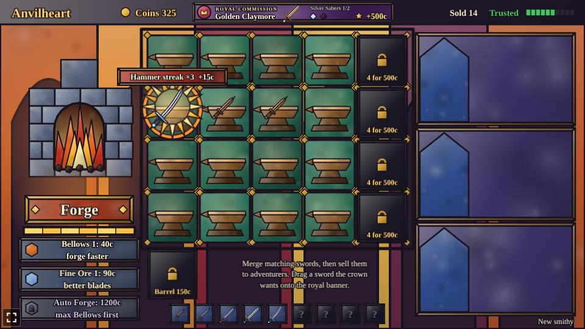

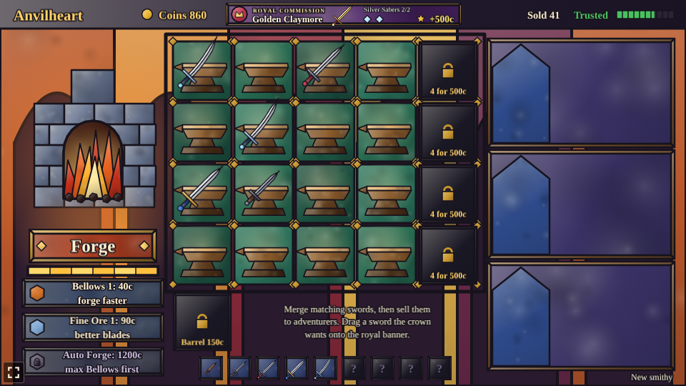

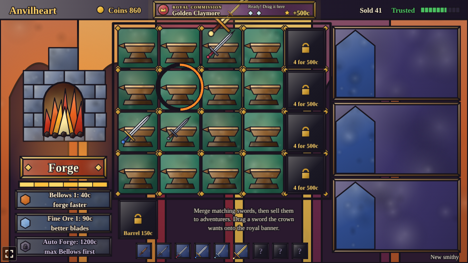

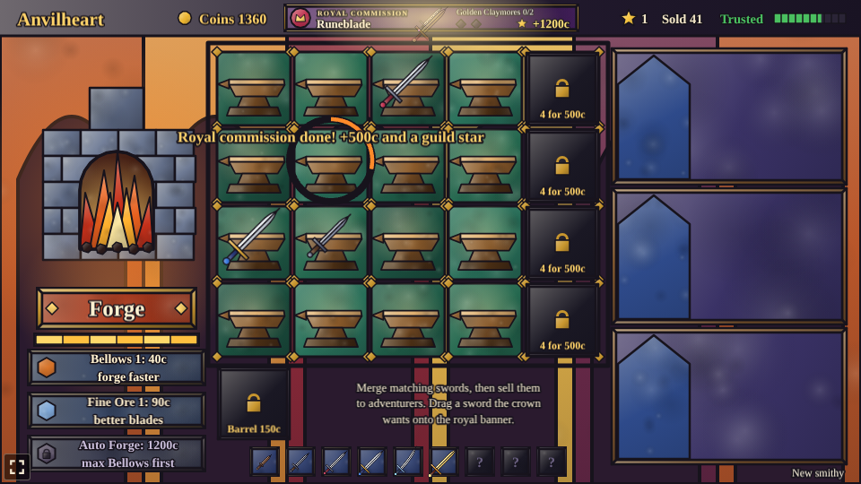

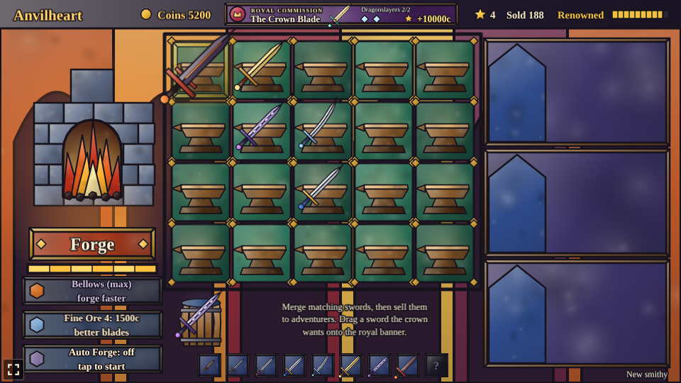

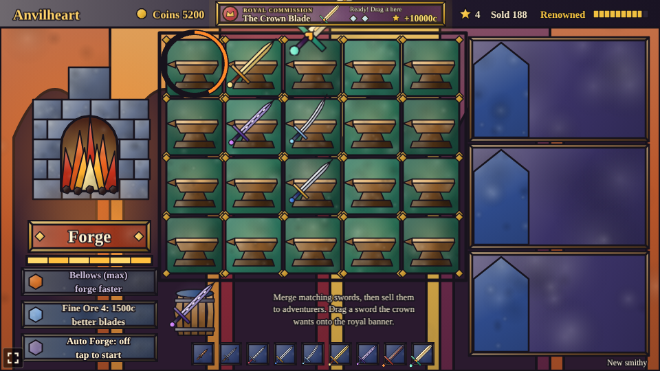

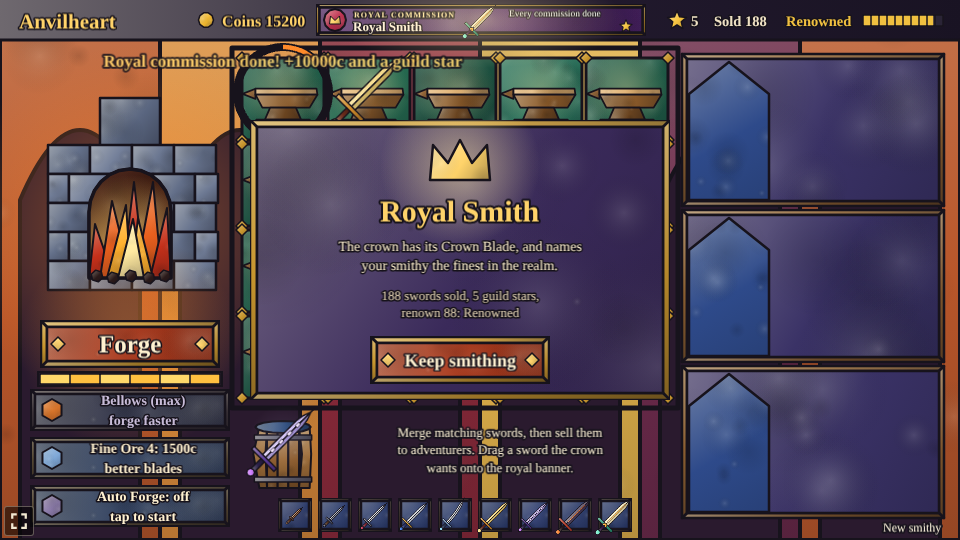

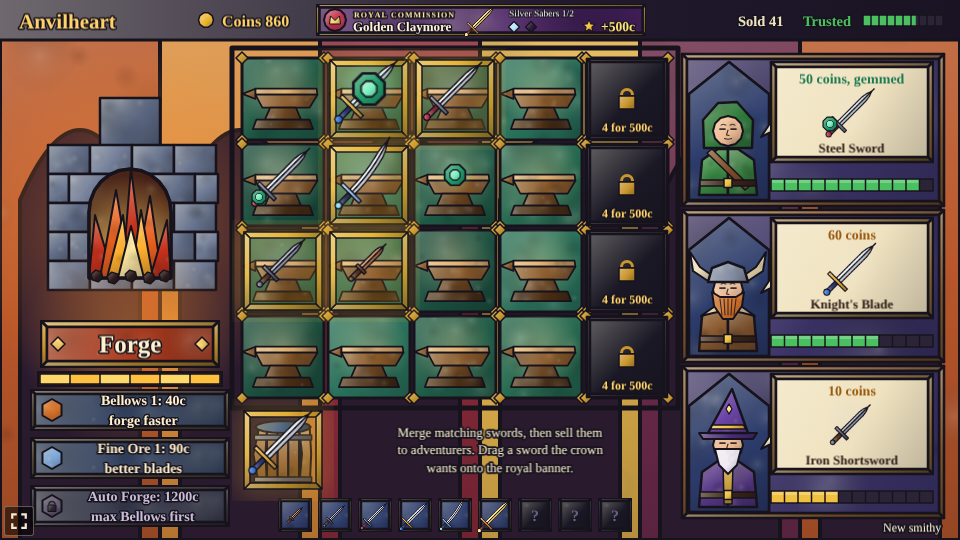

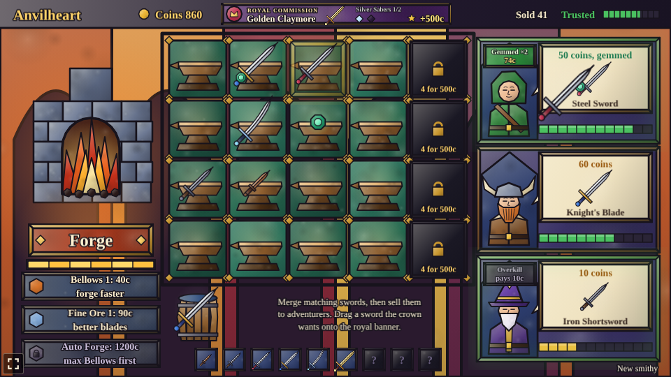

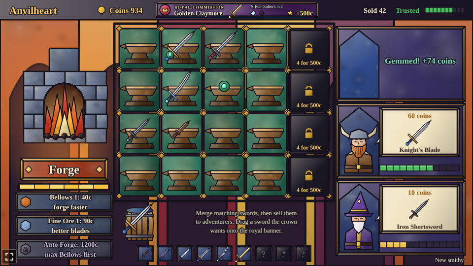

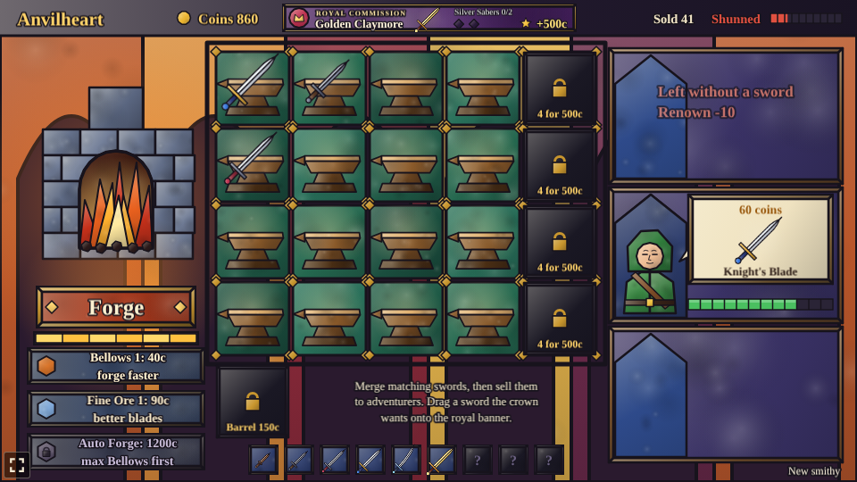

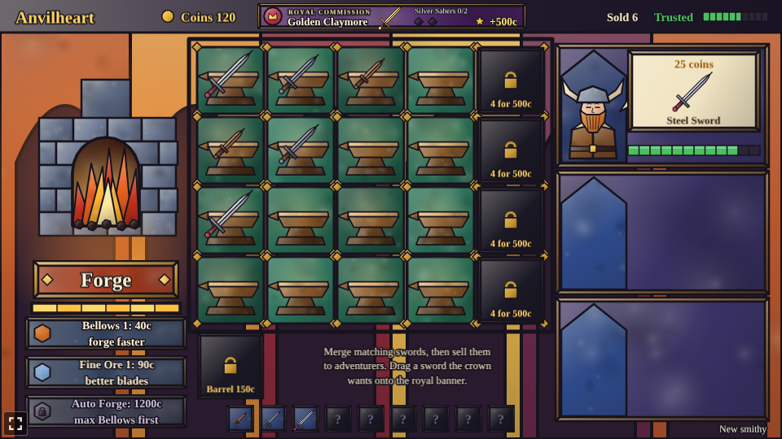

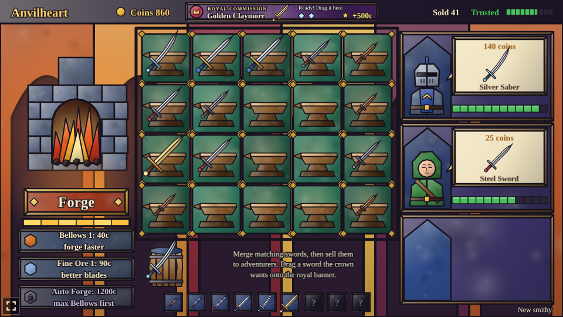

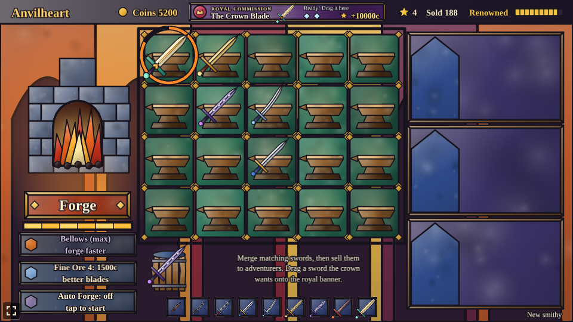

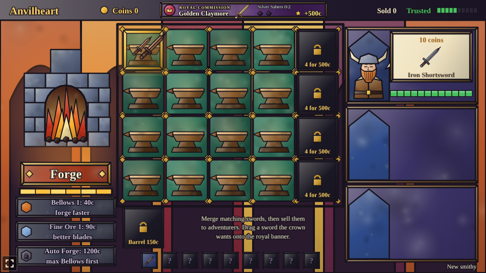

### Swords

Prices are what an adventurer who asked for that sword pays; given exactly that sword, they pay 50%
more.

| Tier | Sword | Price |
| --- | --- | --- |
| 1 | Rusty Dagger | 4 |
| 2 | Iron Shortsword | 10 |
| 3 | Steel Sword | 25 |
| 4 | Knight's Blade | 60 |
| 5 | Silver Saber | 140 |
| 6 | Golden Claymore | 320 |
| 7 | Runeblade | 720 |
| 8 | Dragonslayer | 1600 |
| 9 | Anvilheart | 4000 (no adventurer asks for it) |

### Upgrades

| Upgrade | Ranks | What it does |
| --- | --- | --- |
| Bellows | 4 (40, 110, 260, 600 coins) | The forge heats up 20% faster per rank |
| Fine Ore | 5 (90, 250, 700, 1500, 3000 coins) | 20% chance per rank that the forge makes an Iron Shortsword; at rank 5 it makes nothing else |
| Auto Forge | 1 (1200 coins), once Bellows is maxed | The forge makes a sword by itself whenever it is hot and an anvil is free, so you only merge and sell. Tap it again to pause or restart it |
| Quench barrel | 1 (150 coins), tap the barrel | Holds one sword or gem off the anvils; the forge never fills it |
| Four more anvils | 1 (500 coins), tap a locked anvil | Opens the board's fifth column |

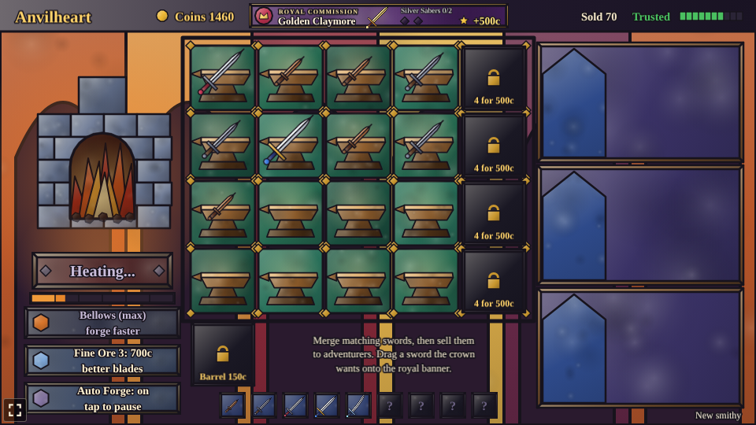

The difficulty, set on the hub page's Settings, changes one thing: adventurers wait 50% longer on Easy and 30% less on Hard.

## Running locally

`npm run dev` at the repo root, then open `/games/anvilheart/` (or pick Anvilheart on the hub page).

## Playthrough test

`e2e/playthrough.spec.ts` plays the first sale in headless Chromium: it checks the new smithy and
its first royal commission, waits for the first adventurer and their Iron Shortsword order, taps
Forge twice (checking the forge must heat up in between), drags one dagger onto the other and
checks they merged and started a hammer streak, then drags the Shortsword onto the adventurer and
checks the sale paid the exact-fit tip (15 coins) and raised the guild's renown from 50 to 54, and
finally that the lone streak runs out. Like
the other games' tests it owns the game clock and plays at 4x speed (`PLAYTHROUGH_SPEED`). The
shared **Playthrough** workflow (`.github/workflows/playthrough.yml`) runs it on every pull request
that changes `games/anvilheart/` or the workflow itself, and uploads the video and screenshots as
the `playthrough-anvilheart` artifact.

```sh
npx playwright test --project anvilheart
```

## Code layout

All paths are inside `games/anvilheart/`.

- `src/game/`: the rules in plain TypeScript with no Phaser dependency. `swords.ts`,
  `upgrades.ts` and `commissions.ts` are data tables, `state.ts` holds the shop, its timings, the
  sale price rule, renown and gems, `sim.ts` forges, merges (with streaks), sets gems, delivers to
  the crown, sells, buys and moves the adventurers on, and `save.ts` keeps the smithy.
- `src/scenes/`: `BootScene` bakes textures, `GameScene` draws the smithy and turns drags into
  rules calls, `layout.ts` says where things are drawn.
- `src/art/`: all the stained-glass art, painted on canvases in code at startup: `glass.ts` holds
  the glass-and-lead painting kit, `scenery.ts` the mosaic wall, furnace, anvils and counter,
  `swords.ts` the nine swords and the gem, `characters.ts` the four adventurers and `ui.ts` the
  buttons, cards, tags, banner, barrel, padlocks, Royal Smith panel and effects.
- `src/ui/`: the leaded-glass button.

Adding a sword is an entry in `src/game/swords.ts` and a shape and colours for it in
`src/art/swords.ts`.
