# Apothecary

A small automation game prototype built with [Phaser 4](https://phaser.io), TypeScript and Vite, part of
the [game hub](../../README.md).

You play a plague doctor running a medieval apothecary. Grow herbs in the backyard, refine them,
brew potions in the cauldron and sell them to customers at the storefront. It looks like a page
from a herbalist's almanac: watercolour washes on aged paper in deep, muted tones, wobbly ink outlines and hatched
shadows, with the interface in dark ink on parchment cards and a serif type.

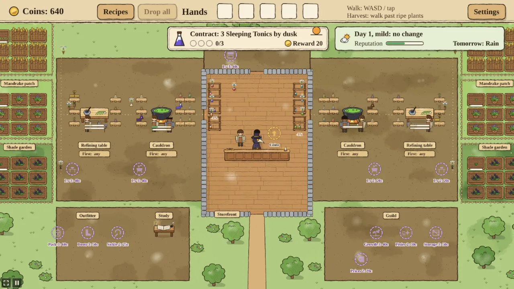

The apothecary is laid out in two rows either side of the shop. The first production line runs
east along the left half: the wheat field, mandrake patch and shade garden stacked at the far
edge, then the refining table, then the cauldron, then into the shop's left wall. Each station has
its drop and pick-up markers north of it, either side, and its work spot just above it; its in
pallets stand left of it and its out pallets right of it, and its name, its "First:" sign and its
upgrade, craftsman and pixie markers sit in a row below it. The shop stands in the middle and faces
the street at the bottom; the doctor goes in by its north door, where the counter's drop-off
stands outside. The market below holds the outfitter and the study on the left and the guild on
the right. The right half is grass until the expansion is bought, which opens it up for a second
production line that mirrors the first. Pixies fly goods along each row into the shop. The map is
bigger than the screen, so the camera follows the doctor.

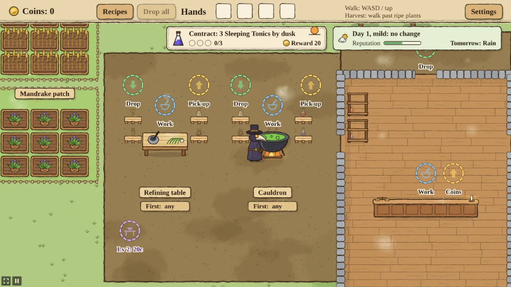

## How to play

| Control | Action |
| --- | --- |
| WASD / arrow keys, or tap | Walk |
| Mouse wheel, + / - keys, or pinch with two fingers | Zoom in and out; the top bar stays the same size and the zoom is remembered |
| Walk past ripe plants | Harvest every ripe plant within one character height of the doctor; the spinning sickle marks the edge |
| Recipes (top bar) | Show what each station makes from what, and what each potion sells for; tap again to close |
| Drop all (top bar) | Throw away everything the doctor carries |
| Stand on a floor marker | Each is a dashed ring with a faint icon. Green: drop off items. Blue: work the station. Gold: pick up products or coins, a mix of every kind there. Purple: stand still on it to pay coins towards an upgrade or build, each kind with its own icon; its caption shows the coins still to pay |

1. **Gardens**: each garden grows one kind of plant in nine beds, three rows of three edge to
   edge. Harvest ripe wheat in the wheat field and mandrake in the mandrake patch. Beds regrow on
   their own: wheat in 24 seconds, mandrake in 42 and nightshade in 54. Tap a garden's sign to
   replant it with another plant of its line (see **Replanting** below).
2. **Refining table**: drop off plants; wheat becomes wheat flour, mandrake becomes mandrake seeds
   and nightshade becomes nightshade extract.
   Stand on the work spot while it refines; pick the finished goods up on the pick-up marker.
3. **Cauldron**: drop in refined goods. Two wheat flour brew a Healing Draught and two mandrake
   seeds a Sleeping Tonic; those two recipes are known from the start. Four more are learned at the
   study (see below): wheat flour and mandrake seeds brew a Vigour Tonic, nightshade extract and
   mandrake seeds a Shadow Elixir, nightshade extract and wheat flour a Moonlight Salve, and two
   nightshade extract a Witch's Brew. Stand on the work spot while it brews. When work starts, the cauldron brews whichever
   potion it has fewest of on its out pallets. The last quarter of each brew is
   its fine window, gold on the brewing bar: step off the work spot then (which stops the brew
   where it is) and onto the pick-up marker, and the potion comes out **Fine**, worth half again
   as much. Left to finish, it comes out plain onto its pallet, as craftsmen always do.
4. **Storefront**: the storefront faces the street at the bottom of the map. Customers come in
   by the street door in the shop's bottom wall, walk up to the counter and show the potions they want and how long they will wait; they are only served, and
   only lose patience, once they stand at the counter. The doctor goes in and out by the north door
   in the top wall, since the shop's walls are solid and the street door is the customers' own.
   Drop potions on the drop marker outside the north door, before going in, and stand on the work
   spot right behind the counter; customers pay for each potion as they get it and leave the coins
   on the pick-up marker beside it. Along the shop's side walls stands one shelf for each potion the
   apothecary has learned, showing up to
   six bottles (and how many there are, past that). A well-stocked shop sells cheaper: a customer
   pays 2.5% less for a potion for each other one of its kind still on the shelves, down to half
   price, and the cut for the next sale shows under each shelf ("-30%"). A fine potion stands on
   its plain potion's shelf, with a gold sparkle, and goes to the next customer who wants that
   potion first. Each shelf has a price sign beside it, Cheap, Fair or Dear (see **Price signs**
   below).

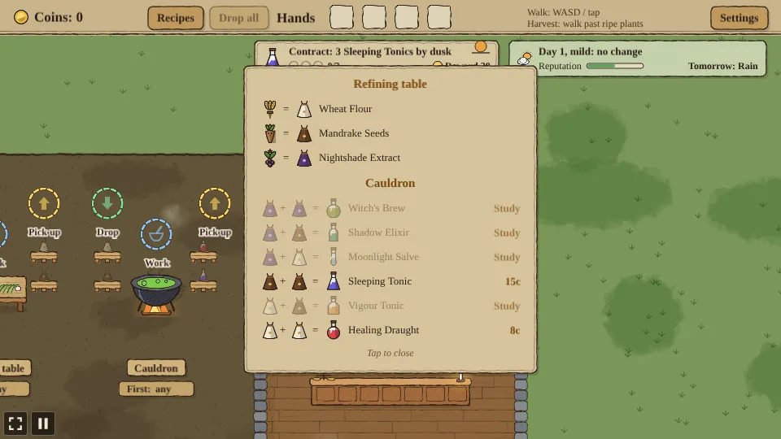


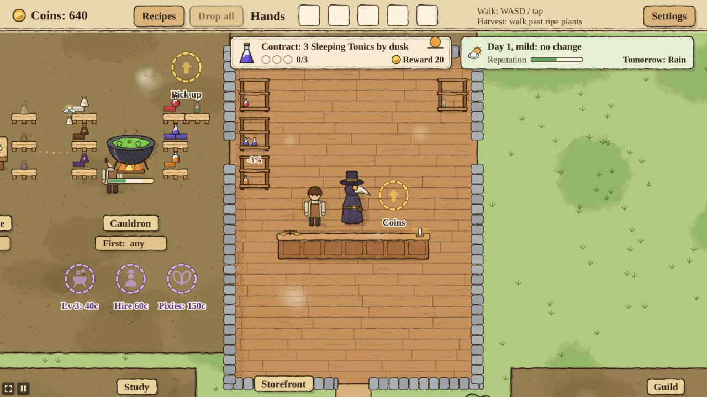

**The study**, in the market beside the outfitter, teaches the recipes the apothecary doesn't know
from the start, one at a time and always in this order: the Vigour Tonic (30 coins, sells for
11), the Shadow Elixir (60, sells for 24), the Moonlight Salve (120, sells for 20) and the Witch's
Brew (240, sells for 34). Its purple marker goes up for sale once the garden's pixies are hired,
and its caption names the next recipe. Customers only ask for potions the apothecary has learned,
and a cauldron only brews those. The Recipes panel lists every recipe, the ones still to learn
faded with "Study" in place of their price.

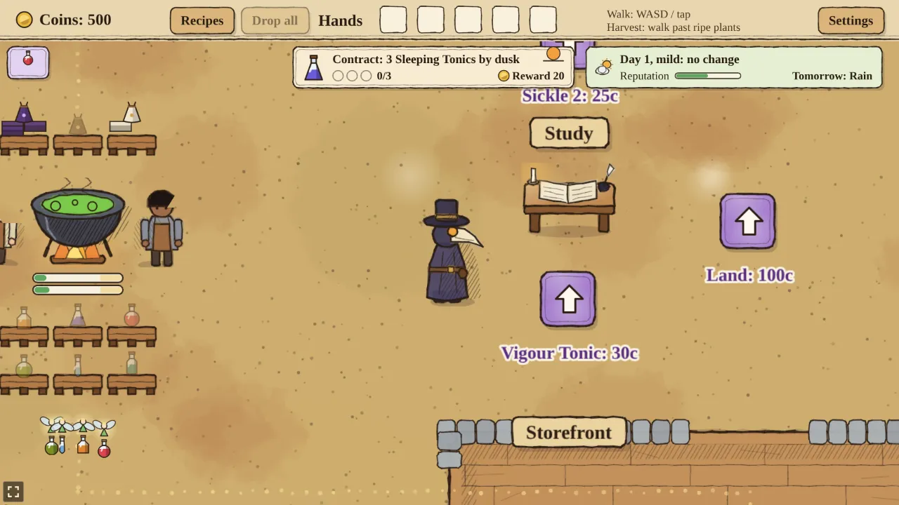

**The shade garden** grows nightshade, for the Shadow Elixir, the Moonlight Salve and the Witch's
Brew. It stands at the top of the market, on the left, and is planted on its
purple marker (80 coins) once the garden's pixies are hired; the second line's stands beside it,
on the right, and is planted once the expansion's land is bought (60). Customers only ask for the
nightshade potions once a shade garden grows and the study has taught them. The garden's pixies
fly its nightshade in from its own garden to the refining table's third pallet.

**Regulars and reputation**: a customer served with at least half of their tip left comes back
another day as a regular, with a gold star on their order bubble, for the same potions as last
time, and pays 3 coins more for each. The street keeps a reputation, the bar on the town card at
the top right: it starts halfway, each filled order raises it by 3 and each customer who walks off
unserved lowers it by 8. A good reputation brings customers more often, up to twice as often at
the top; a bad one, up to a third less often.

**Weather**: the town card shows today's weather from the almanac and tomorrow's, and the yard
shows it too: on a rainy day the light turns grey-blue and rain falls, in a drought a warm haze
hangs over everything with heat rising in wavy lines, a fair day is a little golden, and a mild
day is as it is. With reduced motion the light changes but nothing falls or rises. Rain makes
plants grow half again as fast, a drought slows them to 60%, a fair day brings customers half
again as often, and a mild day, like the first, changes nothing. A day ends at dusk or when its contract is
kept, as before.

**Market day**: every fourth day is a market day. At midday a crowd of up to five customers comes in
at once, filling every place at the counter and two more. Serve every one of them and the purse
gets 6 coins for each; if any walks off, the bonus is lost. The town card counts them, and a note
under it says how it went.

**Blight**: from the third day, rain can blight a bed (about one every 45 seconds of a rainy day).
A blighted bed withers to a sickly violet-grey, stops growing and blights a neighbouring bed in
its garden every 40 seconds, in any weather, until the doctor walks past it: the sickle clears
blighted beds in reach before it cuts anything, hands full or not, and the bed grows again from
seed. The town card says which garden the blight struck. The guild's **Herbalist** upgrade (60
coins, after growth) makes every bed immune, so a garden left to the pixies is never quite
hands-off until then.

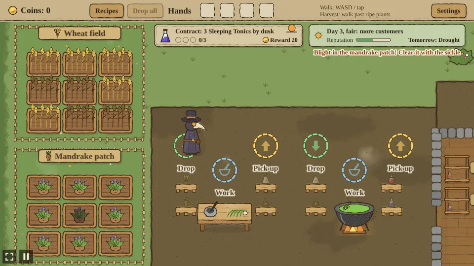

**Replanting**: tap a garden's sign to switch all nine of its beds to the next plant its line
grows: wheat, mandrake, and nightshade once the line's shade garden is planted (the shade garden
can be switched too). The sign shows the plant's name and icon. Every bed starts again from seed
and the blight is cleared, so rebalancing the gardens for the day's contract costs a crop. The
pixies pick from whatever each garden grows, flying it in from that garden.

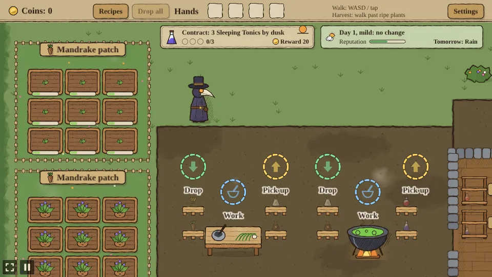

**Price signs**: each shelf has a sign beside it, Fair at first. Tap it to go Dear, then Cheap,
then Fair again. A Dear potion sells for 40% more, but a customer waiting for one loses patience
half again as fast (and so tips less). A Cheap one sells for 25% less, is asked for twice as
often and raises the reputation by 2 more for each one sold. The cut under each shelf counts the
sign in: "+33%" or "-27%" against the price.

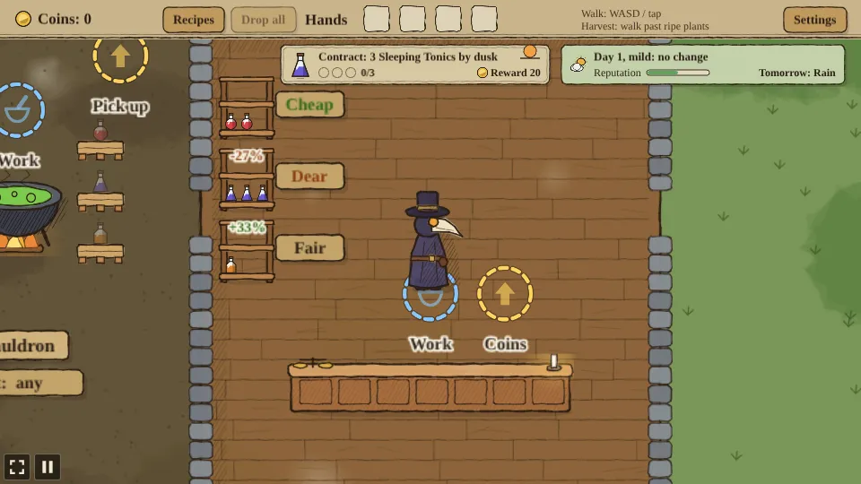

**The rival shop**: from the fourth day a rival apothecary opens a stall across the street, left
of the street door, and undercuts one potion a day (the same one in every game, going round what
customers ask for). Customers pay 30% less for a plain one that day ("rival -30%" under its
shelf); a Fine one beats the cut and pays in full. The rival sells 4 of that potion a day itself;
sell 5 or more and the day counts as outsold. The stall's lines say what is undercut and how the
race stands ("Outsold 2/10 days, 3/5 today"). Outsell it for a month, ten days running, and it
closes for good: the stall is boarded up and the street is yours.

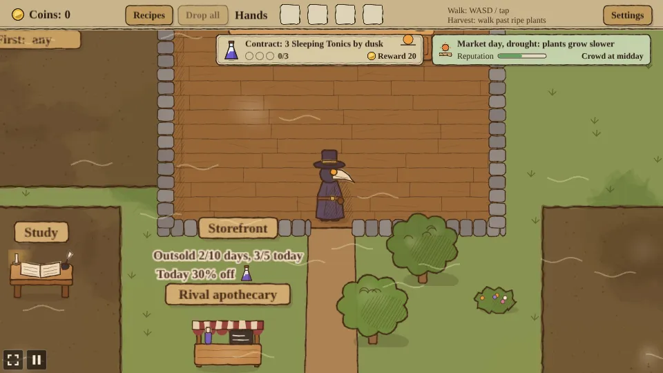

**The plague**, the game's ending: from the fifth day a sickness spreads through the town in
three stages, each on its own card under the town card. The first asks for 6 Healing Draughts,
the second for 6 Sleeping Tonics, the third for 10 potions of any kind, each sold at the counter
within three days (a pip per potion, and the days left on the right). A stage met moves the
sickness on; a stage missed comes back asking for 2 more and costs 10 reputation. Past the last
stage the **Panacea** is unlocked: one wheat flour, one mandrake seeds and one nightshade extract
in a cauldron brew the town's cure (9 seconds) before anything else, and it goes straight to the
town the moment it is done, never out early and never for sale. That cures the town and wins the
game: a panel says so, and "Keep trading" carries on with the shop as it is.

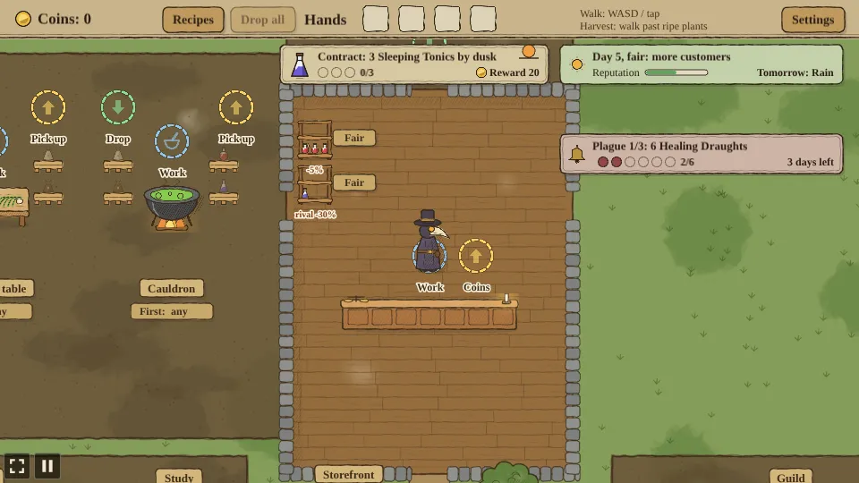

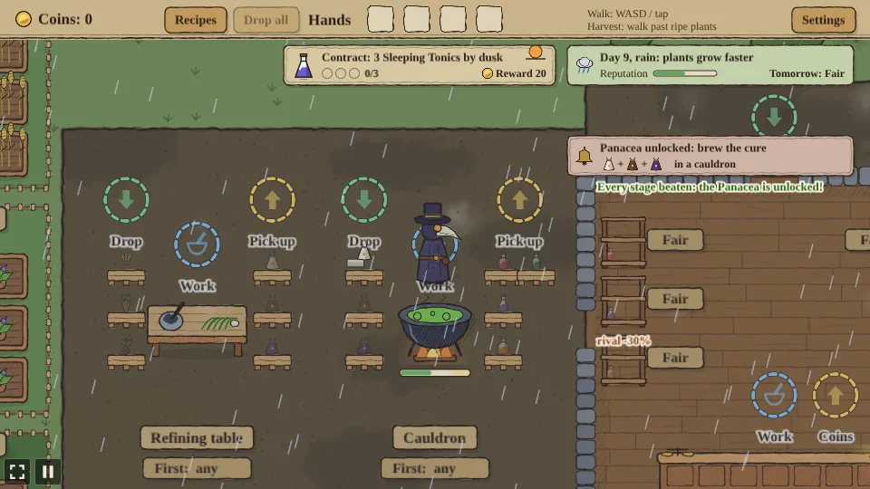

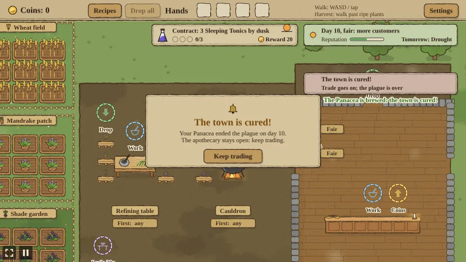

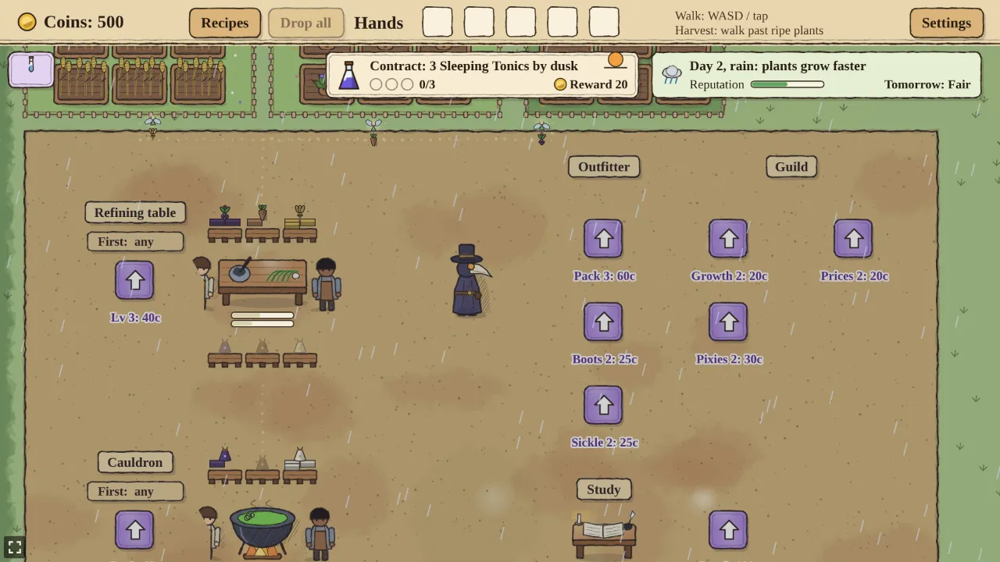
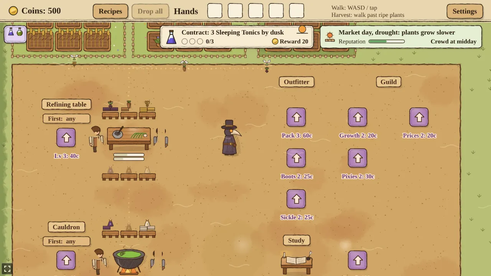

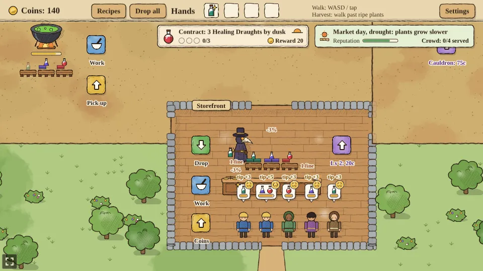

**Tips**: on top of the price, a customer whose order is filled leaves a tip: a coin, plus two
for each potion they asked for (3 for one potion, 5 for two). The tip shrinks while they wait at
the counter and is gone once they have used up 60% of their patience, so a quick shop earns more.
The coin ring on the corner of each order bubble shows it: the ring empties as the tip shrinks,
and the label above it says what they would tip right now ("tip +4", or "no tip"). The bar under
the potions is their patience, as before.

**Orders**: every customer's order is always on screen too, in a row of small cards under the top
bar on the left: one card per customer, in the order they came in, with the potions they still
want and, once they wait at the counter, a bar of their patience. So the doctor can see what is
needed while working out in the gardens.

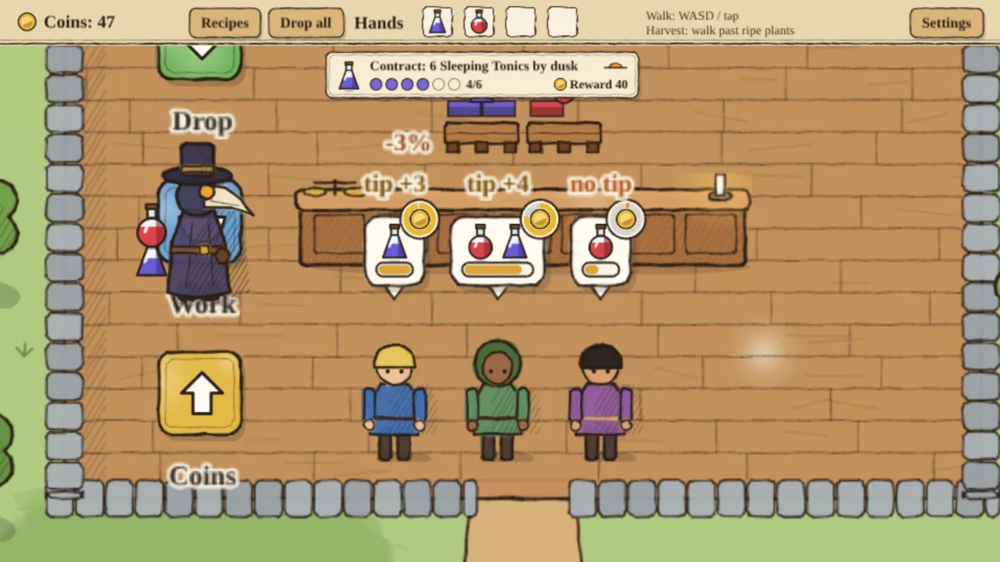

**Daily contract**: the card at the top of the screen asks for a number of one potion by dusk,
"Contract: 3 Sleeping Tonics by dusk" on the first day. Each potion of that kind sold at the
counter fills a pip. Fill them all and the reward goes straight into the purse and the next day's
contract comes in at once; at dusk an unkept contract lapses and the next day starts. A day lasts
four minutes, and the little sun on the right of the card sinks towards the horizon as dusk nears.
Days alternate Sleeping Tonics and Healing Draughts, each kept contract asks for one more potion
than the last (up to 12), and the reward is a little under half of what the potions sell for.

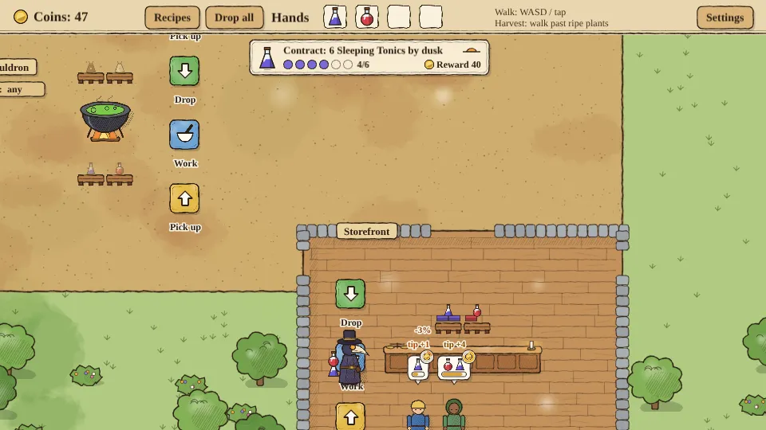

**While you were away**: once anything runs without the doctor (a craftsman or pixies hired), the apothecary keeps going while the game is closed. On the next visit the time away, up
to two hours, is played through the same rules with the doctor off his work spots, and a chip in
the top right says what it earned: "While you were away: +32 coins, 9 potions". Tap the chip to
dismiss it. The coins land where they would have: in the till, or in the purse when a craftsman
carries them or a contract pays.

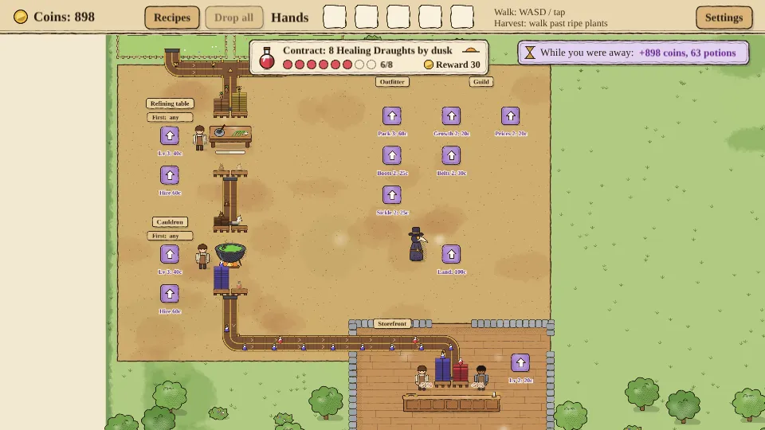

**Pallets**: every station keeps each kind of goods coming in or going out on its own pallet. A
pallet or shelf holds 10 of each kind at first; the guild's Storage upgrade raises that by 10 a
level, up to 40. The refining table keeps its plants on pallets left of it and its refined goods
on pallets right of it; the cauldron keeps the refined goods left of it and its potions on two
columns of pallets right of it, and the counter keeps its potions on shelves. A pallet stands
only once its goods can be had: nightshade's once a shade garden grows, a potion's once it is
learned. The drop and pick-up markers stand above the pallets they fill and empty. A full pallet takes nothing more: the doctor keeps the item and the
pixies wait until there is room.

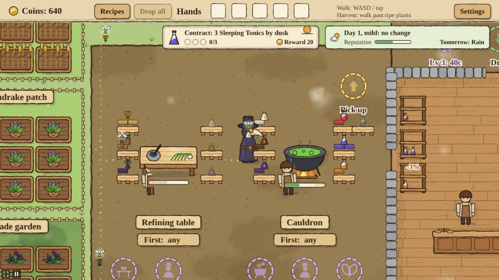

**Craftsmen** work a station so the doctor doesn't have to stand on its work spot. Each station
takes up to two, hired one at a time on the purple marker beside it (30, then 60 coins); they
stand by the station once hired, and its work spot goes away. At work they rock to and fro over
the station, grinding, stirring or handing potions over; idle, they stand still. At a refining table or cauldron the
first craftsman works as the doctor would, and the second opens a second pipe: a second plant or
brew on the go alongside the first, at the same speed, with its own bar below the first. Either
pipe's brew can be taken out fine. At the counter
the first craftsman serves customers, a potion every 1.5 seconds where the doctor hands them over
at once, and the second makes that twice as fast and also brings the coins from the till.

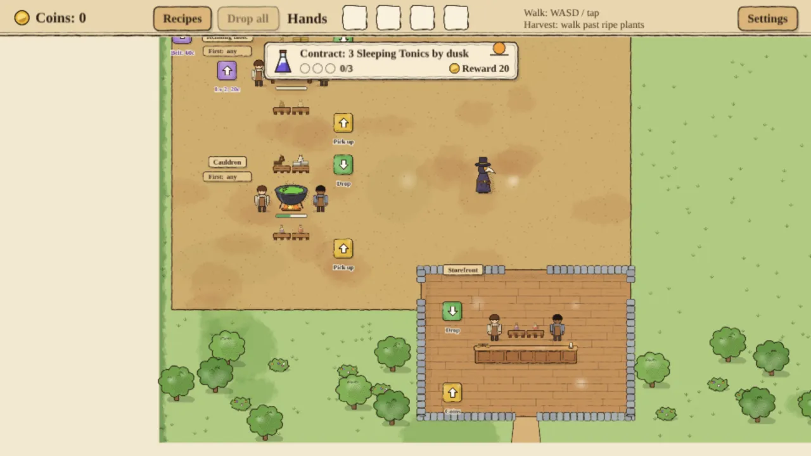

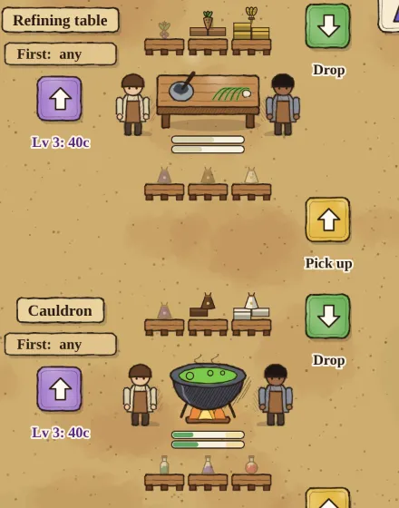

**Priority**: each refining table and cauldron has a small "First:" sign by its name. Tap it to
choose what the station makes first whenever it can: wheat, mandrake or nightshade at a table, a
any potion learned at a cauldron, or "any" to leave it to the station (a table takes
plants in the order they came, a table and a cauldron make what their out pallets hold fewest of). Tapping the
sign doesn't walk the doctor. A station with nothing for its priority makes something else rather
than wait.

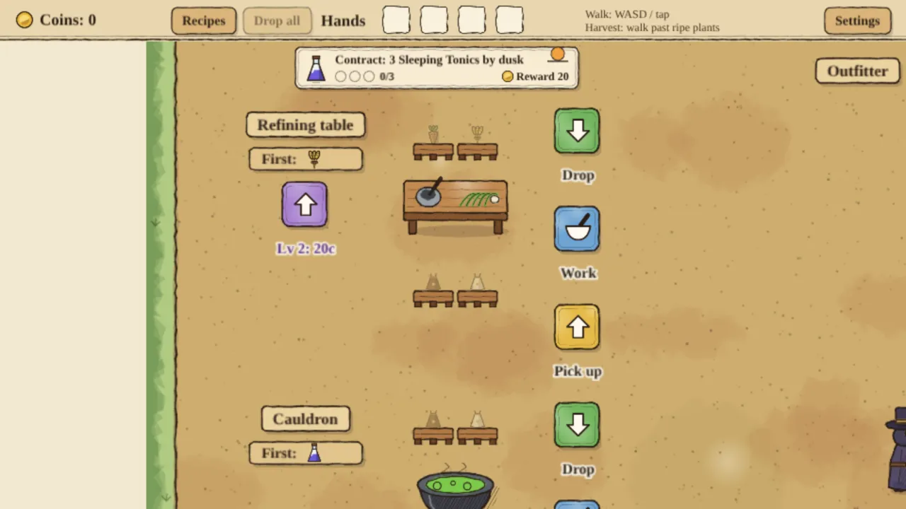

**What's for sale** opens up as you buy things. At first only one purple marker shows, and each
purchase puts the next one out, in this order: refining table level 2, pack 2, cauldron level 2, a
craftsman at the counter, then the garden's pixies. From the garden's pixies on it branches out:
boots, sickle, the counter's upgrade, craftsmen at the table and cauldron, the table's pixies, the
shade garden, the study, and entry to the guild (50 coins), which puts the guild's growth, pixies,
storage and prices upgrades up for sale. The cauldron's pixies follow the table's, the land follows the
cauldron's pixies, customers follows prices and the extra slot follows customers. The second line's things are for sale once their
station stands.

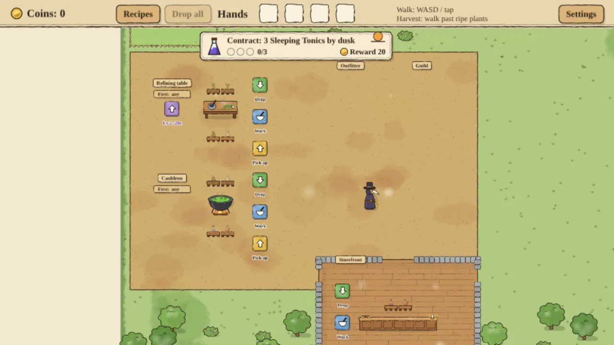


Every station has an upgrade marker and goes up to level 5. Upgrades cost 20, 40, 80 and 160
coins: the refining table and cauldron work faster, and customers at an upgraded counter pay
more for each potion (2 coins over the price per counter level, counting level 1) and wait
longer. Once a level is paid off, step off the marker and back on to start on the next. An upgrade
marker goes away once its last level is bought, and a hire marker once both craftsmen are hired.

The **outfitter** in the market below the first line kits the doctor out, two levels each: a bigger
pack carries one more item per level (30, then 60 coins), boots walk a fifth faster per level and
a longer sickle harvests from a quarter further away (25, then 50 coins each).


The **guild** in the market below the second line sells upgrades for the rest of the apothecary:
growth makes every garden grow a quarter faster per level (20, then 40 coins), pixies fly half again
as fast per level, carrying more goods a second (30, then 60), storage lets every pallet and shelf
hold 10 more of each kind per level (25, 50, then 100), prices make customers pay a quarter
more per potion per level (20, then 40), an extra order slot lets a fourth customer wait at the
counter (30), customers makes them come in more often, a new one every 6 to 10 seconds and then
every 4 to 7 instead of every 12 to 20 (25, then 50), and the herbalist (60, after growth) keeps
every bed clear of blight. A busier shop is harder to keep up with: per
customers level, a fifth more customers want two potions (35% at first, then 55% and 75%), and they
wait a third less long, then half as long. One line with a craftsman per station can't serve
everyone at the top level; it takes the second line, more craftsmen or station upgrades.

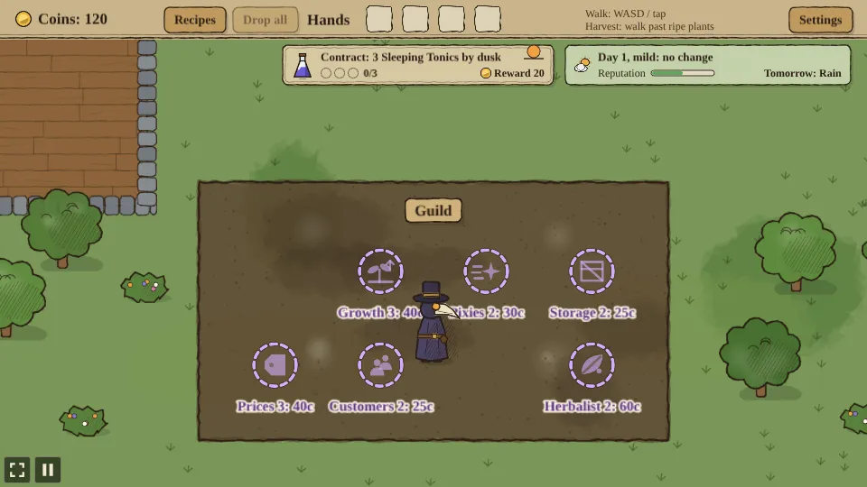

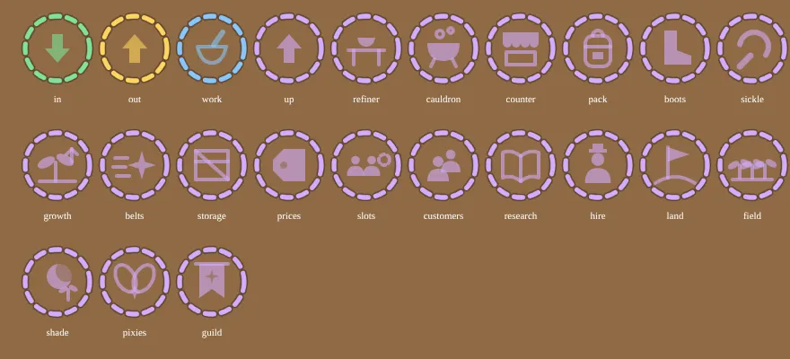

**Pixies** take the walking out of the loop. Three teams can be hired on their own purple markers,
a handful of coins at a time: gardens to refining table (60 coins), table to cauldron (100) and
cauldron to counter (150). Pixies pick ripe plants up from the gardens, or finished goods from a
station's out pallets, and fly them along a faint trail of fairy dust to the next station, where
each one flies over to its own kind's pallet or shelf and sets its goods down when there is room.
Mandrakes and nightshade set off from their own garden. The drop and pick-up markers they replace
go away, though a drop marker comes back while the doctor carries goods they take, such as goods
from the other line. What the doctor carries goes to them when they are hired, one after another,
unless the other line still moves those goods by hand. Each kind of goods keeps to its own side of
the trail, so when one kind waits for room at the next station the others keep flying. With
reduced motion the pixies glide without beating their wings.

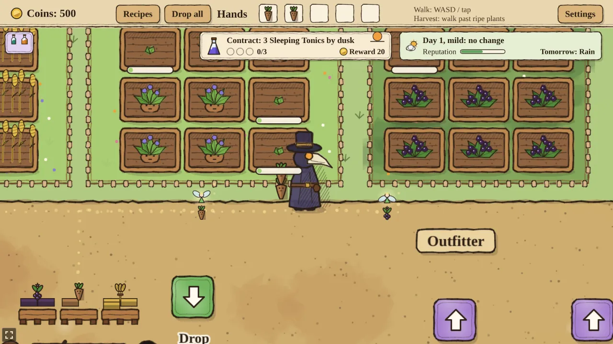

**The expansion** opens the right half for a second production line. Its land is bought on a
marker beside the shop's right wall (100 coins), which lays the yard and puts a build marker where each
part will go: a wheat field and a mandrake patch (25 coins each), a refining table (50), a
cauldron (75) and its shade garden (60). The second line works like the first and has its own
pixies, for hire once the stations at both ends stand; its cauldron's pixies fly in through the
shop's right wall, as the first line's do through the left. The counter's drop marker stays
until every cauldron has its pixies, and comes back whenever the doctor carries a potion.

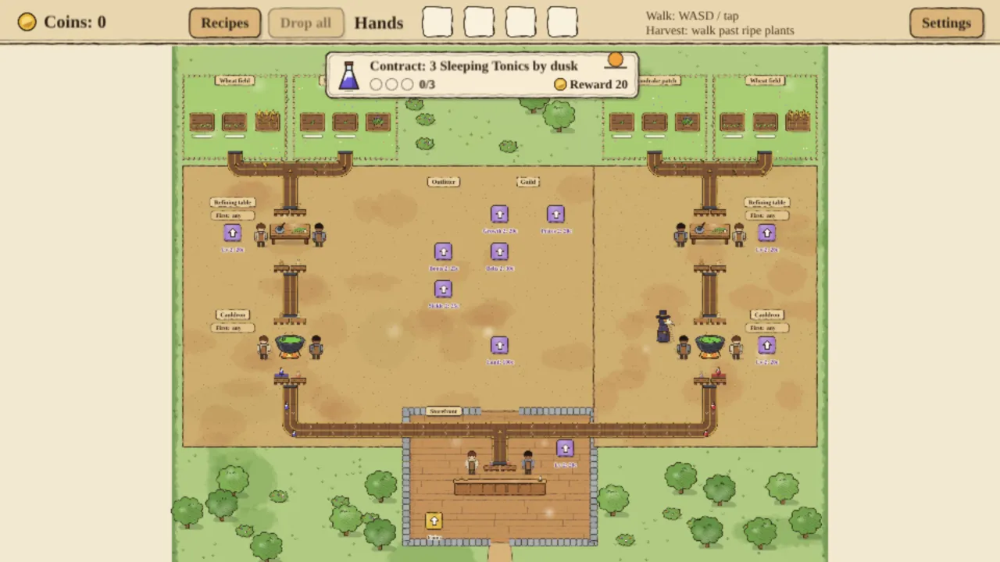

You can carry four items at a time, more with a bigger pack; they stack up on the doctor's back. Progress is saved in the browser automatically.

"Settings" in the top bar shows the difficulty and frame rate the game runs with, which are set on
the hub page's Settings, and has "New game", which starts over. On Easy customers wait 50% longer
before they leave, on Hard 30% less.

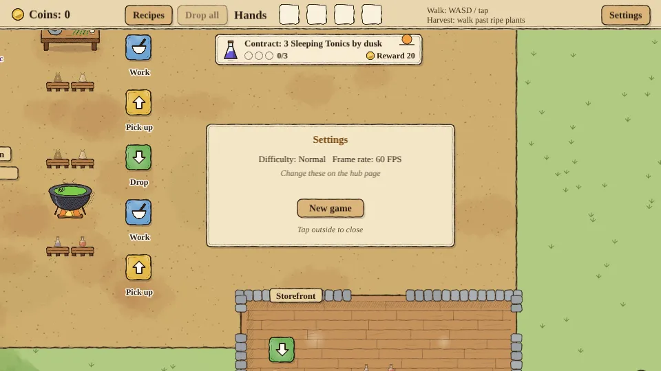

## Running locally

`npm run dev` at the repo root, then open `/games/apothecary/` (or pick Apothecary on the hub page).

## Playthrough test

`e2e/playthrough.spec.ts` plays the first round of the loop in headless Chromium with real
clicks: it opens and closes the recipes, harvests both gardens, refines, brews, takes one potion
out fine in its window, sells potions to a customer and collects the coins, checking items,
pallets, the recipe the cauldron picks, what each potion is paid and tipped, the reputation and the
first day's contract along the way. It plays at 4x speed (`PLAYTHROUGH_SPEED`), so the run takes
under a minute. The Playthrough Apothecary workflow runs it on every PR
that changes `games/apothecary/` and uploads a video and milestone screenshots as the
`playthrough-apothecary` artifact.

```sh
npx playwright install chromium        # once
npx playwright test --project apothecary   # starts the dev server and plays; CPU_THROTTLE=4 simulates a slow machine
```

Changes to gameplay, layout or controls update the test in the same PR; see the repo's `AGENTS.md`
for the rules and for how to debug a failing run.

## Code layout

All paths are inside `games/apothecary/`.

- `src/game/`: the rules (items, recipes, state, simulation tick and player actions) in plain
  TypeScript with no Phaser dependency, plus saving.
- `src/scenes/`: Phaser scenes. `BootScene` bakes textures, `GameScene` draws the world and wires
  input to the rules.
- `src/art/`: all the art, painted in code on canvases at startup with the watercolour and ink
  helpers in `paint.ts` (no image files): the plague doctor, townsfolk, items, gardens, stations,
  the study, shop shelves, pixies, floor markers, the ground and the parchment interface cards.
- `src/ui/`: small reusable display pieces (icon rows, progress bars, pallets, shop shelves) and the recipe and settings panels.
