# Apothecary

A small automation game prototype built with [Phaser 4](https://phaser.io), TypeScript and Vite, part of
the [game hub](../../README.md).

You play a plague doctor running a medieval apothecary. Grow herbs in the backyard, refine them,
brew potions in the cauldron and sell them to customers at the storefront. It looks like a page
from a herbalist's almanac: watercolour washes on cream paper, wobbly ink outlines and hatched
shadows, with the interface in dark ink on parchment cards and a serif type.

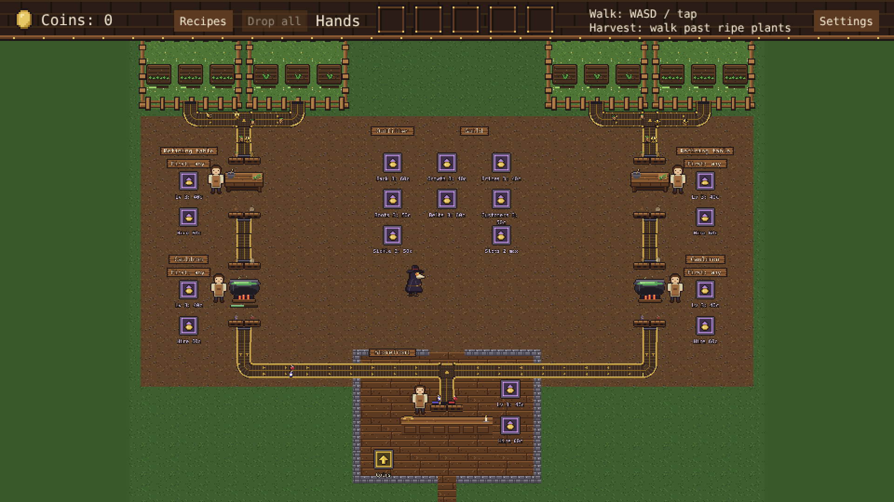

The apothecary is laid out in columns. The first production line runs straight down the left
column: the wheat field and mandrake patch at the top, then the refining table, then the cauldron,
each with its drop, work and pick-up markers in a row on the side facing the market and its upgrade,
craftsman and belt markers on the outer side. The market in the middle holds the outfitter and the
guild, and the shop sits at the bottom of it. The right column is grass until the expansion is
bought, which opens it up for a second production line that mirrors the first. Belts run straight
down each column and along the bottom into the shop. The map is bigger than the screen, so the
camera follows the doctor.

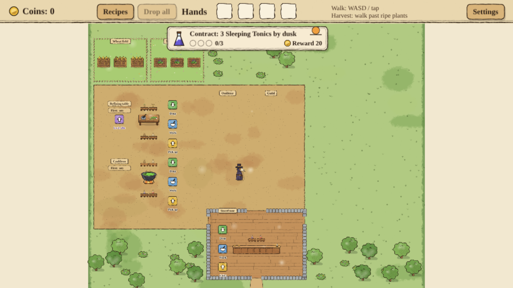

## How to play

| Control | Action |
| --- | --- |
| WASD / arrow keys, or tap | Walk |
| Mouse wheel, + / - keys, or pinch with two fingers | Zoom in and out; the top bar stays the same size and the zoom is remembered |
| Walk past ripe plants | Harvest every ripe plant within one character height of the doctor; the spinning sickle marks the edge |
| Recipes (top bar) | Show what each station makes from what, and what each potion sells for; tap again to close |
| Drop all (top bar) | Throw away everything the doctor carries |
| Stand on a floor marker | Green: drop off items. Blue: work the station. Gold: pick up products or coins. Purple: stand still on it to pay coins towards an upgrade or build; its caption shows the coins still to pay |

1. **Gardens**: each garden grows one kind of plant in nine beds, three rows of three edge to
   edge. Harvest ripe wheat in the wheat field and mandrake in the mandrake patch. Beds regrow on
   their own: wheat in 24 seconds, mandrake in 42 and nightshade in 54.
2. **Refining table**: drop off plants; wheat becomes wheat flour, mandrake becomes mandrake seeds
   and nightshade becomes nightshade extract.
   Stand on the work spot while it refines; pick the finished goods up on the pick-up marker.
3. **Cauldron**: drop in refined goods. Two wheat flour brew a Healing Draught, wheat flour and
   mandrake seeds brew a Sleeping Tonic, and nightshade extract and mandrake seeds brew a Shadow
   Elixir. Stand on the work spot while it brews. When work starts, the cauldron brews whichever
   potion customers are waiting for that the shop has least of. The last quarter of each brew is
   its fine window, gold on the brewing bar: step off the work spot then (which stops the brew
   where it is) and onto the pick-up marker, and the potion comes out **Fine**, worth half again
   as much. Left to finish, it comes out plain onto its pallet, as craftsmen always do.
4. **Storefront**: the storefront faces the street at the bottom of the map. Customers come in
   by the street door in the shop's bottom wall, walk up to the counter and show the potions they want and how long they will wait; they are only served, and
   only lose patience, once they stand at the counter. The doctor goes in and out by the back door
   in the top wall, from the market, since the shop's walls are solid and the street door is the
   customers' own. Drop potions
   on the counter and stand on the work spot behind it; customers pay for each potion as they get
   it and leave the coins on the pick-up marker. A well-stocked shop sells cheaper: a customer pays
   2.5% less for a potion for each other one of its kind still on the counter's pallets, down to
   half price, and the cut for the next sale shows beside each pallet ("-30%"). A fine potion
   stands on its plain potion's pallet ("1 fine" beside it) and goes to the next customer who wants
   that potion first.

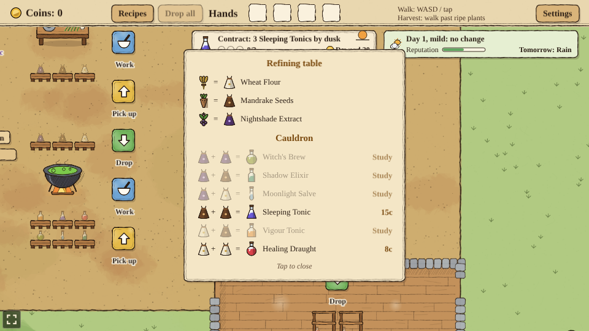

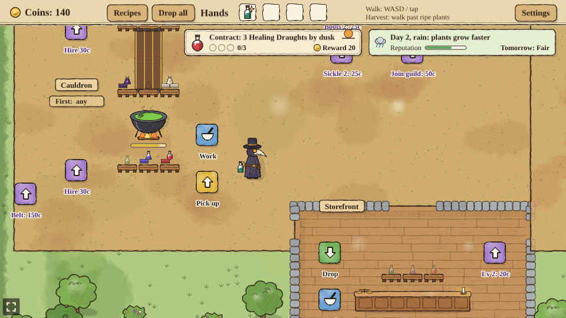

**The shade garden** grows nightshade, for the Shadow Elixir (24 coins), the first potion that
mixes two lines of goods. It stands at the top of the market, on the left, and is planted on its
purple marker (80 coins) once the garden belt is built; the second line's stands beside it, on the
right, and is planted once the expansion's land is bought (60). Customers only ask for Shadow
Elixirs once a shade garden grows. Its nightshade rides the garden belt on its own feeder, in a
third lane, to the refining table's third pallet; every belt and station now has a lane and a
pallet for each of the three kinds.

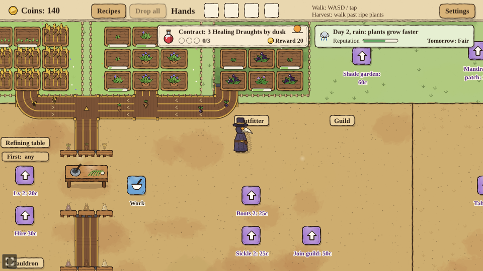

**Regulars and reputation**: a customer served with at least half of their tip left comes back
another day as a regular, with a gold star on their order bubble, for the same potions as last
time, and pays 3 coins more for each. The street keeps a reputation, the bar on the town card at
the top right: it starts halfway, each filled order raises it by 3 and each customer who walks off
unserved lowers it by 8. A good reputation brings customers more often, up to twice as often at
the top; a bad one, up to a third less often.

**Weather**: the town card shows today's weather from the almanac and tomorrow's. Rain makes plants
grow half again as fast, a drought slows them to 60%, a fair day brings customers half again as
often, and a mild day, like the first, changes nothing. A day ends at dusk or when its contract is
kept, as before.

**Market day**: every fourth day is a market day. At midday a crowd of up to five customers comes in
at once, filling every place at the counter and two more. Serve every one of them and the purse
gets 6 coins for each; if any walks off, the bonus is lost. The town card counts them, and a note
under it says how it went.


**Tips**: on top of the price, a customer whose order is filled leaves a tip: a coin, plus two
for each potion they asked for (3 for one potion, 5 for two). The tip shrinks while they wait at
the counter and is gone once they have used up 60% of their patience, so a quick shop earns more.
The coin ring on the corner of each order bubble shows it: the ring empties as the tip shrinks,
and the label above it says what they would tip right now ("tip +4", or "no tip"). The bar under
the potions is their patience, as before.

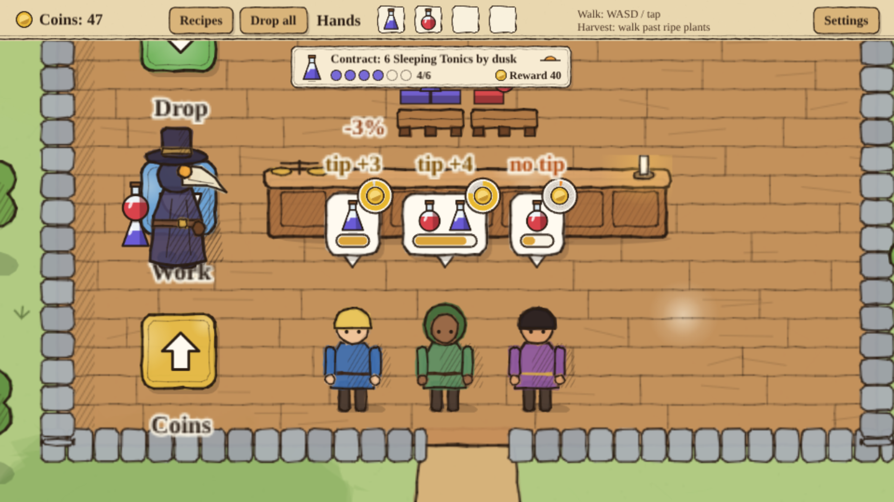

**Daily contract**: the card at the top of the screen asks for a number of one potion by dusk,
"Contract: 3 Sleeping Tonics by dusk" on the first day. Each potion of that kind sold at the
counter fills a pip. Fill them all and the reward goes straight into the purse and the next day's
contract comes in at once; at dusk an unkept contract lapses and the next day starts. A day lasts
four minutes, and the little sun on the right of the card sinks towards the horizon as dusk nears.
Days alternate Sleeping Tonics and Healing Draughts, each kept contract asks for one more potion
than the last (up to 12), and the reward is a little under half of what the potions sell for.

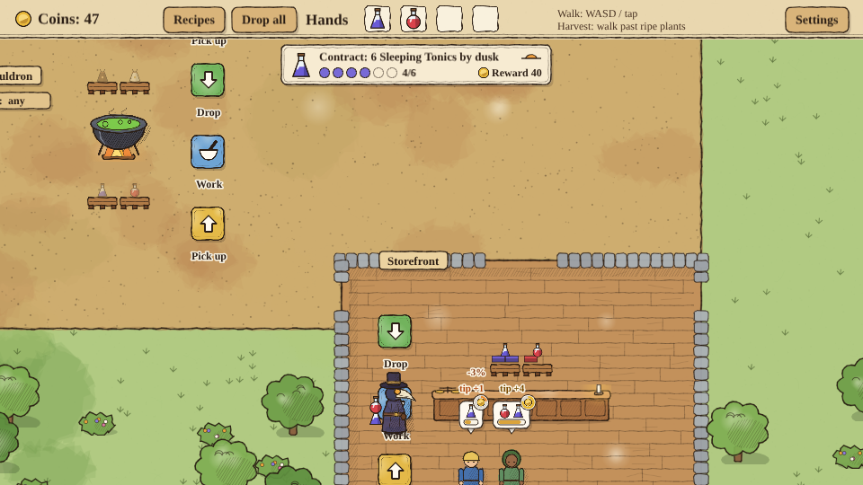

**While you were away**: once anything runs without the doctor (a craftsman hired or a belt
built), the apothecary keeps going while the game is closed. On the next visit the time away, up
to two hours, is played through the same rules with the doctor off his work spots, and a chip in
the top right says what it earned: "While you were away: +32 coins, 9 potions". Tap the chip to
dismiss it. The coins land where they would have: in the till, or in the purse when a craftsman
carries them or a contract pays.


**Pallets**: every station keeps each kind of goods coming in or going out on its own pallet: two
by two on the base, stacked up to ten layers high, so 40 of each kind. The refining table and
the cauldron keep what comes in on a pair of pallets above them and what goes out on a pair below
them, and the counter keeps its potions behind it. The drop and pick-up markers stand beside the pallets they fill and empty. A full
pallet takes nothing more: the doctor keeps the item and a belt waits until there is room.

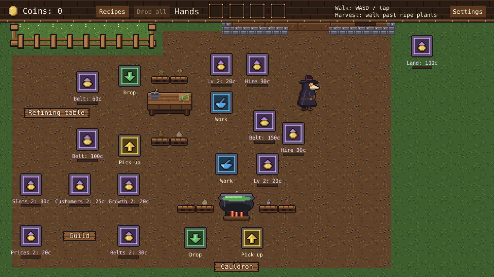

**Craftsmen** work a station so the doctor doesn't have to stand on its work spot. Each station
takes up to two, hired one at a time on the purple marker beside it (30, then 60 coins); they
stand by the station once hired, and its work spot goes away. At a refining table or cauldron the
first craftsman works as the doctor would, and the second opens a second pipe: a second plant or
brew on the go alongside the first, at the same speed, with its own bar below the first. Either
pipe's brew can be taken out fine. At the counter
the first craftsman serves customers, a potion every 1.5 seconds where the doctor hands them over
at once, and the second makes that twice as fast and also brings the coins from the till.


**Priority**: each refining table and cauldron has a small "First:" sign by its name. Tap it to
choose what the station makes first whenever it can: wheat, mandrake or nightshade at a table, a
Healing Draught, a Sleeping Tonic or a Shadow Elixir at a cauldron, or "any" to leave it to the station (a table takes
plants in the order they came, a cauldron brews what the customers are shortest of). Tapping the
sign doesn't walk the doctor. A station with nothing for its priority makes something else rather
than wait.

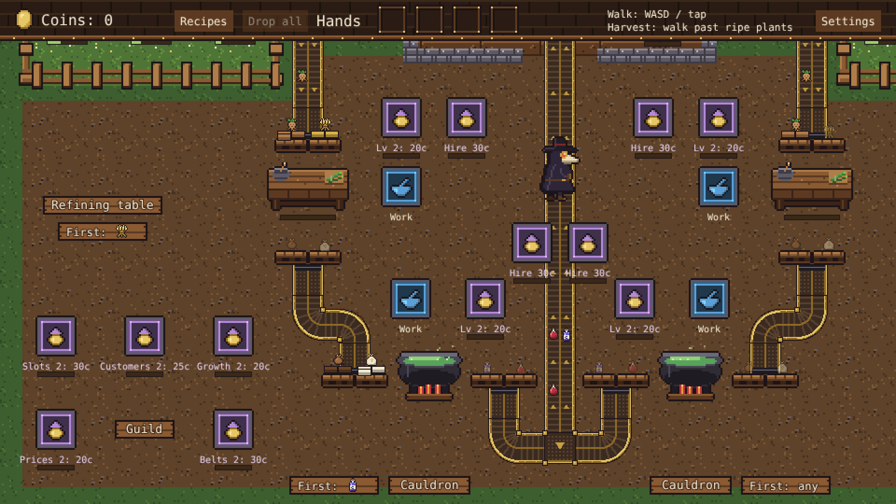

**What's for sale** opens up as you buy things. At first only one purple marker shows, and each
purchase puts the next one out, in this order: refining table level 2, pack 2, cauldron level 2, a
craftsman at the counter, then the garden belt. From the garden belt on it branches out: boots,
sickle, the counter's upgrade, craftsmen at the table and cauldron, the table's belt, the shade
garden, and entry to the guild (50 coins), which puts the guild's growth, belts and prices upgrades up for sale. The
cauldron's belt follows the table's, the land follows the cauldron's belt, customers follows
prices and the extra slot follows customers. The second line's things are for sale once their
station stands.

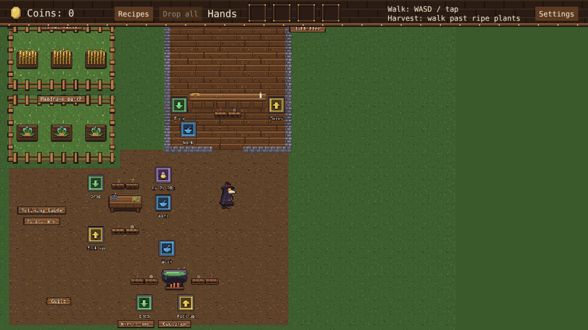

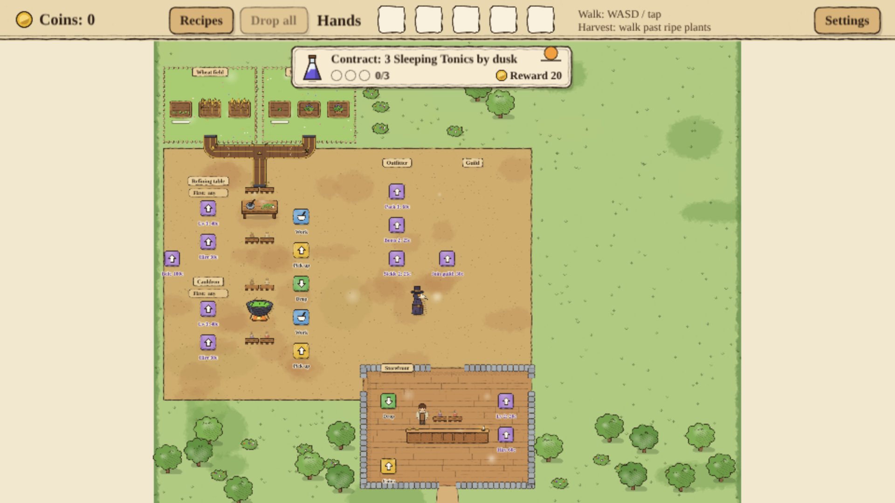

Every station has an upgrade marker and goes up to level 5. Upgrades cost 20, 40, 80 and 160
coins: the refining table and cauldron work faster, and customers at an upgraded counter pay
more for each potion (2 coins over the price per counter level, counting level 1) and wait
longer. Once a level is paid off, step off the marker and back on to start on the next. An upgrade
marker goes away once its last level is bought, and a hire marker once both craftsmen are hired.

The **outfitter** in the left half of the market kits the doctor out, two levels each: a bigger
pack carries one more item per level (30, then 60 coins), boots walk a fifth faster per level and
a longer sickle harvests from a quarter further away (25, then 50 coins each).

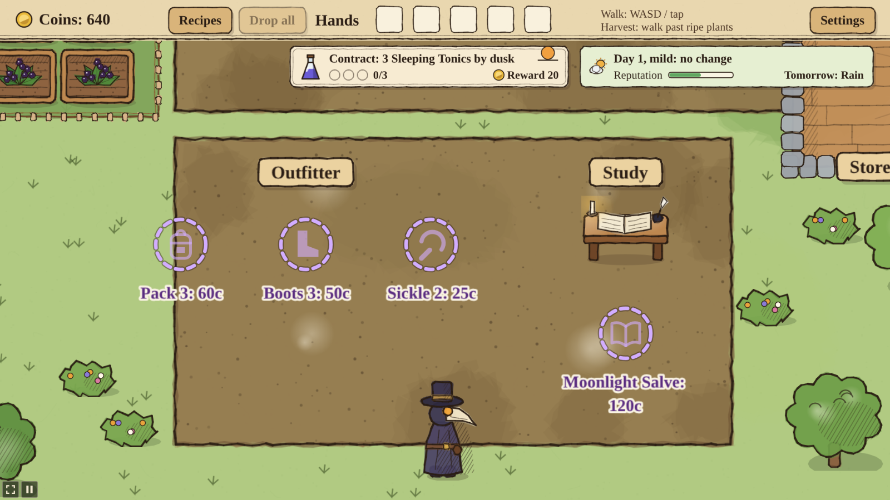

The **guild** in the right half of the market sells upgrades for the rest of the apothecary:
growth makes every garden grow a quarter faster per level (20, then 40 coins), belts run half again
as fast per level, carrying more goods a second (30, then 60), prices make customers pay a quarter
more per potion per level (20, then 40), an extra order slot lets a fourth customer wait at the
counter (30), and customers makes them come in more often, a new one every 6 to 10 seconds and then
every 4 to 7 instead of every 12 to 20 (25, then 50). A busier shop is harder to keep up with: per
customers level, a fifth more customers want two potions (35% at first, then 55% and 75%), and they
wait a third less long, then half as long. One line with a craftsman per station can't serve
everyone at the top level; it takes the second line, more craftsmen or station upgrades.


**Conveyor belts** take the walking out of the loop. Three can be bought on their own purple build
markers, a handful of coins at a time: gardens to refining table (60 coins), table to cauldron (100)
and cauldron to counter (150). A belt picks ripe plants up from the gardens, or finished goods
from a station's out pallets, and runs to the next station's in pallets, where each lane ends at
its own kind's pallet; it hands goods over when that pallet has room. Mandrakes and nightshade get
on the garden belt at their own garden. The drop and pick-up markers it replaces go away,
though a drop marker comes back while the doctor carries goods it takes, such as goods from the
other line. The goods it carries go from the doctor's hands onto it when it is built, one after
another, unless the other line still moves them by hand. Each belt has a
narrow lane for every kind of goods it carries (the three plants, the three refined goods, or the
three potions), so when one kind waits for room at the next station the others keep moving. Each
lane runs at half the belt's speed.

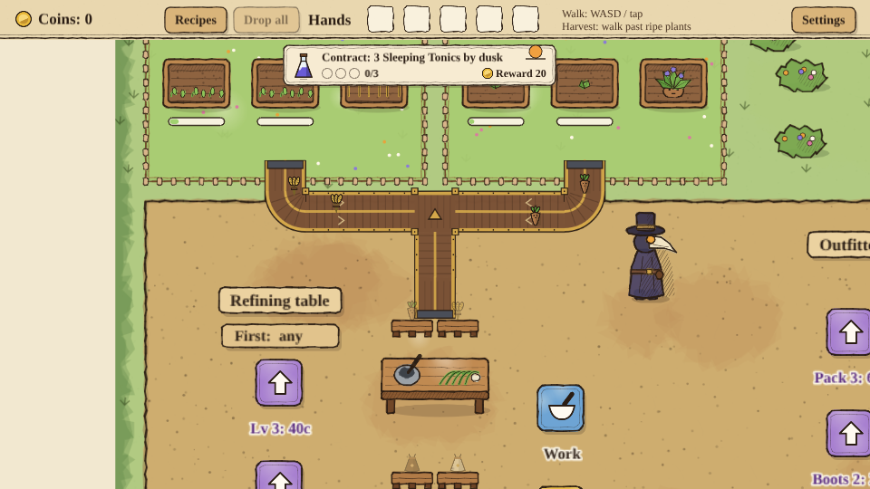

The belts are steampunk machinery, brass rails over leather slats, in an otherwise medieval world.

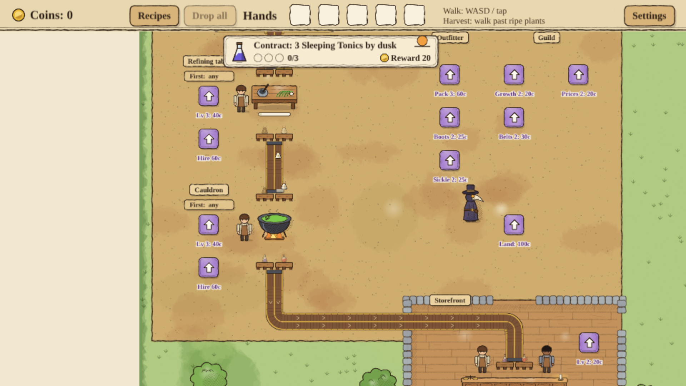

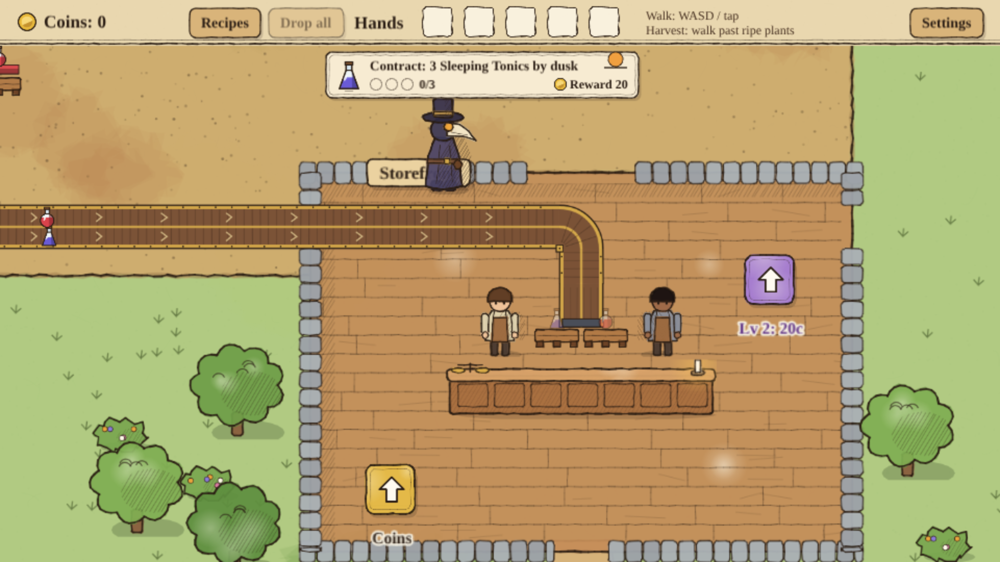

**The expansion** opens the right column for a second production line. Its land is bought on a
marker in the market below the guild (100 coins), which lays the yard and puts a build marker where each
part will go: a wheat field and a mandrake patch (25 coins each), a refining table (50), a
cauldron (75) and its shade garden (60). The second line works like the first and has its own belts, buildable once the
stations at both ends stand; its cauldron belt meets the first line's at a T inside the shop, above
the counter, and shares the run down to it. The counter's drop marker stays until every cauldron has its belt, and comes back whenever the
doctor carries a potion.


You can carry four items at a time, more with a bigger pack; they stack up on the doctor's back. Progress is saved in the browser automatically.

"Settings" in the top bar shows the difficulty and frame rate the game runs with, which are set on
the hub page's Settings, and has "New game", which starts over. On Easy customers wait 50% longer
before they leave, on Hard 30% less.

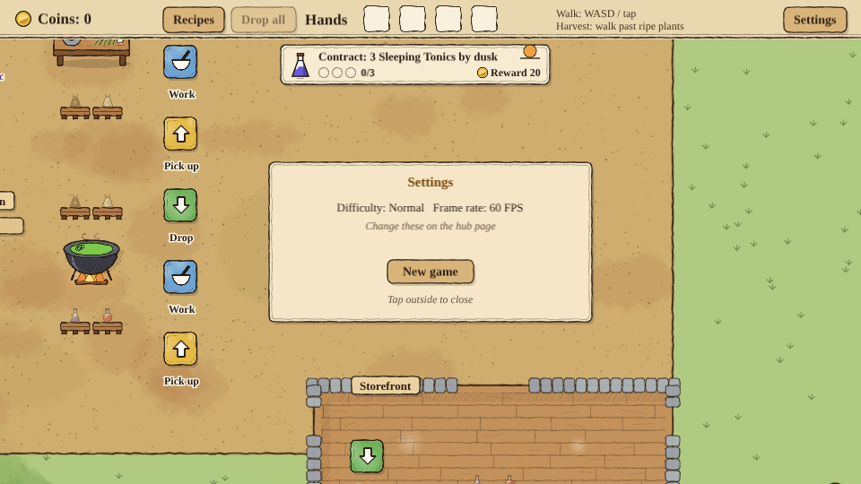

## Running locally

`npm run dev` at the repo root, then open `/games/apothecary/` (or pick Apothecary on the hub page).

## Playthrough test

`e2e/playthrough.spec.ts` plays the first round of the loop in headless Chromium with real
clicks: it opens and closes the recipes, harvests both gardens, refines, brews, takes one potion
out fine in its window, sells potions to a customer and collects the coins, checking items,
pallets, the recipe the cauldron picks, what each potion is paid and tipped, the reputation and the
first day's contract along the way. It plays at 4x speed (`PLAYTHROUGH_SPEED`), so the run takes
under a minute. The Playthrough Apothecary workflow runs it on every PR
that changes `games/apothecary/` and uploads a video and milestone screenshots as the
`playthrough-apothecary` artifact.

```sh
npx playwright install chromium        # once
npx playwright test --project apothecary   # starts the dev server and plays; CPU_THROTTLE=4 simulates a slow machine
```

Changes to gameplay, layout or controls update the test in the same PR; see the repo's `AGENTS.md`
for the rules and for how to debug a failing run.

## Code layout

All paths are inside `games/apothecary/`.

- `src/game/`: the rules (items, recipes, state, simulation tick and player actions) in plain
  TypeScript with no Phaser dependency, plus saving.
- `src/scenes/`: Phaser scenes. `BootScene` bakes textures, `GameScene` draws the world and wires
  input to the rules.
- `src/art/`: all the art, painted in code on canvases at startup with the watercolour and ink
  helpers in `paint.ts` (no image files): the plague doctor, townsfolk, items, gardens, stations,
  conveyor belts, floor markers, the ground and the parchment interface cards.
- `src/ui/`: small reusable display pieces (icon rows, progress bars) and the recipe and settings panels.
