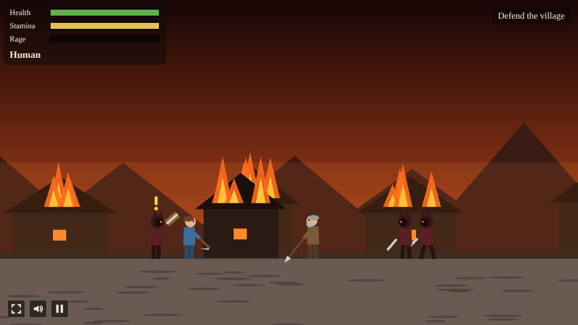

# Bearclaw Saga

A side-view action prototype built with [Phaser 4](https://phaser.io), TypeScript and Vite, part of
the [game hub](../../README.md).

A 2D take on the first playable version of
[Bearclaw Saga](https://github.com/Chriszly/bearclaw-saga), following its game design document
(`Docs/GAME_DESIGN.md` there) with a simpler combat system. You play Bjarn, a hunter from a fjord
village who does not know he can turn into a hybrid of man and bear, and into a bear. The cult
raids his village, its leader Skarn kills his father, and the beast breaks out. Bjarn wakes in the
woods covered in blood that isn't his, meets Ratatoskr, the talking squirrel of the World Tree,
follows the tracks to the old trapper Torvald and goes after the cult's wolf chief, Ulfgar.

Everything is placeholder art drawn in code: figures from simple shapes, parallax backdrops of
mountains, firs and burning houses.

## How to play

- **Walk** with A / D or the arrow keys. **Strike** with J, Z or a click. **Block** by holding K
  or X; a block raised just before a hit lands is a **parry**, which costs nothing and stuns the
  foe. **Dodge** with L, C or Shift: nothing hits you mid-roll.
- On a touch screen, the buttons appear once you touch it: ◀ ▶ bottom left, Strike, Block, Dodge
  (and Shift and Use when they apply) bottom right.
- A yellow mark over a foe means a strike you can block, a red one a strike you must dodge.
- Strikes, dodges and blocks cost **stamina**. At zero Bjarn is exhausted: weaker, slower strikes
  and no dodge until it is back up.
- **Rage** rises only when Bjarn is hit, never from blocks, parries, dodges or his own strikes.
  When it overflows, the beast breaks out: first the hybrid, and under more pressure the bear. In
  the outburst the screen goes red and the beast fights on its own; you can only nudge it. It ends
  when the rage has drained.
- Each form plays differently (numbers in `src/game/forms.ts`):

  | Form | Speed | Damage | Reach | Resistance | Block | Heals by |
  | --- | --- | --- | --- | --- | --- | --- |
  | Human | 220 | 10 | 72 | 0% | 85% held off | herbs |
  | Hybrid | 255 | 25 | 92 | 30% | 65% held off | herbs |
  | Bear | 165 | 40 | 118 | 50% | none | 30% of the damage it deals |

- Changing form at will is locked at first, as in the story. In the fight against Ulfgar's giant
  wolf Bjarn learns to call the hybrid (Q or the Shift button, and back). Changing form right as a
  strike lands counters it like a parry.
- **E** looks closer at tracks on the trail. **Space**, **Enter**, **E** or a tap reads on while
  someone talks.
- A fall starts the chapter over. The game saves at the start of every chapter.

## The chapters

| # | Chapter | What happens |
| --- | --- | --- |
| 1 | The Hunt | Boars in the snowy woods teach walking, striking, blocking and dodging. Smoke rises over the village. |
| 2 | The Raid | Bjarn fights the cult beside his father until Skarn kills him. Grief and wounds fill the rage until the beast breaks out, hybrid and then bear, with a blurry, broken view. |
| 3 | Awakening | Bjarn wakes in the woods; Ratatoskr finds him. |
| 4 | The Trail | Torn raiders, paw prints that end in a man's footprints and a hut torn open from inside. Torvald gives shelter, teaches the parry (parry his stick twice) and his recipes, so herbs heal more. |
| 5 | The Forest | Wolves and cultists on the cult's trail, with Ratatoskr's rumours. |
| 6 | Ulfgar | The wolf chief fights as a man beside two cultists. At half health he becomes a giant wolf and calls his pack: too fast for the bear, too strong for the man, so Bjarn calls the hybrid for the first time. Reward: the sealed skill Wolf's Trail. |
| 7 | Riders of the Jarl | Sigrun and Haakon's warriors find Bjarn, and the version ends. |

## Running locally

From the repository root, `npm run dev` and open `http://localhost:5173/games/bearclaw-saga/`.

## Playthrough test

`e2e/playthrough.spec.ts` plays the hunt in headless Chromium with real key presses: it reads the
opening lines, walks east, blocks the boars' charges and strikes back, and walks on until the raid
begins, checking the kills, the save and that Bjarn never fell. Run it with
`npx playwright test --project bearclaw-saga`.

## Code layout

| Path | What it holds |
| --- | --- |
| `src/main.ts` | Creates the game and hands it to the hub's `setupGame` and `setupScaling` |
| `src/howToPlay.ts` | The How to play shown on the start and pause screens |
| `src/game/forms.ts` | Bjarn's forms, stamina, rage, healing and the foes' numbers |
| `src/game/story.ts` | The seven chapters as lists of events: talk, waves, tracks, people and scripted moments |
| `src/game/state.ts` | The save: the chapter reached, Torvald's recipes, the hybrid at will, falls and kills |
| `src/scenes/GameScene.ts` | The director that runs a chapter's events, Bjarn, the foes, the people and the drawing |
| `src/scenes/art.ts` | Every figure and backdrop, drawn with vector shapes |
| `src/scenes/hud.ts` | The bars, the objective, hints, toasts, the talk box, touch buttons, the outburst's haze and the cards |
| `src/audio/` | The music and the sound effects, both made in code |
| `src/i18n/` | Every text on screen in British English, US English and German |
