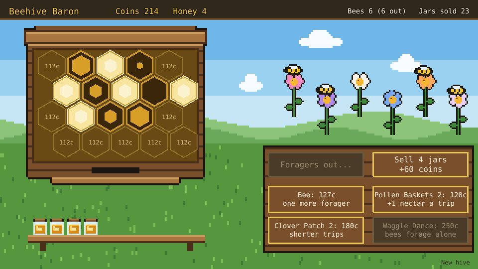

# Beehive Baron

An idle beehive. Build comb cells, send your foragers out to the meadow for nectar, let the full
cells ripen into honey, harvest the capped cells and sell the jars. The coins buy more cells, more
bees and upgrades, until the Waggle Dance sends the bees out on their own.



## How to play

1. **Build a cell**: tap a spot in the comb. The first cell is free; each one after costs more.
2. **Send the foragers**: tap **Send foragers**. Every bee at home flies to a flower and brings
   nectar back. A cell holds 4 drops; nectar that comes home to a full comb is lost.
3. **Harvest**: a full cell ripens into honey and is capped with pale wax. Tap it to fill a jar,
   and the cell starts over.
4. **Sell**: tap **Sell** to sell every jar on the shelf for 15 coins each.
5. **The hive is kept**: the comb, coins, jars, bees and upgrades are saved in the browser. Bees out
   foraging come home when the page reloads. **New hive**, in the bottom right corner, starts over.


### What the coins buy

| Buy | Ranks | What it does |
| --- | --- | --- |
| Comb cell | one per spot (20 spots): free, then 12 coins, rising 25% per cell | Room for 4 more drops of nectar |
| Bee | up to 12 bees: 25 coins, rising 50% per bee | One more forager |
| Pollen Baskets | 3 (40, 120, 320 coins) | Every forager brings one more drop a trip |
| Clover Patch | 3 (60, 180, 480 coins) | Trips take 20% less time per rank |
| Waggle Dance | 1 (250 coins) | Bees at home fly out by themselves whenever the comb has room |

The difficulty, set on the hub page's Settings, changes one thing: foraging trips take 25% less
time on Easy and 30% more on Hard.

## Running locally

`npm run dev` at the repo root, then open `/games/beehive-baron/` (or pick Beehive Baron on the hub
page).

## Playthrough test

`e2e/playthrough.spec.ts` plays the first jar of honey in headless Chromium: it checks the new
hive, checks the foragers stay home while there is no comb, builds the first cell, sends the two
foragers out twice until the cell is full, waits for it to ripen and be capped, harvests it and
sells the jar. Like the other games' tests it owns the game clock and plays at 4x speed
(`PLAYTHROUGH_SPEED`). The **Playthrough Beehive Baron** workflow
(`.github/workflows/playthrough-beehive-baron.yml`) runs it on every PR that touches this folder or
the workflow, and uploads the video and screenshots as the `playthrough-beehive-baron` artifact.

```sh
npx playwright test --project beehive-baron
```

## Code layout

All paths are inside `games/beehive-baron/`.

- `src/game/`: the rules in plain TypeScript with no Phaser dependency. `state.ts` holds the hive
  and its numbers, `sim.ts` builds, forages, ripens, harvests, sells and buys, `upgrades.ts` is the
  upgrade table and `save.ts` keeps the hive.
- `src/scenes/`: `BootScene` bakes textures, `GameScene` draws the hive and turns taps into rules
  calls, `layout.ts` says where things are drawn.
- `src/art/`: all the pixel art, drawn in code and baked into textures at startup: the meadow, the
  hive box, the flowers, the honey jar and the bee.
- `src/ui/`: the buttons.
