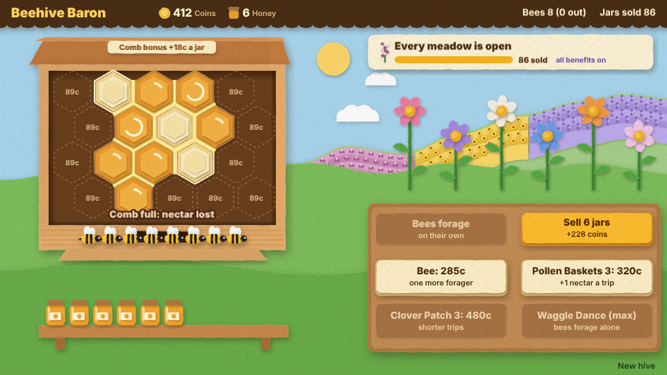

# Beehive Baron

An idle beehive in cut paper. Build comb cells, send your foragers out to the meadow for nectar,
let the full cells ripen into honey, harvest the capped cells and sell the jars. Cells built side by
side earn a comb bonus on every jar, goals of jars sold unlock new meadows on the far hill, and the
bees keep gathering a little nectar while you are away. The coins buy more cells, more bees and
upgrades, until the Waggle Dance sends the bees out on their own.


## How to play

1. **Build a cell**: tap a spot in the comb. The first cell is free; each one after costs more.
   With a mouse, pointing at an empty spot first shows a green preview with its price and how many
   built cells it would touch.
2. **Send the foragers**: tap **Send foragers**. Every bee at home flies to a flower and brings
   nectar back. A cell holds 4 drops; nectar that comes home to a full comb is lost.
3. **Harvest**: a full cell ripens into honey and is capped with pale wax. Tap it to fill a jar,
   and the cell starts over.
4. **Sell**: tap **Sell** to sell every jar on the shelf. A jar is worth 15 coins, plus the comb
   bonus, plus 5 once the Sunflower Ridge is open.
5. **The hive is kept**: the comb, coins, jars, bees, upgrades and unlocked meadows are saved in
   the browser. Bees out foraging come home when the page reloads. **New hive**, in the bottom
   right corner, starts over.


### Comb bonus: build cells touching

Every edge two built cells share glows gold and adds **1 coin to every jar you sell**. The plaque
on the hive roof shows the total ("Comb bonus +18c a jar"), and the Sell button's price includes
it. Building a cell next to others pops a green "+3 touching" tag over it, and the build preview
lights the edges it would share in green. A tight cluster pays far more than cells scattered over
the comb: ten cells in a clump share 18 edges, which more than doubles a jar's price.


### Goals unlock meadows

The goal card at the top right names the next goal, the meadow it unlocks and that meadow's
benefit, with a bar of how far along you are. The locked meadow already shows, faded, on the far
hill with a padlock tag. The goals come in a chain, each counting jars sold since the hive began,
and every meadow's benefit lasts for good:

| Goal | Unlocks | Benefit |
| --- | --- | --- |
| 10 jars sold | Lavender Field | Every forager brings 1 more drop a trip |
| 30 jars sold | Sunflower Ridge | Every jar sells for 5 more coins |
| 80 jars sold | Heather Moor | Full cells ripen twice as fast |




### While you were away

Close the page and the bees keep foraging, slowly: each bee gathers 1 drop per 30 seconds away,
up to **20 drops** a visit, poured into the filling cells (it never spills, and an already full
comb gets nothing). When you come back a chip under the hive says how much they brought, with a
bar against the cap: "While you were away: +12 nectar (cap 20)". It fades after a few seconds, or
when tapped. Cells it fills start ripening as you return.


### What the coins buy

| Buy | Ranks | What it does |
| --- | --- | --- |
| Comb cell | one per spot (20 spots): free, then 12 coins, rising 25% per cell | Room for 4 more drops of nectar, and comb bonus for each built cell it touches |
| Bee | up to 12 bees: 25 coins, rising 50% per bee | One more forager |
| Pollen Baskets | 3 (40, 120, 320 coins) | Every forager brings one more drop a trip |
| Clover Patch | 3 (60, 180, 480 coins) | Trips take 20% less time per rank |
| Waggle Dance | 1 (250 coins) | Bees at home fly out by themselves whenever the comb has room |

The difficulty, set on the hub page's Settings, changes one thing: foraging trips take 25% less
time on Easy and 30% more on Hard.

## Running locally

`npm run dev` at the repo root, then open `/games/beehive-baron/` (or pick Beehive Baron on the hub
page).

## Playthrough test

`e2e/playthrough.spec.ts` plays the first jar of honey in headless Chromium: it checks the new
hive, checks the foragers stay home while there is no comb, builds the first cell, sends the two
foragers out twice until the cell is full, waits for it to ripen and be capped, harvests it and
sells the jar for 15 coins (a lone cell touches nothing, so no comb bonus, and one jar is short of
the first goal, so no meadow unlocks). Like the other games' tests it owns the game clock and plays
at 4x speed (`PLAYTHROUGH_SPEED`). The **Playthrough Beehive Baron** workflow
(`.github/workflows/playthrough.yml`) runs it on every PR that touches this folder or
the workflow, and uploads the video and screenshots as the `playthrough-beehive-baron` artifact.

```sh
npx playwright test --project beehive-baron
```

## Code layout

All paths are inside `games/beehive-baron/`.

- `src/game/`: the rules in plain TypeScript with no Phaser dependency. `state.ts` holds the hive,
  its numbers and the comb bonus, `sim.ts` builds, forages, ripens, harvests, sells, buys and adds
  the nectar gathered while away, `meadows.ts` is the chain of goals, `upgrades.ts` is the upgrade
  table and `save.ts` keeps the hive.
- `src/scenes/`: `BootScene` bakes textures, `GameScene` draws the hive and turns taps into rules
  calls, `layout.ts` says where things are drawn.
- `src/art/`: the cut-paper art, painted on canvases at startup: `paper.ts` cuts card with
  shadows and grain, `scenery.ts` the meadow, meadows, hive, flowers, jar, comb cells and UI cards,
  `bees.ts` the bee.
- `src/ui/`: the paper buttons.
