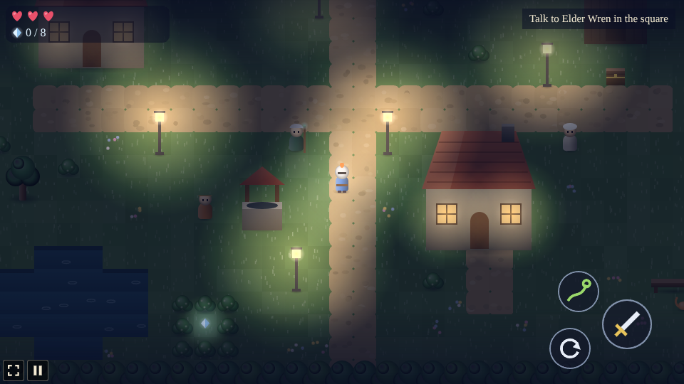
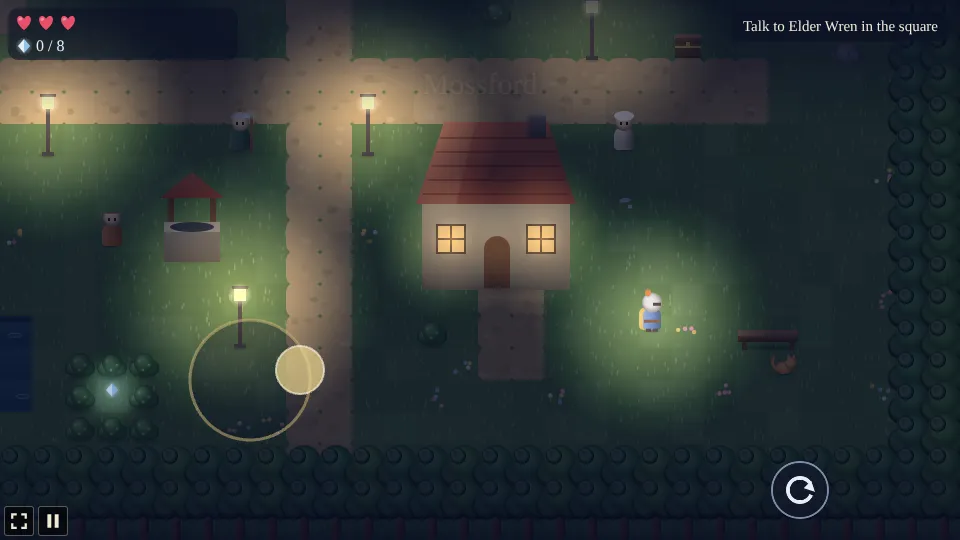
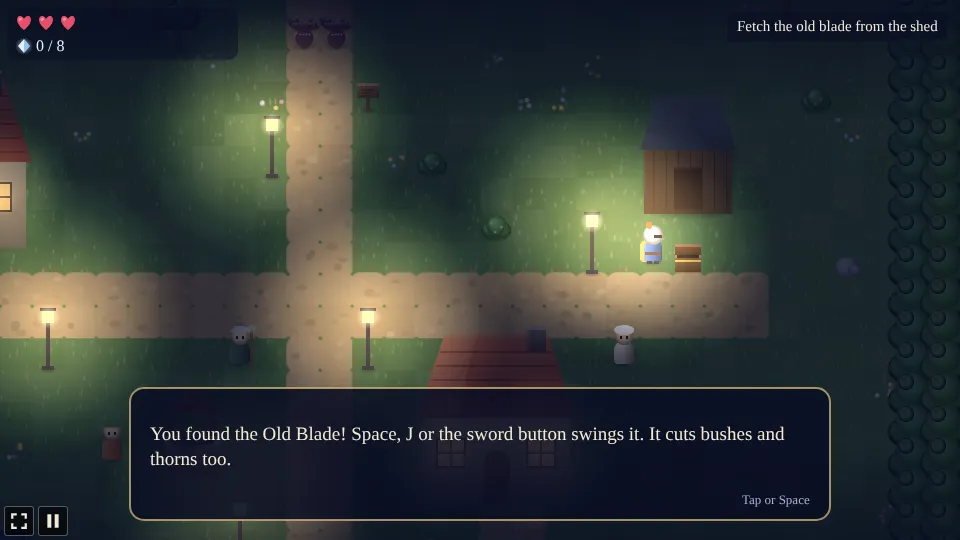
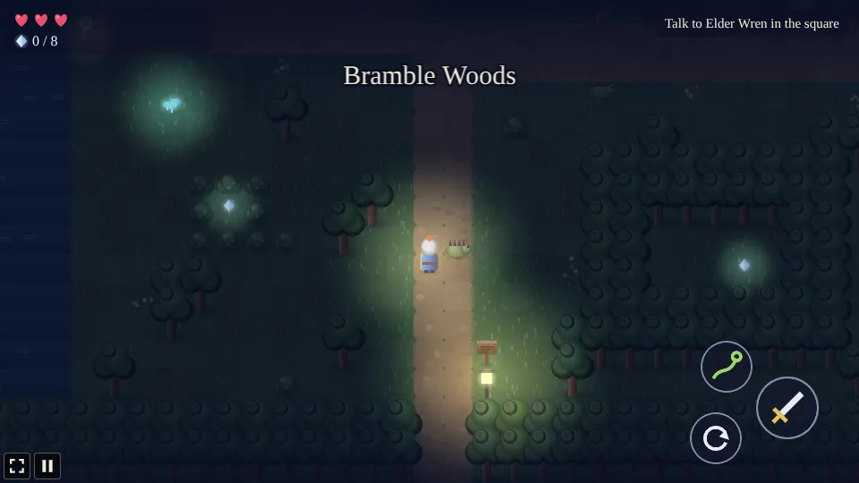
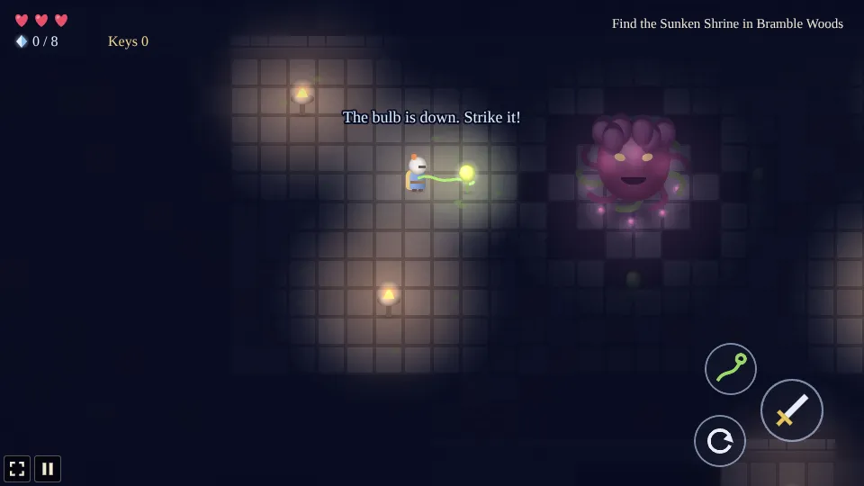

# Bramblecrest

A top-down adventure built with [Phaser 4](https://phaser.io), TypeScript and Vite, part of the
[game hub](../../README.md).

A small knight in a lamplit village at night. Thorns keep creeping over Mossford's north gate, and
Elder Wren has a job for you: fetch your grandfather's old blade, cut the gate free and find out
what grows the thorns. Beyond the gate lie Bramble Woods, a misty fen across the river and a shrine
sunk deep in the roots, with a new tool inside that opens more of the world. Everything is drawn as
a soft 3D miniature by moonlight: lamp glow, fog, fireflies and a tilt-shift haze.

The kingdom keeps secrets. Moonstones are hidden on every map, and most of them are not lying in
plain sight. People drop hints if you listen, and how many stones you carry home changes how the
chapter ends.

## How to play

- **Walk** with WASD or the arrow keys, or click or tap the ground. Tapping a person, chest, sign,
  bush or foe walks over and talks, opens, reads, cuts or attacks.
- **Steer by touch**: put a finger down anywhere on the world and drag. A steering stick appears
  where the finger went down and the knight walks the way you drag; the stick follows a finger that
  goes past its rim, and a quick tap still walks to what you tapped. Another finger can use the
  buttons meanwhile.

- **Space**, **J** or the sword button talks to or opens what is in front of you, and otherwise
  swings the sword. The sword cuts bushes and thorns too.
- **Shift**, **K** or the roll button rolls out of the way; nothing hits you mid-roll.
- **Q**, **L** or the vine button throws the hookvine once you have it. It pulls you to golden
  posts, across water and pits, and it does a few other things worth finding out.
- The journal line at the top right always says what to do next.

### The chapter

1. Talk to Elder Wren in the square. She sends you for the old blade in the chest by the shed.
2. Bring the blade back to her, then cut the thorns at the north gate.
3. Find the Sunken Shrine in Bramble Woods. It has a locked door, a stone block that wants to be
   somewhere else, a chasm and a tool in a chest behind iron bars.
4. Face the Thornmother at the bottom of the shrine. Her bulbs are her weak spot, but you can't
   reach them from where you stand.
5. Bring the news back to the elder.

### Hearts and falls

You have three hearts on Normal (five on Easy, two on Hard). Foes, thorn seeds and the Thornmother
cost half a heart a hit. Cut bushes now and then drop a heart, and heart vessels add one for good.
Fall and you wake where you last came in, healed; nothing is lost.

### Secrets

There are eight moonstones. A few hints, and no more:

- Listen to the people of Mossford, and to anyone you meet past the river.
- Not every tree casts a shadow.
- Statues look at things for a reason.
- A wisp that runs from you is not always running away.
- Be kind to animals. More than once.

## Running locally

From the repository root, `npm run dev` and open `http://localhost:5173/games/bramblecrest/`.

## Playthrough test

`e2e/playthrough.spec.ts` plays the first quest in headless Chromium with real taps: it talks to
Elder Wren, takes the Old Blade from the chest by the shed, brings it back and cuts the thorns at
the north gate, checking the quest, items, flags and save at each step. Run it with
`npx playwright test --project bramblecrest`.

## Code layout

| Path | What it holds |
| --- | --- |
| `src/main.ts` | Creates the game and hands it to the hub's `setupGame` and `setupScaling` |
| `src/howToPlay.ts` | The How to play shown on the start and pause screens |
| `src/game/maps.ts` | The four maps as tile grids, with their people, chests, signs, exits, foes, posts, doors, blocks, plates, rooms and moonstones |
| `src/game/state.ts` | The save: where the knight is, hearts, items, keys, moonstones, flags and the quest |
| `src/game/talk.ts` | What each person says, by where the quest stands |
| `src/game/path.ts` | A* for tap-to-walk |
| `src/art/paint.ts` | Every sprite, painted onto canvases in soft 3D |
| `src/art/ground.ts` | Paints each map's ground into one texture |
| `src/scenes/GameScene.ts` | The world: walking, the sword, the hookvine, foes, puzzles, the boss and the story |
| `src/scenes/foes.ts` | Foe stats and the Thornmother's timings |
| `src/scenes/light.ts` | The night: the dark, the lamp glow and the miniature haze |
| `src/scenes/hud.ts` | Hearts, moonstones, keys, the journal line, dialog, touch buttons and the end card |
| `src/scenes/layout.ts` | The view, speeds, reaches and button positions |
