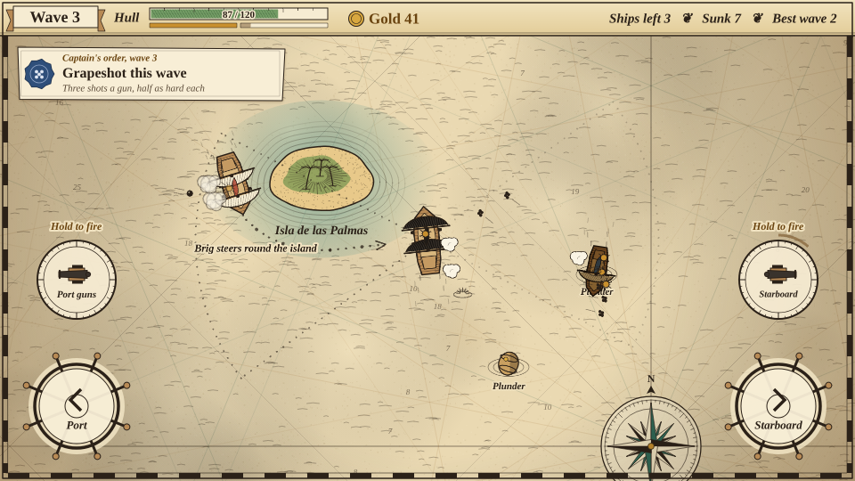
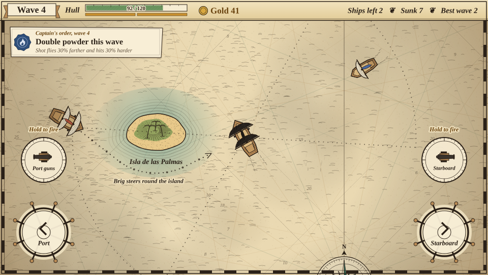
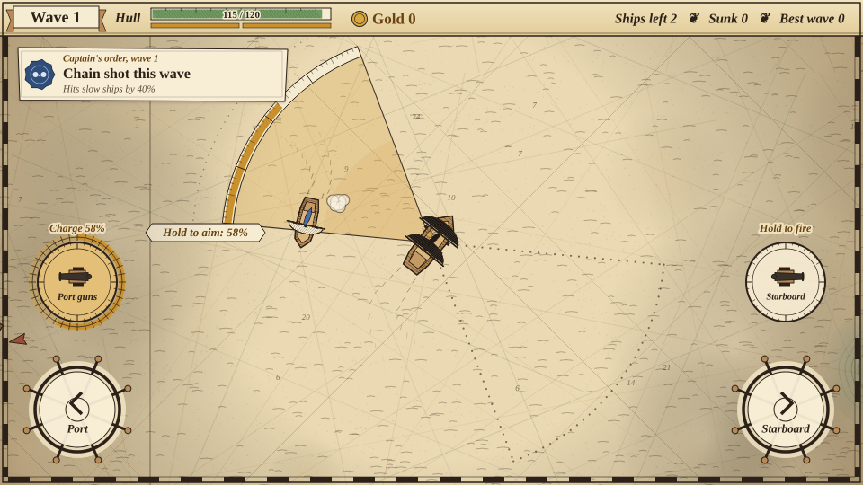
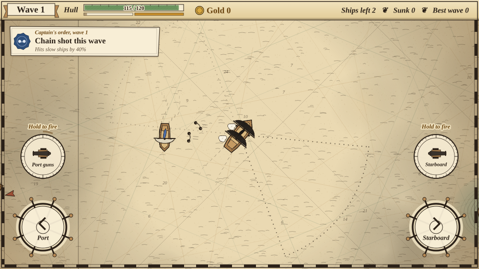
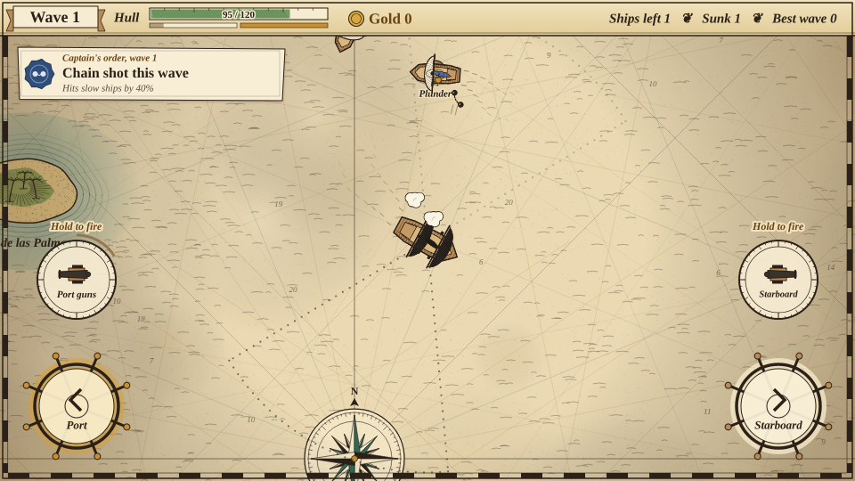
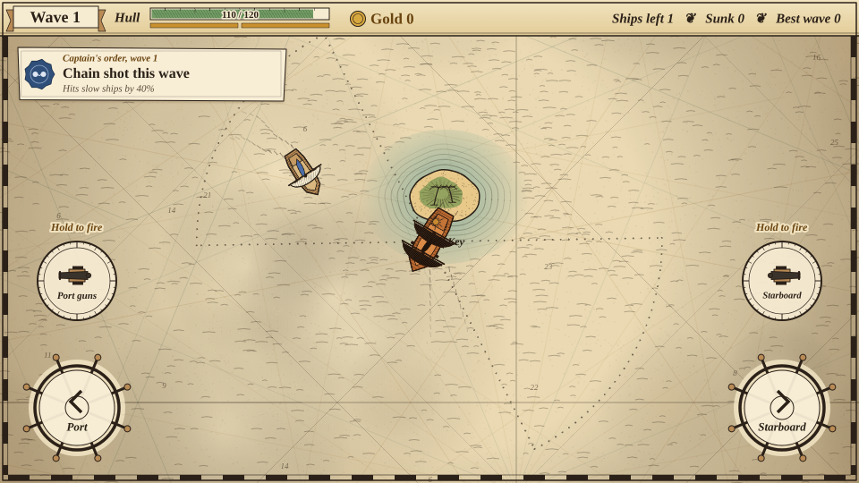
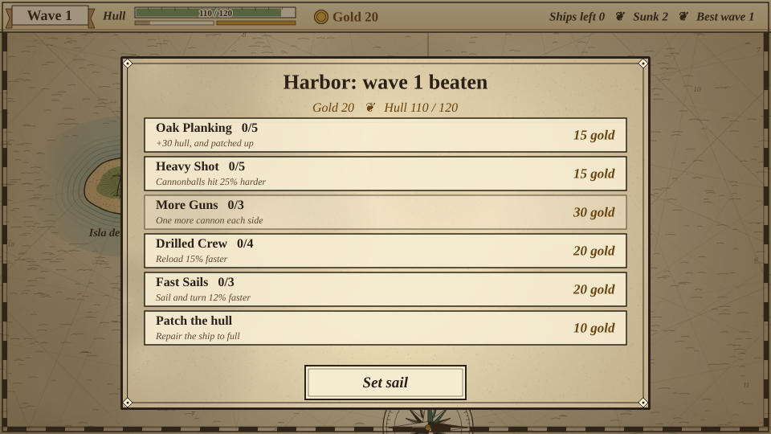

# Broadside

A naval battle prototype built with [Phaser 4](https://phaser.io), TypeScript and Vite, part of
the [game hub](../../README.md).

You captain a pirate ship with black sails, drawn as an engraved miniature on an old hand-tinted
sea chart: parchment with a compass rose and rhumb lines, hatched sea, and islands ringed with
coast form lines. The ship always sails on; you put the helm over to port or starboard, and you
fire the cannons that line its sides yourself. Hold a side's fire control to aim: its firing arc
lights up and a charge fills along the arc's rim, and letting go fires the broadside, further and
harder the longer you held it. Each wave comes with one captain's order, a bonus for that wave.
Sunk ships leave a barrel of plunder floating where they went down; sail over it to haul it
aboard. Once a wave is beaten the ship puts into harbor, where the gold buys a stronger hull,
heavier shot, more guns, a faster crew and faster sails.


## How to play

| Control | Action |
| --- | --- |
| Hold the **Port** wheel (bottom left), Left arrow or A | Turn to the left |
| Hold the **Starboard** wheel (bottom right), Right arrow or D | Turn to the right |
| Hold **Port guns** (above the left wheel) or Q, then let go | Aim, charge and fire the port broadside |
| Hold **Starboard** guns (above the right wheel) or E, then let go | Aim, charge and fire the starboard broadside |
| Tap a row at the harbor | Buy that upgrade, or patch the hull |
| Set sail | Leave the harbor for the next wave |

On a phone, one thumb can hold a wheel while the other holds a fire control.

1. **Hold to aim.** The guns no longer fire on their own. At rest each side shows a dotted wedge,
   its firing arc out to the guns' full reach (fainter while that side reloads). Holding a fire
   control turns that wedge into an ochre wash and fills a charge meter, like a sextant's scale,
   along its rim and round the held button. Letting go fires the broadside. An uncharged shot
   reaches 65% of the full range and hits for the base damage; a full charge (one second) reaches
   all of it and hits 50% harder. The gun crews train on the nearest enemy in reach within the arc
   (or just outside it), leading a moving target, and fire straight out if there is none. Each side
   reloads on its own (two seconds), and the two bars under the hull show how loaded they are; a
   side being reloaded doesn't charge until it is loaded.
2. **One captain's order per wave.** A note under the top bar, sealed in blue wax, names one bonus
   for the whole wave. The first wave is always chain shot; every later wave draws a different
   order from the last. Your shot looks like the order:

   | Order | Bonus | Your shot |
   | --- | --- | --- |
   | Chain shot | A hit slows the ship by 40% for 4 seconds | Two balls on a chain |
   | Grapeshot | Each gun fires three shots in a fan, each half as hard | Small clusters |
   | Double powder | Shot flies 30% farther and hits 30% harder | Balls with a powder flash |
   | Fair wind | Sail and turn 25% faster | Round shot |
   | Rum for the gun crews | Reload 30% faster | Round shot |

3. **Enemy ships** come over the horizon one after another, close in and turn to fire their own
   broadsides, which go off on their own. Their crews aim worse than yours. Rust-coloured arrows at
   the edge of the screen point to ships out of sight.
4. **Enemies steer round islands.** A captain whose way to you is blocked by an island plans a
   course round it, the shorter way, and draws it on the chart as a faint dotted line ending in an
   arrow, labelled with the ship's name. Close in, every captain keeps a lookout and bears off a
   beach ahead, shortening sail to come about in time, so islands make cover to fight round.
5. **Loot**: every sunk ship leaves a barrel of gold that drifts toward your ship once close. It
   sinks after 25 seconds, blinking at the end; ochre arrows point to barrels out of sight. Once
   the last ship of a wave goes down, the crew hauls in every barrel still afloat.
6. **The harbor** opens as soon as the last enemy ship of the wave is sunk. The crew patches a
   quarter of the hull for free; the rest is 10 gold.
7. **The sea has no edge.** Like on a globe, sailing off the top brings you back in at the
   bottom, and off the left side back in on the right. Enemy ships, loot and cannonballs cross
   over the same way, and the arrows point the shortest way round.
8. **Islands**: the shallows around an island are safe, but a ship that runs onto the sand,
   yours or an enemy's, glances off and takes 8 damage to its hull.
9. **The run is over when your hull is sunk**. "Sail again" starts afresh at wave 1. The best wave
   beaten is kept in the browser.














### Enemy ships

| Ship | From | What it does |
| --- | --- | --- |
| Sloop | wave 1 | Small and quick, one gun a side, 10 gold |
| Brig | wave 3 | Two guns a side and twice the timber, 25 gold |
| Galleon | wave 5 | Slow, three guns a side and very tough, 60 gold |

Every wave brings one more sloop than the last, and enemy hulls get 12% tougher each wave.

### Upgrades

| Upgrade | Ranks | What it does |
| --- | --- | --- |
| Oak Planking | 5 | +30 hull, and patches 30 of it |
| Heavy Shot | 5 | Cannonballs hit 25% harder |
| More Guns | 3 | One more cannon each side |
| Drilled Crew | 4 | Reload 15% faster |
| Fast Sails | 3 | Sail and turn 12% faster |



The difficulty, set on the hub page's Settings, changes one thing: enemy ships have 25% less health on Easy and 30% more on Hard.

## Running locally

`npm run dev` at the repo root, then open `/games/broadside/` (or pick Broadside on the hub
page).

## Playthrough test

`e2e/playthrough.spec.ts` plays the first wave in headless Chromium. It holds the helm wheels
down to check that the ship turns each way and sails straight on once let go, and checks that the
first wave's order is chain shot. Then it steers by the wheels to close on each sloop and turn
side-on, holds that side's fire control (checking that the broadside charges without firing),
lets go once the charge reaches the sloop, and checks that chain shot flew and that the sloop it
hit is slowed. It fights on the same way until both sloops are sunk, checks the gold from the loot
(sailed over, or hauled in when the wave ends), waits for the harbor, buys Heavy Shot with the
plunder and sets sail for wave 2. Like the other games' tests it owns the game clock and plays at
4x speed (`PLAYTHROUGH_SPEED`). The **Playthrough Broadside** workflow
(`.github/workflows/playthrough-broadside.yml`) runs it on every pull request that changes
`games/broadside/` or the workflow itself, and uploads the video and screenshots as the
`playthrough-broadside` artifact.

```sh
npx playwright test --project broadside
```

## Code layout

All paths are inside `games/broadside/`.

- `src/game/`: the rules in plain TypeScript with no Phaser dependency. `ships.ts`,
  `upgrades.ts` and `orders.ts` (the captain's orders) are data tables, `waves.ts` says what each
  wave brings, `state.ts` holds the run and works out the player's ship from the upgrades bought
  and the wave's order, `sim.ts` sails the ships (enemy captains plan their way round islands),
  charges and fires the broadsides and runs the harbor, and `save.ts` keeps the best wave.
- `src/scenes/`: `BootScene` paints the textures, `GameScene` draws the chart, follows the ship
  with the camera across the wrapping sea and wires the helm wheels, fire controls and keys to the
  rules, `layout.ts` says where things are drawn.
- `src/art/`: the chart, ships, shot, plunder, controls and panels, painted on canvases in code
  and added as textures at startup.
- `src/ui/`: the harbor panel and buttons.

Adding an upgrade is an entry in `src/game/upgrades.ts` and its effect in `stats` in
`src/game/state.ts`; adding a captain's order is an entry in `src/game/orders.ts` (plus a seal
emblem in `bakeSeal` in `src/art/art.ts`); adding an enemy ship is an entry in
`src/game/ships.ts`, a look in `src/art/art.ts` and a place in `src/game/waves.ts`.
