# Catacomb

A dungeon deckbuilder prototype built with [Phaser 4](https://phaser.io), TypeScript and Vite, part
of the [game hub](../../README.md).

A knight walks a dungeon in two acts: the Crypt, from the entrance on the left to the Bone King on
the right, then down a stair to the Sunken Tombs and the Hollow Queen. Each room on the way is a
fight, an elite, a campfire, a treasure chest, a merchant or a mystery, and the paths fork, so the
route is the player's to pick. Each act is laid out anew for every run. Fights are played with a
deck of cards: a hand of five each turn, three energy to spend on them, and foes who show what they
will do on their next turn. Every fight won drops gold and adds a new card to the deck; gold buys
cards, relics and a card's removal from the merchant. Everything is painted in a painterly style,
with brush strokes drawn in code.


## How to play

| Control | Action |
| --- | --- |
| Tap a lit room | Walk there and go in |
| Tap a card in hand | Play it, if there is energy for it |
| End turn | Discard the hand and let the foes act |
| Tap a reward card | Add it to the deck (or Skip to take none) |
| Rest, Temper or Remove a card | At a campfire: heal, or tap a card to temper it or burn it from the deck |
| Tap a ware | At the merchant's: buy a card or a relic, or pay to remove a card; Leave to go on |
| Tap a choice | In a mystery room: take one of its two choices |
| Tap a relic in the top bar | Show its name and what it does |

1. **The map**: each act has seven columns of rooms, and from each room the dotted paths lead on
   to one or more rooms in the next. The rooms that can be entered next are lit gold; elites and
   the boss have a red ring. The first room is a lone fight (always a slime in the Crypt) and the
   last the act's boss. Every column between holds two or three rooms: one kind that is always
   there (a mystery in the second, a campfire in the third, a treasure chest in the fourth, a
   merchant in the fifth) and one or two more drawn from fights, elites, mysteries and merchants.
2. **Turns**: each turn the hero draws five cards and has three energy. A card's cost is in its
   corner. Attacks (red) hit the foe in front, or every foe; skills (blue) give block, health,
   energy or more cards. When the draw pile runs out, the discard pile is shuffled into it.
3. **Block** soaks up damage until the start of the hero's next turn. Health carries over from
   room to room, and the run is over when it reaches zero.
4. **Intents**: a sword over a foe is the damage it will deal on its turn (with a status icon after
   it if the hit also leaves one), a shield the block it will gain, an arrow that it grows
   stronger, adding to every hit after, and a purple skull the status it will put on the hero.
   Each foe opens with the same move, then picks its next one at random from its moves, never the
   same one twice in a row.
5. **Statuses**, shown over a fighter's head with their numbers:
   - **Weak** (a broken sword): attacks deal a quarter less. Wears off by one each time its owner
     acts.
   - **Vulnerable** (a cracked shield): takes half as much damage again from attacks. Wears off by
     one at the end of each round.
   - **Poison** (a green drop): loses that much health at the start of its turn, ignoring block,
     then the poison drops by one.
6. **Gold and rewards**: every fight drops gold (each foe has its own amount) and offers one of
   three common cards; an elite drops more gold and offers rare cards. A treasure chest offers
   three rare cards.
7. **Campfires**: rest to heal 30% of the hero's health, temper a card (each card can be tempered
   once, for more damage, block or effect, or a lower cost; tempered cards have a `+` and green
   lettering), or burn a card to thin the deck (down to no fewer than five cards).
8. **The merchant** sells two common cards (30 gold), a rare card (65), two relics (80 each) and
   removes one card from the deck per visit (40).
9. **Mystery rooms** each hold one of four scenes with two choices: an altar (8 health for a rare
   card), a shrine (temper two random cards, or 45 gold for 6 health), a chained chest (6 maximum
   health for a relic) and a pool (heal 15, or temper a random card for 4 health).
10. **Relics** are passive bonuses for the rest of the run, shown in the top bar.
11. **Two acts**: beating the Bone King leaves a relic and opens the stair down to the Sunken
    Tombs, with new foes, its own elite and the Hollow Queen; the hero heals 30% on the way down.
    Beat her to clear the dungeon.

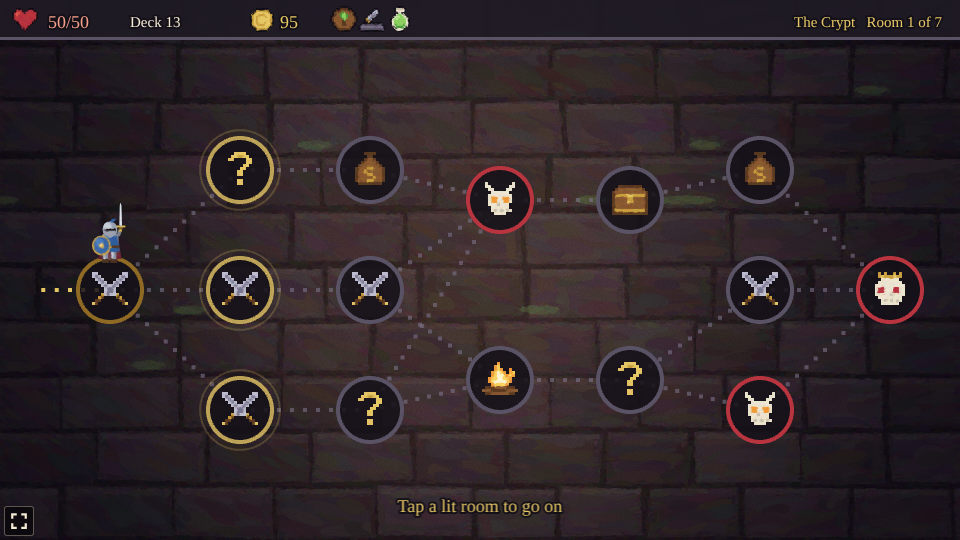


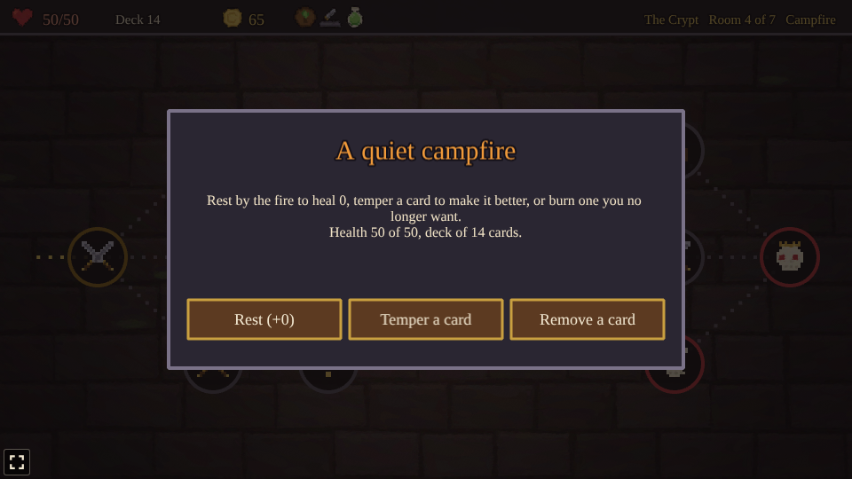

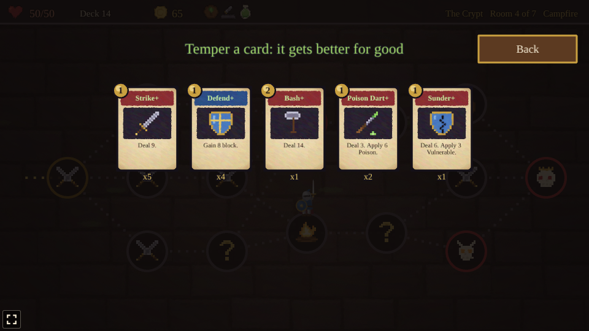

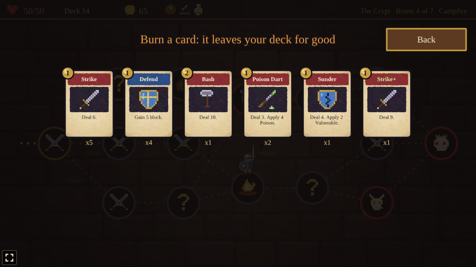

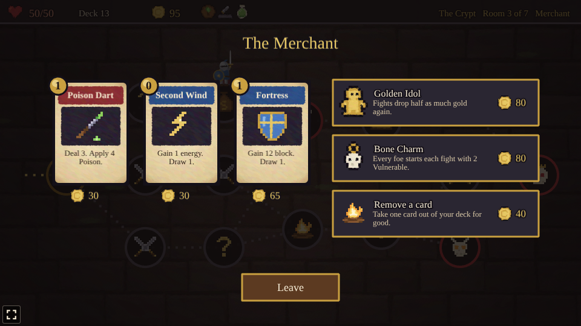

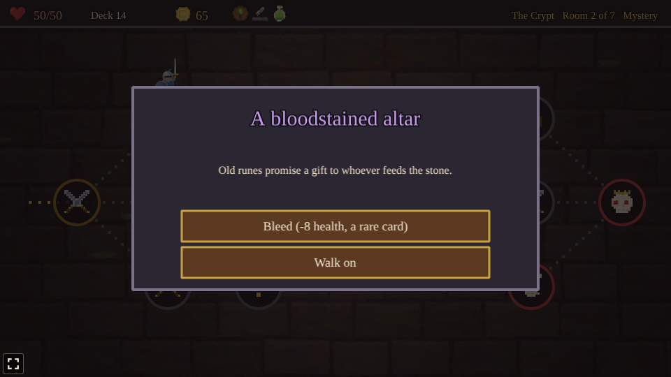

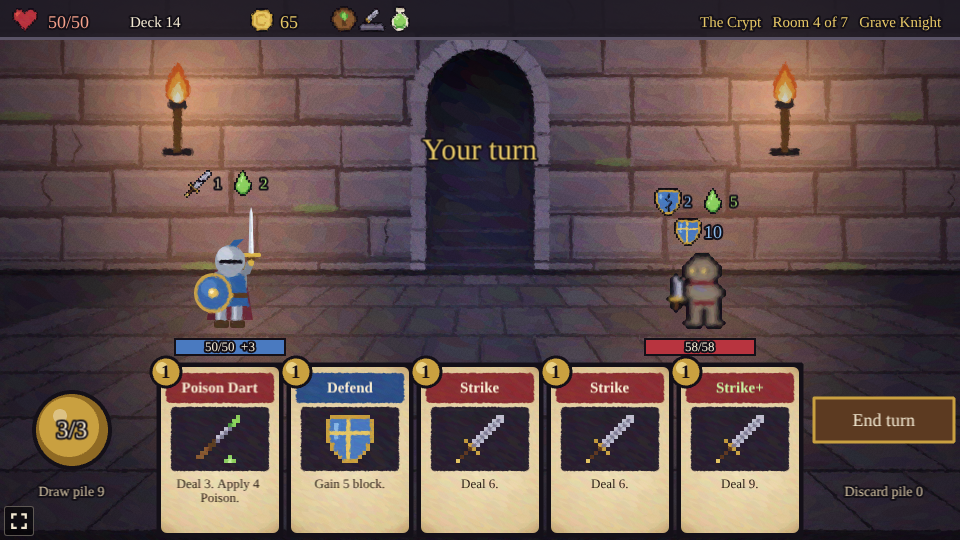

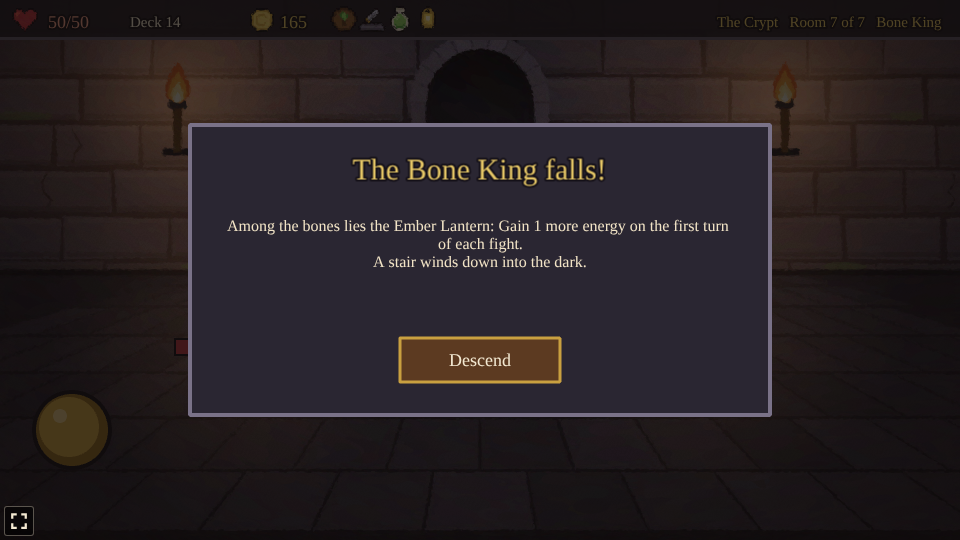

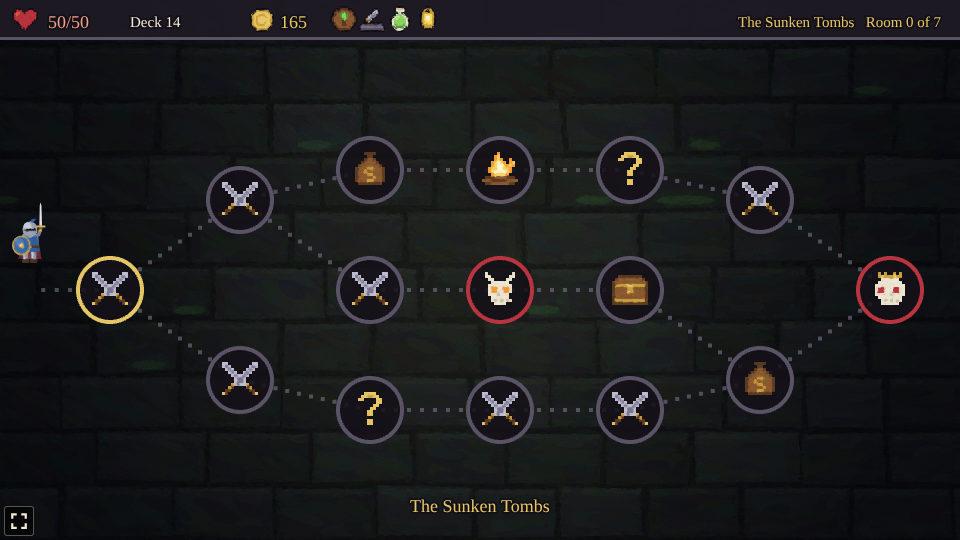

### Foes

| Foe | Act | Health | Gold | Moves (the first is its opening move) |
| --- | --- | --- | --- | --- |
| Slime | 1 | 24 | 12 | Attack 6, block 5, attack 8 |
| Giant Rat | 1 | 13 | 7 | Attack 3 twice, attack 4 and 2 Poison |
| Skeleton | 1 | 30 | 14 | Block 6, attack 9, attack 4 twice |
| Cultist | 1 | 26 | 14 | Grow 2 stronger, attack 6, 2 Weak |
| Grave Knight (elite) | 1 | 58 | 40 | Block 10, attack 13, attack 6 twice and 2 Vulnerable |
| Bog Witch (elite) | 1, 2 | 46 | 40 | 2 Weak, attack 7 and 3 Poison, attack 11, grow 2 stronger |
| Bone King (boss) | 1 | 90 | 60 | Attack 10, block 12, attack 4 three times, grow 3 stronger, 2 Vulnerable |
| Ghoul | 2 | 34 | 16 | Attack 8 and 1 Weak, attack 12, grow 2 stronger |
| Wraith | 2 | 28 | 15 | 2 Vulnerable, attack 5 twice, block 8 |
| Tomb Spider | 2 | 22 | 11 | Attack 3 and 3 Poison, attack 7, block 6 |
| Mummy | 2 | 44 | 18 | Block 10, attack 13, 2 Weak |
| Gargoyle (elite) | 2 | 82 | 50 | Block 16, attack 17, attack 5 three times |
| Hollow Queen (boss) | 2 | 130 | 100 | 4 Poison, attack 15, attack 6 three times and 1 Vulnerable, block 15, grow 3 stronger |


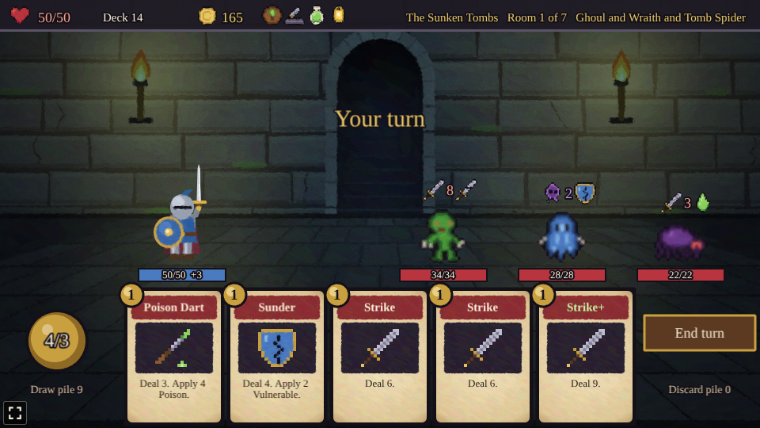

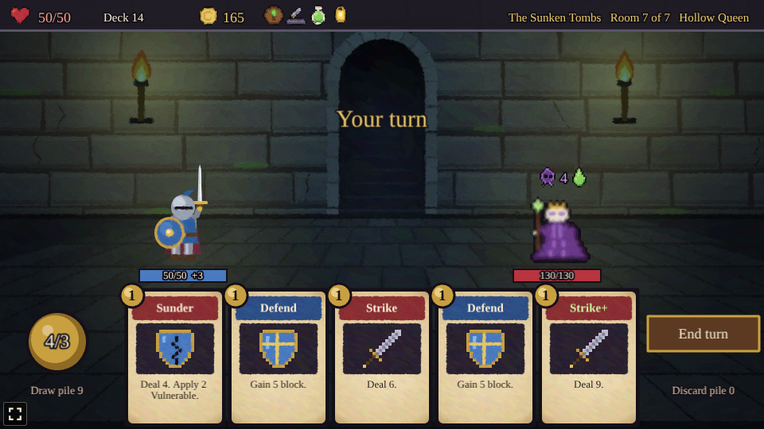

### Cards

The deck starts with five Strikes, four Defends and a Bash. Tempered at a campfire, each card
becomes its `+` version.

| Card | Cost | Effect | Tempered | Found |
| --- | --- | --- | --- | --- |
| Strike | 1 | Deal 6 | Deal 9 | Starter |
| Defend | 1 | Gain 5 block | Gain 8 block | Starter |
| Bash | 2 | Deal 10 | Deal 14 | Starter |
| Cleave | 1 | Deal 7 to all foes | Deal 10 to all | After a fight |
| Twin Strike | 1 | Deal 4 twice | Deal 6 twice | After a fight |
| Iron Wall | 2 | Gain 13 block | Gain 18 block | After a fight |
| Scout Ahead | 0 | Draw 2 | Draw 3 | After a fight |
| Shield Bash | 1 | Deal 5, gain 5 block | Deal 7, gain 7 block | After a fight |
| Heavy Blow | 2 | Deal 16 | Deal 22 | After a fight |
| Bandage | 1 | Heal 4, draw 1 | Heal 7, draw 1 | After a fight |
| Second Wind | 0 | Gain 1 energy, draw 1 | Gain 2 energy, draw 1 | After a fight |
| Hamstring | 1 | Deal 5, apply 2 Weak | Deal 7, apply 3 Weak | After a fight |
| Sunder | 1 | Deal 4, apply 2 Vulnerable | Deal 6, apply 3 Vulnerable | After a fight |
| Poison Dart | 1 | Deal 3, apply 4 Poison | Deal 3, apply 6 Poison | After a fight |
| Whirlwind | 2 | Deal 6 twice to all foes | Deal 8 twice to all | Rare |
| Fireball | 2 | Deal 15 to all foes | Deal 20 to all | Rare |
| Leech | 2 | Deal 12, heal 6 | Deal 15, heal 8 | Rare |
| Fortress | 1 | Gain 12 block, draw 1 | Costs 0 | Rare |
| Toxic Cloud | 2 | Apply 5 Poison to all foes | Apply 8 Poison to all | Rare |
| War Cry | 1 | Apply 2 Weak and 2 Vulnerable to all foes | Costs 0 | Rare |

Rare cards come from treasure chests, elites, the merchant and the altar.

### Relics

| Relic | Effect |
| --- | --- |
| Oak Ward | Start each turn with 3 block |
| Whetstone | Your attacks deal 2 more damage per hit |
| Ember Lantern | Gain 1 more energy on the first turn of each fight |
| Mending Moss | Heal 5 after each fight you win |
| Golden Idol | Fights drop half as much gold again |
| Bone Charm | Every foe starts each fight with 2 Vulnerable |
| Venom Gland | Poison you apply is 2 higher |


The difficulty, set on the hub page's Settings, changes one thing: foes have 25% less health on Easy and 30% more on Hard.

## Running locally

`npm run dev` at the repo root, then open `/games/catacomb/` (or pick Catacomb on the hub page).

## Playthrough test

`e2e/playthrough.spec.ts` plays the first room in headless Chromium: it checks the new run (full
health and the starter deck), taps the first room on the map, checks the fight starts with a hand
of five and three energy, then plays cards by tapping them (attacks first, then defends) and ends
turns until the slime falls, checking each card's cost and effect, that the slime opens with its
first move and never repeats a move twice in a row, and each of its turns against its intent. Then it checks the slime's 12 gold was picked up, takes the first reward card and checks it joined the deck and the next
rooms opened. Like the other games' tests it owns the game clock and plays at 4x speed
(`PLAYTHROUGH_SPEED`). The **Playthrough Catacomb** workflow (`.github/workflows/playthrough.yml`)
runs it on every pull request that touches this folder or that workflow (not on pushes to main), and uploads
the video and screenshots as the `playthrough-catacomb` artifact.

```sh
npx playwright test --project catacomb
```

## Code layout

All paths are inside `games/catacomb/`.

- `src/game/`: the rules in plain TypeScript with no Phaser dependency. `cards.ts` and `enemies.ts`
  are data tables (the cards, the foes and their moves), `map.ts` lays out a new Crypt for each run,
  `relics.ts` and `events.ts` are the relics and mystery rooms, `state.ts` describes a run, and
  `sim.ts` moves it on: walking the map, playing cards, statuses, the foes' turn, the campfire, the
  merchant, mystery rooms, rewards and the descent to the second act. Randomness (the maps,
  shuffles, rewards, wares, relics, foes' next moves) goes through `Math.random`.
- `src/scenes/`: `BootScene` bakes textures, `GameScene` draws the map, the fights, the merchant and the panels
  and wires taps to the rules, `layout.ts` says where things are drawn.
- `src/art/`: all the art, drawn in code and baked into textures at startup, then repainted with
  brush strokes by `paint.ts`: the knight and the foes, the crypt and the map, the parchment card
  faces, and the icons for cards, intents, statuses, relics, gold and rooms.
- `src/ui/`: the card faces and buttons.

Adding a card is an entry in `src/game/cards.ts` (and, for a new kind of effect, `playCard` in
`src/game/sim.ts`); adding a foe is an entry in `src/game/enemies.ts` and its art in
`src/art/characters.ts`.
