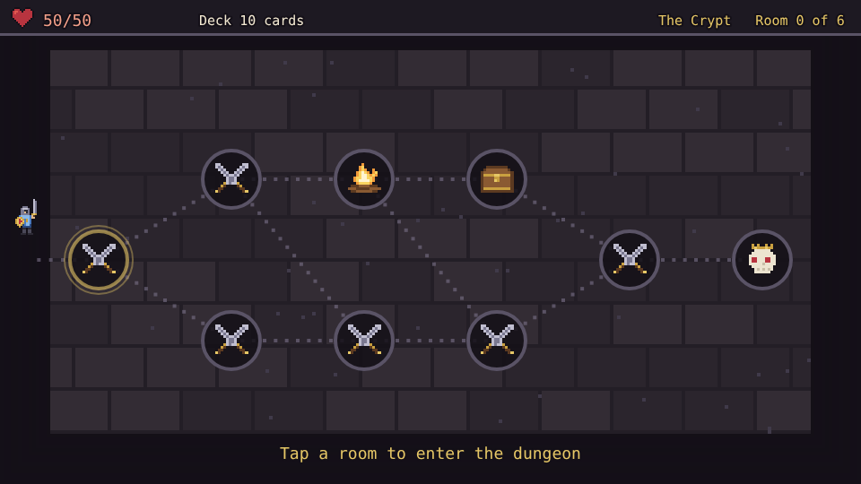
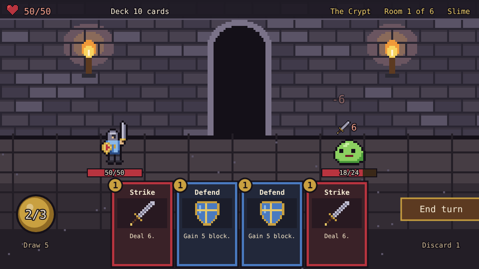
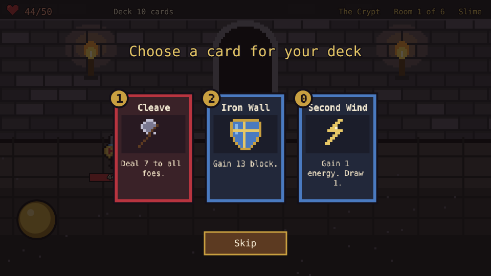
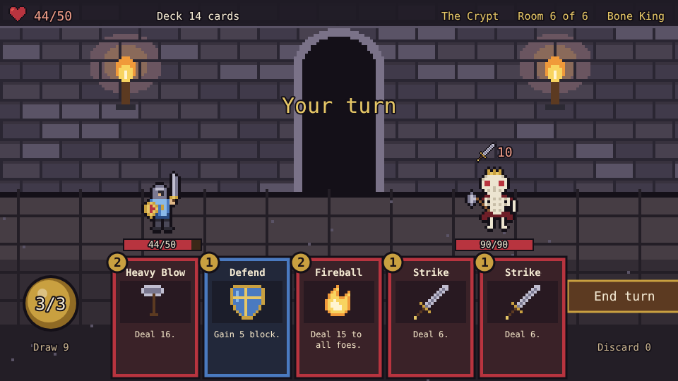
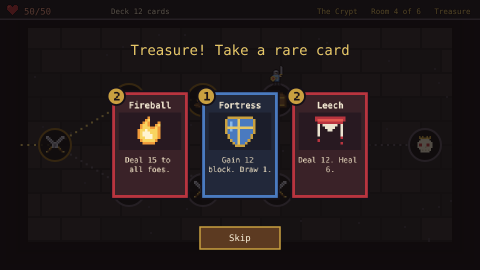
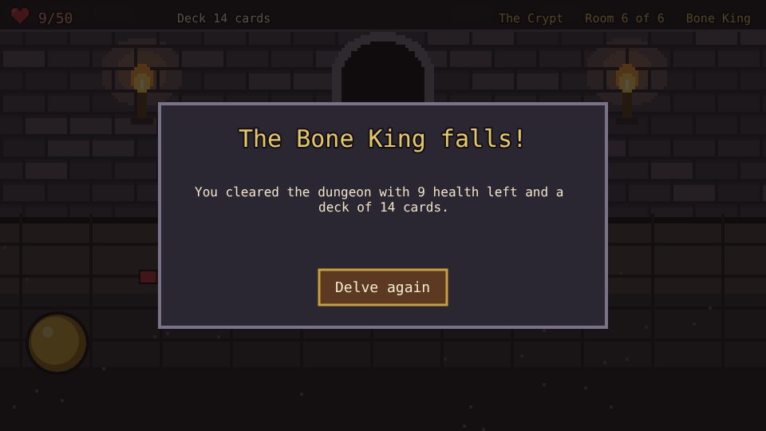

# Catacomb

A dungeon deckbuilder prototype built with [Phaser 4](https://phaser.io), TypeScript and Vite, part
of the [game hub](../../README.md).

A knight walks a short dungeon, the Crypt, from the entrance on the left to the Bone King on the
right. Each room on the way is a fight, a campfire or a treasure chest, and the paths fork, so the
route is the player's to pick. Fights are played with a deck of cards: a hand of five each turn,
three energy to spend on them, and foes who show what they will do on their next turn. Every fight
won adds a new card to the deck.



## How to play

| Control | Action |
| --- | --- |
| Tap a lit room | Walk there and go in |
| Tap a card in hand | Play it, if there is energy for it |
| End turn | Discard the hand and let the foes act |
| Tap a reward card | Add it to the deck (or Skip to take none) |

1. **The map**: rooms are in six columns, and from each room the dotted paths lead on to one or
   two rooms in the next. The rooms that can be entered next are lit gold.
2. **Turns**: each turn the hero draws five cards and has three energy. A card's cost is in its
   corner. Attacks (red) hit the foe in front, or every foe; skills (blue) give block, health,
   energy or more cards. When the draw pile runs out, the discard pile is shuffled into it.
3. **Block** soaks up damage until the start of the hero's next turn. Health carries over from
   room to room, and the run is over when it reaches zero.
4. **Intents**: a sword over a foe is the damage it will deal on its turn, a shield the block it
   will gain, and an arrow that it grows stronger, adding to every hit after.
5. **Rewards**: after each fight, pick one of three cards to add to the deck. A treasure chest
   offers three rare cards; a campfire heals 30% of the hero's health.
6. **The Bone King** waits in the last room. Beat him to clear the dungeon.





### Foes

| Foe | Health | What it does, in turn |
| --- | --- | --- |
| Slime | 24 | Attack 6, block 5, attack 8 |
| Giant Rat | 13 | Attack 3 twice, attack 5 |
| Skeleton | 30 | Block 6, attack 9, attack 4 twice |
| Cultist | 26 | Grow 2 stronger, attack 6, attack 6 |
| Bone King | 90 | Attack 10, block 12, attack 4 three times, grow 3 stronger |



### Cards

The deck starts with five Strikes, four Defends and a Bash.

| Card | Cost | Effect | Found |
| --- | --- | --- | --- |
| Strike | 1 | Deal 6 | Starter |
| Defend | 1 | Gain 5 block | Starter |
| Bash | 2 | Deal 10 | Starter |
| Cleave | 1 | Deal 7 to all foes | After a fight |
| Twin Strike | 1 | Deal 4 twice | After a fight |
| Iron Wall | 2 | Gain 13 block | After a fight |
| Scout Ahead | 0 | Draw 2 | After a fight |
| Shield Bash | 1 | Deal 5, gain 5 block | After a fight |
| Heavy Blow | 2 | Deal 16 | After a fight |
| Bandage | 1 | Heal 4, draw 1 | After a fight |
| Second Wind | 0 | Gain 1 energy, draw 1 | After a fight |
| Whirlwind | 2 | Deal 6 twice to all foes | Treasure |
| Fireball | 2 | Deal 15 to all foes | Treasure |
| Leech | 2 | Deal 12, heal 6 | Treasure |
| Fortress | 1 | Gain 12 block, draw 1 | Treasure |





The difficulty, set on the hub page's Settings, changes one thing: foes have 25% less health on Easy and 30% more on Hard.

## Running locally

`npm run dev` at the repo root, then open `/games/catacomb/` (or pick Catacomb on the hub page).

## Playthrough test

`e2e/playthrough.spec.ts` plays the first room in headless Chromium: it checks the new run (full
health and the starter deck), taps the first room on the map, checks the fight starts with a hand
of five and three energy, then plays cards by tapping them (attacks first, then defends) and ends
turns until the slime falls, checking each card's cost and effect and each of the slime's turns
against its intent. Then it takes the first reward card and checks it joined the deck and the next
rooms opened. Like the other games' tests it owns the game clock and plays at 4x speed
(`PLAYTHROUGH_SPEED`). The **Playthrough Catacomb** workflow (`.github/workflows/playthrough-catacomb.yml`)
runs it on every PR and push to main that touches this folder or a shared build file, and uploads
the video and screenshots as the `playthrough-catacomb` artifact.

```sh
npx playwright test --project catacomb
```

## Code layout

All paths are inside `games/catacomb/`.

- `src/game/`: the rules in plain TypeScript with no Phaser dependency. `cards.ts`, `enemies.ts`
  and `map.ts` are data tables (the cards, the foes and their intent patterns, the rooms and their
  paths), `state.ts` describes a run, and `sim.ts` moves it on: walking the map, playing cards, the
  foes' turn and the rewards. Randomness (shuffles, rewards) goes through `Math.random`.
- `src/scenes/`: `BootScene` bakes textures, `GameScene` draws the map, the fights and the panels
  and wires taps to the rules, `layout.ts` says where things are drawn.
- `src/art/`: all the pixel art, drawn in code and baked into textures at startup: the knight and
  the foes, the dungeon room and the map, and the icons for cards, intents and rooms.
- `src/ui/`: the card faces and buttons.

Adding a card is an entry in `src/game/cards.ts` (and, for a new kind of effect, `playCard` in
`src/game/sim.ts`); adding a foe is an entry in `src/game/enemies.ts` and its art in
`src/art/characters.ts`.
