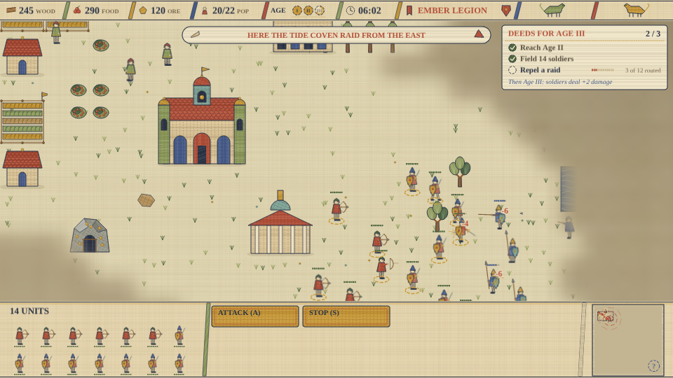
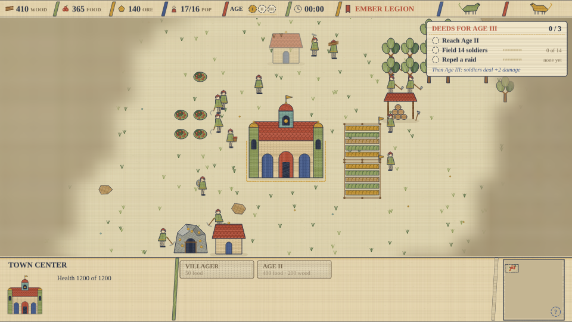
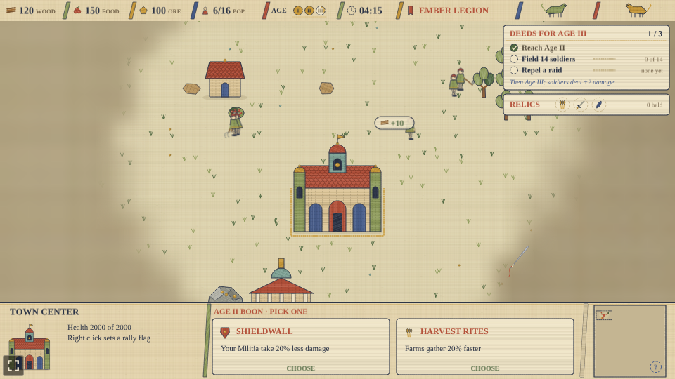

# Colonizer

A small real-time strategy prototype built with [Phaser 4](https://phaser.io), TypeScript and Vite,
part of the [game hub](../../README.md). It is a classic base-building RTS with villagers, ages and armies, and is
drawn as the Bayeux tapestry: the skirmish embroidered in eight wool colours on natural linen, every
figure in profile with a kite shield, buildings in elevation, fog as unworked linen with the needle
still at its edge, and the HUD as the tapestry's borders with slanted bars and stitched lettering.
All of it is painted in code on 2D canvases; there are no image files.

You pick one of three factions and play a skirmish on a 128 by 128 tile map against an AI opponent,
which plays the next faction along. Gather wood, food and ore, put up buildings, research techs in
the Academy and the Town Center, train villagers and armies, earn your way through three ages, and
destroy the enemy Town Center to win. Lose your own Town Center and the match is over.

## Factions

| Faction | Units |
| --- | --- |
| Ember Legion | Militia (melee), Archer (ranged), Knight (cavalry) |
| Tide Coven | Spearman (melee, strong against cavalry), Slinger (ranged), Rider (cavalry) |
| Thorn Grove | Brute (tough melee), Hunter (long-range), Stalker (fast cavalry) |

Every faction has the same buildings and the same villagers.

## How to play

| Control | Action |
| --- | --- |
| Left click | Select one unit or building; hold and drag to box-select units; Shift adds to the selection |
| Right click | Attack an enemy, gather from a tree, bush or mine, finish a building, or walk |
| A, then left click | Attack-move: the army walks and fights whatever it meets on the way |
| S | Stop the selected units |
| B | Open the build list for the selected villagers, then click a spot to place it |
| 1 to 9 | Select a control group; Ctrl with a number saves the selection to it |
| Arrow keys, or the screen edge | Scroll the map |
| Click the minimap | Look at that part of the map |
| Click the horn toast | Look at the raid it names |
| Esc | Cancel placing a building or attack-moving |
| Bottom panel | Train units, research techs and advance the ages from the buttons |

Villagers gather on their own once they have a node to work, and go back to a node of the same kind
when one runs out. Buildings need a builder to finish them, and a builder goes on to gather once
the building is done. Every unit is animated in a few embroidered frames: villagers chop with an
axe, reap with a sickle, mine with a pick, hammer at a building and carry their load home; soldiers
walk (riders gallop), swing a sword or club, thrust a spear, draw and loose a bow, whirl a sling or
charge with a lowered lance.

## The three ages

- **Age I** is where every match starts.
- **Age II** is researched at the Town Center (400 food, 200 wood). It unlocks Stirrups and Bodkin
  at the Academy (Stirrups makes cavalry 20% faster), and offers the **Age II boon**: a one-time pick between two cards in the panel,
  which stand in for the panel's buttons until you choose.
  - **Shieldwall**: your melee infantry (Militia, Spearmen or Brutes) take 20% less damage.
  - **Harvest Rites**: farms gather 20% faster.
- **Age III** is earned, not only bought. The **deeds card** under the top bar lists three deeds:
  reach Age II, field 14 soldiers at once, and repel a raid (kill every raider the enemy sent). Once
  all three are done, the Town Center can research Age III (500 food, 300 wood, 200 ore), and every
  soldier then deals 2 more damage.

The top bar's age track has a pip for each age; the next pip fills as its deeds are done.

## Raids

When the enemy sends its army at your Town Center, a horn sounds: a toast under the top bar names
the raid and the side it comes from, with an arrow pointing towards it, and the minimap pulses rings
of red running stitch where the raiders are until the last of them falls. The deeds card counts
how many have been routed. In a fight, every blow throws ochre sparks and a damage number, and
arrows fly from the bows; every load a villager drops off pops a "+10" badge with its icon.

## Economy and population

- Wood comes from trees, food from berry bushes and farms, and ore from gold mines.
- Villagers carry ten at a time to the Town Center, or to a Lumber or Mining Camp for wood and ore.
- A house adds population; the Town Center adds ten. Units in training count against the cap.

## Difficulty

| Easy | Normal | Hard |
| --- | --- | --- |
| The AI gathers 25% slower | The game as designed | The AI gathers 25% faster |

The hub's difficulty setting changes only how fast the AI gathers. Normal is the game as designed.
With the hub's Reduce motion setting on, every unit holds one still frame for what it is doing,
sparks and arrows in flight are left out, damage numbers and badges fade without rising, and the
minimap's raid rings stand still.

## Notes

- There is no save yet: each match starts fresh.
- Units can walk over each other.
- The map is the same for a given seed, and the seed is fixed in the playthrough test.
- The AI picks Shieldwall when it reaches Age II, and researches Age III once it has the three deeds.
- The AI plays at a human pace: about 30 commands a minute, so it can leave villagers idle too.
- The Town Center and Watchtowers shoot hard enough to hold off a small raid on their own; a
  Watchtower costs 125 wood and 50 ore.
