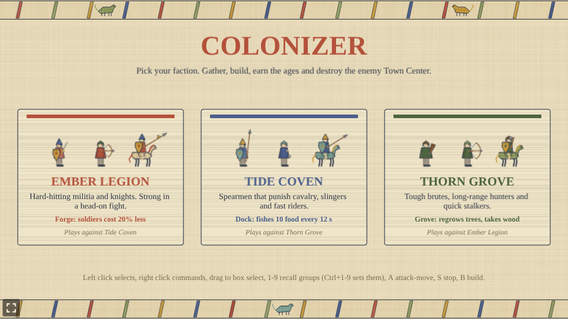
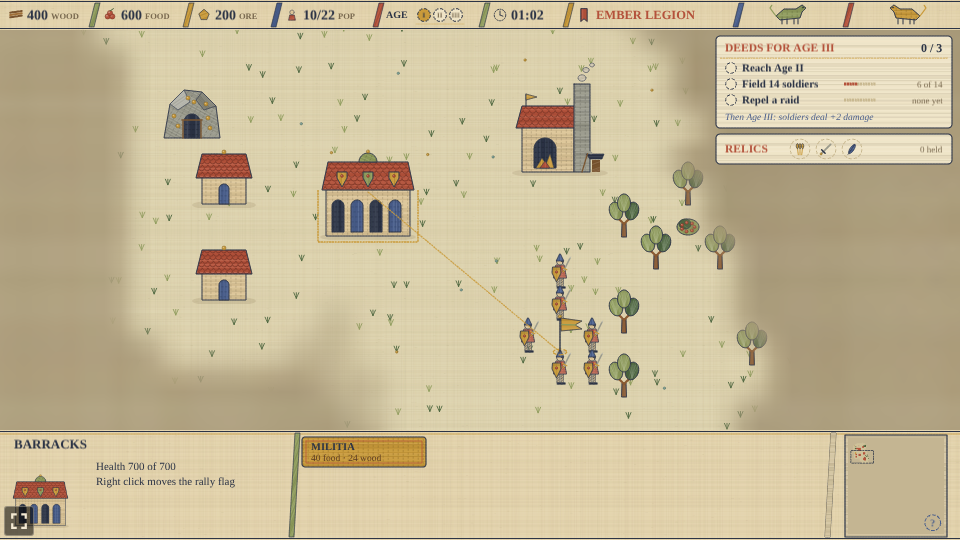
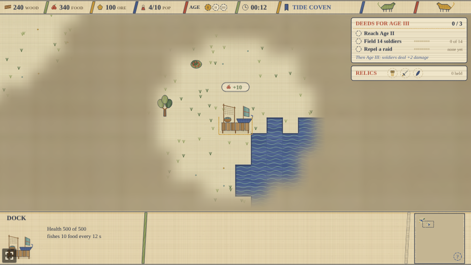
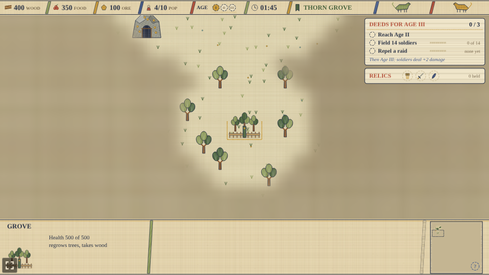
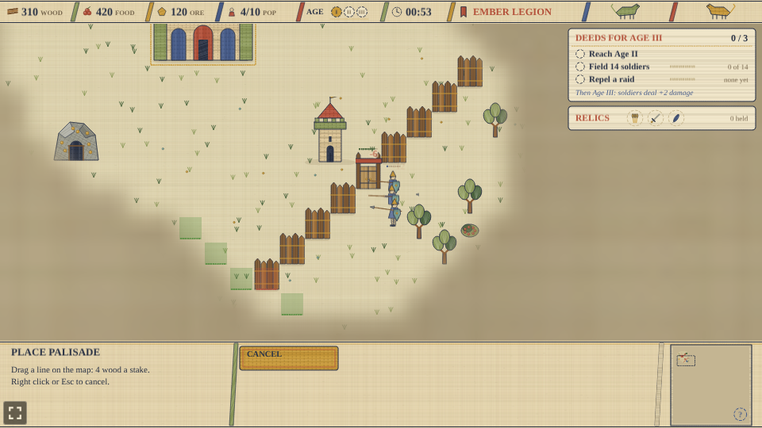
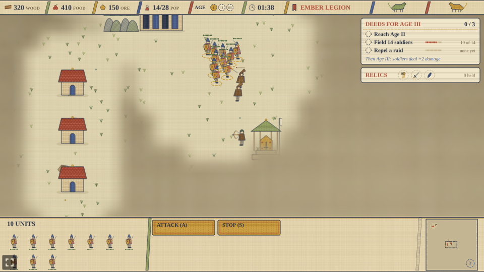
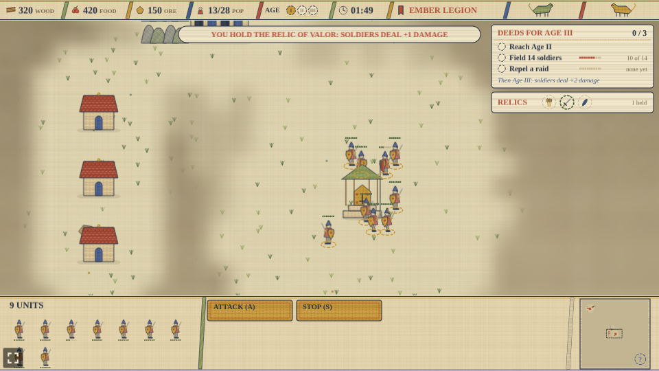
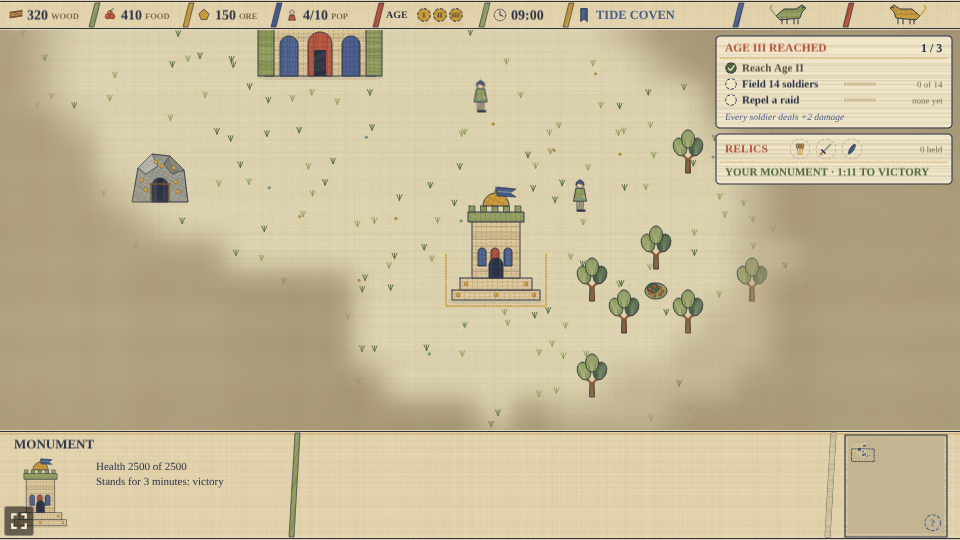
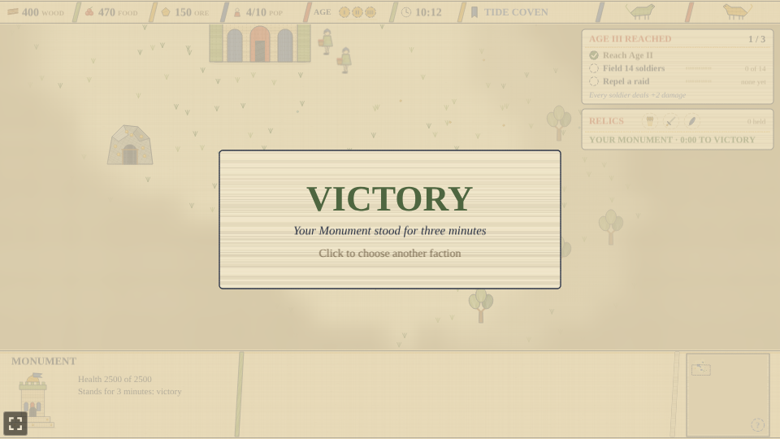
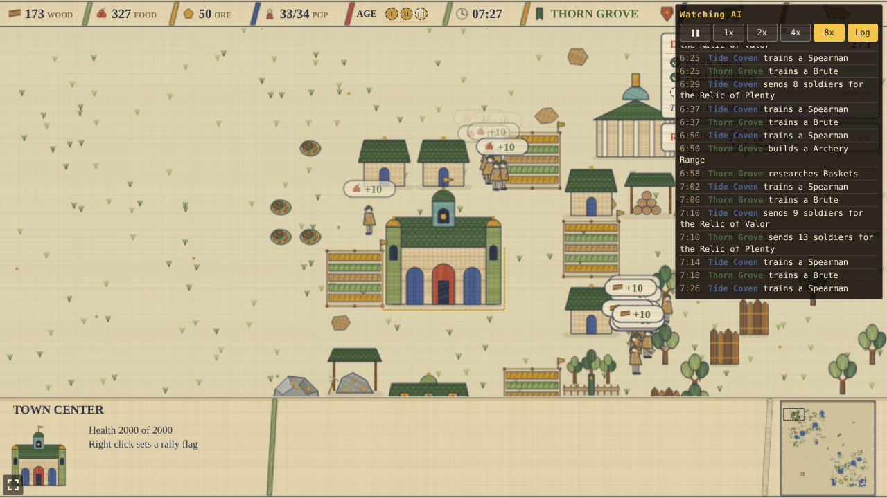

# Colonizer

A small real-time strategy prototype built with [Phaser 4](https://phaser.io), TypeScript and Vite,
part of the [game hub](../../README.md). It is a classic base-building RTS with villagers, ages and armies, and is
drawn as the Bayeux tapestry: the skirmish embroidered in eight wool colours on natural linen, every
figure in profile with a kite shield, buildings in elevation, fog as unworked linen with the needle
still at its edge, and the HUD as the tapestry's borders with slanted bars and stitched lettering.
All of it is painted in code on 2D canvases; there are no image files.

You pick one of three factions and play a skirmish on a 128 by 128 tile map against an AI opponent,
which plays the next faction along. Gather wood, food and ore, put up buildings, research techs in
the Academy and the Town Center, train villagers and armies, earn your way through three ages, and
destroy the enemy Town Center to win, or raise a Monument in Age III and hold it for three minutes.
Lose your own Town Center, or let the enemy's Monument stand, and the match is over.

## Factions

| Faction | Units | Own building |
| --- | --- | --- |
| Ember Legion | Militia (melee), Archer (ranged), Knight (cavalry) | **Forge** (150 wood, 50 ore, one only): every soldier costs 20% less |
| Tide Coven | Spearman (melee, strong against cavalry), Slinger (ranged), Rider (cavalry) | **Dock** (140 wood, up to three): stands on a shore and lands 10 food every 12 s |
| Thorn Grove | Brute (tough melee), Hunter (long-range), Stalker (fast cavalry) | **Grove** (100 wood, 50 food, up to two): plants a tree nearby every 15 s, up to 14 around it, and takes wood like a Lumber Camp |

Every faction has the same villagers and the same other buildings. The faction's own building is
the last one on the first page of the build list.

## How to play

| Control | Action |
| --- | --- |
| Left click | Select one unit or building; hold and drag to box-select units; Shift adds to the selection |
| Right click | Attack an enemy, gather from a tree, bush or mine, finish a building, walk, or go to a camp |
| Right click, with a production building selected | Plant its rally flag: new units walk there (on a tree, bush, mine or farm, new villagers gather it) |
| A, then left click | Attack-move: the army walks and fights whatever it meets on the way |
| S | Stop the selected units |
| B | Open the build list for the selected villagers, then click a spot to place it (drag a line for a palisade) |
| 1 to 9 | Select a control group; Ctrl with a number saves the selection to it |
| Arrow keys, or the screen edge | Scroll the map |
| Click the minimap | Look at that part of the map |
| Click the horn toast | Look at the raid it names |
| Click a camp | Say what it holds and who has it |
| Esc | Cancel placing a building or attack-moving |
| Bottom panel | Train units, research techs and advance the ages from the buttons |

Villagers gather on their own once they have a node to work, and go back to a node of the same kind
when one runs out. Buildings need a builder to finish them, and a builder goes on to gather once
the building is done. Every unit is animated in a few embroidered frames: villagers chop with an
axe, reap with a sickle, mine with a pick, hammer at a building and carry their load home; soldiers
walk (riders gallop), swing a sword or club, thrust a spear, draw and loose a bow, whirl a sling or
charge with a lowered lance.

## The three ages

- **Age I** is where every match starts.
- **Age II** is researched at the Town Center (400 food, 200 wood). It unlocks Stirrups and Bodkin
  at the Academy (Stirrups makes cavalry 20% faster), and offers the **Age II boon**: a one-time pick between two cards in the panel,
  which stand in for the panel's buttons until you choose.
  - **Shieldwall**: your melee infantry (Militia, Spearmen or Brutes) take 20% less damage.
  - **Harvest Rites**: farms gather 20% faster.
- **Age III** is earned, not only bought. The **deeds card** under the top bar lists three deeds:
  reach Age II, field 14 soldiers at once, and repel a raid (kill every raider the enemy sent). Once
  all three are done, the Town Center can research Age III (500 food, 300 wood, 200 ore), and every
  soldier then deals 2 more damage.

The top bar's age track has a pip for each age; the next pip fills as its deeds are done.

## Raids

When the enemy sends its army at your Town Center, a horn sounds: a toast under the top bar names
the raid and the side it comes from, with an arrow pointing towards it, and the minimap pulses rings
of red running stitch where the raiders are until the last of them falls. The deeds card counts
how many have been routed. In a fight, every blow throws ochre sparks and a damage number, and
arrows fly from the bows; every load a villager drops off pops a "+10" badge with its icon.

## Rally flags and spacing

Select a Town Center, Barracks, Archery Range or Stable and right click the map to plant its rally
flag: an ochre pennant with a running thread back to the building, shown while it is selected. New
soldiers walk to the flag and stand round it; a villager whose flag is on a tree, bush, mine or farm
goes straight to work there. Units no longer stack on one spot: they push gently apart until each
has room, so a group spreads out where it stops (villagers at work hold their place).

## Walls and gates

The build list's second page (**Walls & Monument**) has the **Palisade** (4 wood a stake) and the
**Gate** (25 wood). Drag a line on the map to lay a palisade, up to 40 stakes; the selected villagers
start on it and each goes on to the next unfinished piece nearby. A diagonal line has no gaps. A gate
goes in a gap or straight onto one of your own stakes, and only your units walk through it. Soldiers
and towers never pick walls as targets on their own, but an army with no way round breaks through the
nearest stake or gate. The AI lays a short palisade with a gate across the front of its base once it
reaches Age II.

## Neutral camps and relics

Seven camps sit in cleared patches on every map, guarded by wild Brigands and Poachers who fight
anyone who comes near and never stray far from their post:

- Four **caches**, a cart of 250 ore and a cart of 300 food near each side. Kill the guards and stand
  someone by the cart, and the pile is yours (it is gone for the other side).
- Three **relics**, each in a little gilded shrine. The **Relic of Valor** stands in the middle of
  the map (soldiers deal 1 more damage), the **Relic of Plenty** and the **Relic of Haste** on the two
  flanks (villagers gather 10% faster; every unit moves 10% faster). Once the guards are dead, a side
  with units at the shrine, and none of the other side's, holds the relic and its banner flies their
  colour; the other side takes it the same way.

Right click a camp to send the selection to stand round it. The **relics card** under the deeds card
shows each relic with a green ring when you hold it and the enemy's colour when they do. The AI sends
its army to take relics between raids.

## The Monument

In Age III the build list's second page offers the **Monument** (500 wood, 300 food, 400 ore, one
only, 90 s to build). Once it is finished it counts down three minutes on the relics card; if it is
still standing at the end, its owner wins. Everyone sees a Monument from the moment it is begun, the
match says so when one is finished, and the AI throws everything it has at yours. The AI builds one
too once it reaches Age III.

## Economy and population

- Wood comes from trees, food from berry bushes and farms, and ore from gold mines. The Tide Coven's
  Dock adds food on its own, and the Thorn Grove's Grove grows new trees.
- Villagers carry ten at a time to the Town Center, or to a Lumber or Mining Camp for wood and ore.
- A house adds population; the Town Center adds ten. Units in training count against the cap.

## Difficulty

| Easy | Normal | Hard |
| --- | --- | --- |
| The AI gathers 25% slower | The game as designed | The AI gathers 25% faster |

The hub's difficulty setting changes only how fast the AI gathers. Normal is the game as designed.
With the hub's Reduce motion setting on, every unit holds one still frame for what it is doing,
sparks and arrows in flight are left out, damage numbers and badges fade without rising, and the
minimap's raid rings stand still.

## Watch AI

Add `?watch` to the game's URL (`/games/colonizer/?watch`) to skip the menu and start a
match between two random factions, both played by the AI, with the whole map in view. Scroll with the
arrow keys or the minimap and click a unit to see what it is doing. The panel in the top right
pauses (**P**), sets the speed from 1x to 8x (**[** and **]**) and opens a log of every build,
unit, tech, attack and relic run (**L**). A click on the end screen starts another match.

## Notes

- There is no save yet: each match starts fresh.
- The map is the same for a given seed, and the seed is fixed in the playthrough test.
- The AI picks Shieldwall when it reaches Age II, and researches Age III once it has the three deeds.
- The AI builds its faction's own building early, sets a rally flag in front of its base for each
  production building, and walls off the front of its base in Age II.
- The AI plays at a human pace: about 30 commands a minute, so it can leave villagers idle too.
- The Town Center and Watchtowers shoot hard enough to hold off a small raid on their own; a
  Watchtower costs 125 wood and 50 ore.
