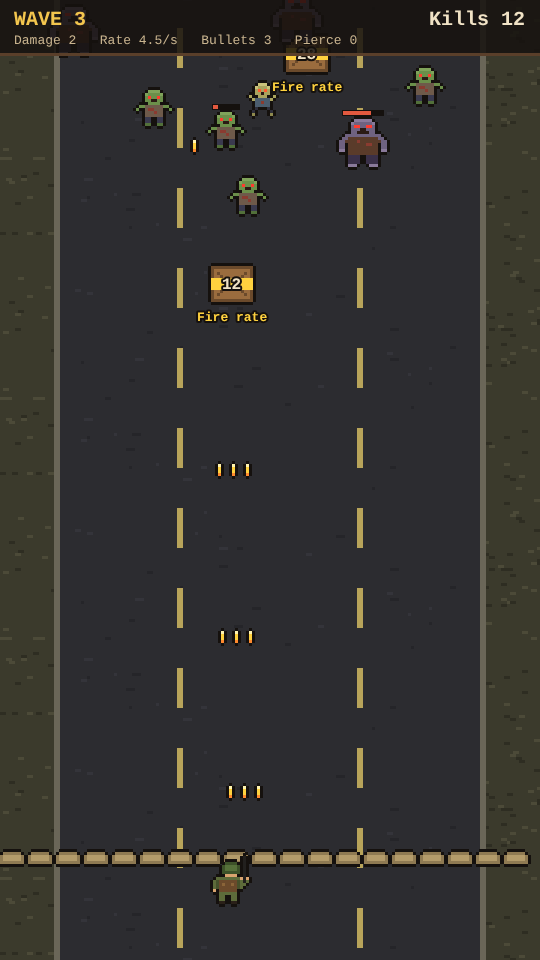
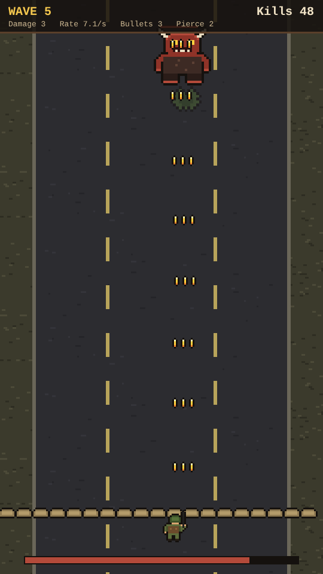

# Deadline

A wave defense prototype built with [Phaser 4](https://phaser.io), TypeScript and Vite, part of the
[game hub](../../README.md). It plays on an upright, phone-shaped screen.

A lone soldier holds the bottom of a ruined road while hordes of zombies come down it. The soldier
fires on their own; you only move them left and right. Upgrade crates come down among the zombies:
shoot one open to collect its upgrade. There is no XP and no levelling: every upgrade comes from a
crate. The waves keep getting bigger and tougher, and every fifth wave ends with a boss. If a zombie
reaches the sandbags in front of the soldier, it's game over.

## How to play

| Control | Action |
| --- | --- |
| Tap or drag anywhere | Move the soldier left or right, to below that spot |
| A / D or arrow keys | Move left or right |
| Tap after game over | Start again from wave 1 |

- **Shooting** is automatic: a volley goes straight up from the soldier's rifle every so often.
  Stand below what you want to hit.
- **Zombies** walk down the road and veer towards the soldier. Grunts come first; runners (fast,
  weak) join from wave 2 and brutes (slow, tough) from wave 3. A wave is cleared once all of its
  zombies are down, and the next one comes after a short pause.
- **Crates** drift down slower than the horde and show how many hits they still take. Opening one
  gives its upgrade:

  | Crate | Upgrade |
  | --- | --- |
  | Fire rate (yellow) | 20% less time between volleys |
  | Damage +1 (red) | Each bullet takes one more hit point |
  | Bullets +1 (blue) | One more bullet in each volley, side by side |
  | Pierce +1 (green) | Bullets go through one more zombie |

  A crate nobody opens is lost behind the sandbags.
- **Bosses** come at the end of every fifth wave, with a big health bar along the bottom of the
  screen.

The difficulty, set on the hub page's Settings, changes one thing: zombies have 25% less health on Easy and 30% more on Hard.

## Code layout

- `src/game/rules.ts`: the numbers and rules: enemy stats, upgrades, wave plans. No drawing.
- `src/game/pool.ts`: reuses sprites for enemies, bullets, crates and splats, so a big horde doesn't
  create and destroy objects every frame.
- `src/art/sprites.ts`: the placeholder pixel art, baked into textures at startup.
- `src/scenes/GameScene.ts`: the battle: moving the soldier, spawning, shooting, hits, waves, the
  HUD and game over.
- `e2e/playthrough.spec.ts`: plays the first wave with taps, collecting its crate (see `AGENTS.md`
  at the repo root).
