# Deadline

A wave defense prototype built with [Phaser 4](https://phaser.io), TypeScript and Vite, part of the
[game hub](../../README.md). It plays on an upright, phone-shaped screen.

A lone soldier holds the bottom of a ruined road while hordes of zombies come down it. The soldier
fires on their own; you only move them left and right. Upgrade crates come down among the zombies:
shoot one open to collect its upgrade. Fuel drums roll down too: shoot one and it blows up the
zombies around it. Kills in quick succession build a frenzy that doubles your fire rate. There is no
XP and no levelling: every upgrade comes from a crate. The waves keep getting bigger and tougher,
and every fifth wave ends with a boss that fights back and leaves a supply drop behind; from wave
20 that drop also offers a way out. If a zombie
reaches the sandbags in front of the soldier, it's game over. Your best wave is kept, so every run
has a record to beat, and every kill banks scrap that buys a head start for the next run and
lasting upgrades for your outpost. Instead of the endless road, a run can also be a 10-wave
operation with its own rules and medals.

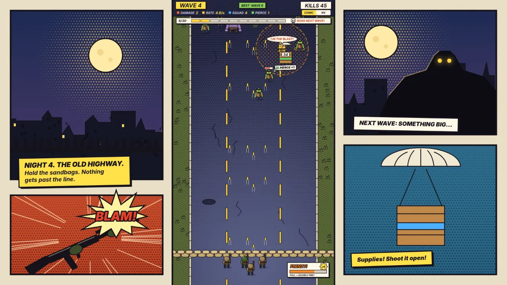

## Two art styles

The game can be drawn in two styles. Switch between them at any time with the **COMIC | NV**
switch at the right of the top bar (or the **V** key). The game remembers your choice.

- **Pulp horror comic** (the default): inked outlines, flat colours and halftone dots, lettered
  BLAM!, SPLUT! and KA-BOOM! sound effects, and the HUD in caption boxes. On a screen wider than
  the game, comic panels fill the sides: the night's narration, a boss lurking in the dark (it tells
  you when "something big" is next) and the supply drops.
- **Night-vision overwatch feed**: the road as seen through a green night-vision camera, with
  bloom, grain, scanlines and glowing zombie eyes under an amber tactical overlay. Crates keep the
  colour of their chemlights. On a wide screen an overwatch console fills the sides: the feed's REC
  clock, a strip map with the horde on it, the squad roster, the supply drops and your stats.

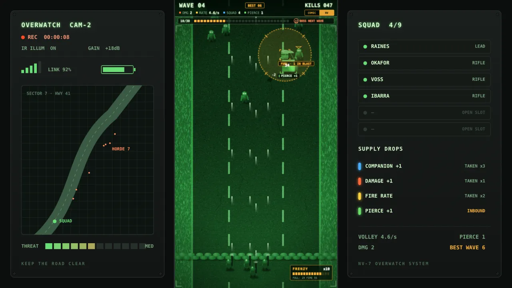

With **Reduce motion** on in the hub's Settings, the feed's grain, scanlines and flicker hold still
and the fuel drum's blast doesn't swell.

## How to play

| Control | Action |
| --- | --- |
| Tap or drag anywhere | Move the soldier left or right, to below that spot |
| A / D or arrow keys | Move left or right |
| Tap the kit panel (bottom left), then a lane | Place a sandbag wall in that lane |
| S | Place a sandbag wall in the soldier's lane |
| Tap a card, or 1 / 2 / 3 | Pick a supply after a boss, or the role of a survivor who joins |
| Tap the wide card, or 4 | Extract: end the run as a win (from wave 20) |
| Tap the COMIC / NV switch, or V | Switch the art style |
| Tap a starting crate after game over | Buy it with scrap for the next run (tap again to refund) |
| Tap an outpost upgrade after game over | Buy its next level with scrap, for good |
| Tap an operation after game over | Pick what the next run is: the Open Road or an operation |
| Tap anywhere else after game over | Start again from wave 1 |

- **Shooting** is automatic: a volley goes straight up from the soldier's rifle every so often.
  Stand below what you want to hit. Each hit shows a small damage number.
- **Zombies** walk down the road, each one keeping to the middle of its lane to go for that lane's
  sandbags; they never chase the soldier, so move under the lane that needs you. Grunts come first; runners (fast,
  weak) join from wave 2 and brutes (slow, tough) from wave 3. A wave is cleared once all of its
  zombies are down, and the next one comes after a short pause. Later waves bring three more kinds:

  | Zombie | From wave | What it does |
  | --- | --- | --- |
  | Spitter | 4 | Stops halfway down and lobs acid at the squad's line. A ring marks where it lands; step out of it. While the soldier stands in acid, the squad fires at half rate |
  | Crawler | 4 | Small and quick, in swarms of six that come in at once (one more swarm every third wave) |
  | Riot zombie | 6 | Holds a shield in front: bullets without pierce only chip it (a blue bar shows what is left). Pierce, a fuel drum or a flame goes past it, and enough chipping breaks it |

  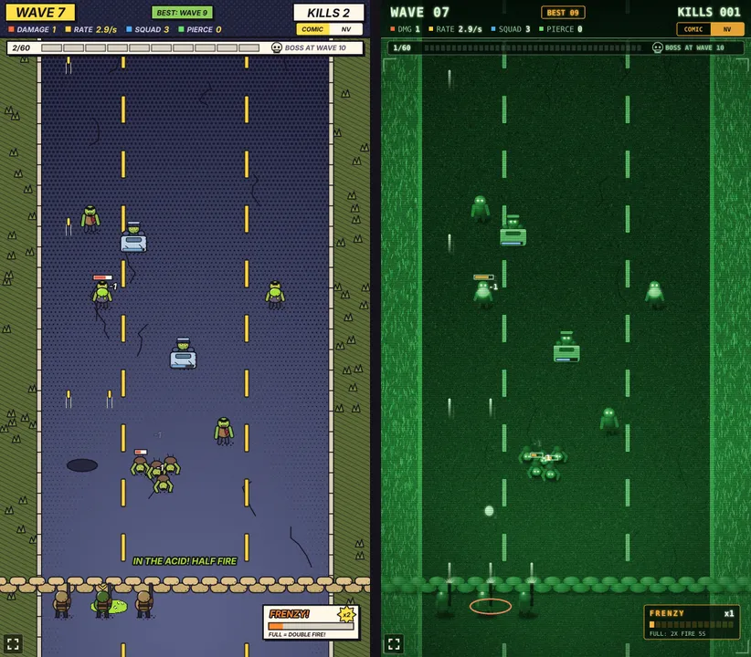
- **Wave progress**: the strip under the top bar fills as the wave's zombies fall (8/30 means 8 of
  its 30 are down). Its end says when the next boss comes, and warns "Boss next wave!" the wave
  before it. The chip in the top bar shows the best wave you have ever reached; beat it and it says
  "New best".

  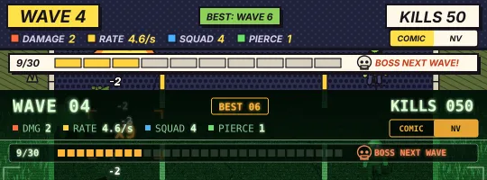
- **Crates** drift down slower than the horde and show how many hits they still take. Opening one
  gives its upgrade:

  | Crate | Upgrade |
  | --- | --- |
  | Fire rate (yellow) | 20% less time between volleys |
  | Damage +1 (orange) | Each bullet takes one more hit point |
  | Companion +1 (blue) | Another soldier joins the squad and fires with you |
  | Pierce +1 (green) | Bullets go through one more zombie |
  | Sandbag wall (tan) | A sandbag wall for the kit panel; from wave 2, about every other wave has one |

  A crate nobody opens is lost behind the sandbags.
- **Upgrade evolutions**: the third crate of one kind (starting crates count) turns its stat into
  a perk for the rest of the run, shown with a star in the top bar and listed on the kit panel.
  Fire rate becomes **fire rounds** (every hit sets the zombie burning for a couple of seconds,
  past any shield), damage becomes **headshots** (every fourth hit lands triple damage) and pierce
  becomes **ricochets** (a bullet that has spent its hits on a zombie jumps to the nearest other
  one for one more hit). Committing to one kind pays.

  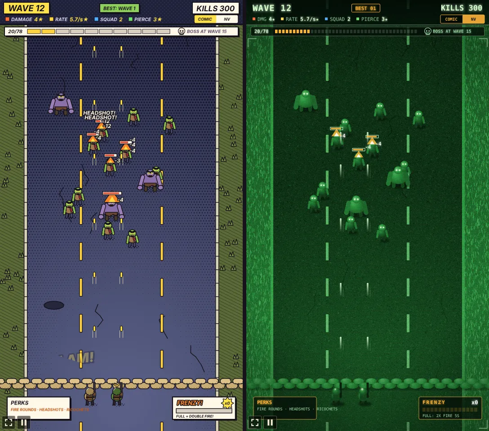
- **Survivors**: from wave 3, one walks down among the zombies each wave, waving at you. They keep
  to the seams between the lanes, out of the horde's columns, and a rifle with a survivor right in
  front holds its shot, but shotgun pellets, a marksman's aimed round and ricochets still hurt them,
  so aiming stays a choice. A survivor who
  reaches the sandbags joins the squad as a companion, or hands over 15 scrap once the squad is
  full.

  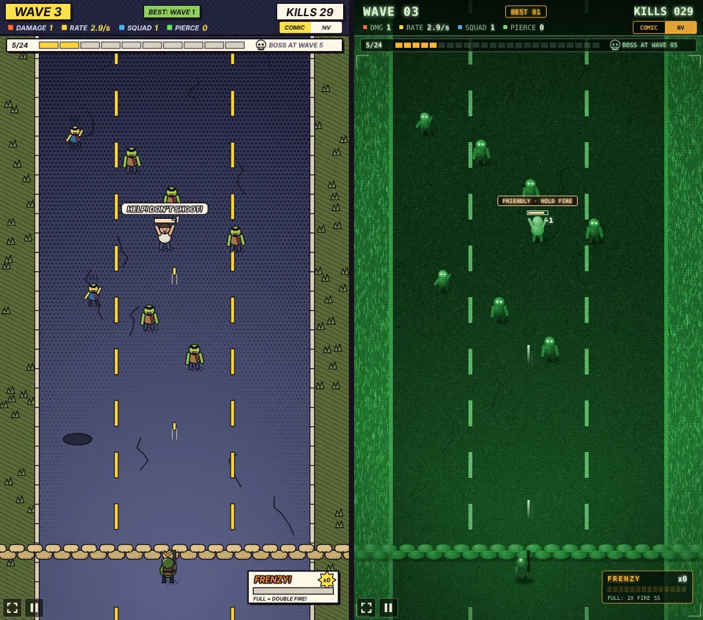
- **Squad roles**: a survivor who joins the squad stops the game to pick a role. A **Gunner**
  fires every volley like everyone else. A **Grenadier** throws a grenade every fourth volley,
  which bursts on the first zombie it hits and hurts everything round it, past riot shields. A
  **Marksman** only fires every third volley, but aims at the toughest zombie on the road and hits
  it for triple damage, going through two more zombies and any shield. A grenadier wears an
  orange badge and a marksman a purple one. Companions from crates, starting crates and the
  Veteran are Gunners.

  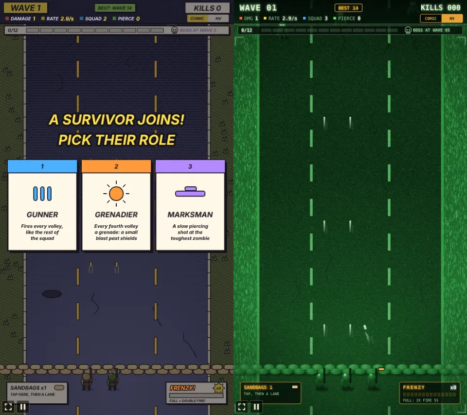
- **Wave conditions**: from wave 6, each wave may come with a condition, named in the wave banner
  and on a chip under the progress strip. A **blackout** means zombies can only be seen when they
  are close to the soldier; a **blood moon** makes the runners half again as fast; an **ammo
  shortage** slows the squad's fire by 40% but rolls two more fuel drums down the road.
- **The horde adapts**: from wave 8 the wave answers your squad's strongest stat, and every fourth
  grunt comes as its counter. Lots of pierce brings **armoured brutes** (a grey plate on the chest:
  any bullet that hits one stops there, pierce or not); a fast fire rate brings **riot shields**;
  a wide squad of four or more companions brings **flank spitters**, which keep to the road's edges.
  The banner and the chip under the progress strip say what the horde adapted to. It counts once a
  stat stands out (pierce 2, two fire rate crates, or four companions).

  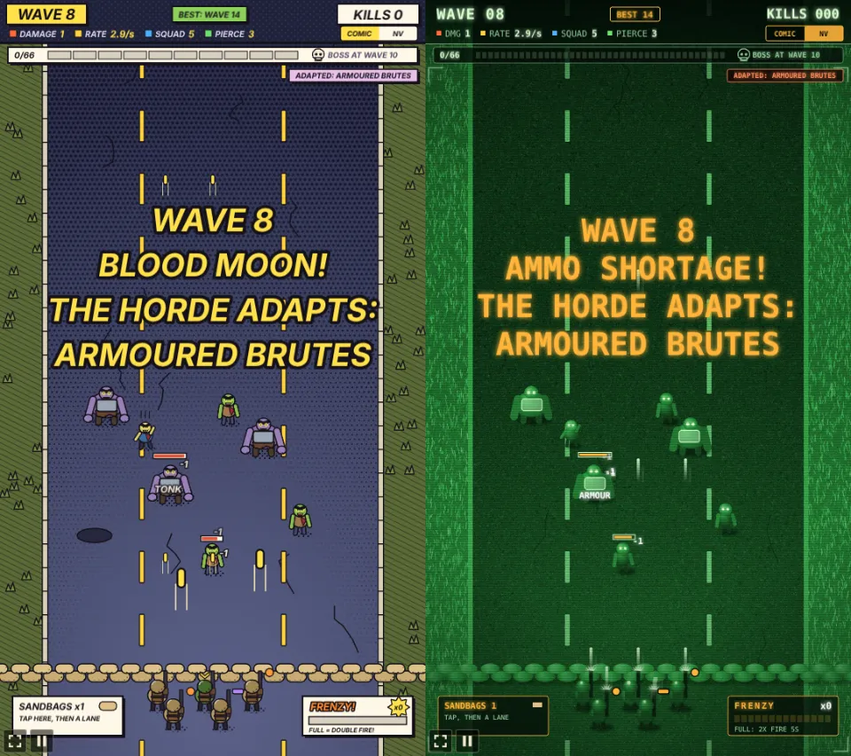

  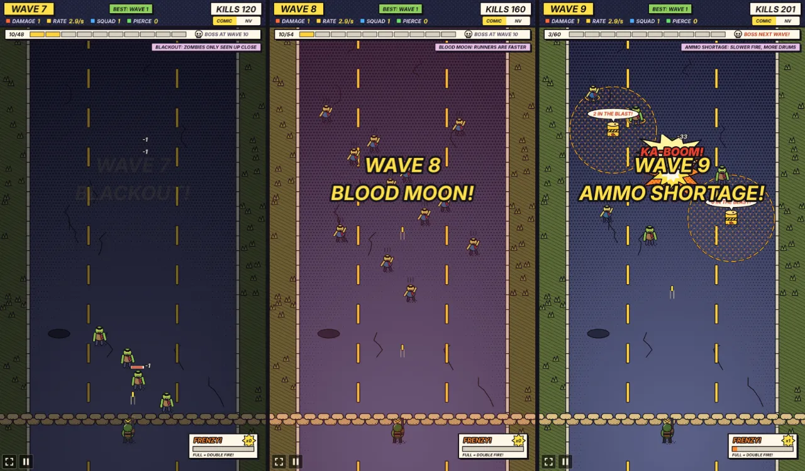
- **Sandbag walls**: tap the kit panel at the bottom left, then tap a lane on the road. A short wall
  goes up across that lane and holds its zombies back for 6 seconds (a boss smashes straight
  through). Tap the panel again, or anywhere off the road, to put the sandbags away.

  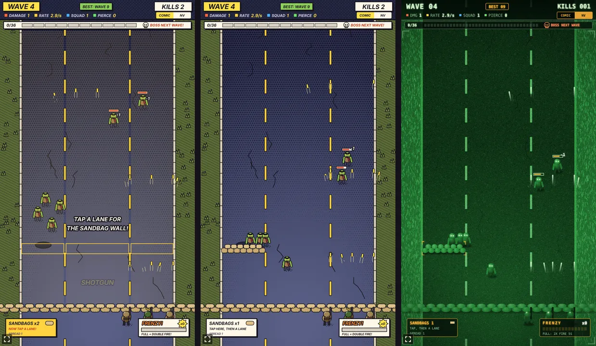
- **Fuel drums** roll down the road in every wave (one more every fourth wave), slower than the
  horde, so the zombies behind them walk through them. A dashed ring round each drum shows its blast
  radius and how many zombies it would catch right now ("2 in the blast!"). A single hit blows it
  up, and every zombie in the ring takes a heavy blow (on the first waves it kills them outright).
  Wait for the crowd to bunch up round it, then step under it. A drum nobody shoots is lost behind
  the sandbags.

  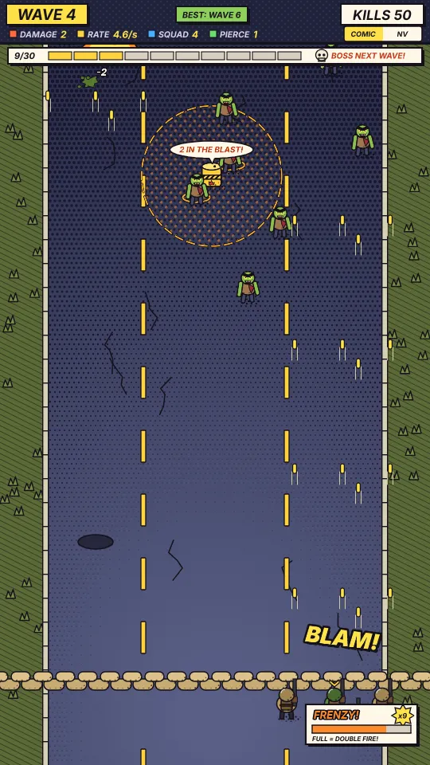
  
- **Frenzy**: every kill that comes within 1.5 seconds of the last one adds to your streak (a burst
  pops up every third kill: x3, x6, x9...). The frenzy meter beside the squad fills with it. At a
  streak of 12 the frenzy starts: for 5 seconds the whole squad fires twice as fast. A pause in the
  killing breaks the streak.

  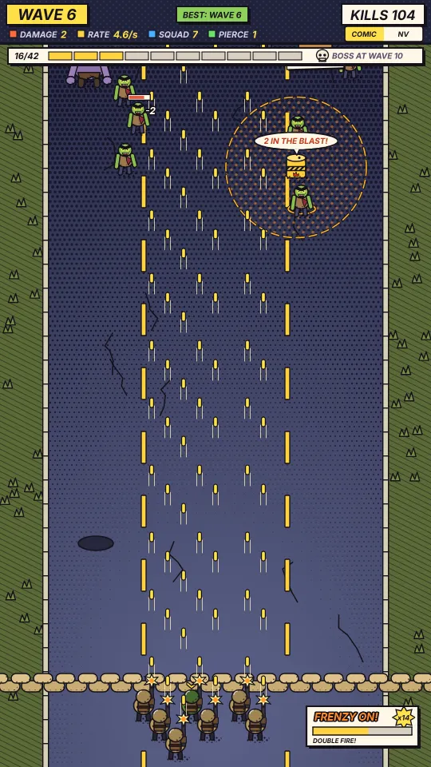
- **Companions** line up beside and behind the soldier, up to three rows of three. Each row is
  shifted a little to the side, so every rifle has its own clear line of fire. Once the squad is
  full, companion crates give Damage +1 instead.
- **Bosses** come at the end of every fifth wave, with a big health bar under the progress strip.
  A boss fights back: every few seconds it winds up a move, called out over its head, and makes it
  after a moment's warning. The **Behemoth** (wave 5) takes turns between a **charge** (an arrow
  shows the lunge across the lanes towards where the soldier stood), an **acid spit** (a big ring
  marks the pool it will leave on the squad's line) and a **roar** that calls a pack of five
  runners out round it. Three bosses take turns: the **Brood Mother** (wave 10) calls a brood of
  eight crawlers instead of runners and bursts into ten more when it falls, and the **Bloater**
  (wave 15) spits a far bigger pool and leaves a huge acid pool on the squad's line when it falls.
  Then the Behemoth again at wave 20, and so on.

  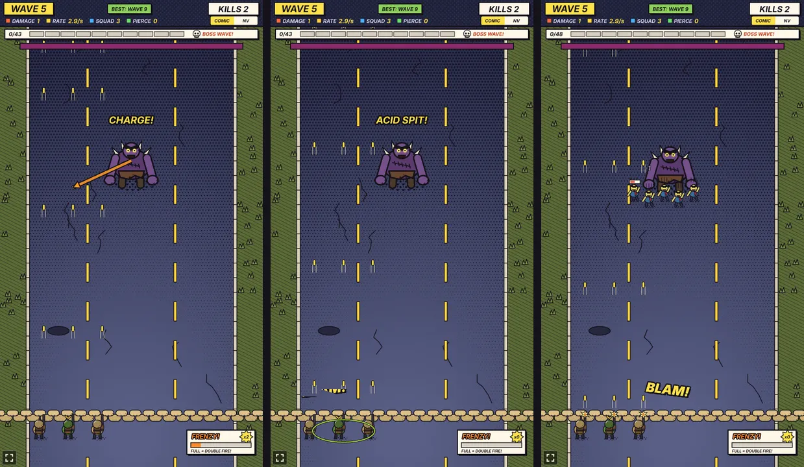
  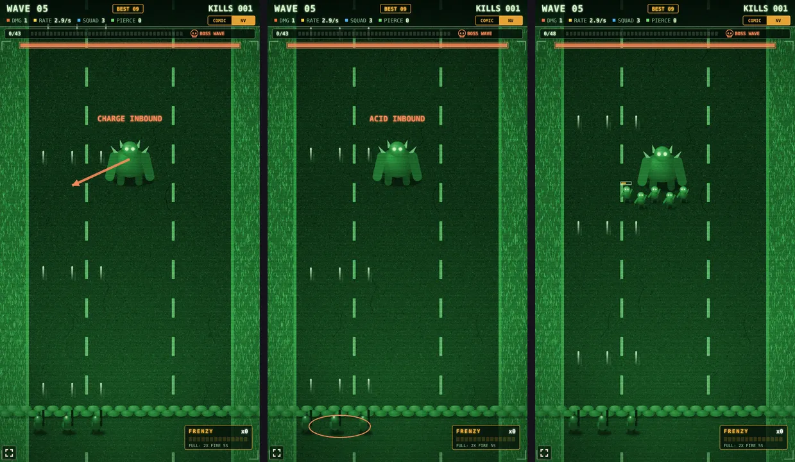
  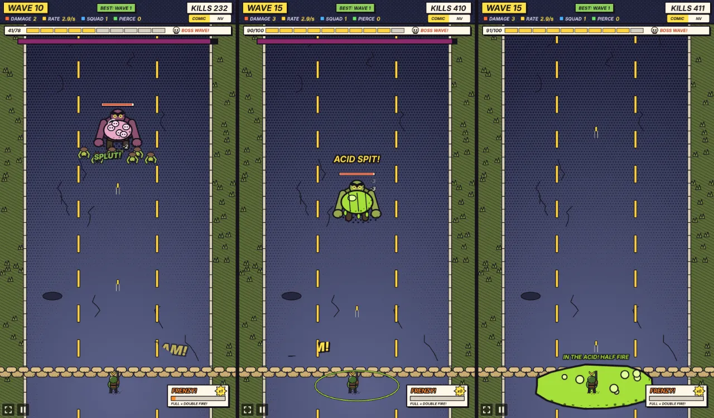
  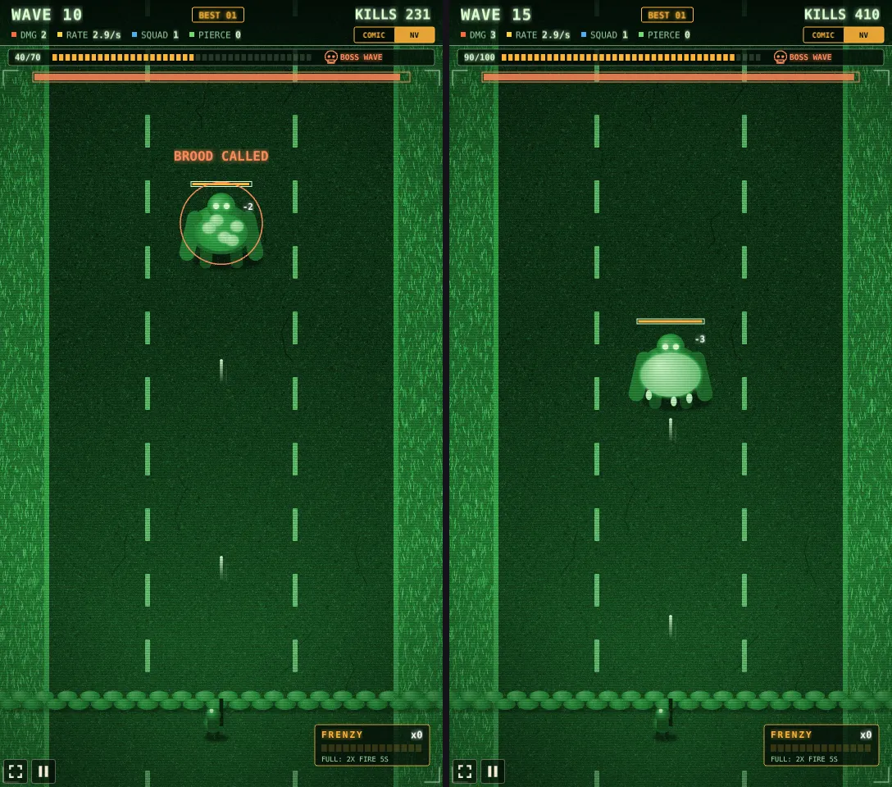
- **Supply drop**: clearing a boss wave brings a supply drop. The game waits while you pick one of
  three: a **shotgun** (two more bullets fan out from the soldier's rifle every volley, up to three
  pairs), a **flamethrower** (two flame bursts that go off on their own when a zombie gets close to
  the sandbags, burning everything near them), a **medkit** (the next zombie to reach the sandbags
  doesn't end the run: everything near the line is thrown back) or **two sandbag walls**. What you
  hold shows in the kit panel.

  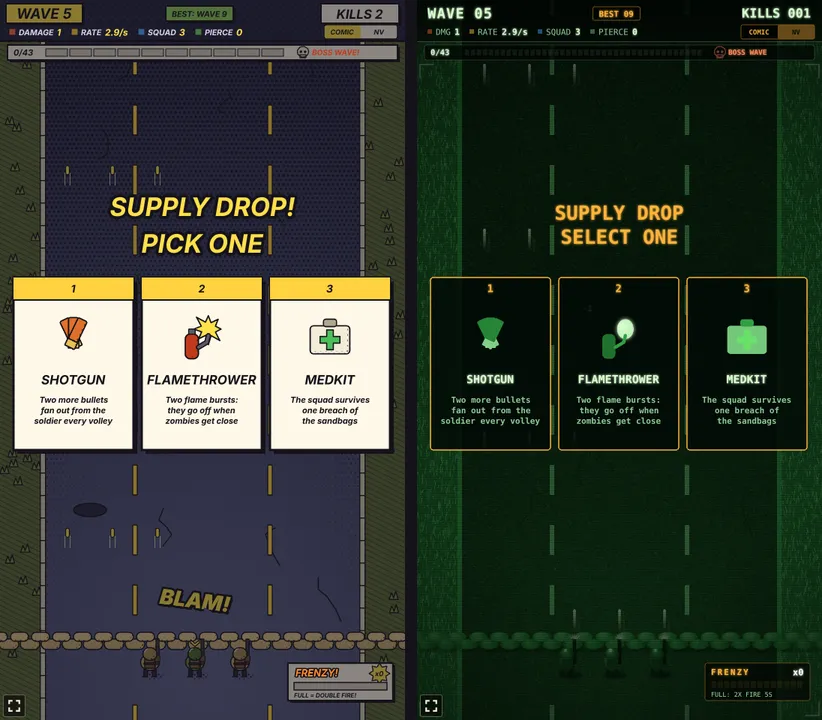
  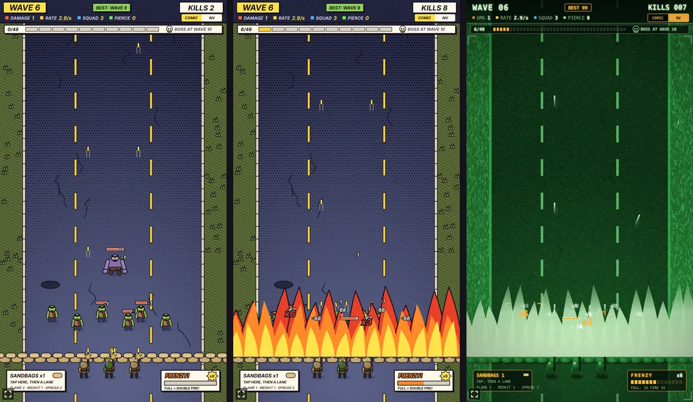
- **Extraction**: from wave 20, every boss's supply drop also offers a wide fourth card: extract.
  Taking it ends the run as a win and banks this run's scrap twice over. Pass it up and the next
  boss's drop pays more (2.5x at wave 25, 3x at wave 30), if you live to see it.

  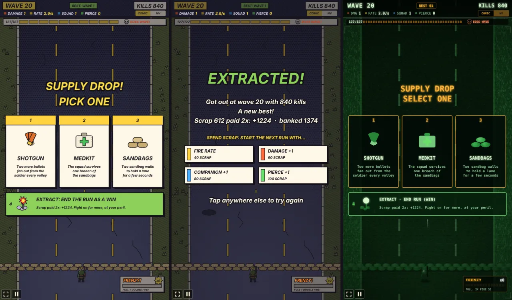
- **Scrap**: every kill banks scrap (a grunt, runner or crawler 1, a spitter 2, a brute or riot
  zombie 3, a boss 25), saved when a wave is cleared and when the run ends. On the game over screen,
  spend it on starting crates for the next run: Fire rate (40), Damage +1 (60), Companion +1 (80)
  or Pierce +1 (100). Each can be bought once per run and is used up when the next run starts.
- **Outpost upgrades**: scrap also builds the outpost, for good. Each upgrade has three levels,
  every one costing more, and is never used up:

  | Upgrade | Per level | Costs |
  | --- | --- | --- |
  | Barricade | Start each run with a sandbag wall | 60, 120, 200 |
  | Field Medic | Start each run with a medkit | 100, 180, 280 |
  | Fuel Depot | One more fuel drum rolls down every wave | 80, 150, 240 |
  | Veteran | Start each run with a companion (a Gunner) | 120, 220, 340 |

  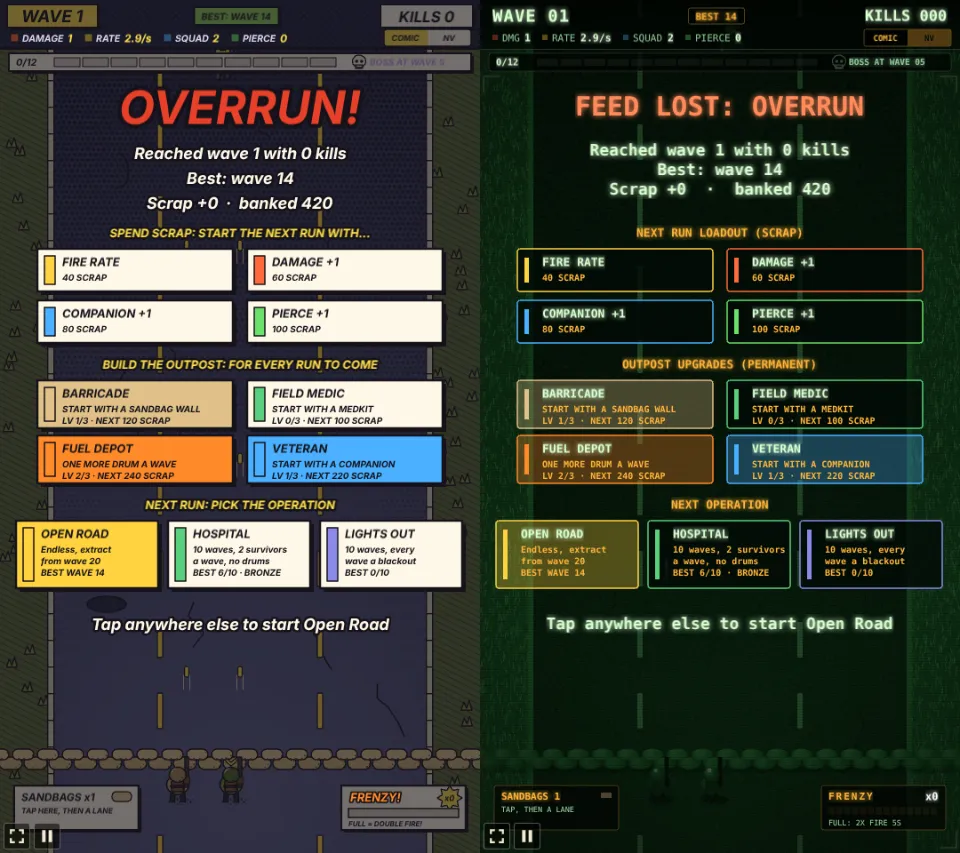
- **Operations**: the game over screen also picks what the next run is, and keeps that pick. The
  **Open Road** is the endless run with extraction. An operation is 10 waves under fixed rules,
  won by clearing wave 10 (its scrap is paid twice over): **Hospital** sends two survivors a wave
  from wave 1 and no fuel drums; **Lights Out** makes every wave a blackout. Each operation keeps
  its own best (waves cleared, shown in the top bar) and the medal it earns: Bronze for 5 waves
  cleared, Silver for 8, Gold for all 10.

  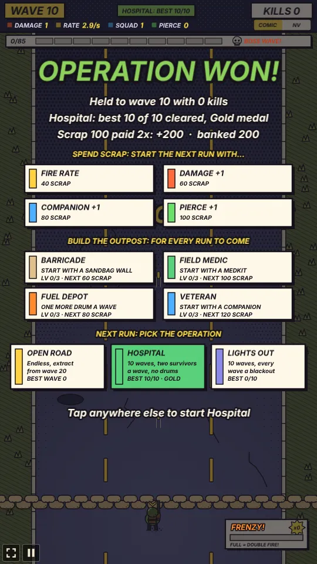

  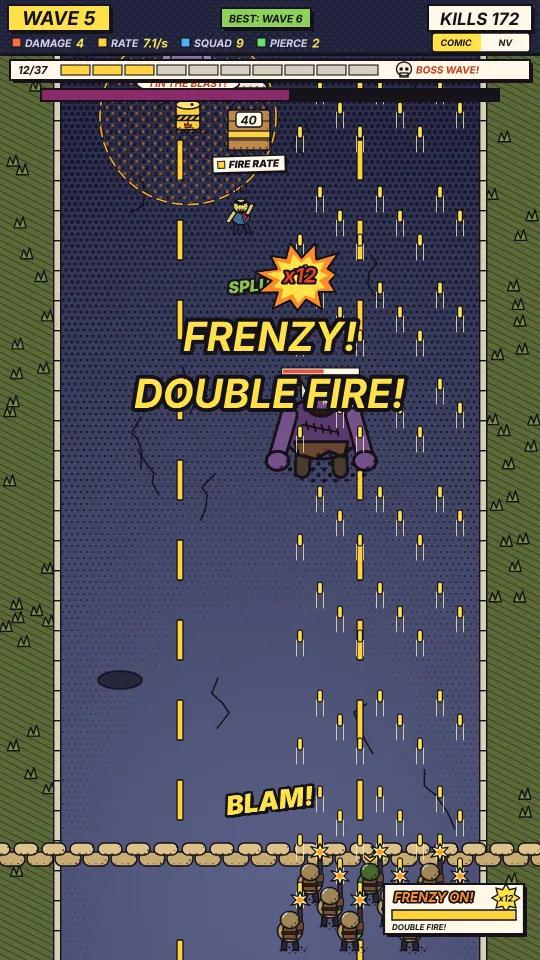
  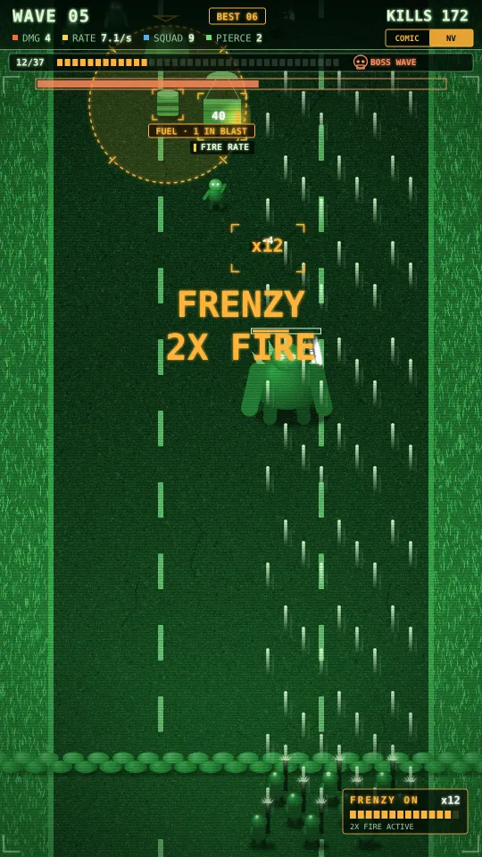

The difficulty, set on the hub page's Settings, changes one thing: zombies have 25% less health on Easy and 30% more on Hard.

Deadline follows the hub's Language setting: every text in the game, How to play and the wide-screen side panels come in British English, US English and German.

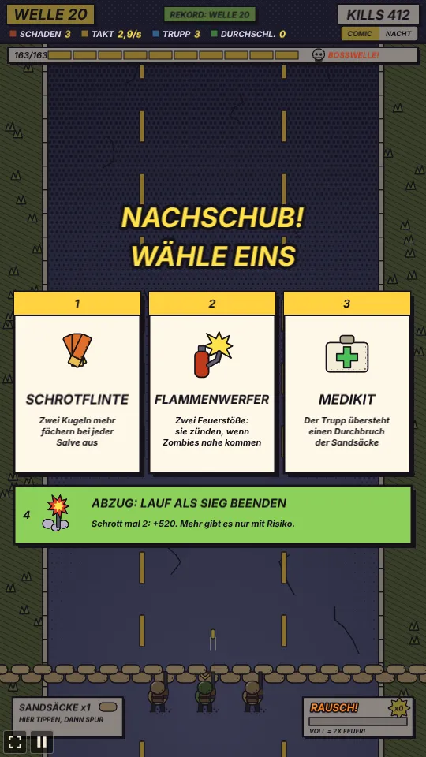

## Code layout

- `src/game/rules.ts`: the numbers and rules: enemy stats, upgrades and their perks, fuel drums,
  the frenzy, wave plans and conditions, the horde adapting, the bosses and their moves, survivors
  and squad roles, sandbag walls, the supply drop, extraction, scrap, the outpost and operations.
  No drawing; its names and texts are keys of `src/i18n/en.ts`.
- `src/i18n.ts` and `src/i18n/`: the game's texts in British English (`en.ts`), German (`de.ts`)
  and US spelling (`en-US.ts`, only what differs). `src/howToPlay.ts` has How to play in all three.
- `src/game/save.ts`: the saved best wave, art style, banked scrap, starting crates, outpost
  upgrades, the next operation and each operation's best.
- `src/game/pool.ts`: reuses sprites for enemies, bullets, crates, drums and effects, so a big horde
  doesn't create and destroy objects every frame.
- `src/art/`: both art styles, painted on canvases in code (no image files): `comic.ts`,
  `nightvision.ts`, their shared tools and sprite sizes in `paint.ts`, HUD colours and fonts in
  `theme.ts`, and the side panels on wide screens in `backdrop.ts`.
- `src/scenes/GameScene.ts`: the battle: moving the soldier, spawning, shooting, hits and perks,
  drums, the frenzy, acid, boss moves, survivors and their roles, conditions, sandbag walls,
  waves, the supply drop, extraction and operations, switching styles and game over with its scrap
  shop, outpost and operation picker. `src/scenes/Hud.ts` draws the top bar, the progress strip, the condition
  chip, the frenzy meter and the kit panel.
- `e2e/playthrough.spec.ts`: plays the first wave with taps: switches the style and back, blows up
  the wave's fuel drum among the horde, collects its crate and checks the wave's scrap is banked
  (see `AGENTS.md` at the repo root).
