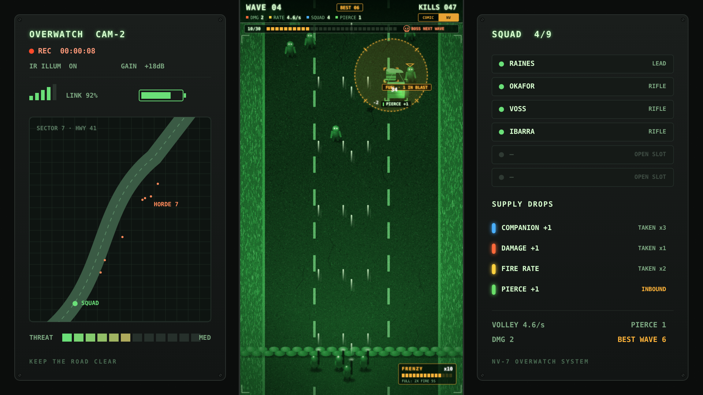
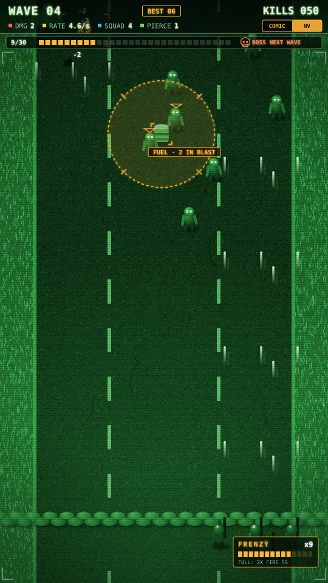
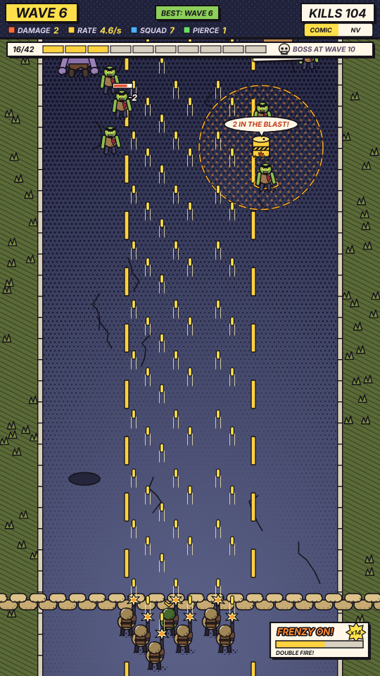
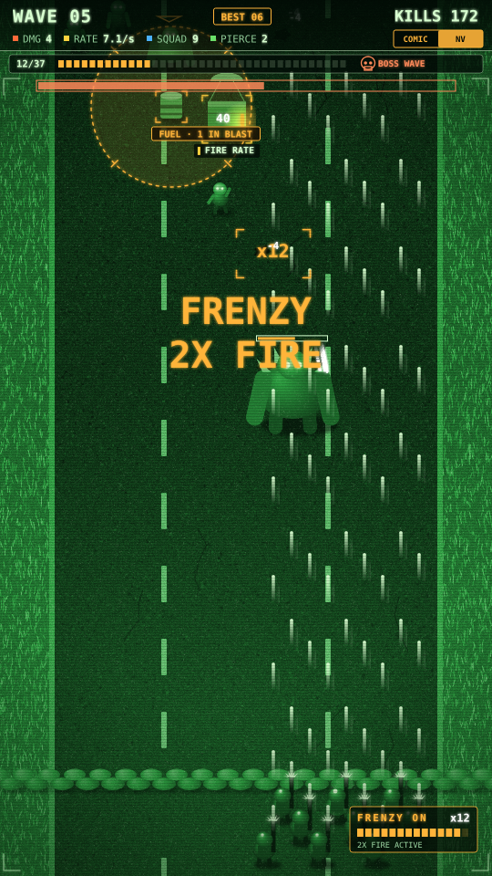
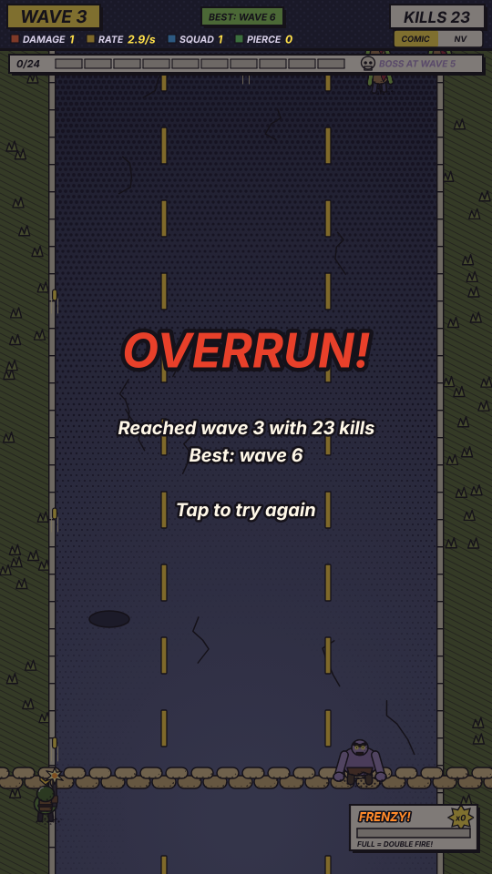

# Deadline

A wave defense prototype built with [Phaser 4](https://phaser.io), TypeScript and Vite, part of the
[game hub](../../README.md). It plays on an upright, phone-shaped screen.

A lone soldier holds the bottom of a ruined road while hordes of zombies come down it. The soldier
fires on their own; you only move them left and right. Upgrade crates come down among the zombies:
shoot one open to collect its upgrade. Fuel drums roll down too: shoot one and it blows up the
zombies around it. Kills in quick succession build a frenzy that doubles your fire rate. There is no
XP and no levelling: every upgrade comes from a crate. The waves keep getting bigger and tougher,
and every fifth wave ends with a boss. If a zombie reaches the sandbags in front of the soldier,
it's game over. Your best wave is kept, so every run has a record to beat.

## Two art styles

The game can be drawn in two styles. Switch between them at any time with the **COMIC | NV**
switch at the right of the top bar (or the **V** key). The game remembers your choice.

- **Pulp horror comic** (the default): inked outlines, flat colours and halftone dots, lettered
  BLAM!, SPLUT! and KA-BOOM! sound effects, and the HUD in caption boxes. On a screen wider than
  the game, comic panels fill the sides: the night's narration, a boss lurking in the dark (it tells
  you when "something big" is next) and the supply drops.
- **Night-vision overwatch feed**: the road as seen through a green night-vision camera, with
  bloom, grain, scanlines and glowing zombie eyes under an amber tactical overlay. Crates keep the
  colour of their chemlights. On a wide screen an overwatch console fills the sides: the feed's REC
  clock, a strip map with the horde on it, the squad roster, the supply drops and your stats.

With **Reduce motion** on in the hub's Settings, the feed's grain, scanlines and flicker hold still
and the fuel drum's blast doesn't swell.

## How to play

| Control | Action |
| --- | --- |
| Tap or drag anywhere | Move the soldier left or right, to below that spot |
| A / D or arrow keys | Move left or right |
| Tap the COMIC / NV switch, or V | Switch the art style |
| Tap after game over | Start again from wave 1 |

- **Shooting** is automatic: a volley goes straight up from the soldier's rifle every so often.
  Stand below what you want to hit. Each hit shows a small damage number.
- **Zombies** walk down the road and veer towards the soldier. Grunts come first; runners (fast,
  weak) join from wave 2 and brutes (slow, tough) from wave 3. A wave is cleared once all of its
  zombies are down, and the next one comes after a short pause.
- **Wave progress**: the strip under the top bar fills as the wave's zombies fall (8/30 means 8 of
  its 30 are down). Its end says when the next boss comes, and warns "Boss next wave!" the wave
  before it. The chip in the top bar shows the best wave you have ever reached; beat it and it says
  "New best".

  
- **Crates** drift down slower than the horde and show how many hits they still take. Opening one
  gives its upgrade:

  | Crate | Upgrade |
  | --- | --- |
  | Fire rate (yellow) | 20% less time between volleys |
  | Damage +1 (orange) | Each bullet takes one more hit point |
  | Companion +1 (blue) | Another soldier joins the squad and fires with you |
  | Pierce +1 (green) | Bullets go through one more zombie |

  A crate nobody opens is lost behind the sandbags.
- **Fuel drums** roll down the road in every wave (one more every fourth wave), slower than the
  horde, so the zombies behind them walk through them. A dashed ring round each drum shows its blast
  radius and how many zombies it would catch right now ("2 in the blast!"). A single hit blows it
  up, and every zombie in the ring takes a heavy blow (on the first waves it kills them outright).
  Wait for the crowd to bunch up round it, then step under it. A drum nobody shoots is lost behind
  the sandbags.

  
  
- **Frenzy**: every kill that comes within 1.5 seconds of the last one adds to your streak (a burst
  pops up every third kill: x3, x6, x9...). The frenzy meter beside the squad fills with it. At a
  streak of 12 the frenzy starts: for 5 seconds the whole squad fires twice as fast. A pause in the
  killing breaks the streak.

  
- **Companions** line up beside and behind the soldier, up to three rows of three. Each row is
  shifted a little to the side, so every rifle has its own clear line of fire. Once the squad is
  full, companion crates give Damage +1 instead.
- **Bosses** come at the end of every fifth wave, with a big health bar under the progress strip.

  
  

The difficulty, set on the hub page's Settings, changes one thing: zombies have 25% less health on Easy and 30% more on Hard.

## Code layout

- `src/game/rules.ts`: the numbers and rules: enemy stats, upgrades, fuel drums, the frenzy, wave
  plans. No drawing.
- `src/game/save.ts`: the saved best wave and art style.
- `src/game/pool.ts`: reuses sprites for enemies, bullets, crates, drums and effects, so a big horde
  doesn't create and destroy objects every frame.
- `src/art/`: both art styles, painted on canvases in code (no image files): `comic.ts`,
  `nightvision.ts`, their shared tools and sprite sizes in `paint.ts`, HUD colours and fonts in
  `theme.ts`, and the side panels on wide screens in `backdrop.ts`.
- `src/scenes/GameScene.ts`: the battle: moving the soldier, spawning, shooting, hits, drums, the
  frenzy, waves, switching styles and game over. `src/scenes/Hud.ts` draws the top bar, the
  progress strip and the frenzy meter.
- `e2e/playthrough.spec.ts`: plays the first wave with taps: switches the style and back, blows up
  the wave's fuel drum among the horde and collects its crate (see `AGENTS.md` at the repo root).
