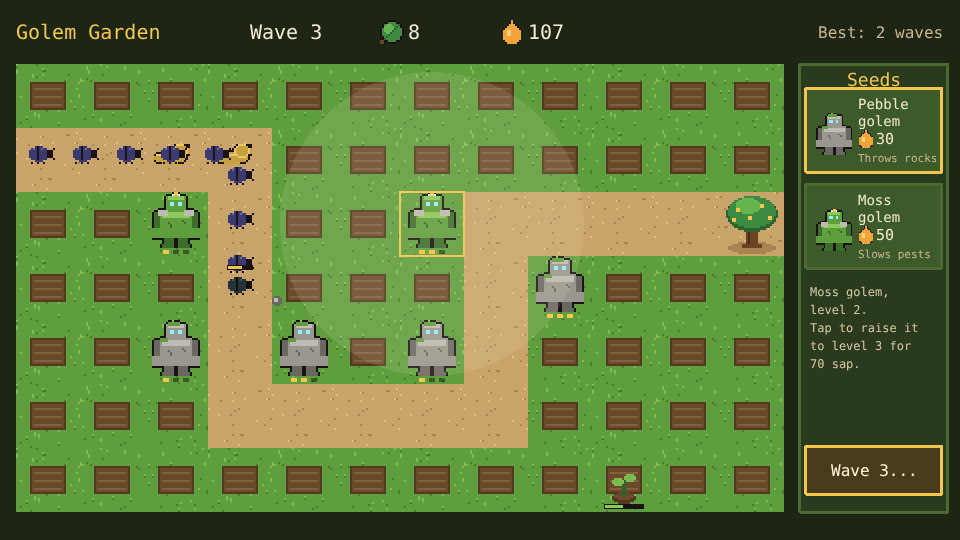
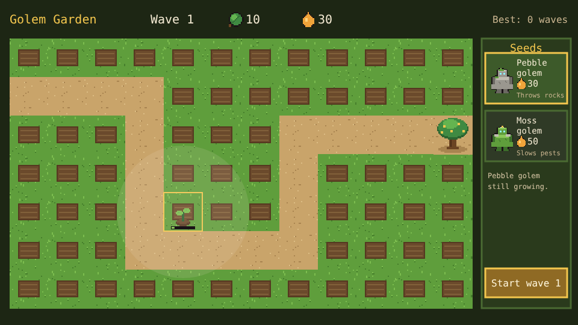
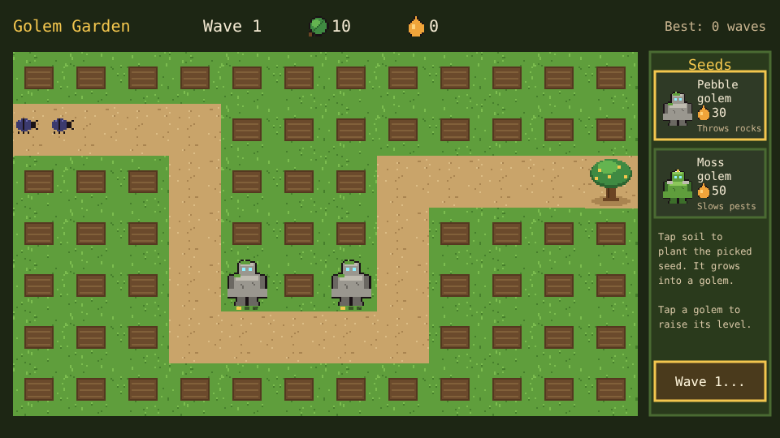

# Golem Garden

A tower defense prototype built with [Phaser 4](https://phaser.io), TypeScript and Vite, part of the
[game hub](../../README.md).

Pests are coming down the garden path to eat the Heartwood, the great tree at its end. Plant seeds
in the soil beside the path: each one grows into a golem that throws rocks or moss at the pests
within reach. Squashed pests drop sap, which buys more seeds and raises your golems' levels. Hold
out as many waves as you can.



## How to play

| Control | Action |
| --- | --- |
| Tap or click a seed button | Pick the seed to plant |
| Hover a soil cell | See how far the golem would reach |
| Tap or click a soil cell | Plant the picked seed there, if you have the sap |
| Tap or click a golem | Raise it a level (up to 3), if you have the sap |
| Start wave | Send the next wave of pests down the path |
| Replant | After the Heartwood falls: start a new garden |

1. **Seeds grow first.** A seed takes a few seconds to grow into a golem, and only a grown golem
   fights. You can plant between waves and during them.
2. **Golems** throw at the pest furthest along the path within their reach:

   | Golem | Seed | Grows in | Damage | Reach | Throws every | Also |
   | --- | --- | --- | --- | --- | --- | --- |
   | Pebble golem | 30 sap | 3s | 7 | 110px | 0.7s | |
   | Moss golem | 50 sap | 4s | 3 | 140px | 0.8s | halves a pest's speed for 1.5s |

   Raising a golem to level 2 costs 40 sap and to level 3 costs 70; each level adds 60% damage and
   12px of reach.
3. **Pests**: beetles (20 health, drop 5 sap), slugs from wave 2 (50 health, slow, drop 9, take 2
   off the Heartwood) and crows from wave 3 (14 health, fast, drop 6). Each wave brings more of
   them, with 12% more health per wave.
4. **The Heartwood** has 10 leaves. A pest that reaches it eats one (a slug two), and the garden is
   lost when none are left. Clearing a wave adds 10 + 5 x the wave's number in sap. The most waves
   ever cleared is saved in the browser.





The difficulty, set on the hub page's Settings, changes one thing: pests have 25% less health on
Easy and 30% more on Hard.

## Running locally

`npm run dev` at the repo root, then open `/games/golem-garden/` (or pick Golem Garden on the hub
page).

## Playthrough test

`e2e/playthrough.spec.ts` plays the first wave in headless Chromium: it picks the pebble seed,
checks a tap on the path plants nothing, plants two seeds by tapping soil, waits for them to grow,
starts wave 1 and checks the golems squash all eight beetles before any reaches the Heartwood, with
the sap they drop and the wave's bonus. Like the other games' tests it owns the game clock and plays
at 4x speed (`PLAYTHROUGH_SPEED`). The **Playthrough Golem Garden** workflow
(`.github/workflows/playthrough-golem-garden.yml`) runs it on pull requests that touch this folder
and uploads the video and screenshots as the `playthrough-golem-garden` artifact.

```sh
npx playwright test --project golem-garden
```

## Code layout

All paths are inside `games/golem-garden/`.

- `src/game/`: the rules in plain TypeScript with no Phaser dependency. `board.ts` has the grid
  and the path, `data.ts` the golems, pests and waves, `state.ts` planting, upgrading and the tick
  that moves pests and makes golems throw, and `save.ts` the best wave.
- `src/scenes/`: `BootScene` bakes textures, `GameScene` draws the garden, the HUD and the seed
  panel and wires taps to the rules, `layout.ts` says where things are drawn.
- `src/art/`: the tiles, golems, pests and icons, drawn in code and baked into textures at startup.
- `src/ui/`: the button.

Retuning a golem or a pest is its row in `GOLEM_INFO` or `PEST_INFO` in `src/game/data.ts`.
