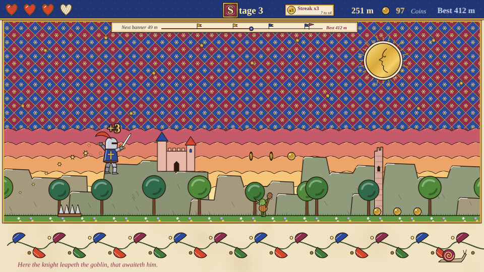
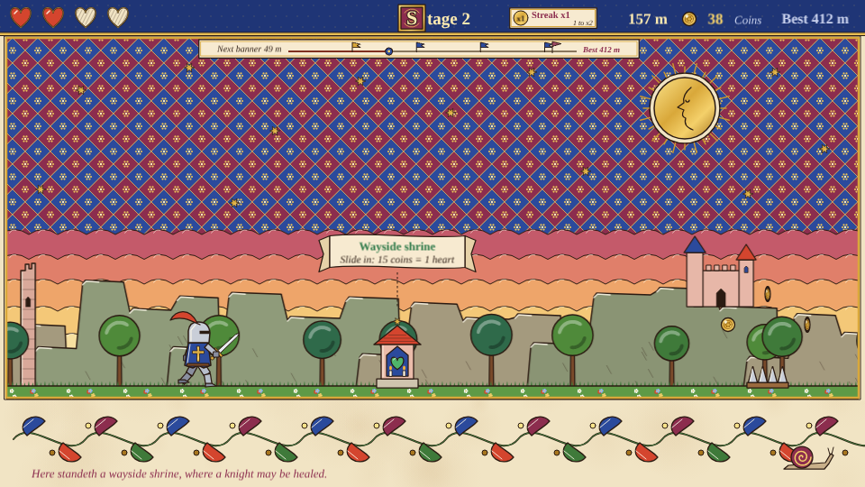
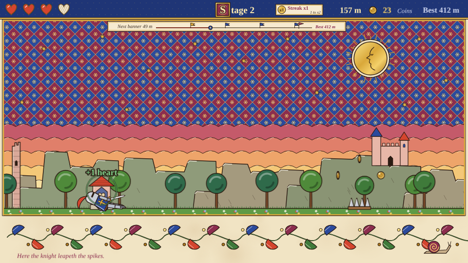
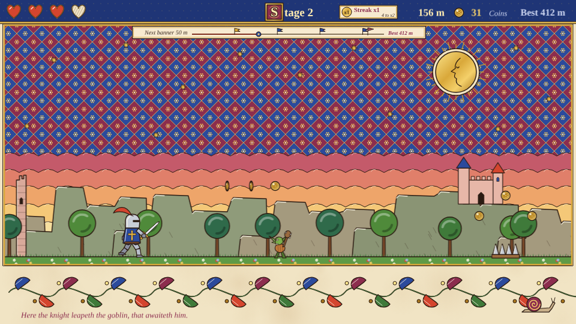
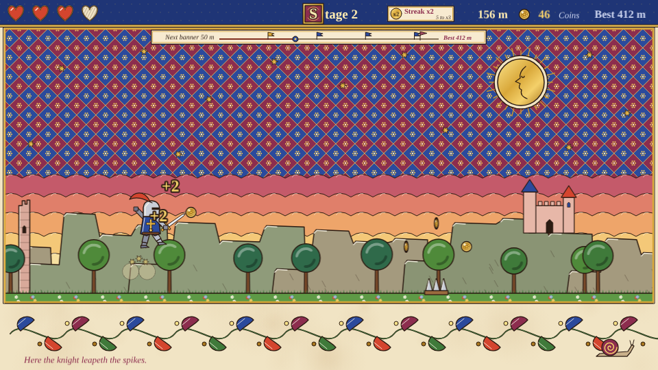
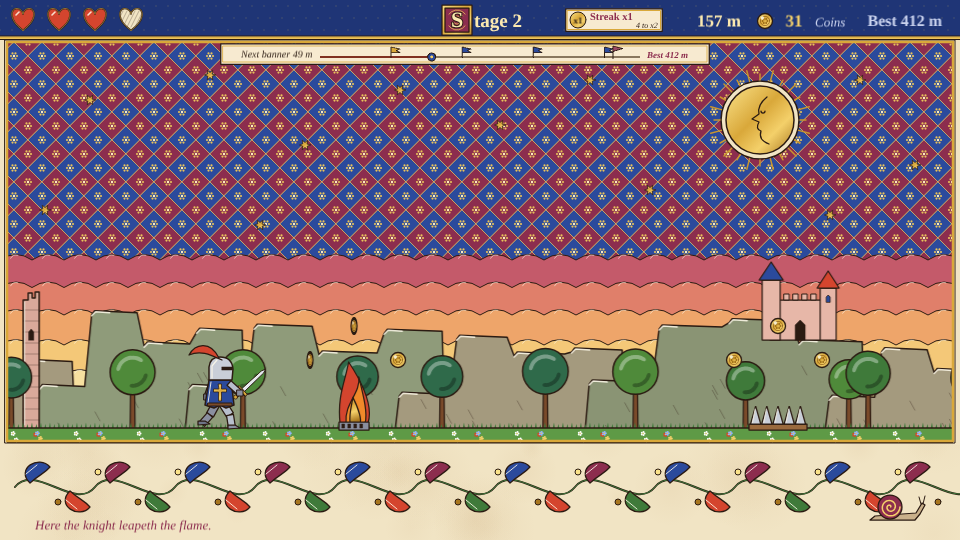
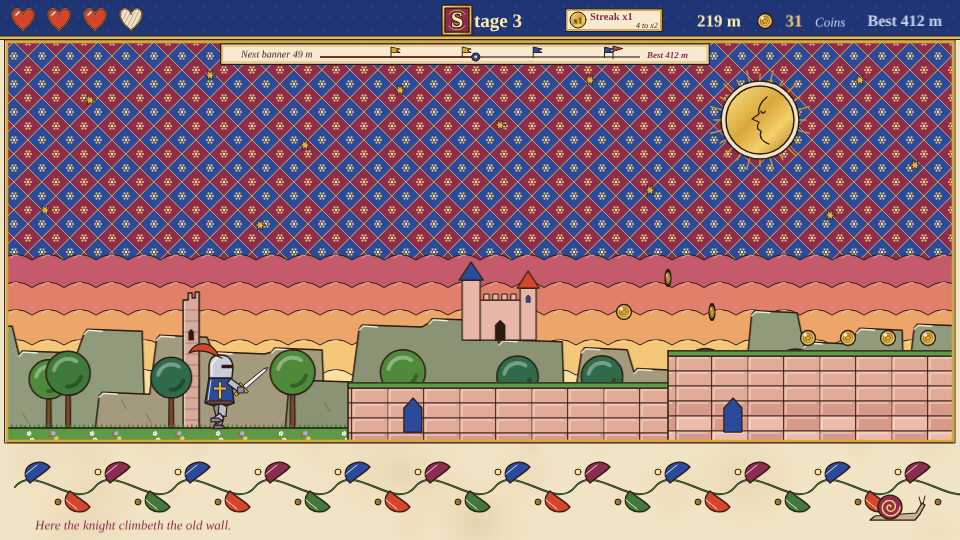

# Hotfoot

An auto-runner prototype built with [Phaser 4](https://phaser.io), TypeScript and Vite, part of
the [game hub](../../README.md).

A knight runs along an old road at dusk and never stops, painted as a gothic miniature on a vellum
page: a sky diapered in lapis and madder, a gold-leaf moon and coins, inked outlines, an
illuminated initial on the stage's name and a margin of leafy scrollwork under the road, where a
rubric caption says what the knight is about. Spikes, pits and fire vents lie in the
road, spiked logs hang over it on chains, goblins walk it and bats swoop along it, and old castle
walls raise stretches of it into ledges: jump the spikes, pits, flames and goblins and up onto the
ledges, slide under the logs and bats, and pick up the coins on the way. Every stage ends at a checkpoint, a banner by a campfire, where the run waits on a choice
of two boons. The knight keeps every boon until they fall, and each stage after runs a little faster
with the traps a little closer together. Coins taken in a row build a streak that multiplies their worth, a wayside shrine on each stage
from the second trades coins for a heart, and a run track under the top band shows how far the
knight is from the next banner and from the best run. Coins are banked when the knight falls, and
can buy back the boon you missed at the last checkpoint to start the next run with it.


## How to play

| Control | Action |
| --- | --- |
| Tap the top half of the screen, or Space / Up / W | Jump (again in the air with Second Leap) |
| Tap the bottom half of the screen, or Down / S | Slide; in the air, drop fast and slide on landing |
| Tap a card | Take that boon at a checkpoint |
| Run again | After a fall: a new run from the start, with no boons (or the one bought on the game-over panel) |

A hint on the first stretch of the run shows where to tap.


1. **Traps**: spikes and pits are jumped, blades are slid under. A fire vent only burns part of the
   time, flaring after a short sputter; jump it, or run over it while it is out.
2. **Foes**: goblins walk back and forth along their stretch of road and are jumped; bats fly in at
   head height and are slid under. Landing on either from above knocks it out for a coin and
   bounces the knight back up.
3. **Ledges**: raised stretches of road to jump up onto, and drop off the far end of. Running into
   the side of one hurts, and the knight scrambles up it. Later stages have steps: a low ledge
   followed by a taller one.
4. **What turns up**: the first stage shows spikes, a blade, a goblin and a ledge once each before
   mixing them up with pits. Fire vents and bats join from stage 2, and steps and tall ledges from
   stage 3.
5. **Hearts**: the knight starts with three. A trap, a foe or a ledge's side takes one (and ends the
   coin streak), and the knight blinks for a moment in which nothing can hurt them. Falling into a pit throws them back out. **The run is over when the
   last heart is gone.**
6. **Coins** lie in arcs over the spikes, pits and fire vents, in rows under the blades and bats,
   high over the goblins and along the tops of the ledges. A stomped goblin or bat drops one too.
7. **Coin streak**: every coin taken without a hit adds to the streak. Each 10 coins in a row raise
   its multiplier by one, up to x5, and each coin after that is worth the multiplier (with Golden
   Greed, its value times the multiplier). The chip by the stage's name shows the multiplier and how
   many coins to the next one ("7 to x4"); a coin worth more than one pops its value ("+3") over the
   knight, and from x2 a trail of gold stars follows them. **Any hit resets the streak**, a hit the
   Aegis shrugs off included.
8. **Wayside shrines**: from stage 2, a little chapel with a green heart stands on the road once a
   stage, under a scroll reading "Slide in: 15 coins = 1 heart". Slide into it to trade 15 of the
   run's coins for a heart, if you have them and are missing a heart; otherwise it says why not
   ("Hearts full" or "Needs 15 coins"). Jump or run past it to keep the coins for the shop.
9. **Run track**: the strip under the top band is the run so far, from 0 m: a banner every 100 m
   (gold once passed), the knight's marker, and a madder ghost flag at the best run. It reads
   "Next banner N m" on the left and the best distance on the right, "New best!" once past it.
10. **Checkpoints** come every 100 m. The run waits while two different boons are offered.
11. **Stages** speed up from 260 to at most 480 pixels a second, the room between obstacles shrinks,
   and goblins and bats get quicker.
   The best distance, the banked coins and any boon bought are saved between runs.



















### Boons and the coin shop

| Boon | Ranks | What it does |
| --- | --- | --- |
| Hearty Ale | 3 | One more heart, and one heart back |
| Winged Boots | 3 | Jump 12% higher |
| Second Leap | 1 | Jump again once in the air |
| Aegis | 2 | Shrug off the first hit after each checkpoint (two with rank 2) |
| Lodestone | 3 | Coins fly to the knight from further off |
| Golden Greed | 3 | Each coin is worth one more |
| Oiled Greaves | 2 | Slides last 30% longer |
| Shadow Cloak | 2 | Stay unhurt 50% longer after a hit |
| Field Dressing | any | Two hearts back; only offered once fewer than two other boons are left |


**The coin shop.** Coins collected in a run are banked when the knight falls. On the game-over panel,
the boon you missed at the last checkpoint (the card you did not tap) is for sale for 30 coins. Buy
it and the next run starts with it at one rank and full hearts. One purchase at a time, and Field
Dressing is never for sale. Nothing is for sale until the run has reached a checkpoint.

The difficulty, set on the hub page's Settings, changes one thing: the knight starts with 5 hearts on Easy and 2 on Hard.
With Reduce motion on, the knight fades instead of blinking after a hit, the shield ring holds still,
the coin pops stay where they appear instead of rising, and the streak's trail of stars is not drawn.

## Running locally

`npm run dev` at the repo root, then open `/games/hotfoot/` (or pick Hotfoot on the hub
page).

## Playthrough test

`e2e/playthrough.spec.ts` plays the first stage in headless Chromium: it checks the new run, taps
the top half of the screen to jump each spike row, pit and goblin and up onto each ledge, and the
bottom half to slide under each blade, as they come up, and checks that the knight reached the
checkpoint without a hit, jumping, sliding, getting past a goblin, running along a ledge and picking
up coins on the way, on one unbroken streak whose multiplier paid out exactly as the rules say.
There it checks that the run waits on two different boons, taps the first card, and checks that the
boon was taken and the faster second stage has begun, with a wayside shrine on it. Like the other games' tests it owns the game clock and plays at 4x speed
(`PLAYTHROUGH_SPEED`). The **Playthrough Hotfoot** workflow
(`.github/workflows/playthrough.yml`) runs it on every PR that touches this folder or its
workflow, and uploads the video and screenshots as the
`playthrough-hotfoot` artifact.

```sh
npx playwright test --project hotfoot
```

## Code layout

All paths are inside `games/hotfoot/`.

- `src/game/`: the rules in plain TypeScript with no Phaser dependency. `state.ts` holds the run,
  the knight's and the traps' sizes and works out the knight's numbers from the boons taken,
  `course.ts` lays out each stage's traps, foes, ledges, coins and shrine, `boons.ts` is the table of boons, `sim.ts`
  moves the run on (foes, ledges, stomps, the coin streak and shrines included), jumps, slides, takes boons and sells the missed one, and `save.ts` keeps the best distance, the banked coins and any boon bought.
- `src/scenes/`: `BootScene` bakes textures, `GameScene` draws the run and wires taps and keys to
  the rules, `layout.ts` says where things are drawn.
- `src/art/`: all the art, painted in code on 2D canvases at startup, in the manner of an
  illuminated manuscript: flat colours with ink outlines, white highlights and gold leaf, using the
  helpers and pigments in `ink.ts`. `scenery.ts` paints the vellum page and its margin, the sky,
  crags and trees, the road, the ledges, the traps, the coins, the checkpoint banner, the wayside
  shrine and the miniature's frame; `knight.ts` the knight's poses; `foes.ts` the goblin and bat;
  `icons.ts` the boon icons and hearts; `hud.ts` the top band, the illuminated initial, the streak
  chip, the run track's strip, the vellum panels and the buttons.
- `src/ui/`: the boon cards and buttons.

Adding a boon is an entry in `src/game/boons.ts`, its effect in `stats` in `src/game/state.ts`, and
an icon in `src/art/icons.ts`. Adding a trap is a kind in `state.ts` (with its height in
`TRAP_SPAN`), a piece in `course.ts` (`planOf` and `piecesOf`) and its art in `src/art/scenery.ts`.
