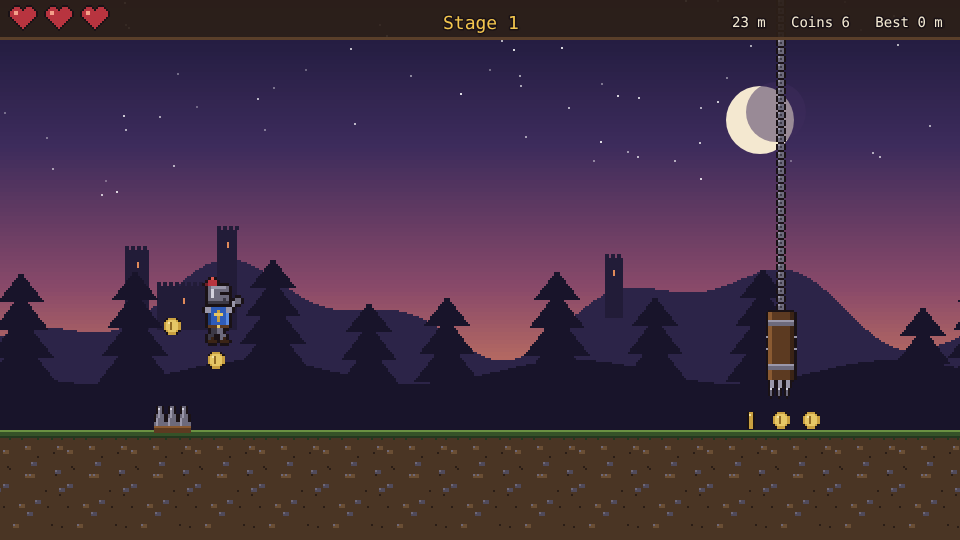
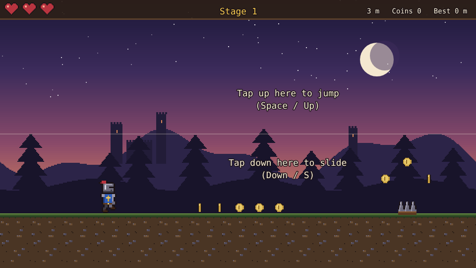
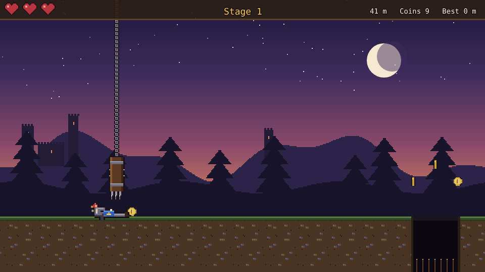
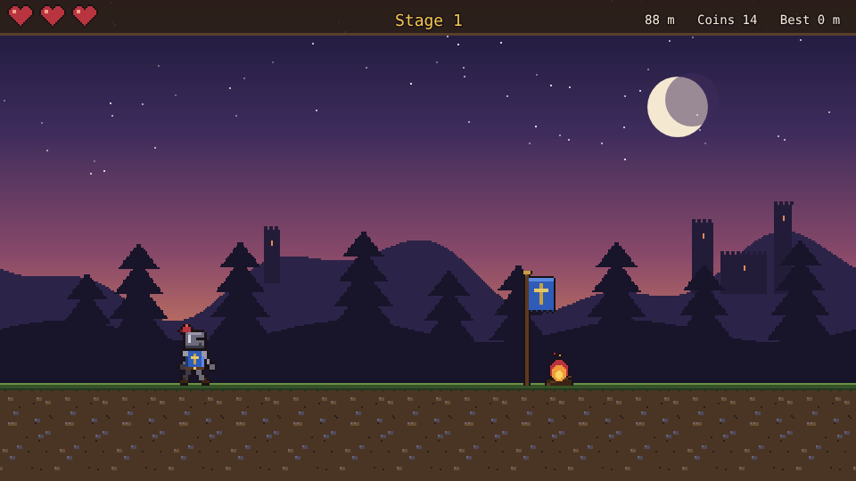
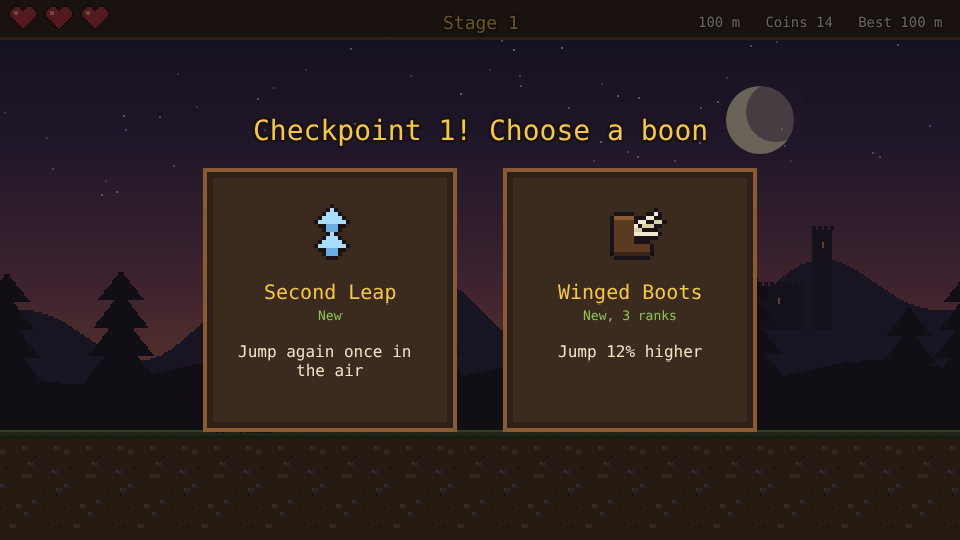
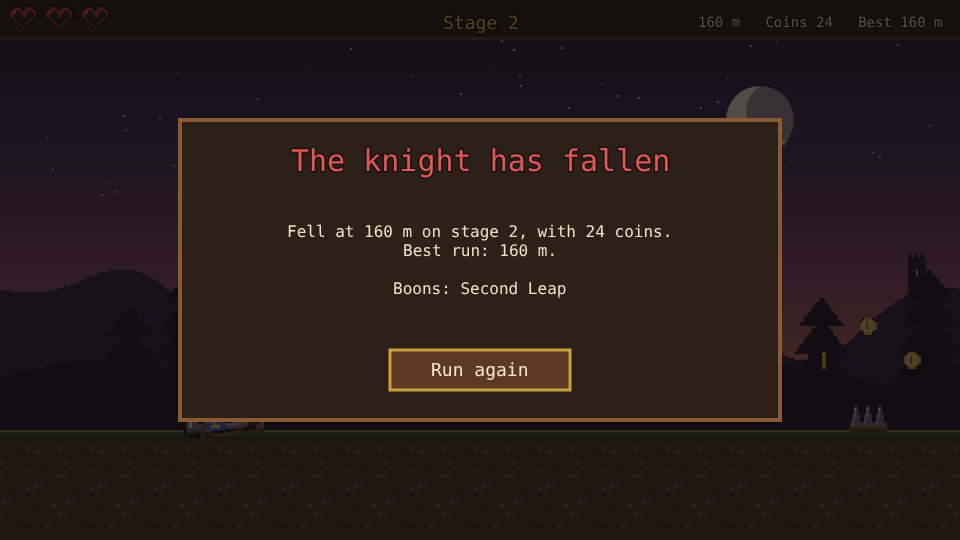

# Hotfoot

An auto-runner prototype built with [Phaser 4](https://phaser.io), TypeScript and Vite, part of
the [game hub](../../README.md).

A knight runs along an old road at dusk and never stops. Spikes and pits lie in the road and spiked
logs hang over it on chains: jump the first two, slide under the third, and pick up the coins on
the way. Every stage ends at a checkpoint, a banner by a campfire, where the run waits on a choice
of two boons. The knight keeps every boon until they fall, and each stage after runs a little faster
with the traps a little closer together.



## How to play

| Control | Action |
| --- | --- |
| Tap the top half of the screen, or Space / Up / W | Jump (again in the air with Second Leap) |
| Tap the bottom half of the screen, or Down / S | Slide; in the air, drop fast and slide on landing |
| Tap a card | Take that boon at a checkpoint |
| Run again | After a fall: a new run from the start, with no boons |

A hint on the first stretch of the run shows where to tap.



1. **Traps**: spikes and pits are jumped, blades are slid under. The first stage shows each once
   before mixing them up.
2. **Hearts**: the knight starts with three. A trap takes one, and the knight blinks for a moment in
   which nothing can hurt them. Falling into a pit throws them back out. **The run is over when the
   last heart is gone.**
3. **Coins** lie in arcs over the spikes and pits and in rows under the blades.
4. **Checkpoints** come every 100 m. The run waits while two different boons are offered.
5. **Stages** speed up from 260 to at most 480 pixels a second, and the room between traps shrinks.
   Only the best distance is saved between runs.





### Boons

| Boon | Ranks | What it does |
| --- | --- | --- |
| Hearty Ale | 3 | One more heart, and one heart back |
| Winged Boots | 3 | Jump 12% higher |
| Second Leap | 1 | Jump again once in the air |
| Aegis | 2 | Shrug off the first hit after each checkpoint (two with rank 2) |
| Lodestone | 3 | Coins fly to the knight from further off |
| Golden Greed | 3 | Each coin is worth one more |
| Oiled Greaves | 2 | Slides last 30% longer |
| Shadow Cloak | 2 | Stay unhurt 50% longer after a hit |
| Field Dressing | any | Two hearts back; only offered once fewer than two other boons are left |






## Running locally

`npm run dev` at the repo root, then open `/games/hotfoot/` (or pick Hotfoot on the hub
page).

## Playthrough test

`e2e/playthrough.spec.ts` plays the first stage in headless Chromium: it checks the new run, taps
the top half of the screen to jump each spike row and pit and the bottom half to slide under each
blade as they come up, and checks that the knight reached the checkpoint without a hit, jumping,
sliding and picking up coins on the way. There it checks that the run waits on two different
boons, taps the first card, and checks that the boon was taken and the faster second stage has
begun. Like the other games' tests it owns the game clock and plays at 4x speed
(`PLAYTHROUGH_SPEED`). The **Playthrough Hotfoot** workflow
(`.github/workflows/playthrough-hotfoot.yml`) runs it on every PR and push to main that
touches this folder or a shared build file, and uploads the video and screenshots as the
`playthrough-hotfoot` artifact.

```sh
npx playwright test --project hotfoot
```

## Code layout

All paths are inside `games/hotfoot/`.

- `src/game/`: the rules in plain TypeScript with no Phaser dependency. `state.ts` holds the run,
  the knight's and the traps' sizes and works out the knight's numbers from the boons taken,
  `course.ts` lays out each stage's traps and coins, `boons.ts` is the table of boons, `sim.ts`
  moves the run on, jumps, slides and takes boons, and `save.ts` keeps the best distance.
- `src/scenes/`: `BootScene` bakes textures, `GameScene` draws the run and wires taps and keys to
  the rules, `layout.ts` says where things are drawn.
- `src/art/`: all the pixel art, drawn in code and baked into textures at startup: the knight's
  poses, the scrolling sky, hills and road, the traps, coins, checkpoint and boon icons.
- `src/ui/`: the boon cards and buttons.

Adding a boon is an entry in `src/game/boons.ts`, its effect in `stats` in `src/game/state.ts`, and
an icon in `src/art/icons.ts`. Adding a trap is a kind in `state.ts` (with its height in
`TRAP_SPAN`), a place in `course.ts` and its art in `src/art/scenery.ts`.
