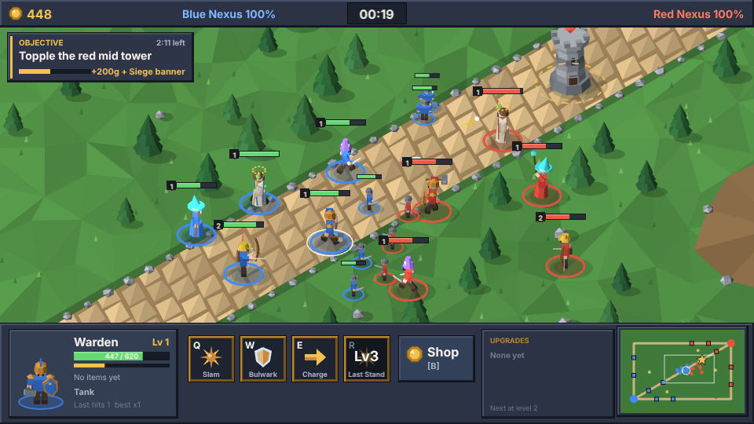

# Lane Brawl

A single-player MOBA prototype built with [Phaser 4](https://phaser.io), TypeScript and Vite, part of
the [game hub](../../README.md).

You pick one of five champions and lead a team of five down three lanes. Four allies walk the lanes
with you, and five NPC champions on the red team fight you. Farm minions for gold, level up on XP,
buy items at your Nexus, and push the lanes until the red Nexus falls. There is no multiplayer.

Everything is low-poly 3D: the champions, minions, the jungle boar, the towers and the Nexus are small
faceted models built in code and rendered by a tiny software renderer at start-up into sprites from
eight directions, with a walk cycle, attack poses and a cast pose. The map has faceted grass, flagstone
lanes with stone kerbs and pines, lit from the top left, under bevelled slate panels.

## How to play

| Control | Action |
| --- | --- |
| Click a champion card | Pick your champion and start the match |
| Click the ground | Walk there |
| Click an enemy | Walk to it and attack it until it dies or you stop it by clicking the ground |
| Q, W, E, R, or click their boxes | Cast the ability at the cursor |
| 1 or 2, or click an upgrade card | Keep one of the two upgrades a new level offers |
| B, or Shop | Open or close the shop; buy an item by clicking it |
| Esc | Close the shop |
| Play again | After a match: pick a champion again |

1. **Your team**: you and four allies, one per remaining champion. Allies walk a lane each and
   fight what they meet.
2. **Standing still** makes your champion attack whatever enemy comes in reach. Clicking the
   ground sends it walking and it stops attacking until it arrives.
3. **Minions** leave both Nexuses every 25 seconds, three to a lane. A champion that lands the
   last hit on one earns 19 gold, and every champion of the other team nearby earns 30 XP.
4. **Last hits**: the enemy minion near you that your next hit would kill gets a gold outline. Each
   last hit pops a coin with the gold it paid and grows your streak, shown in a chip by the gold
   counter. From x4 on, a last hit pays 25% more (24 gold). The streak breaks when a minion you had
   outlined falls to someone else.
5. **Towers** shoot the nearest champion or minion in reach. Each side has two per lane.
6. **Jungle camps**: four neutral camps, two a side. Attack one to take its 80 gold and 120 XP; it
   fights back and returns after a minute.
7. **Champions** level from 1 to 5 on XP. R unlocks at level 3. Each level adds health and damage.
8. **Upgrades**: each new level puts two upgrade cards in the bottom bar and marks the ability box
   they change with a gold diamond. Keep one; it changes that ability for the rest of the match (gold
   pips under a box count the upgrades it has). The choices per champion are in the table below.
9. **Objectives**: a card under the top bar names one goal at a time with a timer and a reward, a
   gold marker floats over its target and a star marks it on the minimap. They come in turn: topple
   the nearest red tower (2:30, 200 gold and the siege banner, +25% damage to towers and the Nexus
   for a minute), clear the jungle camp nearest you (1:30, 120 gold), defeat the red champion nearest
   you (2:00, 150 gold). The goal counts however its target falls; a late one is missed. The next
   goal comes 4 seconds after one ends.
10. **Items**: eight of them, each bought once within reach of your Nexus.

   | Item | Cost | Stats |
   | --- | --- | --- |
   | Long Sword | 350 | +12 damage |
   | Brutal Edge | 650 | +24 damage |
   | Chain Mail | 350 | +6 armor, +90 health |
   | Thornmail | 420 | +14 armor |
   | Giant's Belt | 400 | +200 health |
   | Swift Boots | 300 | +25 speed |
   | Rapid Bow | 400 | +25% attack speed |
   | Cloak of Haste | 350 | -15% ability cooldowns |
11. **Dying** sends the champion back to its Nexus after a short wait that grows with its level.
12. **Winning** destroys the red Nexus. Losing means your Nexus falls first.

The bars under the map show the Nexuses' health and your champion's health, experience and
cooldowns. The minimap in the corner shows every tower, Nexus and champion.

### Champions

| Champion | Role | Q | W | E | R (level 3) |
| --- | --- | --- | --- | --- | --- |
| Warden | Tank | Slam: burst around self, slows | Bulwark: shields allies near the cursor | Charge: dash, hits where it lands | Last Stand: big burst, slows |
| Blade | Assassin | Dash Strike: dash and hit | Whirl: burst around self | Shadow Step: dash | Execute: heavy hit at the cursor |
| Archer | Marksman | Piercing Arrow: long bolt through enemies | Volley: three arrows in a fan | Roll: short dash | Arrow Rain: burst at the cursor |
| Mage | Burst | Fireball: bolt | Frost Nova: burst around self, slows | Blink: dash | Meteor: big burst at the cursor |
| Priest | Support | Smite: bolt | Mend: heals allies near the cursor | Ward: shields allies near the cursor | Sanctuary: heals and shields a wide area |

### Upgrades

| Champion | Level 2 | Level 3 | Level 4 | Level 5 |
| --- | --- | --- | --- | --- |
| Warden | Wide Slam (Q radius +30%) or Stun Slam (Q stuns 0.6s) | Iron Bulwark (W shield +40%) or Long Charge (E range +30%) | Titan Stand (R damage +25%) or Quick Slam (Q cooldown -25%) | Crushing Charge (E damage +40%) or Wide Bulwark (W radius +40%) |
| Blade | Deep Strike (Q range +30%) or Keen Strike (Q damage +30%) | Wide Whirl (W radius +30%) or Quick Step (E cooldown -30%) | Brutal Execute (R damage +25%) or Crippling Whirl (W slows 1.2s) | Swift Strike (Q cooldown -25%) or Long Step (E range +30%) |
| Archer | Heavy Arrow (Q damage +30%) or Wide Volley (W two more arrows) | Long Roll (E range +40%) or Quick Arrow (Q cooldown -25%) | Wide Rain (R radius +30%) or Hard Volley (W damage +30%) | Pinning Arrow (Q stuns 0.5s) or Heavy Rain (R damage +25%) |
| Mage | Big Fireball (Q damage +30%) or Swift Fireball (Q cooldown -25%) | Deep Freeze (W stuns 0.6s) or Far Blink (E range +30%) | Huge Meteor (R radius +30%) or Wide Nova (W radius +30%) | Long Fireball (Q range +30%) or Heavy Meteor (R damage +25%) |
| Priest | Deep Mend (W heals +30%) or Wide Mend (W radius +30%) | Holy Smite (Q damage +30%) or Strong Ward (E shield +40%) | Wide Sanctuary (R radius +25%) or Quick Ward (E cooldown -25%) | Binding Smite (Q stuns 0.5s) or Quick Mend (W cooldown -25%) |

A stunned champion or minion neither moves nor attacks. Only your champion picks upgrades; the AI
champions play their abilities as designed.

### Difficulty

The difficulty, set on the hub page's Settings, changes how hard red hits: Easy has red's champions
and minions deal 20% less damage, Hard 25% more. Normal is the game as designed.

## Running locally

`npm run dev` at the repo root, then open `/games/lane-brawl/` (or pick Lane Brawl on the hub).
The playthrough runs with `npx playwright test --project lane-brawl`: it picks the Warden, buys a
Long Sword, topples the red mid tower (the first objective), clears the camp the next objective
marks, last-hits a gold-outlined minion and, at level 2, keeps Wide Slam.

## Code layout

- `src/main.ts`: creates the game and applies the hub's settings.
- `src/scenes/GameScene.ts`: the pick screen, the match view, the HUD and input; `layout.ts` holds
  where everything sits on screen.
- `src/game/`: the rules, free of Phaser: `data.ts` (map, champions, items, objectives, upgrades),
  `state.ts` (types and a new match) and `sim.ts` (the rules and the AI).
- `src/art/`: `lowpoly.ts` (the software renderer), `models.ts` (every low-poly model), `bake.ts`
  (renders the models into sprite sheets at start-up) and `map.ts` (paints the map).
