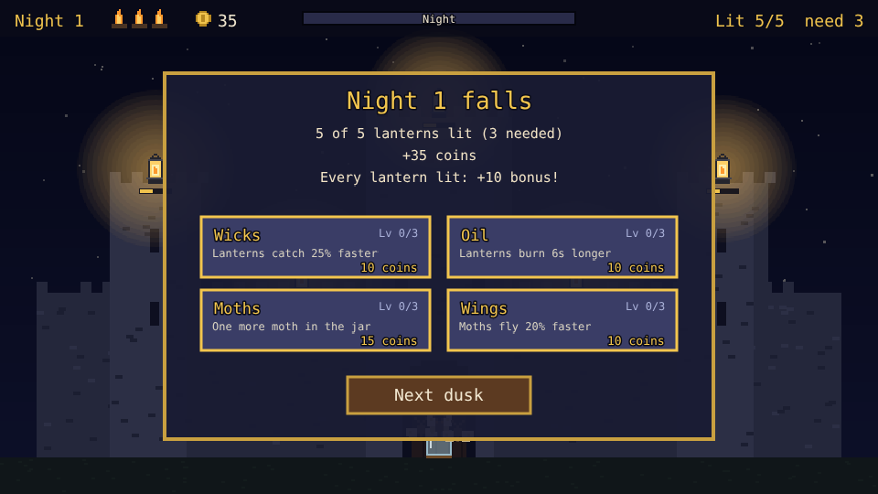

# Lanternkeep

A lantern-lighting prototype built with [Phaser 4](https://phaser.io), TypeScript and Vite, part of
the [game hub](../../README.md).

Dusk is falling on the keep. Its lanterns are dark, and the only way to light them is a jar of
moths: tap a lantern and a moth flies out, catches its wick and flies home. A lantern only burns
for so long on its oil, so light them too early and they are out again before night. Have enough
of them burning when the sun is gone and they pay coins; too few and one of the keep's hearths
goes out. Spend the coins between nights on better wicks, more oil and more, faster moths.


## How to play

| Control | Action |
| --- | --- |
| Tap or click a lantern | Send an idle moth to light it, or to refill a lit one's oil |
| Tap or click an upgrade | Between nights: buy its next level |
| Next dusk | Between nights: start the next night's dusk |
| New keep | After the game ends: start again |

1. **Dusk lasts 45 seconds.** The bar at the top empties as the sun sinks.
2. **Moths**: three wait in the jar at the gate. Each one flies to the lantern you tap, takes a
   moment to catch the wick (the ring fills), then flies back to the jar before it can go again.
   A lantern a moth is already on its way to sends no second moth.
3. **Oil**: a lit lantern burns for 20 seconds (the bar under it), then goes dark. Sending a moth
   to a lit lantern fills it up again.
4. **Nightfall** counts the lanterns still lit. Each pays 5 coins, and all of them lit pays 10
   more. Fewer than three in five lit puts out one of the three hearths; when the last goes out,
   the keep is lost. The most nights kept is saved in the browser.
5. **Each night** adds one more lantern, up to ten.


### Upgrades

| Upgrade | Each level | Costs |
| --- | --- | --- |
| Wicks | Lanterns catch 25% faster | 10, 20, 35 |
| Oil | Lanterns burn 6 seconds longer | 10, 20, 35 |
| Moths | One more moth in the jar | 15, 30, 50 |
| Wings | Moths fly 20% faster | 10, 20, 35 |



The difficulty, set on the hub page's Settings, changes one thing: lanterns burn 26 seconds on
Easy and 16 on Hard, instead of 20.

## Running locally

`npm run dev` at the repo root, then open `/games/lanternkeep/` (or pick Lanternkeep on the hub
page).

## Playthrough test

`e2e/playthrough.spec.ts` plays the first night in headless Chromium: it taps a lantern and checks
one moth (and only one) flies out and lights it, waits for its oil to run dry, then late in the
dusk taps lanterns until all five burn, checking the last ones wait for moths to come home. Night
falls with every lantern lit, and it checks the pay, the hearths and the night panel. Like the
other games' tests it owns the game clock and plays at 4x speed (`PLAYTHROUGH_SPEED`). The
**Playthrough Lanternkeep** workflow (`.github/workflows/playthrough-lanternkeep.yml`) runs it on
every PR that touches this folder, and uploads the video and screenshots as the
`playthrough-lanternkeep` artifact.

```sh
npx playwright test --project lanternkeep
```

## Code layout

All paths are inside `games/lanternkeep/`.

- `src/game/`: the rules in plain TypeScript with no Phaser dependency. `state.ts` has dusk, moths,
  oil, nightfall and the upgrades, `places.ts` where the lanterns and the jar are, and `save.ts`
  the best score.
- `src/scenes/`: `BootScene` bakes textures, `GameScene` draws the sky, castle, lanterns, moths,
  HUD and panels and wires taps to the rules, `layout.ts` says where the HUD and panels go.
- `src/art/`: the castle, lanterns, moths, jar and icons, drawn in code and baked at startup.
- `src/ui/`: the button.

Retuning a night is the constants at the top of `src/game/state.ts`; an upgrade is its row in
`UPGRADES` there.
