# Lanternkeep

A lantern-lighting prototype built with [Phaser 4](https://phaser.io), TypeScript and Vite, part of
the [game hub](../../README.md).

Dusk is falling on the keep. Its lanterns are dark, and the only way to light them is a jar of
moths: tap a lantern and a moth flies out, catches its wick and flies home. A lantern only burns
for so long on its oil, so light them too early and they are out again before night. Have enough
of them burning when the sun is gone and they pay coins; too few and one of the keep's hearths
goes out. Each night the herald orders a bonus, gusts come for the lanterns, and a refill that
saves a nearly dry lantern pays on the spot. Every night is of a kind (foggy, a feast, stormy),
bats come to snuff the lanterns, and lanterns side by side form chains that pay when all of them
burn. Spend the coins between nights on better wicks, more oil, more and faster moths and
fireflies. Keep ten nights to reach the Great Festival; the nights go on after it.

It is played as a shadow-puppet theatre: the keep is black cut card in front of a backlit paper
screen that turns from saffron to indigo as dusk falls, light shows through its arrow slits and
stone joints, the lanterns have coloured-glass panes and the moths are lace-winged puppets.

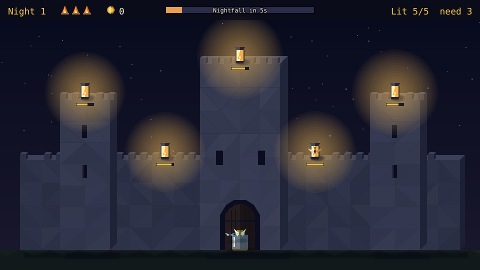

## How to play

| Control | Action |
| --- | --- |
| Tap or click a lantern | Send an idle moth to light it, or to refill a lit one's oil; with every moth busy, the tap waits in line |
| Tap or click a bat | Send an idle moth to chase it off |
| Tap or click an upgrade | Between nights: buy its next level |
| Next dusk | Between nights: start the next night's dusk |
| Keep going | After the Great Festival: play on |
| New keep | After the game ends: start again |

1. **Dusk lasts 45 seconds.** The bar at the top empties as the sun sinks.
2. **Moths**: three wait in the jar at the gate, one of each kind. Each one flies to the lantern
   you tap, takes a moment to catch the wick (the ring fills), then flies back to the jar before it
   can go again. A lantern a moth is already on its way to sends no second moth.
   - **Fast** (lighter, blue wings) flies 50% faster, but takes 30% longer to catch the wick.
   - **Slow** (pale green wings) flies 25% slower, but catches the wick 30% quicker.
   - **Heavy** (big, tan wings) flies 20% slower, and its lanterns burn 50% longer (30 seconds).
   The jar keeps the kinds in that order as it grows: a fourth moth from the Moths upgrade is fast.
   - **Firefly** (green-gold wings and a glowing tail), bought with the Firefly upgrade, flies 10%
     faster and lights two lanterns in one flight: after the one you tap it flies on to the oldest
     waiting tap, or else the nearest dark lantern no moth is going to, then home. A tap sends an
     idle firefly before any other moth.
3. **Queue**: a tap made while every moth is busy is not lost. Up to two taps wait, with an amber
   ring on their lanterns, and the next moth to come home takes the oldest. A tap on a lantern a
   moth is already flying to is ignored, and the queue empties at nightfall.
4. **Oil**: a lit lantern burns for 20 seconds (the bar under it), then goes dark. Sending a moth
   to a lit lantern fills it up again; while the moth sits on it, it burns no oil. Queued taps
   show their place in line on a small badge.
5. **Herald's order**: each night the card under the HUD names a bonus goal, with a pip for each
   part of it. Meet it by nightfall for 15 more coins. The orders take turns, one a night:
   - Both towers and the keep lit at nightfall (night 1, 6, ...).
   - The west wall lit at nightfall: left tower, left wall and far left (night 2, ...).
   - Save two lanterns in a close call (night 3, ...).
   - The east wall lit at nightfall: right tower, right wall and far right (night 4, ...).
   - Shield a lantern from a gust (night 5, ...).
6. **Gusts**: five seconds before a gust, a plaque counts down ("Gust in 4s") beside the lantern
   it will blow out, with wind curling in from the nearer edge and a dashed ring round it. The
   gust goes for the lit lantern with the most oil left. A moth sitting on that lantern when the
   gust hits shields it: a moth that finishes lighting or refilling the warned lantern stays on it
   (a pale blue ring) until the gust has passed, then flies home. Otherwise the lantern goes dark.
   Night 1 has one gust (34 seconds before nightfall), nights 2 and 3 two (also 22), and every
   night after three (also 10). With no lantern lit, the wind passes harmlessly.
7. **Close calls**: a lit lantern with under 15% of its oil left shows an orange ring and a
   "Save it +2c" tag. A moth that reaches it before it goes dark refills it as a close call and
   pays 2 coins at once ("+2c close call!", with a flare of sparks).
8. **Nightfall** counts the lanterns still lit. Each pays 5 coins, all of them lit pays 10 more,
   and the herald's order its reward. Fewer than three in five lit puts out one of the three
   hearths; when the last goes out, the keep is lost. The most nights kept is saved in the
   browser.
9. **Each night** adds one more lantern, up to ten.
10. **Kinds of night**: the plaque under the HUD on the right names the night's kind, and the
    night panel says what the next one will be. The first night is always clear; after it each
    night draws one of four kinds:
    - **Clear night**: nothing changes.
    - **Foggy night**: mist over the castle, and oil burns 40% faster.
    - **Feast night**: bunting on the walls, and the lanterns, the all-lit bonus and the chains pay
      double (the herald's order does not).
    - **Stormy night**: rain, and two more gusts (also 28 and 16 seconds before nightfall).
11. **Bats**: from the third night a bat comes in from the edge of the screen (two from night 6),
    with a dotted line to the lit lantern with the most oil, and snuffs it when it gets there. Tap
    the bat and an idle moth chases it off ("Chased off!"); a moth sitting on the lantern when the
    bat arrives drives it off too. If its lantern goes dark first the bat turns to another lit one,
    and with none lit it leaves.
12. **Lantern chains**: lanterns side by side are joined by a cord: the west wall (far left, left
    tower, left wall), the east wall (right wall, right tower, far right), the keep (its two
    sconces and the top) and the gate (left wall, gate, right wall). A chain only shows on a
    night that has all its lanterns, so the first has none. The cord lights up amber while all
    of it burns, and each chain lit at nightfall pays 8 coins.
13. **The Great Festival**: keep ten nights (meet the quota ten times) and the valley holds the
    Great Festival: a win, with sky lanterns rising. "Keep going" plays on, night after night.

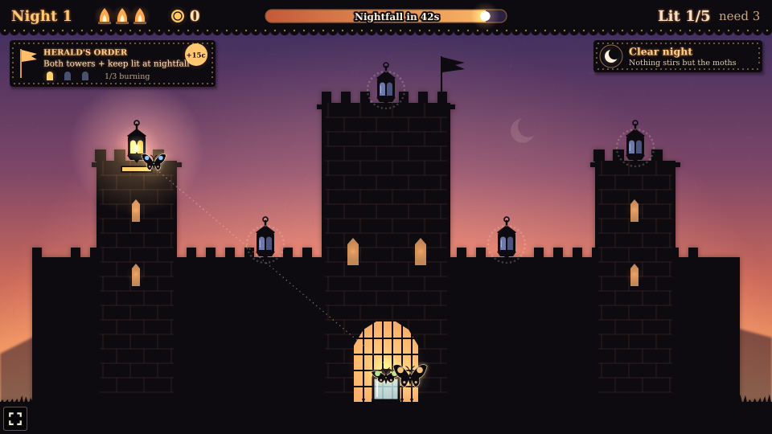

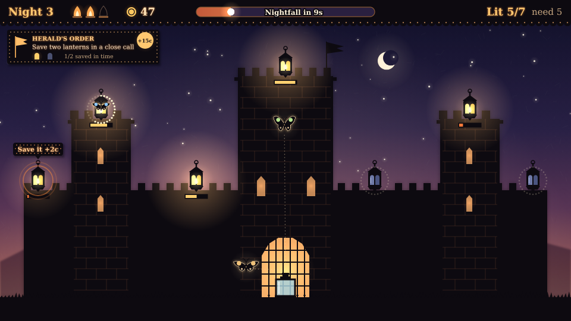

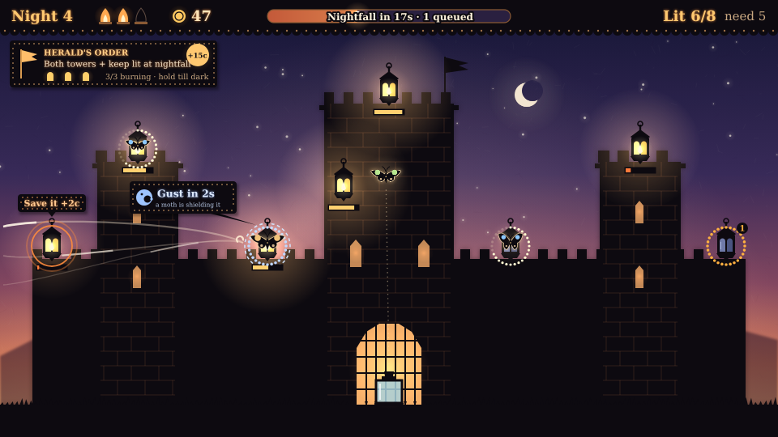

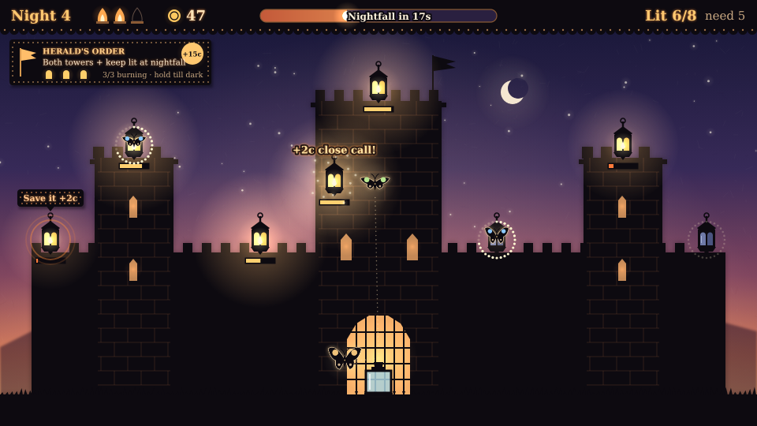

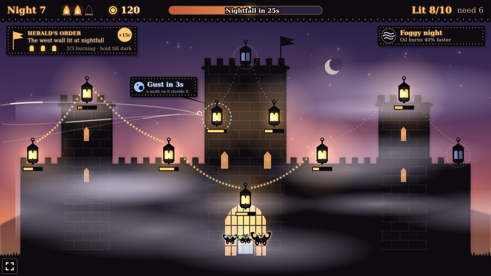

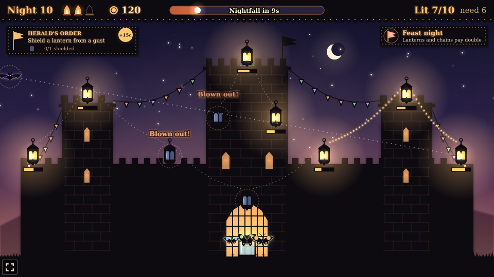

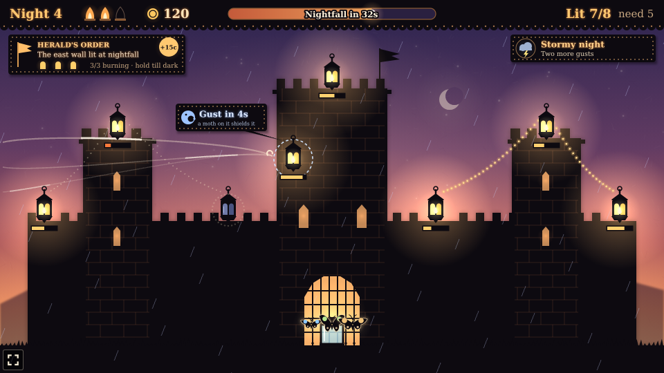

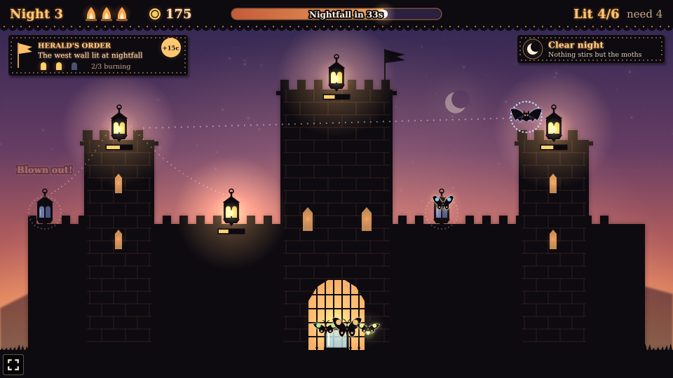

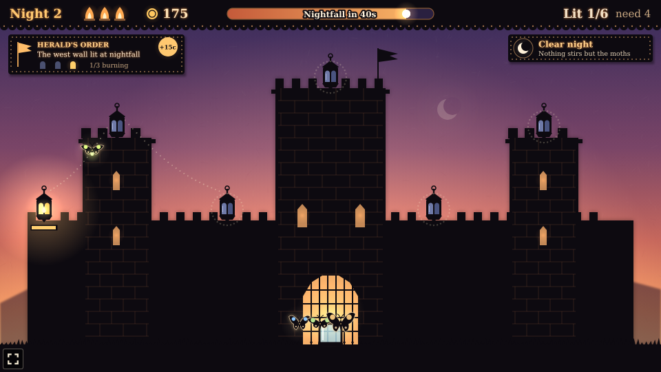

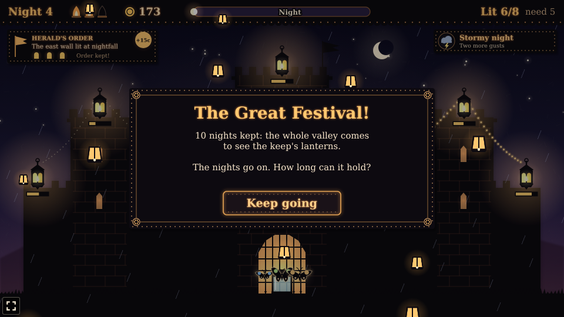

### Upgrades

| Upgrade | Each level | Costs |
| --- | --- | --- |
| Wicks | Lanterns catch 25% faster | 10, 20, 35 |
| Oil | Lanterns burn 6 seconds longer | 10, 20, 35 |
| Moths | One more moth in the jar (kinds keep cycling fast, slow, heavy) | 15, 30, 50 |
| Wings | Moths fly 20% faster | 10, 20, 35 |
| Firefly | One more firefly in the jar | 25, 45 |

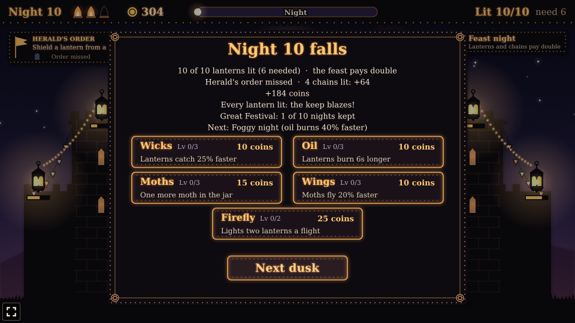

The difficulty, set on the hub page's Settings, changes one thing: lanterns burn 26 seconds on
Easy and 16 on Hard, instead of 20. (A heavy moth's lanterns burn 50% longer on every setting.)

## Running locally

`npm run dev` at the repo root, then open `/games/lanternkeep/` (or pick Lanternkeep on the hub
page).

## Playthrough test

`e2e/playthrough.spec.ts` plays the first night in headless Chromium: it checks the herald's order
and the night's one gust, taps a lantern and checks one moth (and only one) flies out and lights
it, sends a moth to sit on it when the gust is warned for it and checks the gust is shielded,
waits until its oil is nearly gone, then taps it and two more lanterns at once and two more after,
checking the last two wait in the queue and are lit as moths come home and that saving the first
pays a close call. Night falls with every lantern lit, and it checks the pay (with the order's
reward and no chain on the first night), the hearths and the night panel. It also checks the
first night is clear and has no bats. Like the
other games' tests it owns the game clock and plays at 4x speed (`PLAYTHROUGH_SPEED`). The
**Playthrough Lanternkeep** workflow (`.github/workflows/playthrough.yml`) runs it on
every PR that touches this folder, and uploads the video and screenshots as the
`playthrough-lanternkeep` artifact.

```sh
npx playwright test --project lanternkeep
```

## Code layout

All paths are inside `games/lanternkeep/`.

- `src/game/`: the rules in plain TypeScript with no Phaser dependency. `state.ts` has dusk, moths,
  oil, gusts, close calls, the herald's orders, kinds of night, bats, chains, nightfall, the Great
  Festival and the upgrades, `places.ts` where the lanterns, the chains and the jar are, and
  `save.ts` the best score.
- `src/scenes/`: `BootScene` bakes textures, `GameScene` draws the screen, castle, lanterns,
  chains, moths, bats, the order card and night-kind plaque, mist, bunting and rain, gust
  warnings, close-call tags, HUD and panels and wires taps to the rules, `layout.ts` says where
  the HUD and panels go.
- `src/art/puppet.ts`: every texture (paper screens, the cut-card castle, lanterns, moth and bat
  puppets, mist, bunting, sky lanterns, plaques, icons), painted on 2D canvases at startup.
- `src/ui/`: the button.

Retuning a night is the constants at the top of `src/game/state.ts`; an upgrade is its row in
`UPGRADES` there, a moth kind its row in `MOTH_KINDS`, an order its row in `ORDERS`, the gusts
`gustsFor` and `GUST_WARN_MS`, a kind of night its row in `NIGHT_KINDS`, the bats `batsFor` and
`BAT_SPEED`, and a chain its row in `CHAINS` in `places.ts`.
