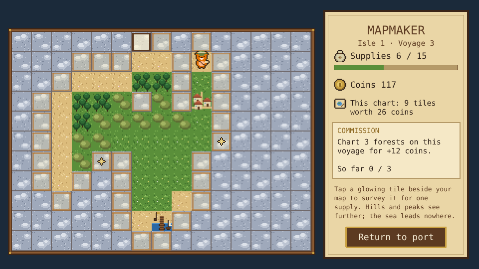
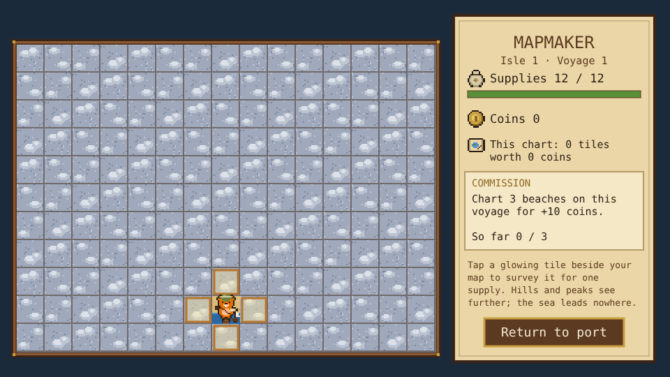
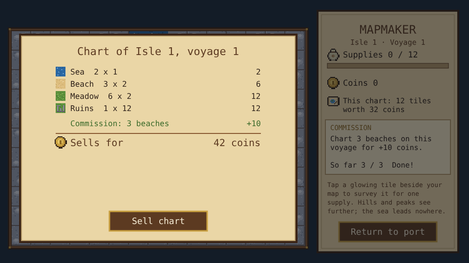
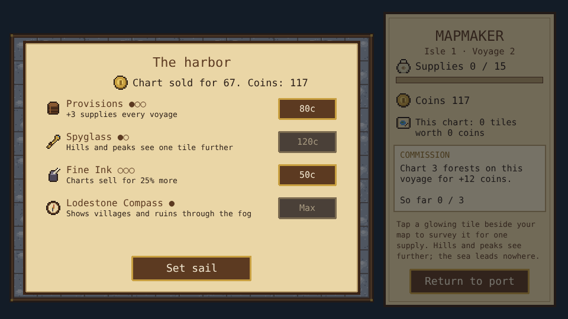

# Mapmaker

A fog-of-war charting prototype built with [Phaser 4](https://phaser.io), TypeScript and Vite,
part of the [game hub](../../README.md).

A bear surveyor lands at the port of an island hidden under fog. Each voyage you have a sack of
supplies, and every tile you survey costs one. Push inland across beaches, meadows and forests,
climb hills and peaks to see the land around them, and find the villages and ruins worth the most.
When the supplies run out (or you call it a day), the surveyor sails home and draws what they found
into a chart, which sells at the port. Spend the coins at the harbor, set sail again, and once the
whole island is charted, a new one waits over the horizon.

## How to play

| Control | Action |
| --- | --- |
| Tap a glowing tile | Survey it for one supply; the surveyor walks there |
| Return to port | End the voyage early and draw the chart |
| Sell chart | Sell the voyage's chart at the port |
| Buy | Buy an upgrade at the harbor |
| Set sail | Start the next voyage with full supplies (to a new isle once this one is charted) |

1. **Surveying**: a fogged tile glows when it is next to a charted land tile. The sea can be charted
   but leads nowhere: you can't survey on from a sea tile.
2. **Lookouts**: hills reveal the four tiles beside them for free, and peaks all eight around them.
3. **Supplies**: 12 a voyage. When they run out, the surveyor heads home on their own.
4. **Charts**: every tile revealed on a voyage, surveyed or seen from a lookout, goes on the chart.
5. **Commissions**: each voyage a buyer at the port asks for a chart with enough of one terrain,
   and pays a bonus if the chart has it.
6. **Islands**: what you have charted stays charted between voyages. Once every tile you can reach
   is charted, the next voyage sails to a new island with more villages and ruins.

The game saves itself at every step.

### What tiles are worth

| Tile | Coins | Note |
| --- | --- | --- |
| Sea | 1 | Leads nowhere |
| Beach | 2 | |
| Meadow | 2 | |
| Forest | 3 | |
| Hills | 4 | Reveals the four tiles beside it |
| Peak | 6 | Reveals the eight tiles around it |
| Village | 10 | Landmark |
| Ruins | 12 | Landmark |

### Upgrades

| Upgrade | Ranks | Costs | What it does |
| --- | --- | --- | --- |
| Provisions | 3 | 40, 80, 140 | +3 supplies every voyage |
| Spyglass | 2 | 60, 120 | Hills and peaks see one tile further |
| Fine Ink | 3 | 50, 100, 180 | Charts sell for 25% more |
| Lodestone Compass | 1 | 90 | Shows villages and ruins through the fog as gold stars |

## Difficulty

The hub's Difficulty setting changes the supplies of a voyage: 16 on Easy, 12 on Normal, 9 on Hard.

## Code layout

- `src/main.ts`: creates the game and applies the hub's settings.
- `src/game/`: the rules, with no Phaser: `island.ts` rolls an island, `sim.ts` surveys, charts,
  sells and buys, `state.ts` holds the state and numbers, `terrain.ts` and `upgrades.ts` the tables,
  `save.ts` the save.
- `src/scenes/`: `BootScene` bakes the art, `GameScene` draws the map, panel and overlays and takes
  the taps, `layout.ts` says where everything goes.
- `src/art/`: the pixel art, drawn in code (`tiles.ts`, `surveyor.ts`, `icons.ts`).
- `src/ui/Button.ts`: the wooden button.
- `e2e/playthrough.spec.ts`: plays the first voyage.

See [AGENTS.md](AGENTS.md) for how it fits together.
