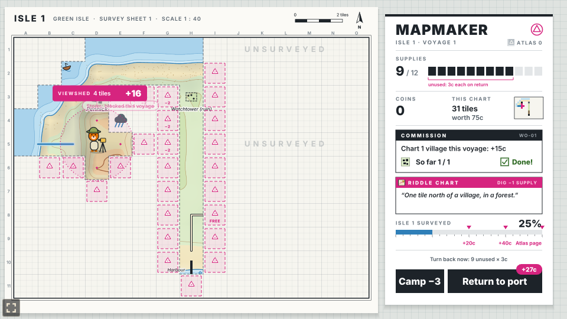
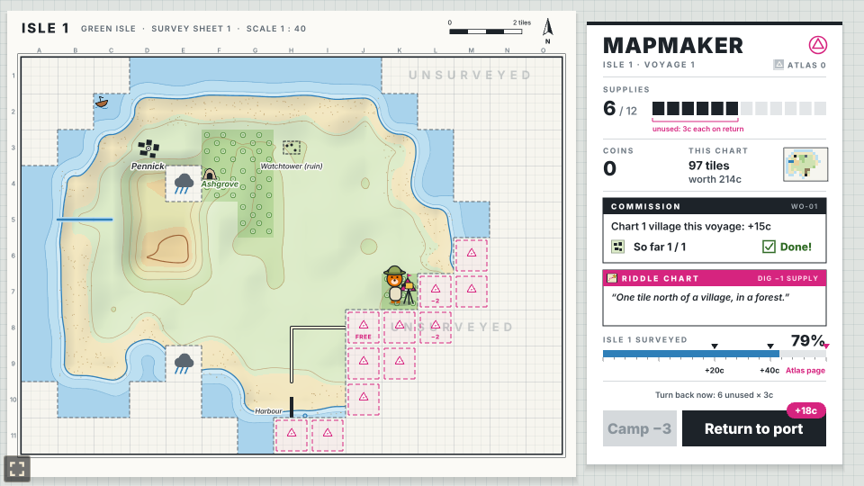
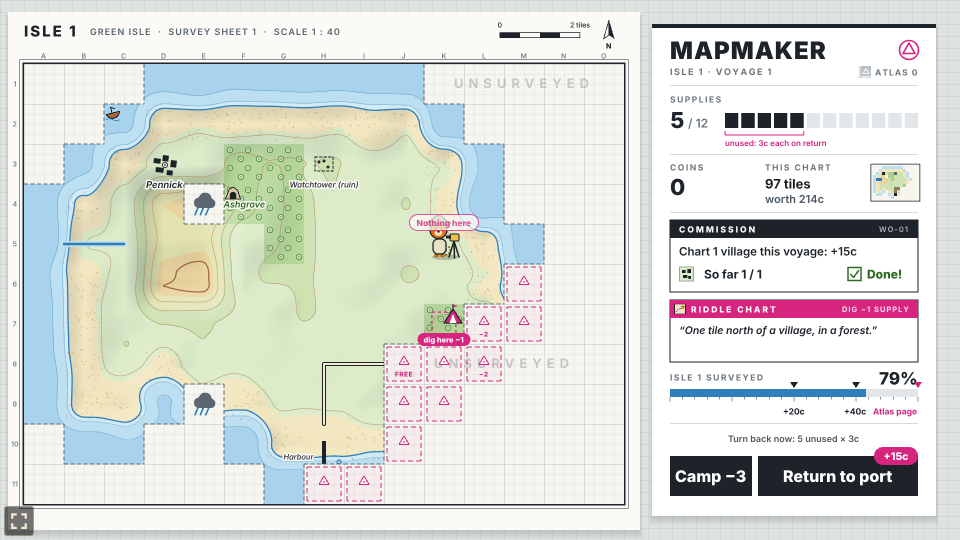
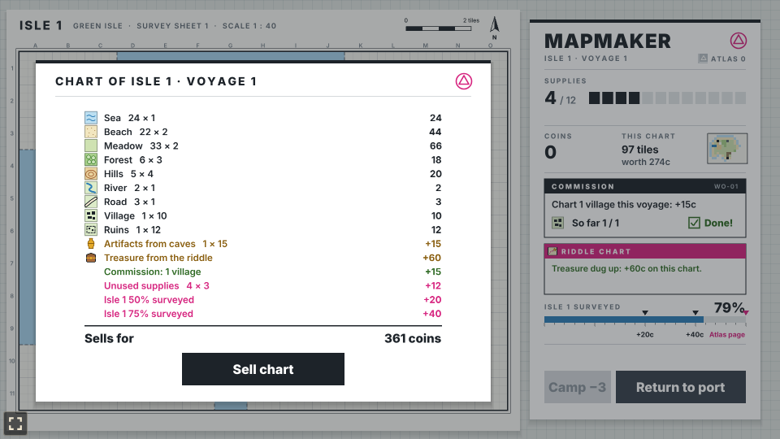
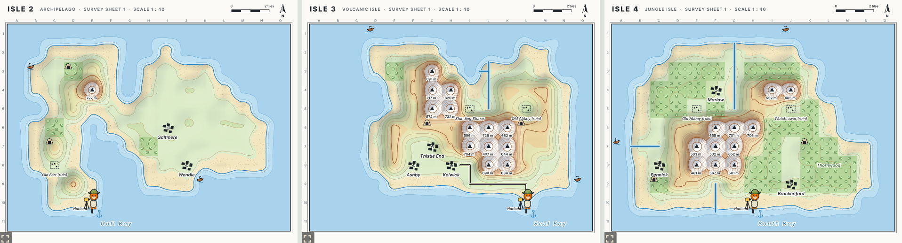

# Mapmaker

A fog-of-war charting prototype built with [Phaser 4](https://phaser.io), TypeScript and Vite,
part of the [game hub](../../README.md).

A bear surveyor lands at the port of an island nobody has mapped. The island is a modern
topographic survey sheet: what you have surveyed is printed in layered height colours with contour
lines, hill shading, map symbols and place names, and the rest is blank, gridded drafting paper.
Each voyage you have a sack of supplies, and every tile you survey costs one (two for forests and
peaks, none along rivers and roads). Push inland across beaches, meadows and forests, climb hills
and peaks to see the land around them, turn up wrecks, caves and storms, pitch base camps, solve
the ruins' treasure riddle, and find the villages and ruins worth the most. When the supplies run out (or you turn back early), the surveyor
sails home and draws what they found into a chart, which sells at the port. Spend the coins at the
harbor, set sail again, and chart the whole isle to bind it into your atlas before a new one waits
over the horizon: an archipelago, a volcanic isle or a jungle isle.

## How to play

| Control | Action |
| --- | --- |
| Tap a magenta survey station | Survey that tile for its cost; the surveyor walks there |
| Camp | Pitch a base camp where the surveyor stands, for 3 supplies |
| Tap charted ground | Once the riddle chart is found, dig there for the treasure, for 1 supply |
| Return to port | End the voyage (early, if you like: unused supplies sell back) and draw the chart |
| Sell chart | Sell the voyage's chart at the port |
| Buy | Buy an upgrade at the harbor |
| Set sail | Start the next voyage with full supplies (to a new isle once this one is charted) |

1. **Surveying**: a blank tile next to a charted land tile carries a magenta survey station
   (pointing at one shows its cost). The sea can be charted but leads nowhere: you can't survey
   on from a sea tile.
2. **Terrain costs**: most tiles cost one supply, but forests and peaks are hard going and cost
   two (the station is marked −2), and rivers and roads are free to follow (marked FREE). A station
   the supplies can't pay for turns grey, so the route you take matters.
3. **Finds**: some tiles hide something, found the moment they are charted. A shipwreck's stores
   add 3 supplies to the voyage; a cave holds an artifact that sells for 15 coins with the chart;
   a storm settles on a blank tile nearby and blocks it until the voyage ends.
4. **Base camps**: Camp spends 3 supplies to pitch a magenta tent where the surveyor stands (not
   on the port). From then on, for the rest of the isle, you can survey any blank tile up to two
   steps from a camp, even with fog in between.
5. **Treasure riddle**: the ruins hold a riddle chart. Chart them and the panel reads its clues,
   such as "Two tiles west of a peak, by the water". Tap charted ground to dig there for 1 supply;
   the right tile pays 60 coins with the chart. While the riddle is open and you have a supply
   left, the voyage waits for you to tap Return to port.
6. **Lookouts**: hills reveal the four tiles beside them for free, and peaks all eight around them.
   A lookout that charts new ground sweeps a dotted sight ring out over the tiles it sees, and their
   values gather into one tally ("Viewshed, 6 tiles, +18"), while the panel's small live chart inks
   the new tiles in magenta.
7. **Supplies**: 12 a voyage. When they can't pay for anything more, the surveyor heads home on
   their own.
8. **Turn back early or push on**: every supply left when you tap Return to port sells back for 3
   coins, up to what the chart's tiles are worth. The panel brackets the unused supply pips and the
   button carries the sell-back as a magenta tag (+18c). A voyage that spends every supply sells
   none back.
9. **Charts**: every tile revealed on a voyage, surveyed or seen from a lookout, goes on the chart,
   with any artifacts and the treasure.
10. **Commissions**: each voyage a buyer at the port asks for a chart with enough of one terrain,
   and pays a bonus if the chart has it.
11. **Isle goal**: the panel's "Isle surveyed" bar shows how much of the isle is charted (its land
   and the sea beside it). The voyage whose chart takes it past 50% pays +20 coins, past 75% +40
   coins, and at 100% the isle is bound into your atlas as a page; the atlas count shows beside the
   voyage in the panel and at the harbor.
12. **Islands**: what you have charted stays charted between voyages. Once every tile you can reach
   is charted, the next voyage sails to a new island with more villages and ruins. The isles take
   turns: a green isle, an archipelago (islets joined by sandbars, lots of beach), a volcanic isle
   (hills and peaks, little wood) and a jungle isle (thick forest cut by rivers, no roads). Each
   binds into the atlas as a page of its own colour.

The game saves itself at every step.

### What tiles are worth

| Tile | Coins | Survey cost | Note |
| --- | --- | --- | --- |
| Sea | 1 | 1 | Leads nowhere |
| Beach | 2 | 1 | |
| Meadow | 2 | 1 | |
| Forest | 3 | 2 | |
| Hills | 4 | 1 | Reveals the four tiles beside it |
| Peak | 6 | 2 | Reveals the eight tiles around it |
| River | 1 | free | Runs from the high ground to the sea |
| Road | 1 | free | Runs from the port to a village |
| Village | 10 | 1 | Landmark |
| Ruins | 12 | 1 | Landmark; holds the riddle chart |

| Find | What it does |
| --- | --- |
| Shipwreck | +3 supplies this voyage |
| Cave | An artifact, +15 coins on the chart |
| Storm | Blocks a blank tile nearby until the voyage ends |
| Treasure | Dug up on the riddle's tile: +60 coins on the chart |

A voyage that turned back with supplies left and took the isle past 50%: the unused supplies and
the milestone are paid with the chart.

### Upgrades

| Upgrade | Ranks | Costs | What it does |
| --- | --- | --- | --- |
| Provisions | 3 | 40, 80, 140 | +3 supplies every voyage |
| Spyglass | 2 | 60, 120 | Hills and peaks see one tile further |
| Fine Ink | 3 | 50, 100, 180 | Charts sell for 25% more |
| Lodestone Compass | 1 | 90 | Shows villages and ruins on blank paper as gold compass roses |

Once an isle is charted in full, its atlas page shows at the harbor and the next voyage sails to a
new isle.

## Difficulty

The hub's Difficulty setting changes the supplies of a voyage: 16 on Easy, 12 on Normal, 9 on Hard.

## Code layout

- `src/main.ts`: creates the game and applies the hub's settings.
- `src/game/`: the rules, with no Phaser: `island.ts` rolls an island (rivers, roads, finds and the
  riddle included), `sim.ts` surveys, camps, digs, charts, sells, buys and tracks the isle goal,
  `state.ts` holds the state and numbers, `terrain.ts`, `kinds.ts` and `upgrades.ts` the tables,
  `save.ts` the save.
- `src/scenes/`: `BootScene` bakes the art, `GameScene` paints the island and draws the sheet,
  panel and overlays and takes the taps, `layout.ts` says where everything goes.
- `src/art/`: the survey-sheet art, painted on canvases in code: `map.ts` (terrain, contours,
  symbols, rivers, roads, blank paper, place names), `surveyor.ts`, `icons.ts` (also the finds,
  camp, riddle and treasure marks), `paint.ts` (colours and helpers).
- `src/ui/Button.ts`: the flat ink button.
- `e2e/playthrough.spec.ts`: plays the first voyage.

See [AGENTS.md](AGENTS.md) for how it fits together.
