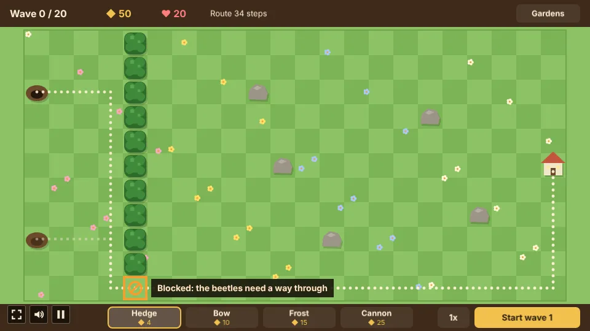
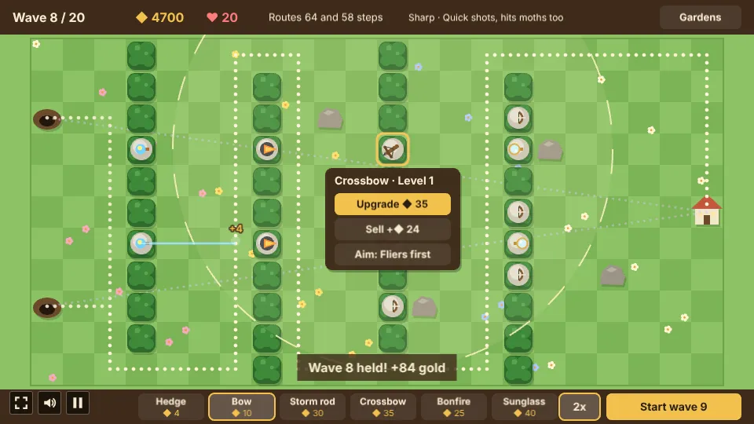
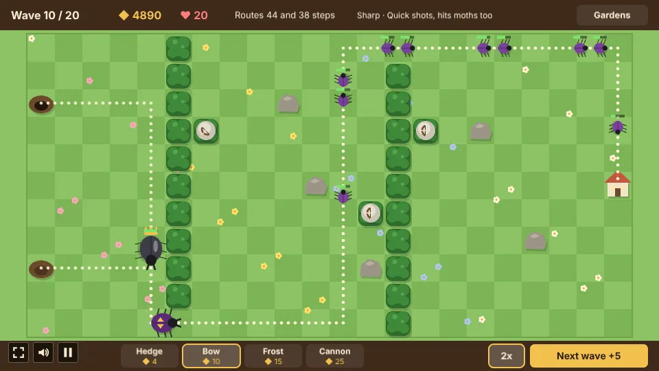
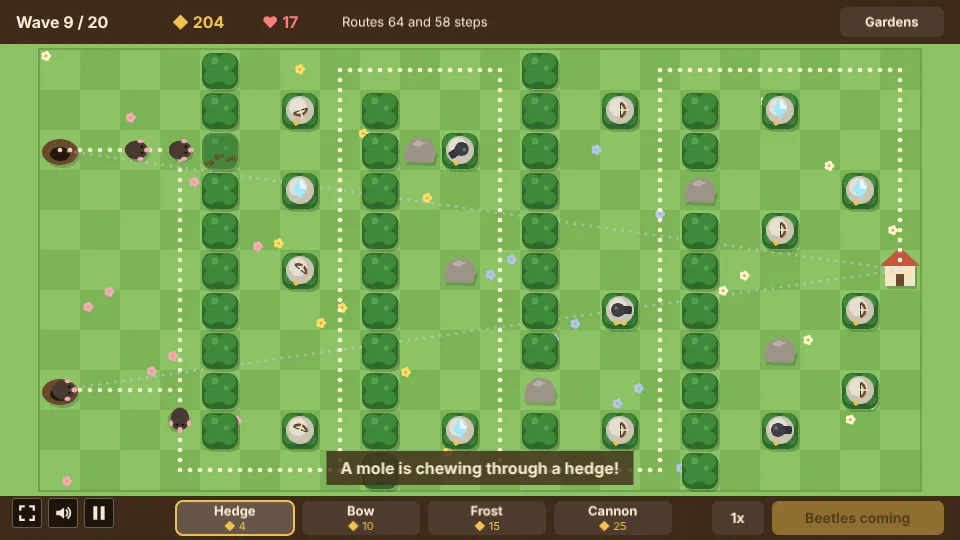

# Mazewright

A tower defense with no road, built with [Phaser 4](https://phaser.io), TypeScript and Vite, part of
the [game hub](../../README.md).

Beetles come out of their burrows and walk to the cottage across an open lawn, always by the
shortest free way. Every hedge and tower you plant is a wall, so you build the maze they must walk:
the longer it is, and the more towers it passes, the fewer beetles get in. The one rule: a way
through must always stay open. A planting that would close the last way from a burrow (or trap a
beetle already on the lawn) is refused with an orange no-entry ring.

## How to play

| Control | Action |
| --- | --- |
| Tap or click a tool, or keys 1 to 6 | Pick a tower from your pouch |
| Tap, click or drag on the lawn | Plant the tool there, or a whole line of them |
| Hover the lawn | See the new route before you plant |
| Tap or click a tower | Open its panel: Upgrade, Sell (tap it twice), Aim for a tower that picks a target, and Turn for a bonfire or sunglass |
| Start wave, or Space | Send the next wave; once the last one is all out, send the next early for 5 gold |
| Speed button, or F | Play at double speed |
| Gardens | Back to the garden picker |

### Gardens

Three gardens, each with its own rocks and burrows, so each asks for its own maze: the open
**Meadow**, the **Orchard** with its rows of rocks, and the **Millpond** with one burrow at the top
and the cottage in the corner. Rocks never move and nothing is planted on them. The picker shows
the best wave reached in each garden.

Under the cards is your **pouch**: the hedge and the bow always come along, and you pick up to four
more of the other ten towers. The pick is kept for the next game.

### Towers

Every tower stands on a hedge and blocks its tile. Every tower but the hedge rises to level 3;
selling gives back 70% of what a tower cost.

| Tower | Cost | Reach | What it does |
| --- | --- | --- | --- |
| Hedge | 4 | | Only blocks the way: the cheap way to make the maze longer |
| Bow | 10 | 3 tiles | Quick single shots at the foe closest to the cottage; hits moths |
| Frost | 15 | 2.5 tiles | A pulse every second that chills (slows to about half) and nicks everything near it |
| Cannon | 25 | 3.5 tiles | Slow shots that hit every foe on the ground around the target; not moths |
| Storm rod | 30 | 3 tiles | A bolt that jumps on to up to 3 more foes standing close together (4 and 5 at higher levels); hits moths |
| Crossbow | 35 | 7 tiles | Slow, heavy bolts at the toughest foe in reach; hits moths |
| Bonfire | 25 | 2.2 tiles, one way | Breathes flames down the way it points and sets ground foes alight; turn it from its panel |
| Puffball | 20 | 2.5 tiles | Poisons a foe, and the poison spreads to ground foes walking close to it; goes through armour |
| Sunglass | 40 | its row or column | A beam down the way it points, up to the first rock or tower, hitting every foe in the line |
| Beehive | 30 | the 8 tiles round it | Doesn't shoot: the towers round it reload 20% faster (30%, 40%) |
| Apple tree | 30 | | Doesn't shoot: drops 5 gold each time a wave is held (8, 12) |
| Whirligig | 20 | 2.5 tiles | Darts that come faster the longer it keeps firing; hits moths |

**Damage kinds and shells.** Every tower's hits are Sharp (bow, crossbow, whirligig), Blast
(cannon), Heat (bonfire, sunglass, and burning), Spark (storm rod), Cold (frost) or Poison
(puffball). Some foes wear a shell: the stag beetle's is waxy (half Heat, 1.5 times Blast), the
mole's coat is hairy (half Blast, 1.5 times Sharp) and the weevil's is hard (half Sharp, 1.5 times
Spark). Poison goes through every shell. Sunglass and bonfire hits also heat a foe up; once it
glows, it takes double Heat damage.

**Aim.** A tower that picks one target can aim at the First foe (closest to the cottage), the
Last, the Strongest, the Weakest or Fliers first. The crossbow starts on Strongest, the others on
First.

### Foes

| Foe | | Lives it costs |
| --- | --- | --- |
| Beetle | the usual walker | 1 |
| Ladybird | quick and frail | 1 |
| Stag beetle | slow and tough, with a waxy shell | 2 |
| Moth | flies straight from its burrow to the cottage, over the maze | 1 |
| Mole | a hairy coat; walks the maze, but chews through a hedge (not a tower) that stands in the way of a much shorter route | 1 |
| Woodlouse | from wave 6; splits into two small woodlice when beaten | 1 |
| Earwig | from wave 7; the fastest foe, and tough | 1 |
| Weevil | from wave 8; a hard shell | 1 |
| Snail | from wave 9; slow, a rubbery shell (half Spark, 1.5 times Cold), and heals unless chilled or poisoned | 1 |
| Ember beetle | from wave 11; fire-proof, Heat does nothing to it | 1 |
| Beetle queen | wave 10, very tough | 5 |
| Beetle Empress | wave 20: lays a beetle every 5 seconds and turns her shell against the kind of damage that hurt her most | 5 |

**Kings and big foes.** A king wears a crown: six times the health, slower, eight times the gold
and three lives. A king beetle leads wave 5, a king stag beetle wave 10 and a king mole wave 15,
and some kings bring a trick: a king mole chews three hedges, a king woodlouse splits into four, a
king moth lets three moths go when beaten. Big foes (size 2 and 3, from wave 12) are bigger,
tougher and cost more lives. After the Empress, one king of every kind rushes in.

There are 20 waves, each tougher than the last. The second burrow opens at wave 6, and from then on
foes come out of both in turn, so the maze has to serve two routes; both must stay open from the
start. Beaten foes pay gold, and a held wave pays 6 more plus its number. Hold all 20 to save the
garden.

**Difficulty** (hub setting): Easy gives 30 lives and foes 20% less health, Hard 12 lives and 25%
more health; Normal is 20 lives.

## Code layout

- `src/game/rules.ts`: the grid size, towers, foes, waves and tuning numbers.
- `src/game/maps.ts`: the three gardens (burrows, cottage, rocks).
- `src/game/grid.ts`: the walking field (steps from every tile to the cottage) and routes.
- `src/game/sim.ts`: a game: building and the never-close rule, foes, shots, waves and events.
- `src/game/save.ts`: the best wave per garden.
- `src/scenes/GameScene.ts`: the garden picker and the game screen: input, drawing and the bars.
- `src/scenes/art.ts`, `layout.ts`: the flat vector art and where things go.
- `src/audio.ts`: music and sound effects.
- `src/i18n/`: the texts in British English, US English and German; `src/howToPlay.ts`.
- `e2e/playthrough.spec.ts`: plays the first wave.

Run it with `npm run dev` from the repo root and open `/games/mazewright/`.
