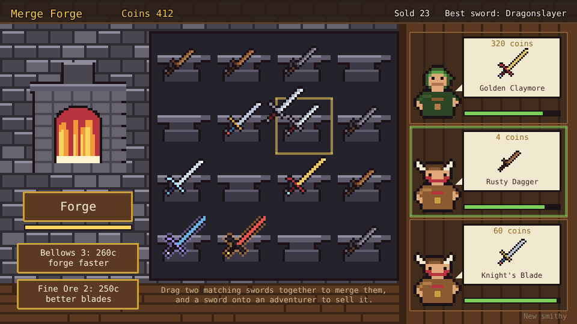
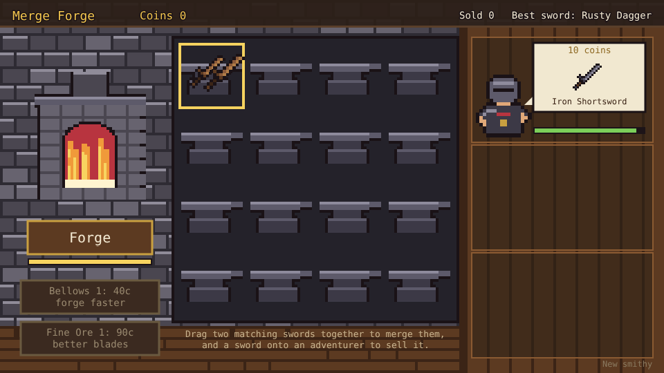

# Merge Forge

A merge game prototype built with [Phaser 4](https://phaser.io), TypeScript and Vite, part of the
[game hub](../../README.md).

You run a smithy. The forge on the left makes Rusty Daggers onto a board of sixteen anvils. Drag
two matching swords together and they merge into one sword of the next tier, up to the
Dragonslayer. Adventurers come to the counter on the right, each asking for a sword, and you sell
them one by dragging it onto them. The coins buy upgrades for the forge.



## How to play

| Control | Action |
| --- | --- |
| Tap or click Forge | Make a Rusty Dagger on the first empty anvil, once the forge is hot |
| Drag a sword onto a matching sword | Merge the two into one of the next tier |
| Drag a sword onto an empty anvil or another sword | Move it there, or swap the two |
| Drag a sword onto an adventurer | Sell it, if it is at least as good as the one they asked for |
| Tap an upgrade | Buy its next rank |
| New smithy (bottom right) | Throw the board, coins and upgrades away and start again |

1. **The forge** makes one sword at a time and then has to heat up again (1.2s), shown by the bar
   under the button.
2. **Merging**: two swords of the same tier make one of the next. While you hold a sword, the
   swords it can merge with are outlined in gold and the adventurers who would buy it in green.
3. **Adventurers** come every 6 seconds while there is room at the counter, three at most. The
   first one always wants an Iron Shortsword; later ones ask for anything up to one tier better
   than your best sword so far. They pay the price of the sword you give them, and leave if they
   wait too long (the bar under their order).
4. **The smithy is kept**: the board, coins, swords sold and upgrades are saved in the browser.



### Swords

| Tier | Sword | Price |
| --- | --- | --- |
| 1 | Rusty Dagger | 4 |
| 2 | Iron Shortsword | 10 |
| 3 | Steel Sword | 25 |
| 4 | Knight's Blade | 60 |
| 5 | Silver Saber | 140 |
| 6 | Golden Claymore | 320 |
| 7 | Runeblade | 720 |
| 8 | Dragonslayer | 1600 |

### Upgrades

| Upgrade | Ranks | What it does |
| --- | --- | --- |
| Bellows | 4 (40, 110, 260, 600 coins) | The forge heats up 20% faster per rank |
| Fine Ore | 3 (90, 250, 700 coins) | 20% chance per rank that the forge makes an Iron Shortsword |

The difficulty, set on the hub page's Settings, changes one thing: adventurers wait 50% longer on Easy and 30% less on Hard.

## Running locally

`npm run dev` at the repo root, then open `/games/merge-forge/` (or pick Merge Forge on the hub page).

## Playthrough test

`e2e/playthrough.spec.ts` plays the first sale in headless Chromium: it checks the new smithy,
waits for the first adventurer and their Iron Shortsword order, taps Forge twice (checking the
forge must heat up in between), drags one dagger onto the other and checks they merged, then drags
the Shortsword onto the adventurer and checks the coins and the sale. Like the other games' tests
it owns the game clock and plays at 4x speed (`PLAYTHROUGH_SPEED`). The **Playthrough Merge
Forge** workflow (`.github/workflows/playthrough-merge-forge.yml`) runs it on every PR and push to
main that touches this folder or a shared build file, and uploads the video and screenshots as the
`playthrough-merge-forge` artifact.

```sh
npx playwright test --project merge-forge
```

## Code layout

All paths are inside `games/merge-forge/`.

- `src/game/`: the rules in plain TypeScript with no Phaser dependency. `swords.ts` and
  `upgrades.ts` are data tables, `state.ts` holds the shop and its timings, `sim.ts` forges,
  merges, sells, buys and moves the adventurers on, and `save.ts` keeps the smithy.
- `src/scenes/`: `BootScene` bakes textures, `GameScene` draws the smithy and turns drags into
  rules calls, `layout.ts` says where things are drawn.
- `src/art/`: all the pixel art, drawn in code and baked into textures at startup: the eight
  swords, the adventurers, the furnace, the anvils and the smithy.
- `src/ui/`: the buttons.

Adding a sword is an entry in `src/game/swords.ts` and a look for it in `src/art/swords.ts`.
