# Palisade

A wave defense prototype built with [Phaser 4](https://phaser.io), TypeScript and Vite, part of
the [game hub](../../README.md), drawn in low-poly 3D: flat-shaded peaks, a castle on the far hill,
rows of pines and a road of faceted earth, with every figure lit from the top left.

A ranger stands on the road on the left, behind a cheval de frise: a heavy log with sharpened
stakes driven through it. Goblins, orcs, harpies, dark knights, shield bearers and shamans march
(or fly) in from the right in ever bigger waves, along a road of ten waves that ends in a boss: the Troll King on wave 10, and a new boss on
every tenth wave after. The ranger can't move and shoots on their own, at the foe nearest the
barricade unless the aim toggle says otherwise. Every kill fills the experience bar and charges Arrow Rain, a volley the player drags
onto the horde, and charges Caltrops, a patch of spikes dragged onto the road; kills pay coins that
hire a spearman or a mage onto the barricade, or buy a fortification in the break; kills in quick
succession build a streak that gives more experience; every level-up pauses the battle on three
upgrades to pick from; after each boss the hero picks the next road; and beating the third boss on
wave 30 lifts the siege, which wins the run and unlocks the next heat.

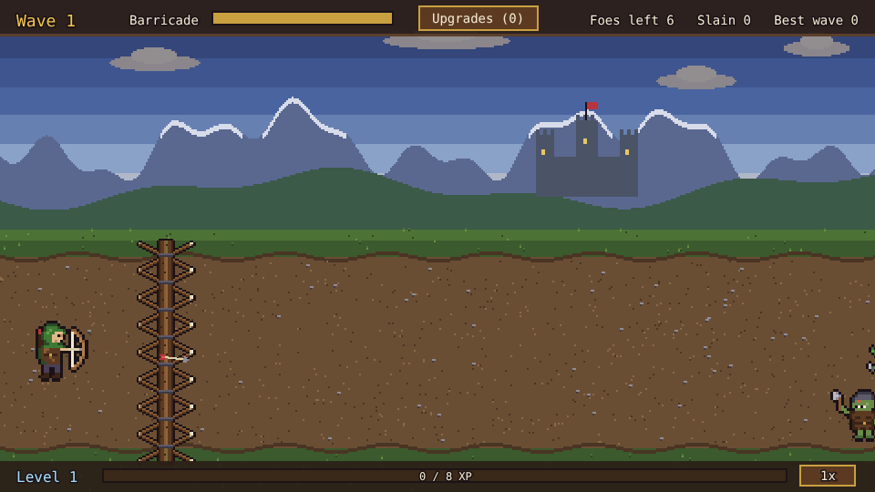

## How to play

| Control | Action |
| --- | --- |
| Drag the Arrow Rain button (above the ranger) | Once it reads READY, drag it onto the field along the dashed arc and let go over the gold ring to loose a volley there; letting go off the road cancels |
| R or Space | Loose a charged Arrow Rain on the thickest crowd of foes |
| Drag the Caltrops button (above Arrow Rain) | Once it reads READY, drag it onto the road and let go to strew caltrops there |
| C | Strew charged caltrops in front of the thickest crowd |
| Tap a slot on the barricade ("Hire") | Hire a spearman or a mage for coins, or train a hired guard; the battle waits until the panel closes |
| Fortify (under the wave track, during a break) | Buy one fortification for the coming waves: a stake line, an oil pot or a lookout; one per break |
| Aim toggle (above the caltrops) or T | Cycle who the ranger shoots first: Nearest, Strongest, Flyers or Healers |
| Keep fighting / Heat N | After the siege is lifted on wave 30: fight on past it, or start a new run at the next heat |
| Tap a road card | After a boss, take that road for the next ten waves (after 10 seconds one is taken at random) |
| Tap or click a card | Take that upgrade when a level-up comes up (after 10 seconds one is taken at random, and a pop-up names it) |
| Auto-pick checkbox (beside the level-up's countdown) | On by default; untick it to halt the countdown so a level-up waits for your pick, tick it to let it run again |
| 1x / 2x (bottom right) | Switch the battle between normal and double speed; the level-up countdown stays 10 real seconds |
| Skill book (in the top bar) | Open the skill book; the battle waits until Back |
| Hover over (or tap) the barricade's bar | Show its health, what Stout Timber adds and how much it mends after each wave |
| Fight again / New hero | After a fall: start again from wave 1 keeping the hero, or with a new one; the "Next run at" row picks the heat |

1. **Waves**: each wave brings more foes than the last, with more health. A short break with the
   wave's banner comes before each, and the barricade gets a tenth of its health back.
2. **The barricade** stops the foes, who hack at it until it breaks, losing stakes as it goes. Once
   it is splinters they walk on to the hero, and **the run is over when a foe reaches the hero**.
   Repairing it then only stops the foes still in front of it: one already past keeps walking.
3. **Experience and level-ups**: each foe gives experience when it falls, shown as a "+N XP" pop
   where it fell and gold orbs that fly into the bar; until they land, the experience they carry
   shows as a gold segment at the end of the bar. A full bar is a level, and the battle waits
   while three different upgrades are offered. A countdown under the cards shows the time left:
   after 10 seconds without a tap, one of them is taken at random.
4. **The hero is kept**: level, experience, every upgrade picked and every relic won carry over to
   the next run, which starts again at wave 1. They are saved in the browser. "New hero" starts
   from scratch.

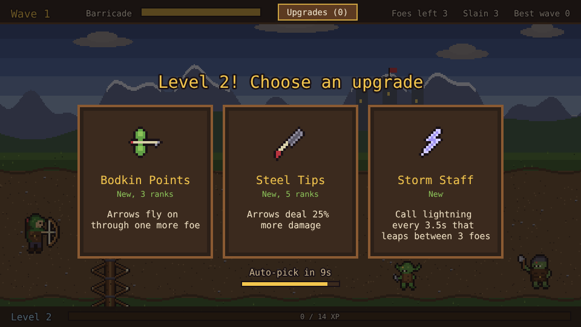

### Road to the Troll King

A track under the top bar shows the road of ten waves the hero is on: a mark for each wave, gold
once cleared, the current wave lit with its number, the boss's mark on the tenth, and the relic
chest after it. Its title names the boss ("Road to the Troll King") and its note says what waits at
the end ("Wave 10: boss, Relic chest").

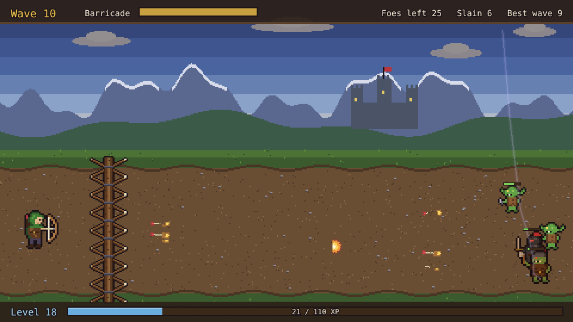

The tenth wave closes with the boss, with stacked health bars at the top of the screen. Beating
the boss opens the **relic chest**: the break after it shows the relic won, a lasting bonus kept
from run to run (a second copy of one stacks). Then the road starts again from wave 11 towards a new
boss: the Troll King on wave 10, the Ogre Warlord on wave 20, the Frost Giant on wave 30, and round
again, each with one more health bar than the last boss.

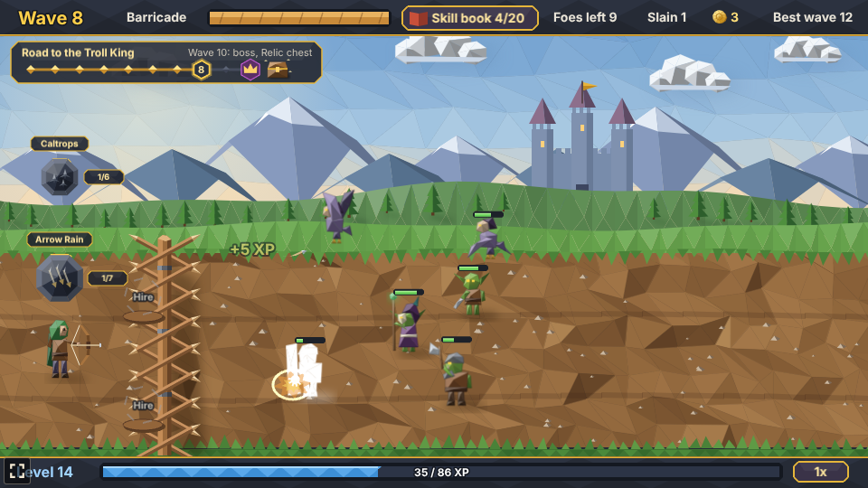
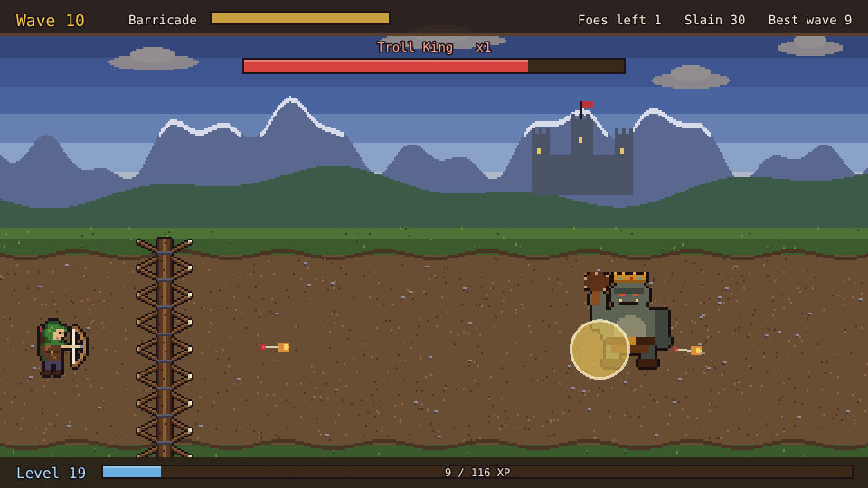
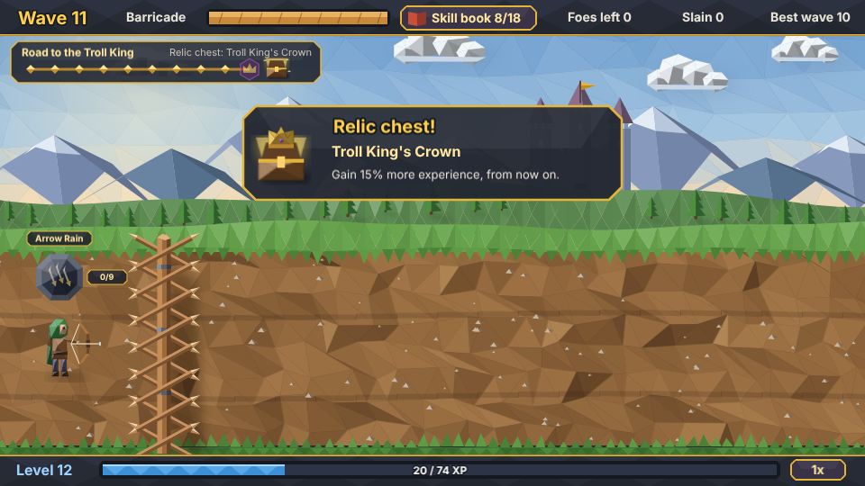

| Relic | Set | What it does |
| --- | --- | --- |
| Oakheart Charm | Warden's | The barricade has 30% more health |
| Hawk Feather | Hunter's | Arrows deal 15% more damage |
| Endless Quiver | Hunter's | Arrow Rain charges with 20% fewer kills |
| Troll King's Crown | Warlord's | Gain 15% more experience |
| War Drum | Warlord's | Shoot 10% faster |
| Streak Banner | Warden's | A kill streak lasts 1s longer |

**Relic sets.** Each relic belongs to a set of two. Holding both relics of a set adds the set's
bonus once, on top of what the relics do: the relic chest says so when a set is completed, and the
skill book lists the relics of a full set in green with its bonus above them.

| Set | Relics | Bonus |
| --- | --- | --- |
| Hunter's set | Hawk Feather, Endless Quiver | Arrow Rain hits 50% harder |
| Warlord's set | Troll King's Crown, War Drum | 10% more chance of a double-damage hit |
| Warden's set | Oakheart Charm, Streak Banner | The barricade mends 20% after each wave, not 10% |

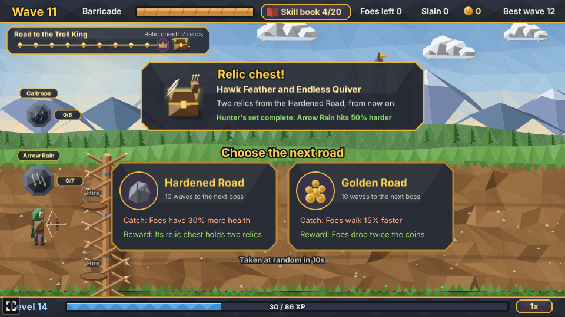

### Siege lifted and heats

Beating the third boss, the Frost Giant on wave 30, **lifts the siege**: the run is won, with a
victory panel over the relic chest. "Keep fighting" goes on to wave 31 and beyond on the same
heat, with a boss every tenth wave as before; "Heat N" starts a new run at the next heat, from wave
1 with the hero kept. Each heat adds a rule on top of the lower ones, and the game-over panel's
"Next run at" row starts the next run at any heat unlocked so far. A chip beside the wave track
shows the heat the run is on.

| Heat | Adds |
| --- | --- |
| Heat 1 | Foes come on 30% faster |
| Heat 2 | Every boss has one more health bar |
| Heat 3 | The barricade mends half as much after a wave and from Mend the Barricade |

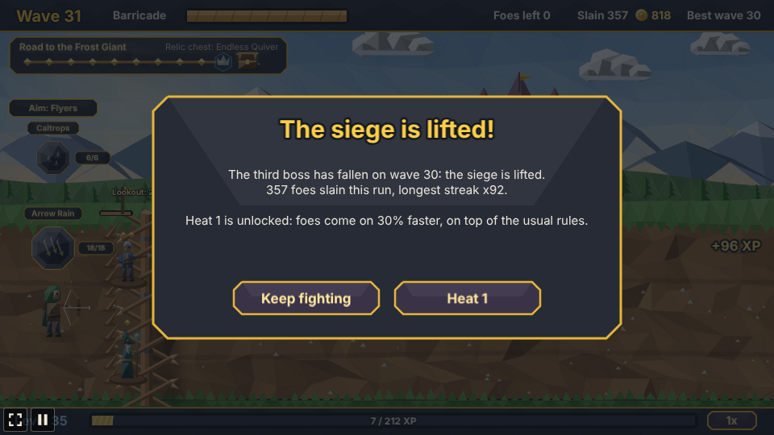
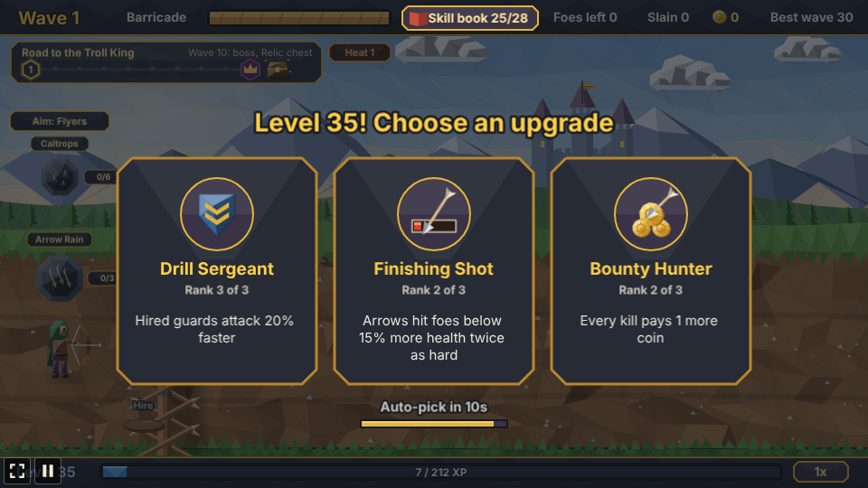
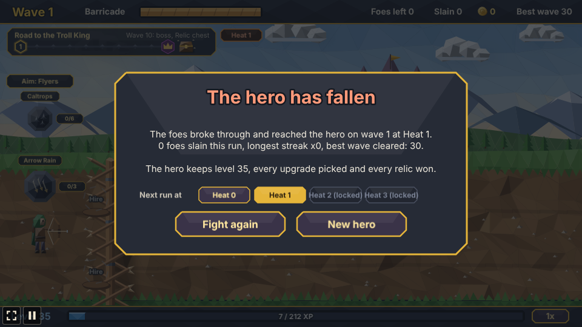

### Road choice

After each boss, under the relic chest, two road cards offer the next road of ten waves, each with
a catch and a reward. The break waits until one is tapped (or takes one at random after 10
seconds). The road's name then heads the wave track ("Golden Road to the Ogre Warlord"). The first
road has no twist, and a new run starts on it again.

| Road | Catch | Reward |
| --- | --- | --- |
| Hardened Road | Foes have 30% more health | Its relic chest holds two relics |
| Crowded Road | 40% more foes in every wave | Foes give 30% more experience |
| Golden Road | Foes walk 15% faster | Foes drop twice the coins |

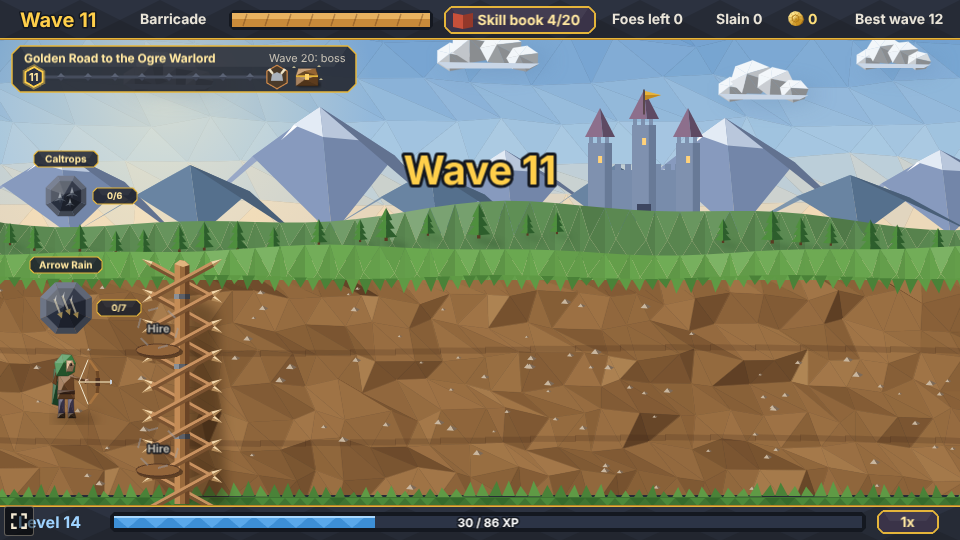

### Arrow Rain

Every kill charges the Arrow Rain button above the ranger, filling its rim edge by edge (4 kills on
wave 1, one more every other wave). Once full it glows gold and reads READY, and a hint says "Drag
onto the horde, let go to loose". Press on the button and drag: a dashed arc follows from the button
up over the field to a gold target ring on the road. Let go and a volley falls on the ring a moment
later, hitting every foe in it for four times an arrow's damage (armour takes its share off). It
then charges again from empty. A level-up or a fall drops it from the hand.

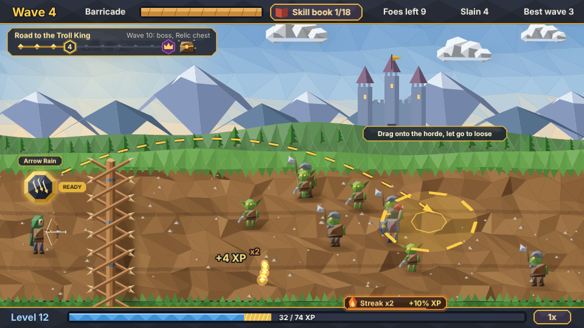
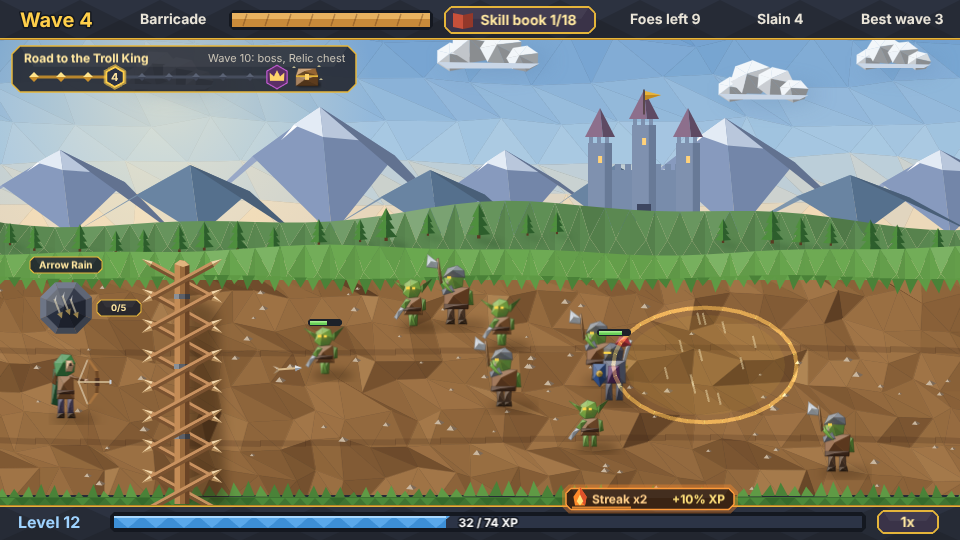

### Aim priority

The ranger always shot the foe nearest the barricade first. The toggle above the caltrops button
(or T) cycles the aim priority for the arrows and the Storm Staff's lightning: **Nearest**,
**Strongest** (the most health first, so bosses and dark knights), **Flyers** (harpies first) or
**Healers** (shamans first), the nearest first breaking every tie. Fireballs still go at the
thickest crowd and the mage still throws at the nearest. The choice is remembered in the browser,
apart from the hero.

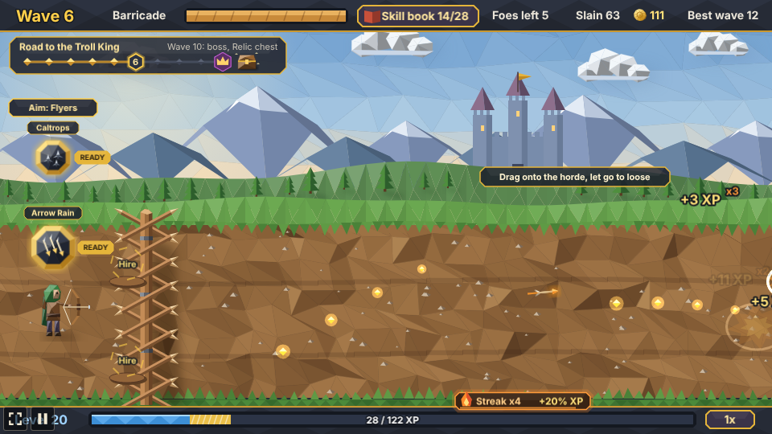

### Caltrops

The second active, on the button above Arrow Rain's. Every kill charges it too (6 kills), and once
it reads READY it is dragged onto the road the same way, along a dashed arc to a dashed patch. Let
go and caltrops are strewn over the patch, where they stay for five waves (the one they are strewn
in included) before they wear off, looking worn on their last wave: every foe walking on them is slowed by 40% and takes 80% of an arrow's damage a second, through
armour. Up to three patches lie on the road at once; strewing a fourth lifts the oldest. Harpies
fly over them.

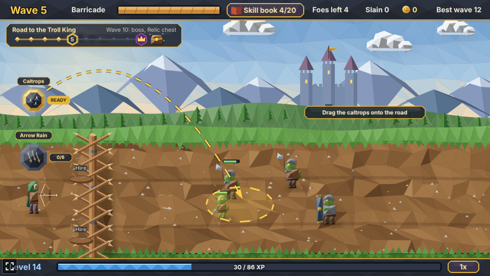
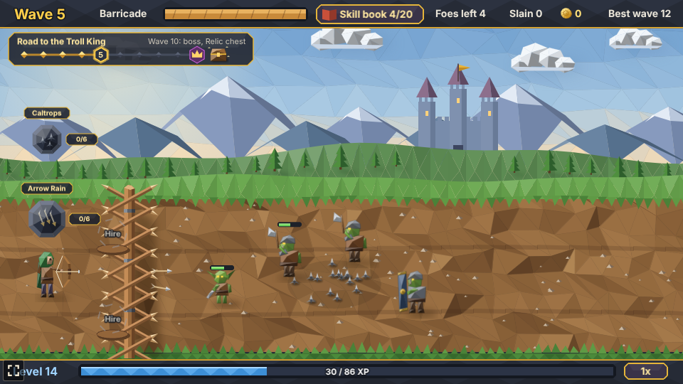

### Hired guards

Every kill pays coins (shown in the top bar): 1 for a goblin, 2 for an orc or a harpy, 3 for a
shield bearer, 4 for a dark knight or a shaman and 30 for a boss. Two slots on the barricade, one
high and one low, read "Hire" and glow once a guard can be afforded. Tapping one opens a panel to
hire a guard for this run, and tapping a hired guard trains it (twice, each time 60% more damage).
The battle waits while the panel is open; a tap beside it closes it.

| Guard | Cost | Training | What it does |
| --- | --- | --- | --- |
| Spearman | 20 coins | 30, then 40 | Stabs the foe at the barricade nearest his slot every 0.7s for 12, through shields (armour counts) |
| Mage | 30 coins | 45, then 60 | Throws an arcane bolt every 1.8s at the foe nearest the barricade, bursting for 16 over a small area, through armour and shields |

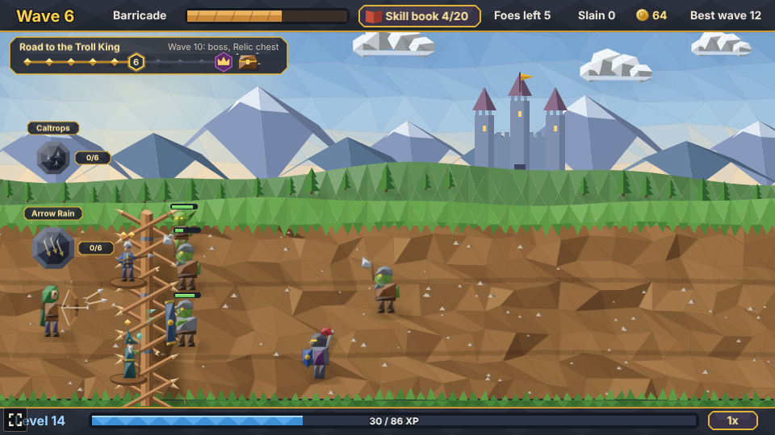
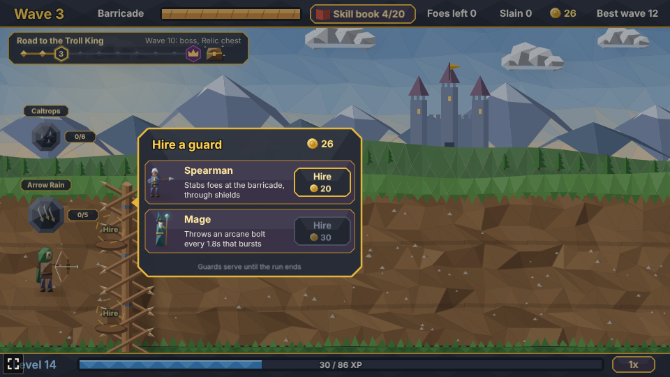

### Fortifications

During each break, a "Fortify" button under the wave track opens a panel of three
fortifications; one can be bought per break, for coins that would otherwise hire guards. The break
waits while the panel is open.

| Fortification | Cost | What it does |
| --- | --- | --- |
| Stake line | 25 coins | A row of stakes behind the barricade. Once the barricade is down, foes stop at the stakes and hack through 80 of them before walking on (Spiked Stakes pricks them there too); buying it again sets it back to full |
| Oil pot | 15 coins | Armed on the barricade. The first foe to reach it next wave bursts the pot: every foe near it takes 15 and burns for 6s, Warded elites aside |
| Lookout | 20 coins | A pennant on the barricade: Arrow Rain's ring is 40% wider for the next three waves (the one it was bought before included) |

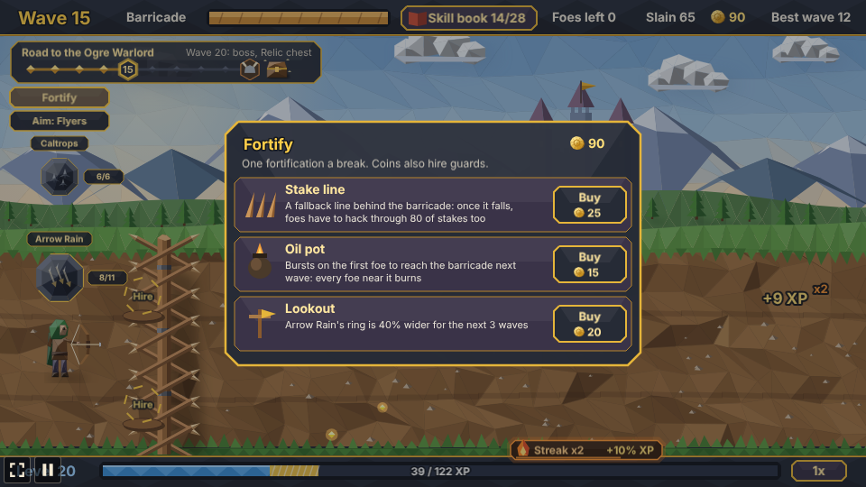
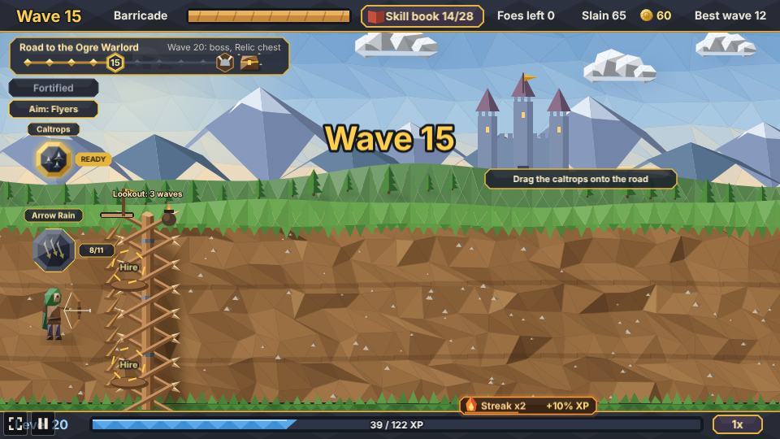
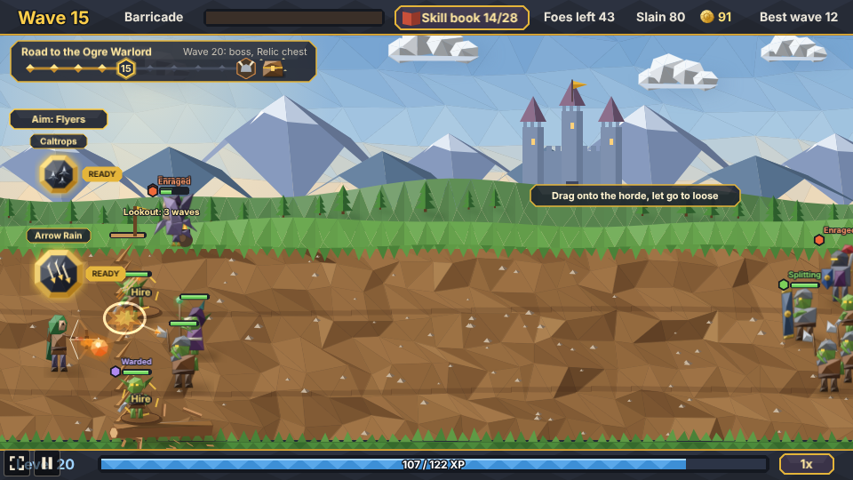

### Kill streak

Kills in quick succession, each within 2.5 seconds of the last, build a kill streak. From two kills
on a chip over the experience bar shows it ("Streak x6 +30% XP"), with a thin bar for the time left
to the next kill, and every kill in it gives 5% more experience per kill in the streak, up to 50%
at ten. The pop where the foe fell shows the streak too ("+5 XP x6"). The streak waits while a
level-up is up, and ends when no kill comes in time.

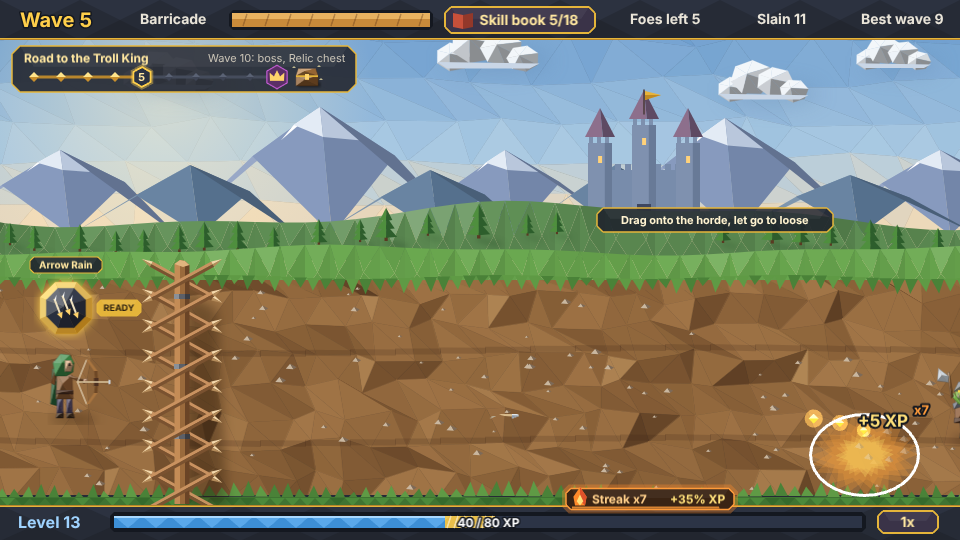

### Foes

| Foe | From | What it does |
| --- | --- | --- |
| Goblin | wave 1 | Quick and weak |
| Orc | wave 1 | The steady grunt; every wave opens with one |
| Harpy | wave 3 | Flies over the barricade and the caltrops, straight at the hero; weak, but the run ends if one gets there |
| Dark Knight | wave 4 | Slow and tough, and its armour takes 5 off every arrow, burst, volley and fireball hit |
| Shield Bearer | wave 5 | Its tower shield takes 75% off every arrow and stops burning, chill and piercing; bursts, fireballs, Arrow Rain, lightning, caltrops and guards get through |
| Shaman | wave 7 | Heals every hurt foe within reach (itself too) by 12% of its health every 2.5s, a boss by 3% |
| Troll King | wave 10 (40, 70...) | A boss: three health bars on wave 10 and one more every ten waves, shown stacked at the top of the screen, each a different colour. Every 7s it throws a rock at a hired guard, stunning it for 4s; with no guard hired the rock takes 25 off the barricade |
| Ogre Warlord | wave 20 (50, 80...) | A boss with a horned helm and a great axe, harder hitting and better armoured. Once below half health it calls four goblins to its side |
| Frost Giant | wave 30 (60, 90...) | The biggest boss, slow, with the most health. Every 9s it roars, and the ranger shoots at 60% of the pace for 4s ("Chilled bow") |


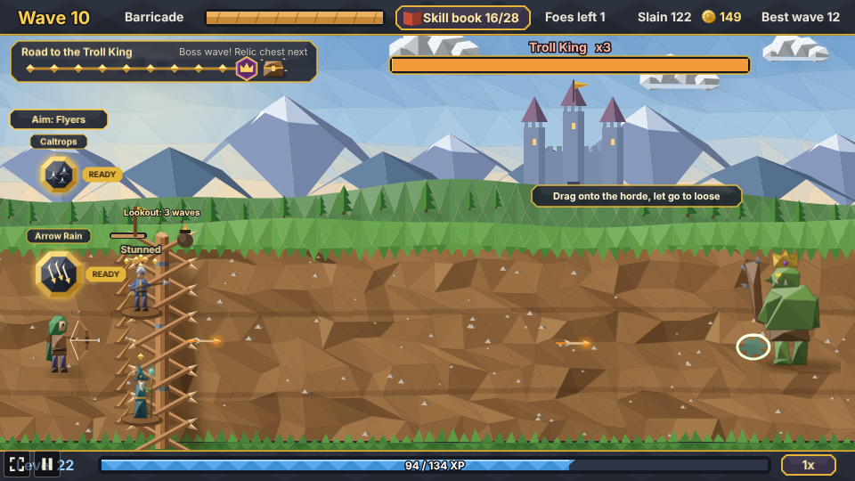
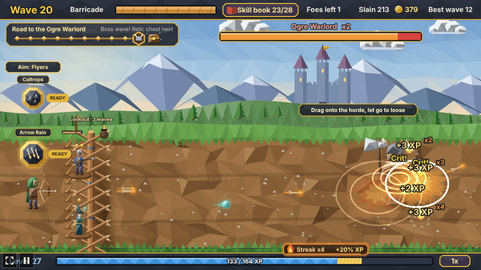
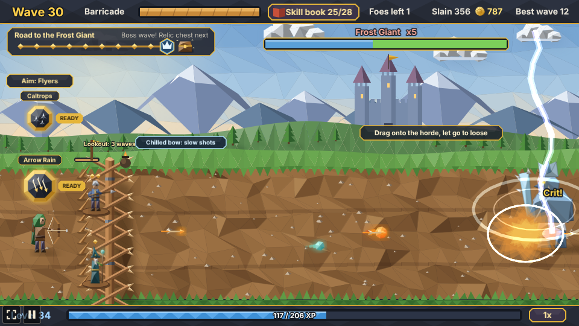

#### Elite foes

From wave 4 some foes (never a boss) come on as **elites**: 10% of them at first, 1.5% more every
wave up to a third. An elite has 50% more health, gives twice the experience and twice the coins,
and carries one of three traits, named over its health bar:

| Trait | What it does |
| --- | --- |
| Splitting | Falls apart into two goblins (with 60% of a goblin's health) where it fell, on the road even if it flew |
| Enraged | Below half health it walks and hits 60% faster, and turns red |
| Warded | Immune to burning and chill, with a violet rune ring on the road; Shatter's bonus never applies to it |

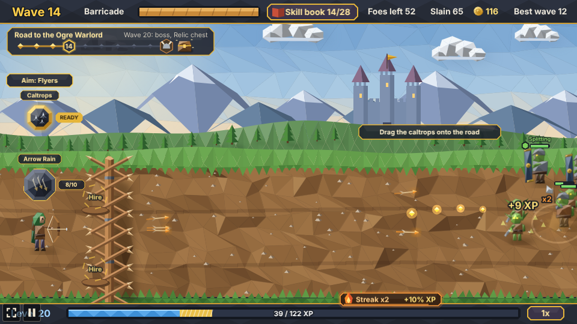

### Upgrades

Most upgrades have several ranks. Follow-ups only show up once the upgrade they improve has been
picked. A level-up always shows three cards: once fewer than three upgrades are left, fillers take
the empty cards. With two upgrades left the third card is "Mend the Barricade" (repair half of the
barricade); with one left the other two are "War Chest" (25 coins) and "Second Wind" (charge Arrow
Rain and the caltrops at once). So every filler turns up on the way to the last skill.

| Upgrade | Ranks | What it does |
| --- | --- | --- |
| Swift Draw | 5, then no cap | Shoot 20% faster |
| Steel Tips | 5, then no cap | Arrows (and Arrow Rain) deal 25% more damage |
| Volley | 3 | One more arrow per shot, each at a different foe |
| Bodkin Points | 3 | Arrows fly on through one more foe |
| Keen Eye | 3 | 10% more chance of a double-damage hit |
| Fire Arrows | 1 | Arrows set foes ablaze for 3s |
| Wildfire | 3 | Burning deals 50% more (after Fire Arrows) |
| Frost Arrows | 1 | Arrows chill foes, slowing them by 35% |
| Deep Freeze | 3 | Chill slows 10% more and lasts longer (after Frost Arrows) |
| Blasting Powder | 1 | Arrows burst on impact, hurting foes nearby |
| Black Powder | 3 | Bursts are wider and hit harder (after Blasting Powder) |
| Tome of Fire | 1 | A new missile: a fireball every 3s at the thickest crowd, which explodes |
| Pyromancy | 3 | Fireballs come 15% sooner and hit 40% harder (after Tome of Fire) |
| Storm Staff | 1 | A new missile: lightning every 3.5s that leaps between 3 foes, through armour |
| Forked Lightning | 3 | Lightning leaps to one more foe and hits 25% harder (after Storm Staff) |
| Stout Timber | 5, then no cap | The barricade gets 25% more health and is repaired |
| Battle Lore | 3 | 20% more experience |
| Shatter | 3 | Arrows deal 20% more damage to chilled foes (after Frost Arrows) |
| Finishing Shot | 3 | Arrows deal double damage to foes below 15% of their health, 30% at rank 2, 45% at rank 3 |
| Giant Slayer | 3 | Arrows and Arrow Rain deal 30% more damage to bosses |
| Cloudburst | 3 | Arrow Rain hits 25% harder and its ring is 15% wider |
| Barbed Caltrops | 3 | Caltrops prick 50% harder and slow foes 10% more |
| Spiked Stakes | 3 | Foes hacking at the barricade take 6 damage a second, through armour |
| Bounty Hunter | 3 | Every kill pays 1 more coin (2 on a Golden Road) |
| Drill Sergeant | 3 | Hired guards attack 20% faster |

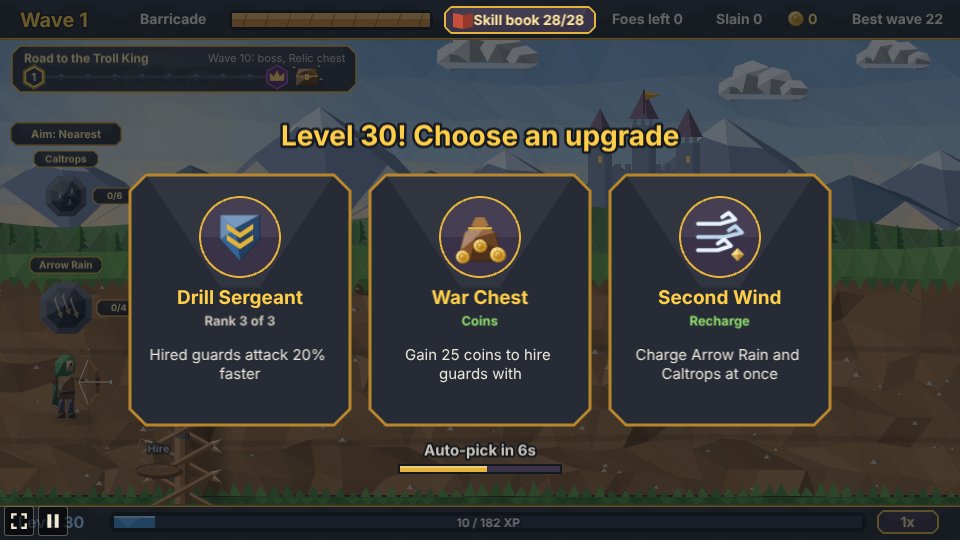

Once every skill is learned, each level-up offers the three base skills again: Swift Draw, Steel
Tips and Stout Timber, with no cap on their ranks ("Rank 6, no cap"), so the hero keeps getting
stronger for as long as the waves keep coming.

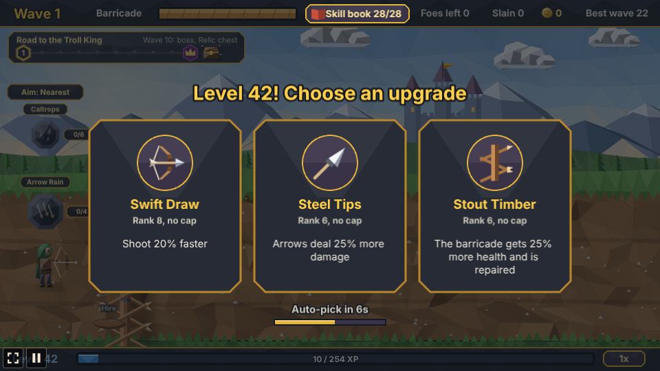
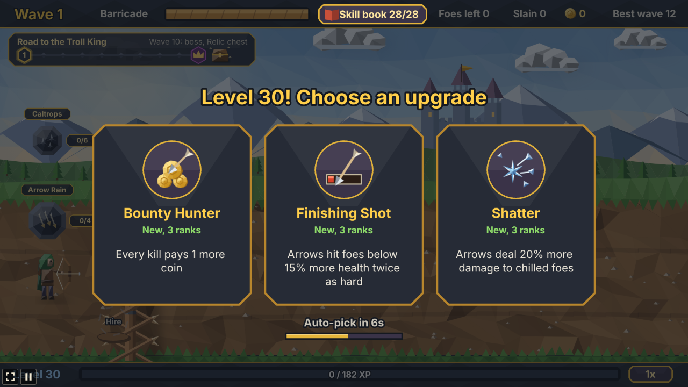

The skill book (its button in the top bar shows how many skills are found, such as "Skill book
8/28") has a page for every upgrade and filler, one theme a row: the bow, harder hits, fire, chill
and slow, powder and lightning, the barricade and guards, then Battle Lore and the fillers. The pages start as empty placeholders, and each fills in the
first time a level-up offers that upgrade, with its icon, what a rank does and the hero's rank
(dimmed while it has none; for a filler, how many times it was picked, such as "2x"). Along its
bottom it lists the relics won, with the bonus of each full set; hovering over a relic shows what
it does and which set it belongs to. The book stays filled for a new hero. It opens during a
level-up too, to check what the hero has before choosing.

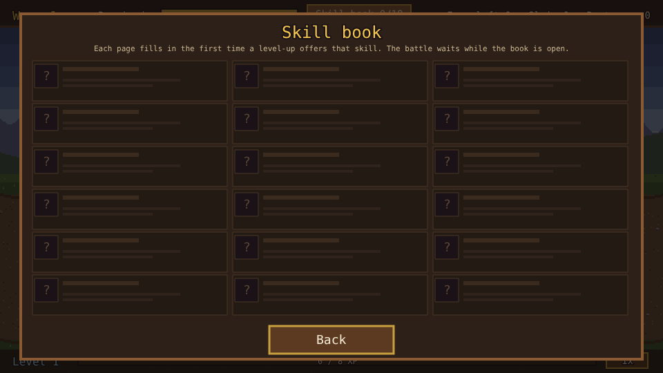
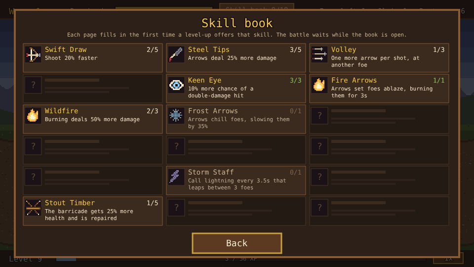
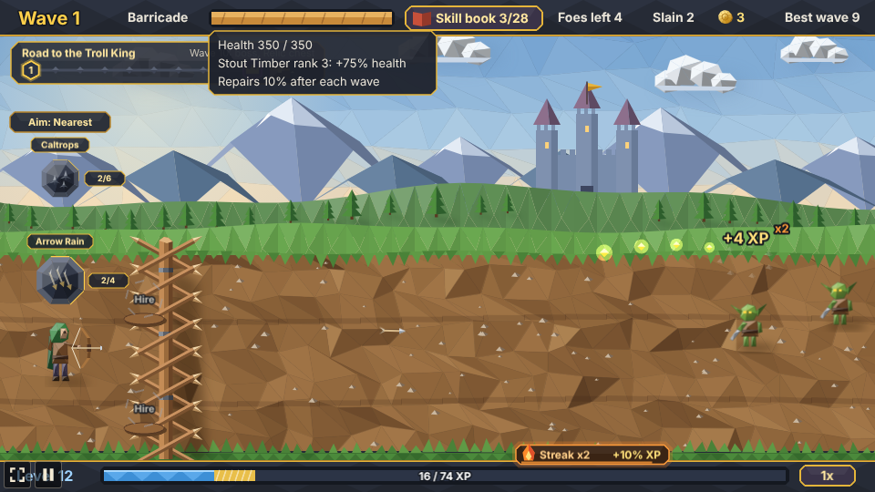
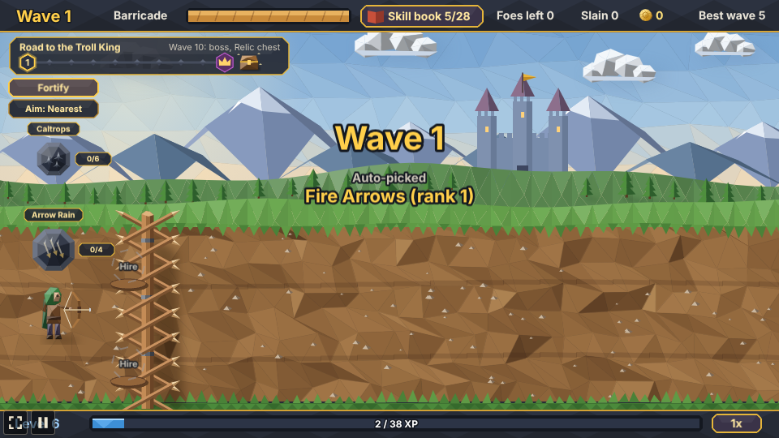
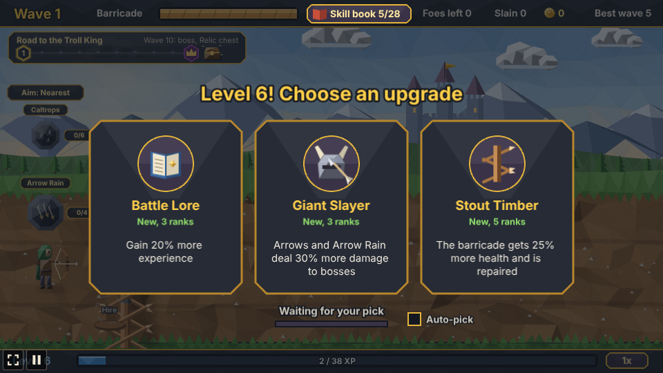
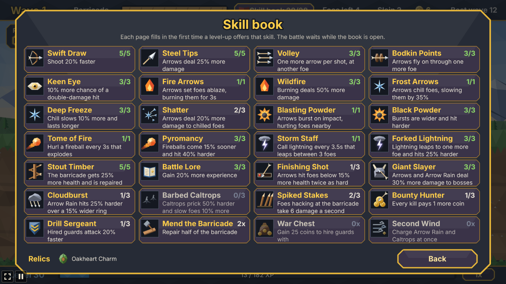

The switch at the right end of the experience bar plays the battle at double speed. It lights up
gold at 2x and is remembered in the browser, separately from the hero.

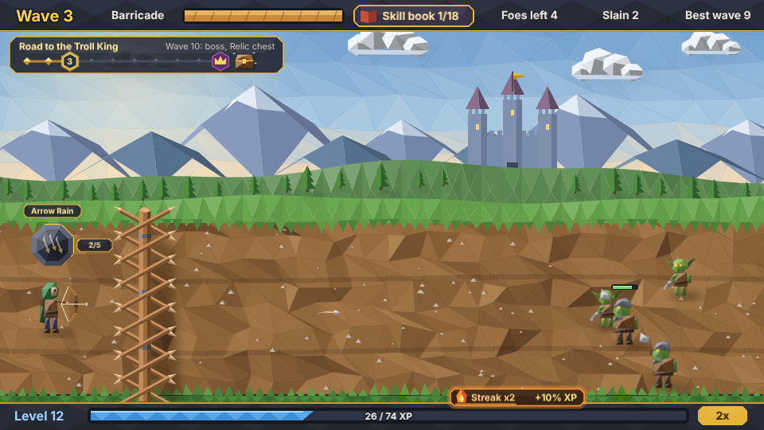

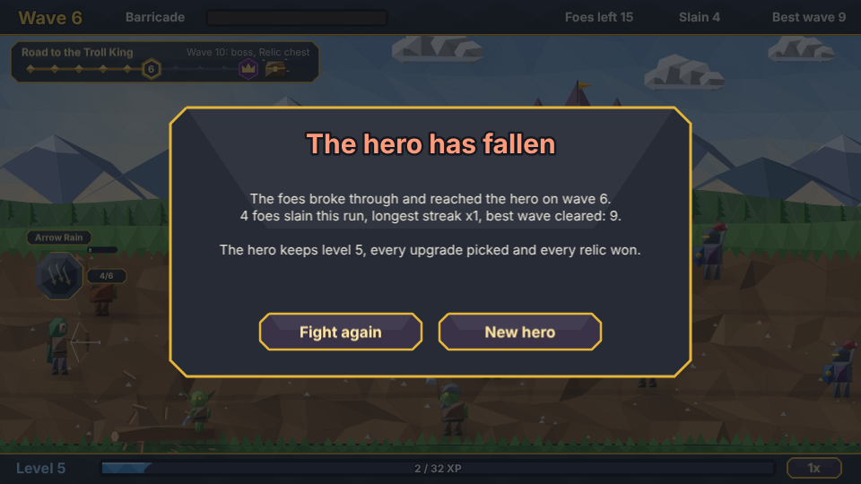

The difficulty, set on the hub page's Settings, changes one thing: foes have 25% less health on Easy and 30% more on Hard. The heats are separate from it.

## Running locally

`npm run dev` at the repo root, then open `/games/palisade/` (or pick Palisade on the hub page).

## Playthrough test

`e2e/playthrough.spec.ts` plays the first wave in headless Chromium: it checks the new hero and
the road to the Troll King, waits for the wave to come on and the ranger to shoot, checks that the
first kill gives just its foe's experience (a streak of one), pops "+N XP", sends orbs to the bar,
pays its coins and charges Arrow Rain and the caltrops, checks that the battle and the streak wait on the level-up, taps the first
card and checks its upgrade was taken. It then plays on until Arrow Rain is charged, drags it from
its button onto a foe with the mouse and lets go, and checks the volley fells that foe. It plays on
until the wave is cleared with the barricade standing, and checks that a streak of two or more
happened, that the experience earned is the foes' own plus the streak bonus, that the six kills
paid 9 coins and charged the caltrops with no guard hired, and that the road moved on a step. Like the Apothecary test it owns the game clock and plays at 4x speed
(`PLAYTHROUGH_SPEED`). The shared playthrough workflow (`.github/workflows/playthrough.yml`) runs it
on every PR that changes this folder or the workflow, and uploads the video and screenshots as the
`playthrough-palisade` artifact.

```sh
npx playwright test --project palisade
```

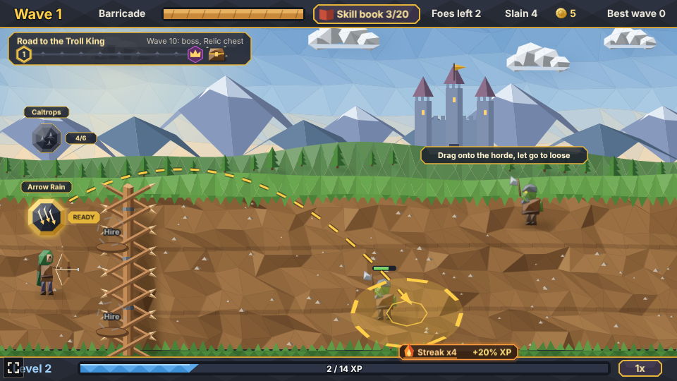
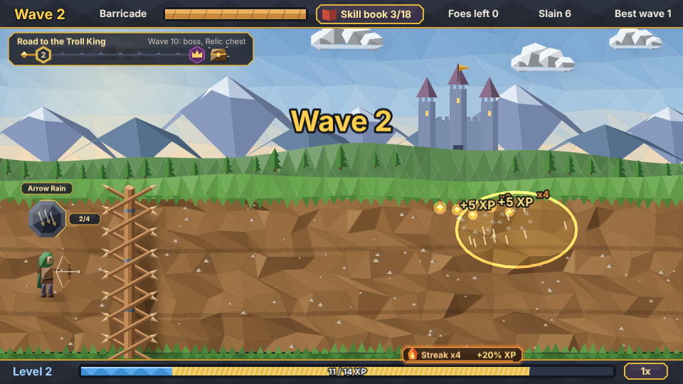

## Code layout

All paths are inside `games/palisade/`.

- `src/game/`: the rules in plain TypeScript with no Phaser dependency. `enemies.ts`,
  `upgrades.ts`, `relics.ts` (with the relic sets), `guards.ts`, `roads.ts`, `forts.ts` (the
  fortifications), `elites.ts` (the traits), `bosses.ts` (the bosses' moves), `heat.ts` (the heats
  and the winning wave) and `aim.ts` (the aim priority) are data tables, `waves.ts` says what each wave brings and which
  road and boss it is on, `state.ts` holds the run and works out the hero's stats from the upgrade
  ranks, relics and heat, `sim.ts` moves the battle on, takes upgrades and roads, looses Arrow Rain, strews caltrops,
  hires and trains guards, buys fortifications and lifts the siege, and
  `save.ts` keeps the hero's progress, the speed and the aim priority.
- `src/scenes/`: `BootScene` paints the textures, `GameScene` draws the battle, the HUD, the wave
  track, Arrow Rain, the caltrops and the guard slots and wires taps and drags to the rules, `layout.ts` says where things are
  drawn.
- `src/art/`: all the low-poly art, painted in code on canvases at startup: `lowpoly.ts` has the
  toolkit (faceted parts lit from the top left, soft shadows), `characters.ts` the ranger, the foes,
  the bosses, the hired guards and the missiles, `scenery.ts` the battlefield, the HUD bars and the barricade (which
  breaks up in stages), and `icons.ts` the upgrade and relic icons, the chest, the boss marks,
  the Arrow Rain and caltrops buttons, the coin and the road icons.
- `src/ui/`: the level-up cards, the road cards (`RoadChoice`), the hire panel (`HirePanel`), the
  fortify panel (`FortifyPanel`), the skill book, and `panel.ts` with the slate-and-gold panels,
  buttons and text style.

Adding an upgrade is an entry in `src/game/upgrades.ts` and its effect in `stats` in
`src/game/state.ts` (and, for a new kind of missile, `shoot` in `src/game/sim.ts`).
