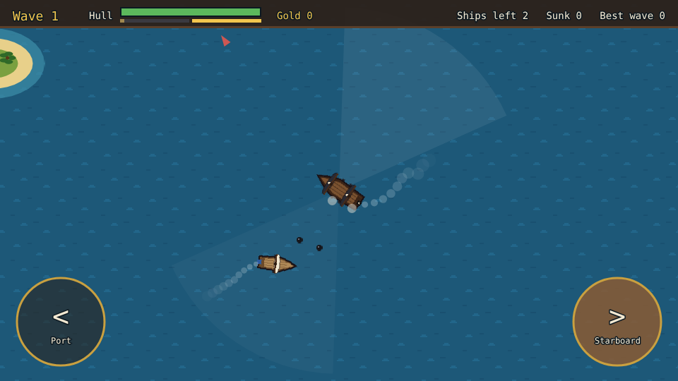
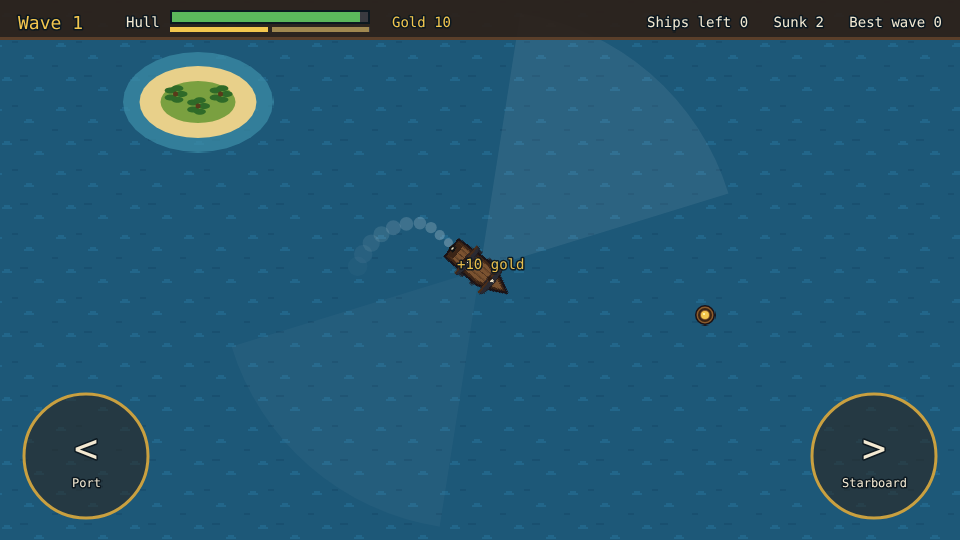
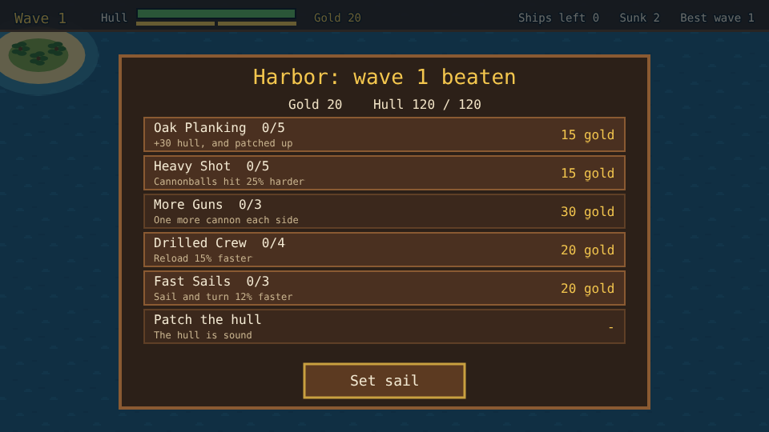

# Pirate Raid

A naval battle prototype built with [Phaser 4](https://phaser.io), TypeScript and Vite, part of
the [game hub](../../README.md).

You captain a pirate ship with black sails. It always sails on, and all you do is put the helm
over to port or starboard. The cannons line the ship's sides and fire on their own whenever an
enemy ship is off either side and in range, so the fight is about steering: close in, then turn
side-on to bring a broadside to bear. Sunk ships leave a barrel of plunder floating where they
went down; sail over it to haul it aboard. Once a wave is beaten the ship puts into harbor, where
the gold buys a stronger hull, heavier shot, more guns, a faster crew and faster sails.



## How to play

| Control | Action |
| --- | --- |
| Hold the **<** (Port) button, Left arrow or A | Turn to the left |
| Hold the **>** (Starboard) button, Right arrow or D | Turn to the right |
| Tap a row at the harbor | Buy that upgrade, or patch the hull |
| Set sail | Leave the harbor for the next wave |

1. **Broadsides**: each side has its own guns and reloads on its own; the two bars under the hull
   show how loaded they are. A faint wedge out of each side shows where it reaches. The gun crews
   aim within that wedge, leading a moving target.
2. **Enemy ships** come over the horizon one after another, close in and turn to fire their own
   broadsides. Their crews aim worse than yours. Red arrows at the edge of the screen point to
   ships out of sight.
3. **Loot**: every sunk ship leaves a barrel of gold that drifts toward your ship once close. It
   sinks after 25 seconds, blinking at the end; gold arrows point to barrels out of sight.
4. **The harbor** opens once no enemy ship or loot is left. The crew patches a quarter of the
   hull for free; the rest is 10 gold.
5. **The run is over when your hull is sunk**. "Sail again" starts afresh at wave 1. The best wave
   beaten is kept in the browser.



### Enemy ships

| Ship | From | What it does |
| --- | --- | --- |
| Sloop | wave 1 | Small and quick, one gun a side, 10 gold |
| Brig | wave 3 | Two guns a side and twice the timber, 25 gold |
| Galleon | wave 5 | Slow, three guns a side and very tough, 60 gold |

Every wave brings one more sloop than the last, and enemy hulls get 12% tougher each wave.

### Upgrades

| Upgrade | Ranks | What it does |
| --- | --- | --- |
| Oak Planking | 5 | +30 hull, and patches 30 of it |
| Heavy Shot | 5 | Cannonballs hit 25% harder |
| More Guns | 3 | One more cannon each side |
| Drilled Crew | 4 | Reload 15% faster |
| Fast Sails | 3 | Sail and turn 12% faster |



## Running locally

`npm run dev` at the repo root, then open `/games/pirate-raid/` (or pick Pirate Raid on the hub
page).

## Playthrough test

`e2e/playthrough.spec.ts` plays the first wave in headless Chromium. It holds the helm buttons
down to check that the ship turns each way and sails straight on once let go, then steers by them
to close on each sloop and turn side-on until a broadside fires, hits and sinks it. It sails over
the loot and checks the gold, waits for the harbor, buys Heavy Shot with the plunder and sets sail
for wave 2. Like the other games' tests it owns the game clock and plays at 4x speed
(`PLAYTHROUGH_SPEED`). The **Playthrough Pirate Raid** workflow
(`.github/workflows/playthrough-pirate-raid.yml`) runs it on every PR and push to main that touches
this folder or a shared build file, and uploads the video and screenshots as the
`playthrough-pirate-raid` artifact.

```sh
npx playwright test --project pirate-raid
```

## Code layout

All paths are inside `games/pirate-raid/`.

- `src/game/`: the rules in plain TypeScript with no Phaser dependency. `ships.ts` and
  `upgrades.ts` are data tables, `waves.ts` says what each wave brings, `state.ts` holds the run
  and works out the player's ship from the upgrades bought, `sim.ts` sails the ships, fires the
  broadsides and runs the harbor, and `save.ts` keeps the best wave.
- `src/scenes/`: `BootScene` bakes textures, `GameScene` draws the sea, follows the ship with the
  camera and wires the helm buttons and keys to the rules, `layout.ts` says where things are drawn.
- `src/art/`: the ships, islands, sea, cannonballs and loot, drawn in code and baked into textures
  at startup.
- `src/ui/`: the harbor panel and buttons.

Adding an upgrade is an entry in `src/game/upgrades.ts` and its effect in `stats` in
`src/game/state.ts`; adding an enemy ship is an entry in `src/game/ships.ts`, a look in
`src/art/art.ts` and a place in `src/game/waves.ts`.
