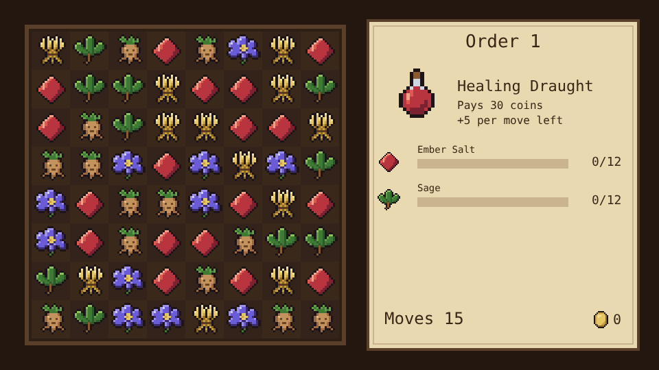
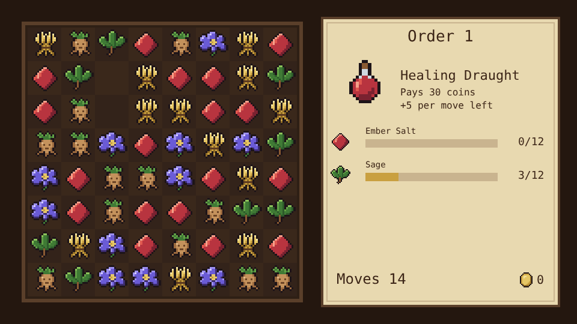
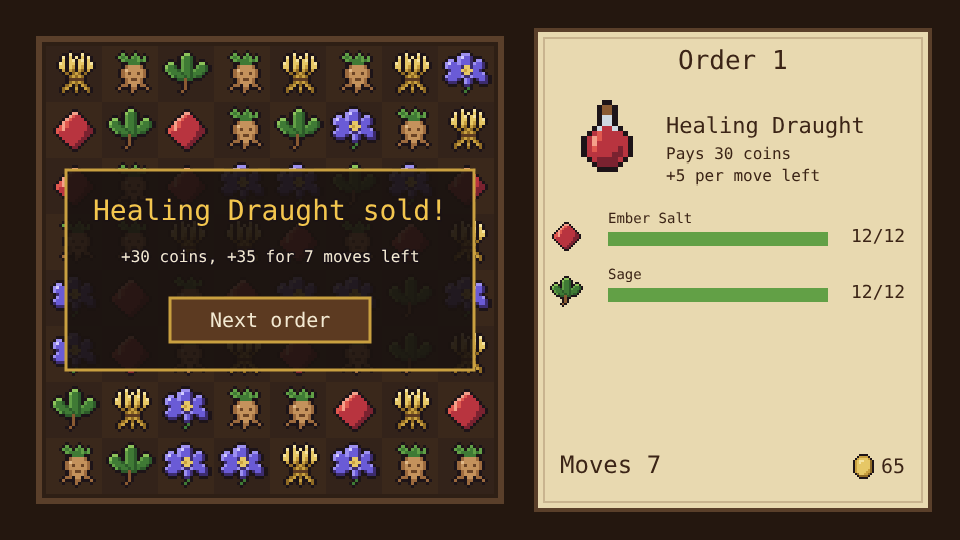

# Potion Puzzle

A match-3 prototype built with [Phaser 4](https://phaser.io), TypeScript and Vite, part of the
[game hub](../../README.md).

The board is an 8x8 grid of Apothecary's ingredients: wheat, mandrake, sage, ember salt and
moonpetal. Each order asks for a potion that takes so many of a few of them. Swap two neighbouring
tiles to line up three or more of a kind: the matched tiles are gathered for the order, the tiles
above fall into the gaps and new ones drop in from the top, which can set off more matches. Gather
everything on the order before the moves run out and the potion sells.



## How to play

| Control | Action |
| --- | --- |
| Tap a tile, then a neighbour | Swap the two |
| Drag a tile onto a neighbour | Swap the two |
| Tap the picked tile again | Let it go |
| Next order / Try again | After an order: start the next one, or the same one again |

1. **Swaps** only count when they make a match. A swap that doesn't slides back and costs no move.
2. **Matches** of three or more in a row or column, across or down, are gathered, every tile of
   every kind. Cascades after a swap are free.
3. **Orders** list the ingredients the potion needs, the moves allowed and what it pays. Filling one
   pays its price plus 5 coins for every move left; running out of moves means trying it again on a
   new board.
4. **Hints**: after a few idle seconds, two tiles that would match wiggle.
5. If the board is left with no move to make, its tiles are shuffled.

Progress (the next order, coins and potions sold) is saved in the browser.



### Orders

The five orders come round again with 3 more of each ingredient and 15 more coins every time.

| Order | Needs | Moves | Pays |
| --- | --- | --- | --- |
| Healing Draught | 12 ember salt, 12 sage | 15 | 30 |
| Sleeping Tonic | 15 moonpetal, 12 wheat | 16 | 35 |
| Mandrake Tincture | 14 mandrake, 12 sage, 10 ember salt | 18 | 45 |
| Golden Elixir | 16 wheat, 14 ember salt, 12 moonpetal | 20 | 55 |
| Moonlit Philter | 20 moonpetal, 16 mandrake, 14 sage | 20 | 70 |



The favicon is the hub's bear with three potions lined up: a match of three.


The difficulty, set on the hub page's Settings, changes one thing: each order gives 5 more moves on Easy and 3 fewer on Hard.

## Running locally

`npm run dev` at the repo root, then open `/games/potion-puzzle/` (or pick Potion Puzzle on the hub
page).

## Playthrough test

`e2e/playthrough.spec.ts` plays the first order in headless Chromium: it checks the new order and
board, taps a swap that makes no match and checks it slid back without costing a move, then makes
the best match it can see, a tap on a tile and a tap on its neighbour, checking each one spends a
move and gathers at least what it matched, until the Healing Draught is sold for its price plus the
bonus for the moves left. Like the other games' tests it owns the game clock and plays at 4x speed
(`PLAYTHROUGH_SPEED`). The **Playthrough Potion Puzzle** workflow
(`.github/workflows/playthrough-potion-puzzle.yml`) runs it on every PR and push to main that
touches this folder or a shared build file, and uploads the video and screenshots as the
`playthrough-potion-puzzle` artifact.

```sh
npx playwright test --project potion-puzzle
```

## Code layout

All paths are inside `games/potion-puzzle/`.

- `src/game/`: the rules in plain TypeScript with no Phaser dependency. `kinds.ts` lists the
  ingredients, `orders.ts` the potion orders, `board.ts` finds matches and moves, lets tiles fall
  and shuffles, `state.ts` holds the order being played, `sim.ts` plays a swap out step by step,
  and `save.ts` keeps the progress.
- `src/scenes/`: `BootScene` bakes textures, `GameScene` draws the board and the order, animates
  each step of a swap and wires taps and drags to the rules, `layout.ts` says where things are drawn.
- `src/art/`: the ingredient, potion and coin pixel art, drawn in code and baked into textures at
  startup. Wheat, mandrake and the flasks are copied from Apothecary.
- `src/ui/`: the button.

Adding an order is an entry in `ORDERS` in `src/game/orders.ts`; a new potion also needs its name
there and its art in `src/art/items.ts`.
