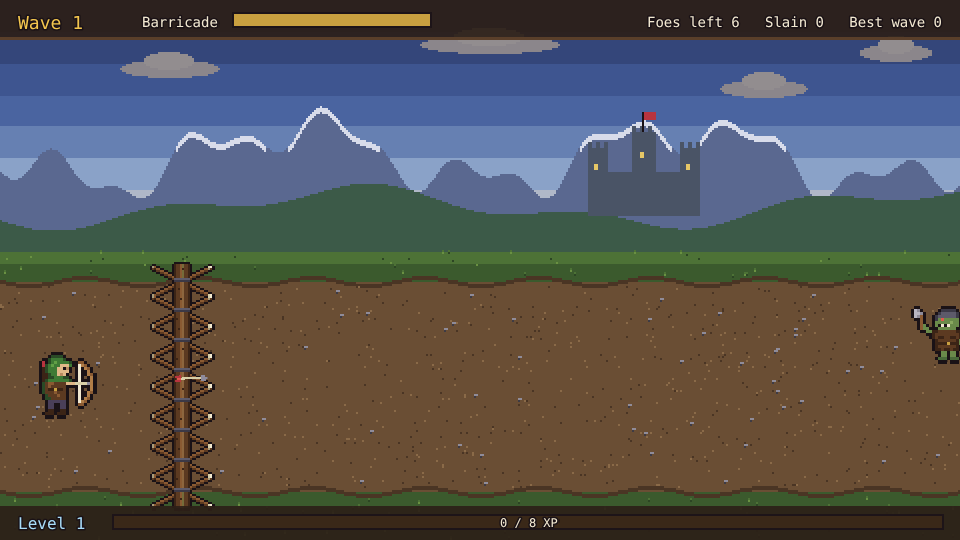
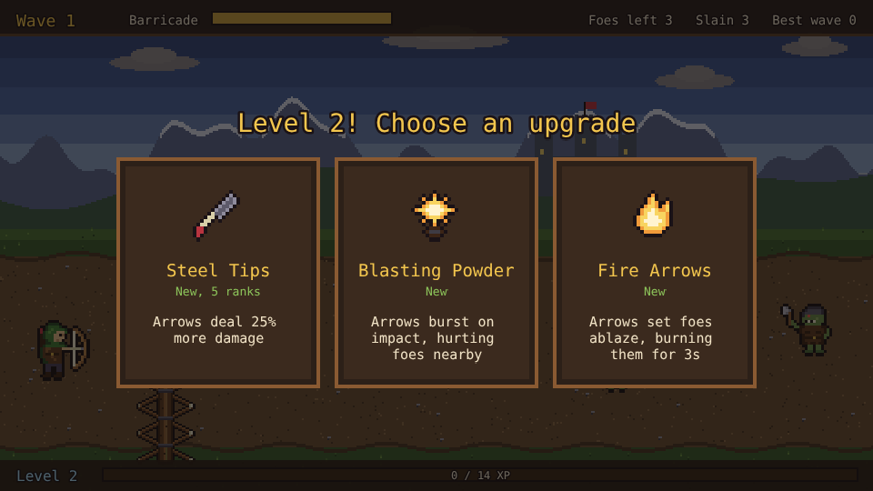
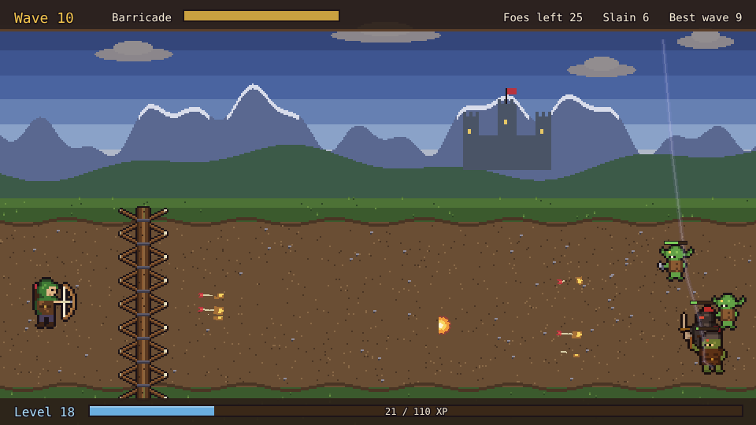
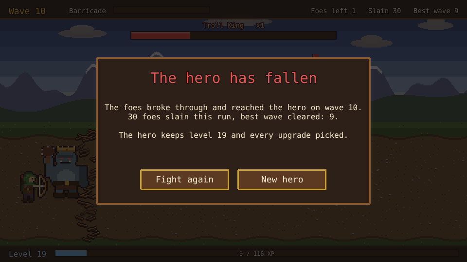

# Rampart

A wave defense prototype built with [Phaser 4](https://phaser.io), TypeScript and Vite, part of
the [game hub](../../README.md).

A ranger stands on the road on the left, behind a cheval de frise: a heavy log with sharpened
stakes driven through it. Goblins, orcs and dark knights march in from the right in ever bigger waves, and every tenth wave the Troll King comes with them. The
ranger can't move and shoots on their own, always at the foe nearest the barricade. Every kill fills
the experience bar, and every level-up pauses the battle on three upgrades to pick from.



## How to play

| Control | Action |
| --- | --- |
| Tap or click a card | Take that upgrade when a level-up comes up |
| Fight again / New hero | After a fall: start again from wave 1 keeping the hero, or with a new one |

1. **Waves**: each wave brings more foes than the last, with more health. A short break with the
   wave's banner comes before each, and the barricade gets a tenth of its health back.
2. **The barricade** stops the foes, who hack at it until it breaks, losing stakes as it goes. Once
   it is splinters they walk on to the hero, and **the run is over when a foe reaches the hero**.
3. **Experience and level-ups**: each foe gives experience when it falls. A full bar is a level,
   and the battle waits while three different upgrades are offered.
4. **The hero is kept**: level, experience and every upgrade picked carry over to the next run,
   which starts again at wave 1. They are saved in the browser. "New hero" starts from scratch.



### Foes

| Foe | From | What it does |
| --- | --- | --- |
| Goblin | wave 1 | Quick and weak |
| Orc | wave 1 | The steady grunt; every wave opens with one |
| Dark Knight | wave 4 | Slow and tough, and its armour takes 5 off every arrow and fireball hit |
| Troll King | every 10th wave | The boss: three health bars on wave 10 and one more every ten waves, shown stacked at the top of the screen, each a different colour |


### Upgrades

Most upgrades have several ranks. Follow-ups only show up once the upgrade they improve has been
picked. Once fewer than three upgrades are left, "Mend the Barricade" fills the gaps.

| Upgrade | Ranks | What it does |
| --- | --- | --- |
| Swift Draw | 5 | Shoot 20% faster |
| Steel Tips | 5 | Arrows deal 25% more damage |
| Volley | 3 | One more arrow per shot, each at a different foe |
| Bodkin Points | 3 | Arrows fly on through one more foe |
| Keen Eye | 3 | 10% more chance of a double-damage hit |
| Fire Arrows | 1 | Arrows set foes ablaze for 3s |
| Wildfire | 3 | Burning deals 50% more (after Fire Arrows) |
| Frost Arrows | 1 | Arrows chill foes, slowing them by 35% |
| Deep Freeze | 3 | Chill slows 10% more and lasts longer (after Frost Arrows) |
| Blasting Powder | 1 | Arrows burst on impact, hurting foes nearby |
| Black Powder | 3 | Bursts are wider and hit harder (after Blasting Powder) |
| Tome of Fire | 1 | A new missile: a fireball every 3s at the thickest crowd, which explodes |
| Pyromancy | 3 | Fireballs come 15% sooner and hit 40% harder (after Tome of Fire) |
| Storm Staff | 1 | A new missile: lightning every 3.5s that leaps between 3 foes, through armour |
| Forked Lightning | 3 | Lightning leaps to one more foe and hits 25% harder (after Storm Staff) |
| Stout Timber | 5 | The barricade gets 25% more health and is repaired |
| Battle Lore | 3 | 20% more experience |





## Running locally

`npm run dev` at the repo root, then open `/games/rampart/` (or pick Rampart on the hub page).

## Playthrough test

`e2e/playthrough.spec.ts` plays the first wave in headless Chromium: it checks the new hero, waits
for the wave to come on and the ranger to shoot, checks that kills fill the experience bar by each
foe's experience, that the battle waits on the level-up, taps the first card and checks its
upgrade was taken, then plays on until the wave is cleared with the barricade standing. Like the
Apothecary test it owns the game clock and plays at 4x speed (`PLAYTHROUGH_SPEED`). The
**Playthrough Rampart** workflow (`.github/workflows/playthrough-rampart.yml`) runs it on every PR
and push to main that touches this folder or a shared build file, and uploads the video and
screenshots as the `playthrough-rampart` artifact.

```sh
npx playwright test --project rampart
```

## Code layout

All paths are inside `games/rampart/`.

- `src/game/`: the rules in plain TypeScript with no Phaser dependency. `enemies.ts` and
  `upgrades.ts` are data tables, `waves.ts` says what each wave brings, `state.ts` holds the run
  and works out the hero's stats from the upgrade ranks, `sim.ts` moves the battle on and takes
  upgrades, and `save.ts` keeps the hero's progress.
- `src/scenes/`: `BootScene` bakes textures, `GameScene` draws the battle and wires taps to the
  rules, `layout.ts` says where things are drawn.
- `src/art/`: all the pixel art, drawn in code and baked into textures at startup: the ranger and
  the foes, the battlefield, the barricade (which breaks up in stages), missiles and upgrade icons.
- `src/ui/`: the level-up cards and buttons.

Adding an upgrade is an entry in `src/game/upgrades.ts` and its effect in `stats` in
`src/game/state.ts` (and, for a new kind of missile, `shoot` in `src/game/sim.ts`).
