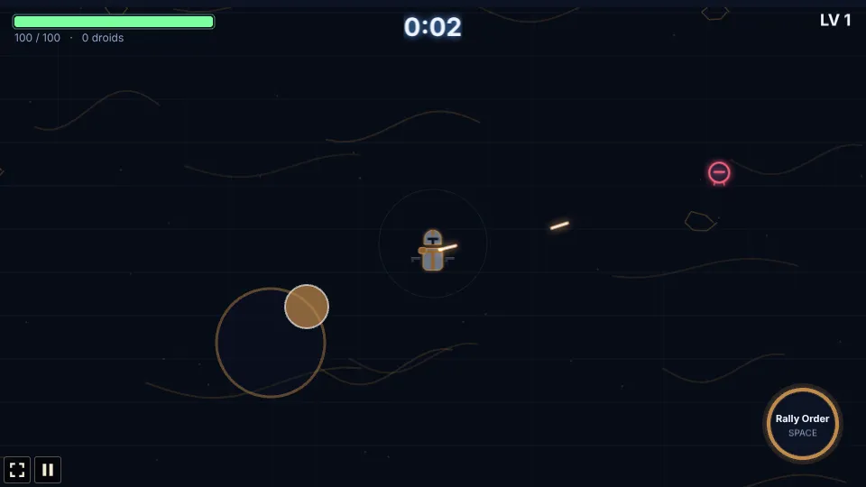
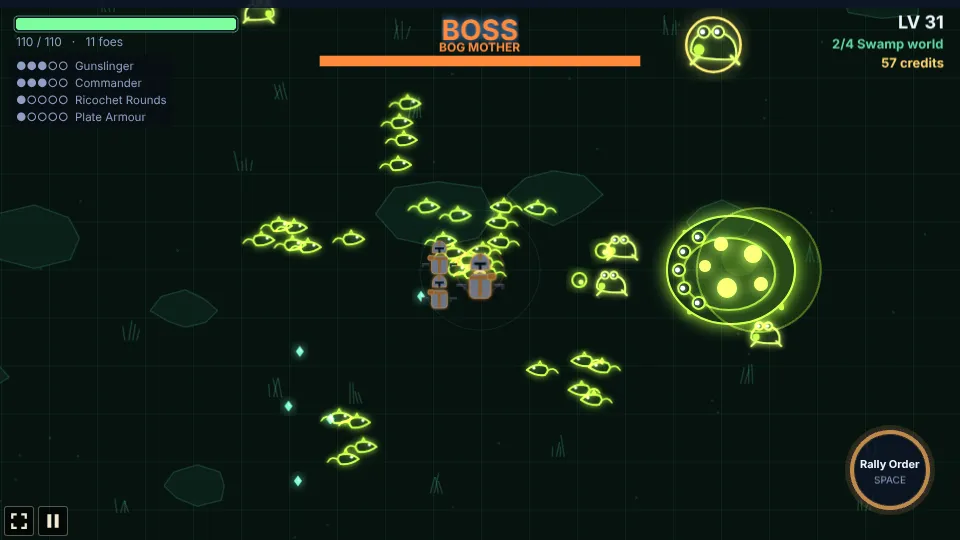
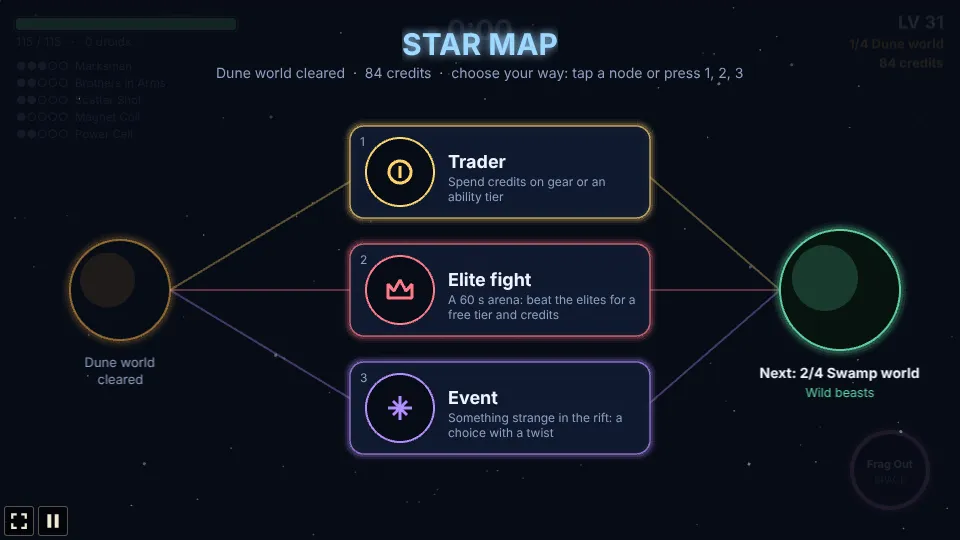
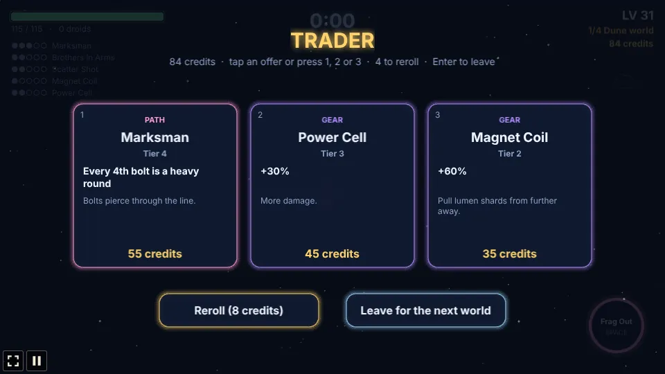
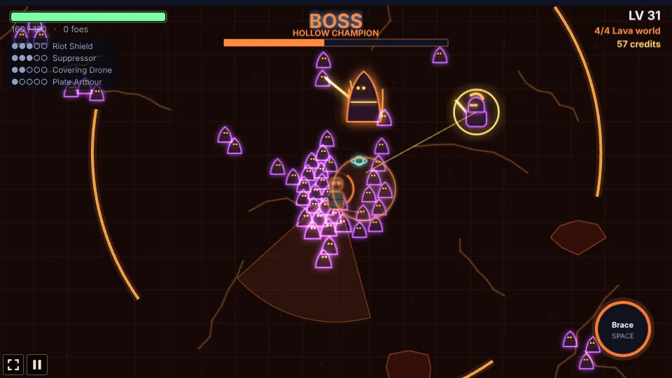

# Riftblade

A survivor-style auto-attack roguelike built with [Phaser 4](https://phaser.io), TypeScript and
Vite, part of the [game hub](../../README.md).

Pick one of three soldiers and fight the Rift Crusade across four worlds: the Dune, Swamp, Ice and
Lava worlds. On each you hold out for five minutes while its faction pours in from every side, then
beat its boss. You only steer: your weapon fires on its own. Shot-down foes drop lumen shards, and
every level-up pauses the run on three upgrade cards. Your hero, level and kit carry over from
world to world, and between worlds a star map offers a trader, an elite fight, a rest or an event.
Beat the Hollow Champion on the Lava world to win the run. Everything is drawn in code in a "Glow
Vector" style: dark fields with a faint grid and each world's own scenery, and neon-rimmed heroes,
foes and bolts.


## How to play

| Input | Action |
| --- | --- |
| WASD or arrow keys | Walk |
| Hold the mouse anywhere on the field | Walk toward that point; the hero keeps walking while you hold |
| Touch: put a finger down anywhere and drag | A steering stick appears where the finger went down; walk the way you drag, faster the further out (the stick follows a finger that goes past its rim) |
| Space, or the round button bottom right | Signature move, once charged |
| Tap a card, or 1 / 2 / 3 | Choose a hero, an upgrade at a level-up, a node on the star map, an offer at the trader or an answer to an event |
| Reroll, or 4 | At the trader: new offers for a few credits |
| Leave, or Enter | At the trader: on to the next world |
| Run again, or Enter | After a run, back to the hero select screen |




### The heroes

| Hero | Weapon | Signature | Paths |
| --- | --- | --- | --- |
| Captain Rook (slate armour, bronze markings) | Twin pistols: alternating shots at the two nearest droids | **Rally Order**: 5 s of +50% fire rate (12 s) | Gunslinger, Commander, Demolitions |
| Legionary TR-9 (charcoal armour, orange lenses) | Spread rifle: three wide, inaccurate bolts at the nearest droid. 150 health, slow | **Brace**: 3 s without damage, knocks droids back (13 s) | Suppressor, Riot Shield, Drop Doctrine |
| Corporal Bram-17 (sand armour, pink markings) | Carbine: fires the way he walks (a little aim assist); standing still, at the nearest droid | **Frag Out**: a grenade that clears a circle (9 s) | Marksman, Jump Trooper, Brothers in Arms |

### The run: the Rift Crusade

A run crosses four planets in a row. Each lasts five minutes and ends with its boss; the clock
starts again on each, and the HUD shows where you are (for example "2/4 Swamp world") and your
credits. Your hero, level, abilities and gear carry over. Each world is tougher than the last: its
foes have more health, hit harder and come faster.

- Foes appear just off screen and come at you. More come every minute, and they get tougher; at
  most 250 are on the field at once. At 1:30, 3:00 and 4:15 a ring of them closes in.
- From 0:50, an **elite** ringed in gold comes every 50 s. It drops a chest (a free tier of an
  upgrade you hold and some health) and a few **credits**.
- After a hit you are safe for a moment. Health does not come back on its own without a Medpack.
- Once a boss is within your weapon's range, aimed weapons fire at it first.

| World | Faction | Foes | Boss |
| --- | --- | --- | --- |
| 1 Dune world | Scrap droids (red and amber) | **Clankers** swarm. **Rollerbombs** stop and glow when close, then rush in a straight line and explode: step aside. | **The Grinder Crawler**: a giant tread tank that fires fans of shells, calls in Clankers, and gets faster below half health |
| 2 Swamp world | Wild beasts (lime) | **Mire rats** run in fast weaving packs. **Spitter toads** stop in range and spit globs that slow you. | **The Bog Mother**: spits fans of globs, spawns packs of young and leaves bog pools that slow you |
| 3 Ice world | Iron Dominion (periwinkle and white) | **Line troopers** come in squads of five that advance in a line and fire volleys together. **Walker gunners** are slow and fire heavy bursts. | **The Siege Walker**: four legs, shell volleys, artillery barrages that light up the ground before they land, and stomps when you get close |
| 4 Lava world | Hollow cult (violet and ember) | **Ash acolytes** swarm and burst into embers that burn for a moment. **Fallen knights** block bolts from the front with a shield and dash at you; hit them while their guard is down. **Lava vents** glow, then erupt. | **The Hollow Champion**: fast blade dashes along a line it marks first; below half health it burns and sends out rings of fire with gaps to slip through |



### The star map

After a boss falls, you collect what is lying about, earn credits for the clear and choose one of
two or three nodes on the star map (tap it or press its number):

- **Trader**: three offers (a gear piece or an ability tier, priced by tier) bought with credits,
  as many as you can afford, and a reroll for 8 credits.
- **Elite fight**: a 60 s arena with two or three elites of the world just cleared. Beat them all
  for a free tier of your choice (of what you hold) and 20 credits, plus what each elite drops.
- **Rest**: heal half your max health.
- **Event**: a choice with a twist, one of: a **stranded droid** (take it along as a turret drone
  for the next world, or strip it for 20 credits), a **derelict cache** (40 credits, or a random
  gear piece for 15% of your max health), a **shrine of the Current** (give a tier of one ability
  for two tiers of another) or a **lumen well** (a free level-up, or 25 credits).

Then the next world begins. Credits come from elites (6 each), the bosses (30) and each world
cleared (12).





### Upgrades


Each level-up offers three different cards, at least one from your hero's own paths while any are
left. Every upgrade has five tiers. A run holds at most **5 abilities** (your paths and pool
skills) and **4 pieces of gear**; when both are full, only what you hold can come up, and when
nothing is left a Field Ration heals you.

- **Hero paths** (three per hero): Gunslinger (fire rate, ricochets, quick-draw bursts), Commander
  (1-3 squad troopers), Demolitions (timed charges, bigger blasts, bomblets); Suppressor (a slowing,
  burning cone), Riot Shield (blocks the front, bashes, reflects), Drop Doctrine (sentry turrets,
  supply crates); Marksman (piercing, heavy rounds), Jump Trooper (jet dashes that leave fire,
  homing mini rockets), Brothers in Arms (1-3 brothers who copy every shot).
- **Blaster pool** (any hero): Ricochet Rounds, Overcharge (pierce), Thermal Grenade, Stun Rounds
  (slow), Quick Reload, Covering Drone, Scatter Shot, Call-In (a supply crate that crashes on the
  swarm and leaves a medkit).
- **Gear**: Servo Boots (speed), Magnet Coil (pickup range), Plate Armour, Overclock (cooldowns),
  Medpack (regeneration), Power Cell (damage), Lumen Lens (XP), Targeting Chip (critical hits).
- **Capstones**: a path at tier 5 together with its gear piece unlocks at once:

  | Hero | Capstone | Path + gear | Effect |
  | --- | --- | --- | --- |
  | Rook | Twin Storm | Gunslinger + Overclock | Both pistols fire every shot, +30% fire rate |
  | Rook | Last Company | Commander + Plate Armour | 5 troopers that hit 50% harder |
  | Rook | Carpet Strike | Demolitions + Magnet Coil | A line of 6 blasts sweeps the thickest swarm every 6 s |
  | TR-9 | Hailstorm | Suppressor + Overclock | A ring of 12 bolts every 1.5 s, +2 rifle bolts |
  | TR-9 | Phalanx | Riot Shield + Plate Armour | Three shields orbit you, blocking and bashing |
  | TR-9 | Orbital Drop | Drop Doctrine + Servo Boots | Every 8 s a turret slams down on the swarm |
  | Bram | Longshot | Marksman + Magnet Coil | Bolts pierce everything, every 2nd is heavy |
  | Bram | Skyfall | Jump Trooper + Servo Boots | Dashes land with a blast, twice the rockets |
  | Bram | The Batch | Brothers in Arms + Medpack | 5 brothers who also throw frags |

- **Crossovers**: a pool skill held with a fitting path gives a bonus: Gunslinger + Ricochet
  Rounds (ricochets seek new targets), Riot Shield + Stun Rounds (shield bashes stun), Brothers in
  Arms + Scatter Shot (brothers fire cones), Demolitions + Thermal Grenade (grenades split into
  bomblets). The cards say when a pick completes one.




The longest run, the wins and the furthest world reached per hero are saved in the browser.

## Running locally

```sh
npm run dev   # then open http://localhost:5173/games/riftblade/
```

## Playthrough test

`e2e/playthrough.spec.ts` plays the first minute in headless Chromium with real inputs: it picks
Captain Rook on the hero select screen, walks him in a wide circle by holding the mouse down at a
point that turns around him, takes the first card at the first level-up and checks the upgrade was
taken, fires Rally Order from its button and plays on to the one-minute mark.

```sh
npx playwright test --project riftblade
```

## Code layout

- `src/main.ts`: creates the game, the hub's settings and scaling.
- `src/howToPlay.ts`: the How to play screen.
- `src/game/`: the rules, without drawing: `heroes.ts` (the heroes and their colour schemes),
  `upgrades.ts` (paths, pool, gear, capstones, crossovers and the card roll), `planets.ts` (the
  four worlds, their bosses and the star map's numbers), `state.ts` (the state and the numbers),
  `sim.ts` (everything that happens in a fight), `voyage.ts` (between fights: the star map, trader,
  arena, events and the next world) and `save.ts`.
- `src/art/`: `glow.ts` (painting helpers), `sprites.ts` (the heroes, Scrap droids and pickups) and
  `factions.ts` (the later factions and their bosses), all painted at boot.
- `src/scenes/`: `BootScene.ts`, `GameScene.ts` (input, camera and drawing) and `layout.ts`.
- `src/ui/panels.ts`: the hero select, level-up, star map, trader, event and end screens.
