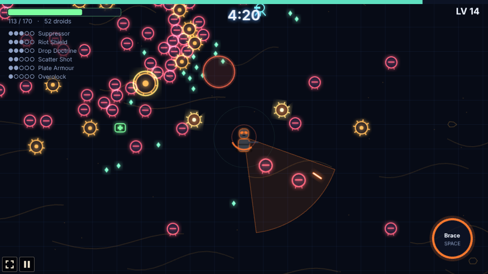
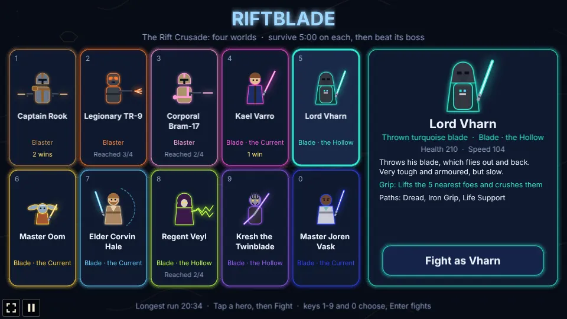
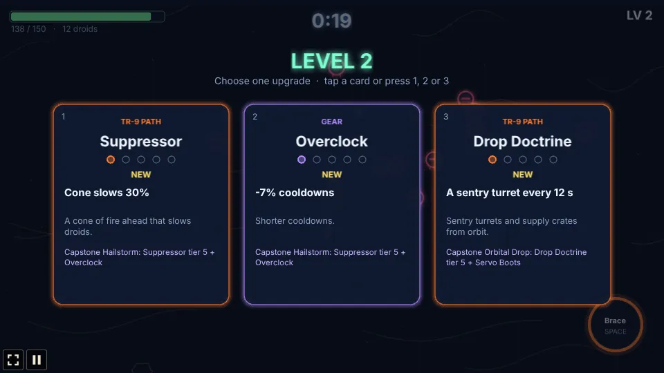
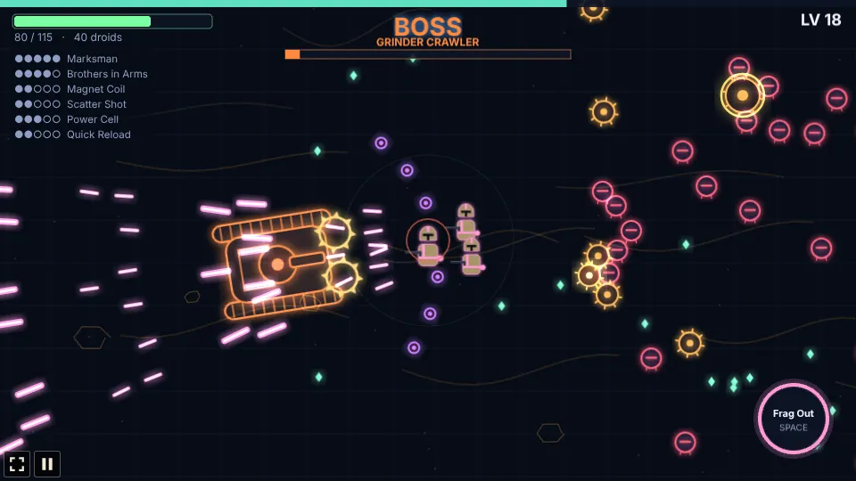

# Riftblade

A survivor-style auto-attack roguelike built with [Phaser 4](https://phaser.io), TypeScript and
Vite, part of the [game hub](../../README.md).

Pick one of three soldiers and hold out on the Dune world for five minutes while Scrap droids pour
in from every side. You only steer: your weapon fires on its own. Shot-down droids drop lumen
shards, and every level-up pauses the run on three upgrade cards. At 5:00 the Grinder Crawler, a
giant tread tank, rolls in; destroy it to win the run. Everything is drawn in code in a "Glow
Vector" style: a dark navy field with a faint grid and amber dune ridges, and neon-rimmed heroes,
droids and bolts.



## How to play

| Input | Action |
| --- | --- |
| WASD or arrow keys | Walk |
| Hold anywhere on the field (mouse or touch) | Walk toward that point; the hero keeps walking while you hold |
| Space, or the round button bottom right | Signature move, once charged |
| Tap a card, or 1 / 2 / 3 | Choose a hero, or an upgrade at a level-up |
| Run again, or Enter | After a run, back to the hero select screen |



### The heroes

| Hero | Weapon | Signature | Paths |
| --- | --- | --- | --- |
| Captain Rook (slate armour, bronze markings) | Twin pistols: alternating shots at the two nearest droids | **Rally Order**: 5 s of +50% fire rate (12 s) | Gunslinger, Commander, Demolitions |
| Legionary TR-9 (charcoal armour, orange lenses) | Spread rifle: three wide, inaccurate bolts at the nearest droid. 150 health, slow | **Brace**: 3 s without damage, knocks droids back (13 s) | Suppressor, Riot Shield, Drop Doctrine |
| Corporal Bram-17 (sand armour, pink markings) | Carbine: fires the way he walks (a little aim assist); standing still, at the nearest droid | **Frag Out**: a grenade that clears a circle (9 s) | Marksman, Jump Trooper, Brothers in Arms |

### The run

- Droids appear just off screen and walk straight at you. More come every minute, and they get
  tougher; at most 250 are on the field at once. At 1:30, 3:00 and 4:15 a ring of them closes in.
- **Clankers** swarm. **Rollerbombs** stop and glow when close, then rush in a straight line and
  explode: step aside. A rollerbomb shot down still blows up, hurting only droids.
- From 0:50, an **elite** droid ringed in gold comes every 50 s. It drops a chest: a free tier of an
  upgrade you hold and some health.
- After a hit you are safe for a moment. Health does not come back on its own without a Medpack.
- **The Grinder Crawler** comes at 5:00: a giant tread tank that fires fans of shells, calls in
  Clankers, and gets faster and angrier below half health. Destroying it wins the run.

### Upgrades



Each level-up offers three different cards, at least one from your hero's own paths while any are
left. Every upgrade has five tiers. A run holds at most **5 abilities** (your paths and pool
skills) and **4 pieces of gear**; when both are full, only what you hold can come up, and when
nothing is left a Field Ration heals you.

- **Hero paths** (three per hero): Gunslinger (fire rate, ricochets, quick-draw bursts), Commander
  (1-3 squad troopers), Demolitions (timed charges, bigger blasts, bomblets); Suppressor (a slowing,
  burning cone), Riot Shield (blocks the front, bashes, reflects), Drop Doctrine (sentry turrets,
  supply crates); Marksman (piercing, heavy rounds), Jump Trooper (jet dashes that leave fire,
  homing mini rockets), Brothers in Arms (1-3 brothers who copy every shot).
- **Blaster pool** (any hero): Ricochet Rounds, Overcharge (pierce), Thermal Grenade, Stun Rounds
  (slow), Quick Reload, Covering Drone, Scatter Shot, Call-In (a supply crate that crashes on the
  swarm and leaves a medkit).
- **Gear**: Servo Boots (speed), Magnet Coil (pickup range), Plate Armour, Overclock (cooldowns),
  Medpack (regeneration), Power Cell (damage), Lumen Lens (XP), Targeting Chip (critical hits).
- **Capstones**: a path at tier 5 together with its gear piece unlocks at once:

  | Hero | Capstone | Path + gear | Effect |
  | --- | --- | --- | --- |
  | Rook | Twin Storm | Gunslinger + Overclock | Both pistols fire every shot, +30% fire rate |
  | Rook | Last Company | Commander + Plate Armour | 5 troopers that hit 50% harder |
  | Rook | Carpet Strike | Demolitions + Magnet Coil | A line of 6 blasts sweeps the thickest swarm every 6 s |
  | TR-9 | Hailstorm | Suppressor + Overclock | A ring of 12 bolts every 1.5 s, +2 rifle bolts |
  | TR-9 | Phalanx | Riot Shield + Plate Armour | Three shields orbit you, blocking and bashing |
  | TR-9 | Orbital Drop | Drop Doctrine + Servo Boots | Every 8 s a turret slams down on the swarm |
  | Bram | Longshot | Marksman + Magnet Coil | Bolts pierce everything, every 2nd is heavy |
  | Bram | Skyfall | Jump Trooper + Servo Boots | Dashes land with a blast, twice the rockets |
  | Bram | The Batch | Brothers in Arms + Medpack | 5 brothers who also throw frags |

- **Crossovers**: a pool skill held with a fitting path gives a bonus: Gunslinger + Ricochet
  Rounds (ricochets seek new targets), Riot Shield + Stun Rounds (shield bashes stun), Brothers in
  Arms + Scatter Shot (brothers fire cones), Demolitions + Thermal Grenade (grenades split into
  bomblets). The cards say when a pick completes one.



The longest run and the wins per hero are saved in the browser.

## Running locally

```sh
npm run dev   # then open http://localhost:5173/games/riftblade/
```

## Playthrough test

`e2e/playthrough.spec.ts` plays the first minute in headless Chromium with real inputs: it picks
Captain Rook on the hero select screen, walks him in a wide circle by holding the mouse down at a
point that turns around him, takes the first card at the first level-up and checks the upgrade was
taken, fires Rally Order from its button and plays on to the one-minute mark.

```sh
npx playwright test --project riftblade
```

## Code layout

- `src/main.ts`: creates the game, the hub's settings and scaling.
- `src/howToPlay.ts`: the How to play screen.
- `src/game/`: the rules, without drawing: `heroes.ts` (the heroes and their colour schemes),
  `upgrades.ts` (paths, pool, gear, capstones, crossovers and the card roll), `state.ts` (the state
  and the numbers), `sim.ts` (everything that happens in a frame) and `save.ts`.
- `src/art/`: `glow.ts` (painting helpers) and `sprites.ts` (every texture, painted at boot).
- `src/scenes/`: `BootScene.ts`, `GameScene.ts` (input, camera and drawing) and `layout.ts`.
- `src/ui/panels.ts`: the hero select, level-up and end screens.
