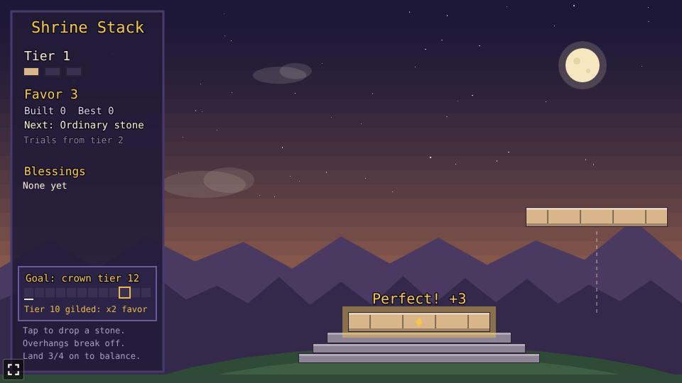
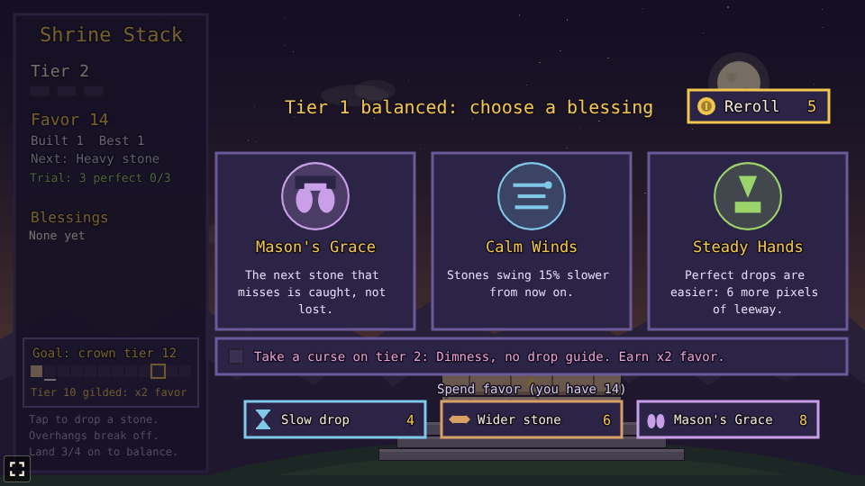
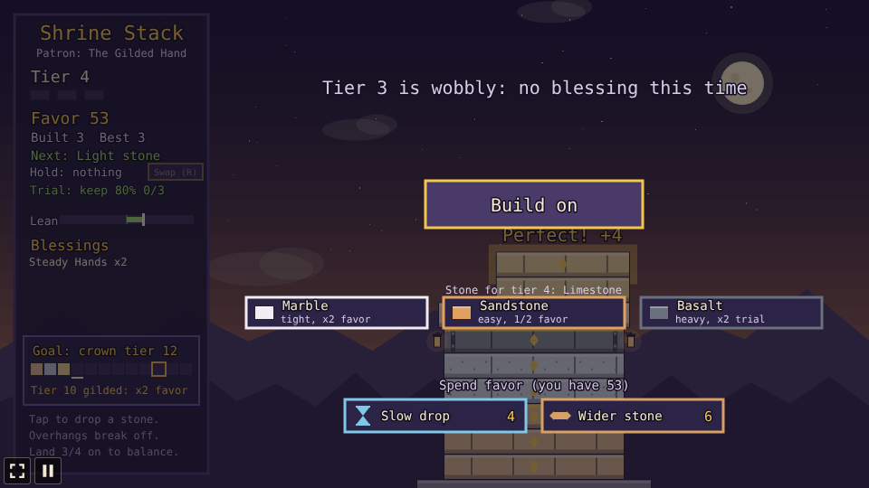
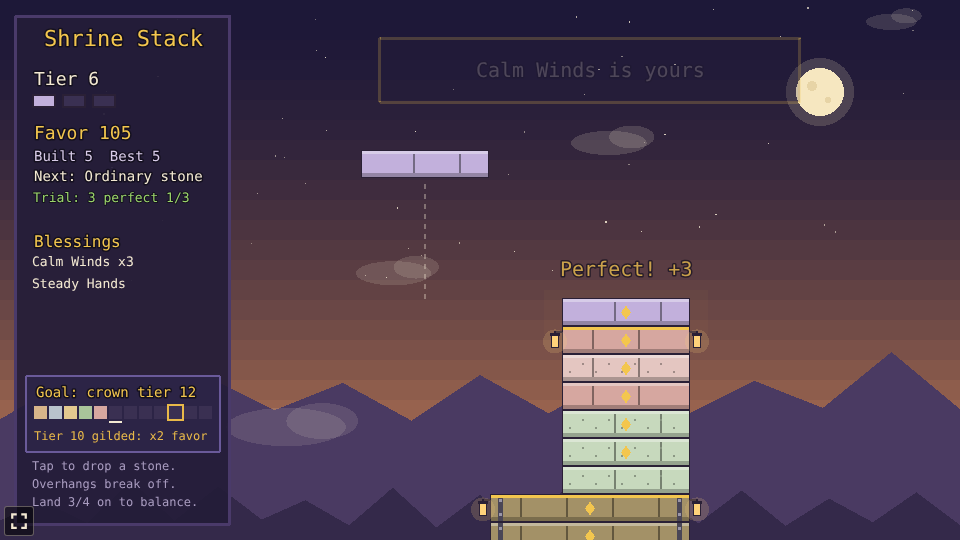
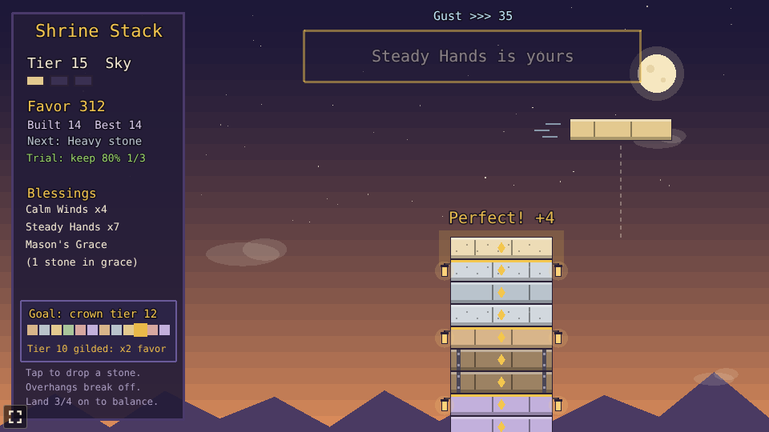
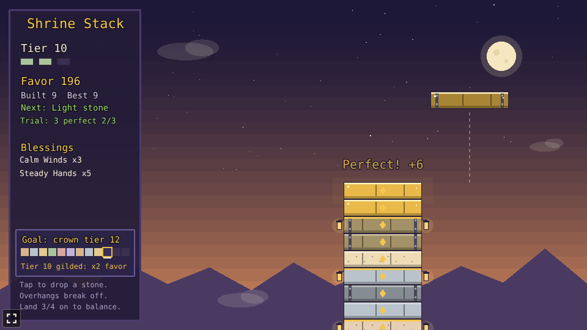
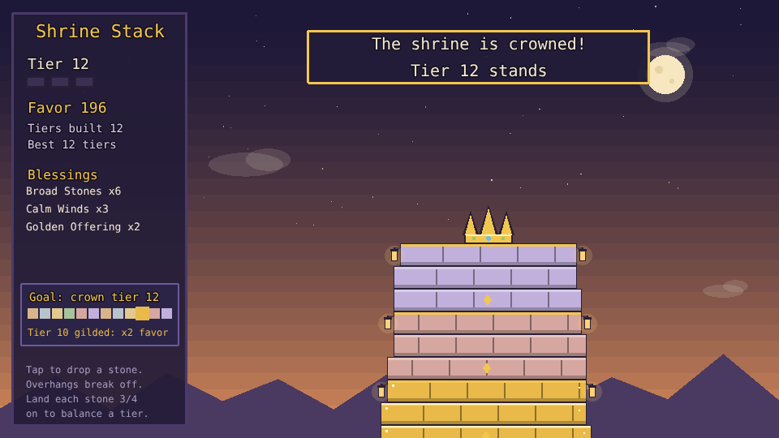
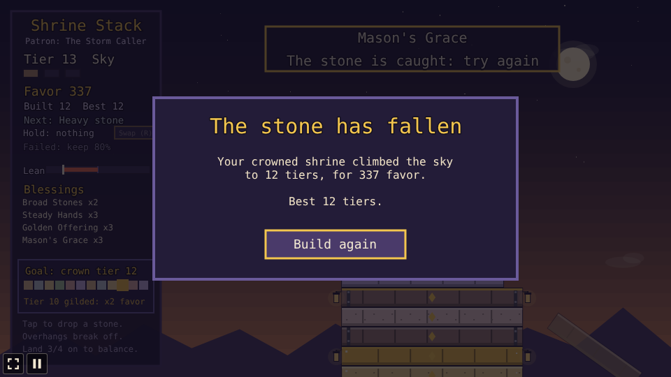

# Shrine Stack

A stacking prototype built with [Phaser 4](https://phaser.io), TypeScript and Vite, part of the
[game hub](../../README.md).

Raise a temple on a hilltop at dusk. A stone swings back and forth above the temple; tap to drop
it. Whatever hangs over the stone below breaks off and tumbles away, so a careless drop narrows the
temple for good. Every three stones make a tier, and a tier whose stones all landed well is
balanced: it earns favor, gold trim and lanterns, and a blessing of your choice. Favor buys new
blessings and one-time help between tiers, heavy and light stones and tier trials change each drop,
a curse taken with a blessing doubles a tier's favor, tier 10 is gilded for double favor, and
finishing tier 12 crowns the shrine. After the crown you can keep building into a windy sky.


## How to play

| Control | Action |
| --- | --- |
| Tap or click anywhere | Drop the swinging stone |
| Tap or click a blessing card | Keep that blessing after a balanced tier |
| Reroll | Spend 5 favor to swap the three blessings on offer for three new ones |
| Slow drop, Wider stone, Mason's Grace | Between tiers: spend favor on one-time help |
| Take a curse | Between tiers: tick it before choosing a blessing to take the curse with it |
| Build on | After a wobbly tier's shop: go back to stacking |
| Keep building | On the crowned panel: carry on into the endless sky |
| Build again | After the temple falls or is crowned: start again on a bare plinth |

1. **Drop the stone over the one below.** Only the part resting on it stays; the overhang breaks
   off, and the next stone is as wide as what is left.
2. **Perfect drops**, within 5 pixels of the stone below, snap on whole and earn 2 extra favor.
3. **Tiers**: three stones make a tier. A tier is balanced when each of its stones kept at least
   three quarters of its width; it earns 5 favor and offers three blessings to choose from. A
   wobbly tier earns nothing extra. Each tier swings 5% faster than the one before.
4. **Reroll**: while choosing, spend 5 favor to draw three new blessings (and a new curse), as
   often as favor lasts.
5. **Spend favor** between tiers on one-time help, each at most once per break: a **Slow drop** (4
   favor: the next stone swings at half speed), a **Wider stone** (6: the top stone grows 20 wider,
   up to the plinth) or **Mason's Grace** (8: the next miss is caught). The shop also opens after a
   wobbly tier when you have at least 4 favor; tap **Build on** to carry on.
6. **Stone kinds**: from tier 2, a stone can be **heavy** (dark, iron-strapped: swings 25% slower,
   but a drop that is not perfect cracks 6 more pixels off) or **light** (pale pumice: swings 30%
   faster and earns 1 more favor). The panel shows the kind of the next stone.
7. **Tier trials**: from tier 2, every tier sets a trial, either three perfect drops or every stone
   keeping at least 80% of its width. Meet it for 6 extra favor; the panel tracks it.
8. **Curses**: a balanced tier's break offers a curse for the next tier (Haste: stones swing 30%
   faster; Brittle: every cut cracks 6 more off; Dimness: no drop guide). Tick it before choosing a
   blessing, and everything that tier earns (stones, balance, trial) is doubled.
9. **The goal** is tier 12. The side panel tracks it, a pip per tier. Tier 10 is gilded: its
   stones are leaf gold, and every stone and its balance bonus earn double favor. Finishing tier 12
   crowns the shrine and wins the run.
10. **The endless sky**: after the crown, **Keep building** lifts the crown off and the temple climbs
    on. Gusts now push the falling stone sideways (the top of the screen and the streaks by the
    stone show which way and how hard), stronger the higher you go. Aim upwind.
11. **The end** comes when a stone misses the temple. The most tiers built in one temple are saved
    in the browser.



### Blessings

| Blessing | Effect |
| --- | --- |
| Broad Stones | The top stone grows 40 pixels wider, up to the plinth's width. |
| Calm Winds | Stones swing 15% slower from now on. |
| Steady Hands | The perfect drop window grows by 6 pixels. |
| Golden Offering | Every stone placed earns 1 more favor. |
| Mason's Grace | The next stone that misses is caught, and you get another try. |

Blessings can be taken more than once, and they add up.















The difficulty, set on the hub page's Settings, changes one thing: stones swing 20% slower on Easy
and 25% faster on Hard.

## Running locally

`npm run dev` at the repo root, then open `/games/shrine-stack/` (or pick Shrine Stack on the hub
page).

## Playthrough test

`e2e/playthrough.spec.ts` plays the first round in headless Chromium: it checks the new temple and
that the first stone swings, drops each of the first tier's three stones with a tap while it is
over the stone below (checking that a second tap while it falls drops nothing), checks the balanced
tier's favor and its three blessings, taps Reroll and checks it cost 5 favor and brought three new
cards, checks the break also shows a curse and the favor shop (neither is taken), and takes the
first blessing, checking its effect and tier 2's trial as tier 2 starts. Like the other games' tests it owns the game clock and plays at 4x speed
(`PLAYTHROUGH_SPEED`). The **Playthrough Shrine Stack** workflow
(`.github/workflows/playthrough.yml`) runs it on every PR that touches this folder or
the workflow, and uploads the video and screenshots as the `playthrough-shrine-stack` artifact.

```sh
npx playwright test --project shrine-stack
```

## Code layout

All paths are inside `games/shrine-stack/`.

- `src/game/`: the rules in plain TypeScript with no Phaser dependency. `state.ts` has the
  swinging, dropping, cutting, tiers, blessing effects, the reroll, the shop, stone kinds, trials,
  curses, the gilded tier, the goal and the endless sky, `blessings.ts` the blessing names and
  texts, `catalog.ts` the shop items, stone kinds, trials and curses, and `save.ts` the best height.
- `src/scenes/`: `GameScene` draws the sky, the temple, the panel with the goal track, the next
  stone, the trial and the curse, the blessing cards, the reroll button, the curse toggle and the
  shop, gusts, the crown, and the end panel and wires taps to the rules; `layout.ts` says where things are drawn.
- `src/ui/`: the button.

Balance numbers (swing speed, the perfect window, the balance share, favor) are the constants at
the top of `src/game/state.ts`.
