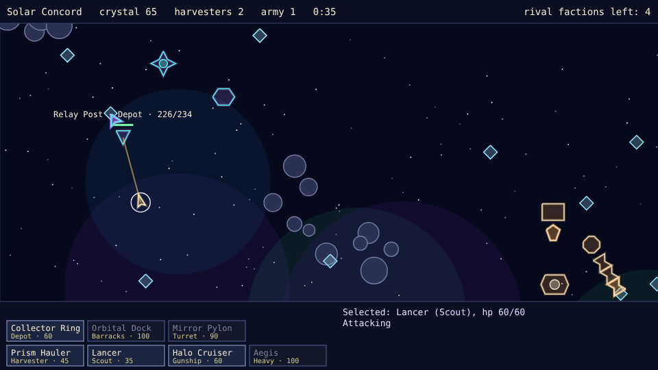
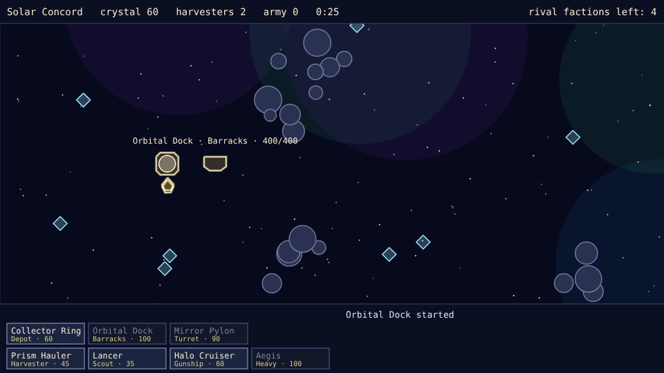

# Space Wars

A real-time strategy prototype built with [Phaser 4](https://phaser.io), TypeScript and Vite, part
of the [game hub](../../README.md).

Five factions share a random star map. Each one starts with a hub and two harvesters (crystal
haulers), and each has its own ships and buildings. Mine crystal, raise a base beside
your hub, train a fleet and take down the four rival hubs before they take down yours.

## How to play

| Control | Action |
| --- | --- |
| Tap a combat unit | Select it (replaces the selection) |
| Drag a box over combat units | Select every combat unit in the box |
| Tap empty space | Move the selected units there |
| Tap an enemy unit or building | Attack it with the selected units |
| Build buttons, then tap the map | Place a building (green outline when it can go there) |
| Train buttons | Queue a unit: harvesters at the hub, combat units at a Barracks |
| Right-click | Cancel a placement and clear the selection |
| Tap after the battle ends | Start a new battle on a new map |

1. **Crystal** is the only currency. Harvesters work on their own: each one mines the crystal
   nearest its hub, fills up and carries it back to the hub or a Depot.
2. **Buildings** cost crystal and take time to finish. Each must go within 240 pixels of your hub,
   clear of other buildings, rock fields and crystal nodes.
3. **Units**: each faction has a fast scout, a gunship and a heavy, all trained at a Barracks. A
   unit with no orders fires at any enemy in its sight.
4. **Victory** comes when all four rival hubs are destroyed. A hub that falls takes its whole
   faction with it. **Defeat** comes when your own hub falls.
5. The rival factions wait about a minute and a half before they attack, then send an army at the
   nearest enemy building once it is big enough.

### The factions

| Faction | Look | Ships (cost) | Signature ability |
| --- | --- | --- | --- |
| Solar Concord | Gold rings and dock | Lancer (35), Halo Cruiser (60), Aegis (100) | Halo Cruiser's shield: friends within 70 px take half the damage |
| Ferrox Hive | Teal and bronze, spiked hive pods | Stinger (30), Brood Carrier (55), Carapace (90) | Brood Carrier spawns a Stinger every 12 s, up to 6 scouts |
| Iron Dominion | Blocky steel and cranes | Ram Skiff (40), Siege Barge (70), Bulwark (115) | Siege Barge's shells splash enemies within 28 px of the target |
| Veil Syndicate | Violet and teal, angular hulls | Phantom Blade (35), Hack Frigate (60), Decoy Wraith (105) | Phantom Blade is hidden until it fires; Hack Frigate's hits disable a turret for 6 s; Decoy Wraith drops a decoy every 15 s |
| Nomad Freight | Amber trade hulls | Courier Skiff (30), Escort Gunship (55), Siege Hauler (105) | Salvage Yard pays 8 crystal for each enemy unit destroyed within 200 px; Nomad carries 14 crystal a trip |

Each faction's outlines, colours and building shapes are its own; its stats are a few multipliers
on the base game (hit points, damage, speed, cost, and how much a harvester carries).

## Difficulty

The difficulty, set on the hub page's Settings, changes how big a rival's army gets before it
attacks.

| Difficulty | Army to attack |
| --- | --- |
| Easy | 9 combat units |
| Normal | 6 combat units |
| Hard | 4 combat units |

With Reduce motion on, the explosions in the battle are left out and shots stay at a steady
brightness instead of fading.

## Running locally

`npm run dev` at the repo root, then open `/games/space-wars/` (or pick Space Wars on the hub
page).

## Playthrough test

`e2e/playthrough.spec.ts` plays the first round in headless Chromium: it waits for the harvesters
to bring in crystal, raises a Barracks beside the hub, trains a Lancer and sends it to attack the
nearest enemy base. Run it with `npx playwright test --project space-wars`.

## Code layout

- `src/main.ts`: creates the Phaser game and calls `setupGame`.
- `src/game/factions.ts`: the five factions, their ship and building outlines and stats.
- `src/game/map.ts`: random star maps: hub spots, crystal nodes, rock fields, nebulae and stars.
- `src/game/world.ts`: the battle (economy, production, orders, combat and the AI), with no Phaser.
- `src/game/arena.ts`: the playing field and the placement and crystal distances.
- `src/scenes/GameScene.ts`: draws the battle each frame and turns clicks into commands.
- `src/scenes/layout.ts`: the top bar, the command bar and its buttons.
- `src/art/draw.ts`: the neon outline, dome and health-bar helpers.

See [AGENTS.md](AGENTS.md) for how the pieces fit and how to make common changes.
