# Space Wars

A real-time strategy prototype built with [Phaser 4](https://phaser.io), TypeScript and Vite, part
of the [game hub](../../README.md).

Five factions share a random star map, a battlefield larger than the screen that you scroll
around. Each one starts with a hub and two harvesters (crystal haulers) at its own start point, and
each has its own ships and buildings. Mine crystal, raise a base beside your hub, train a fleet,
work through a chain of five contracts and take down the four rival hubs before they take down
yours.

It looks like a 1970s science-fiction paperback cover: airbrushed violet skies and nebulae, a
ringed gas giant, sparkle glints, and real low-poly 3D ships with chrome and painted hulls, racing
stripes and long exhaust flames, under a chocolate-and-mustard striped HUD with cream pill buttons.

## How to play

| Control | Action |
| --- | --- |
| Tap a faction card (before the battle) | Command that faction. The other four are AI |
| Tap a combat unit | Select it (replaces the selection) |
| Drag a box over combat units | Select every combat unit in the box |
| Tap empty space | Move the selected units there |
| Tap an enemy unit or building | Attack it with the selected units |
| Build buttons, then tap the map | Place a building (green ring when it can go there) |
| Expansion button, then tap a far crystal field | Place an outpost, a second hub |
| Train buttons | Queue a unit: harvesters at a hub, combat units at a Barracks |
| Research buttons (Hull, Weapons, Engines) | Start the next level at your hub |
| Right-click | Cancel a placement and clear the selection |
| Arrow keys or WASD | Scroll the map |
| H | Centre the map on your hub |
| Hover over a unit or building | Its name, role, hit points and stats |
| Hover over a command button | What it is: cost, stats and ability |
| Tap after the battle ends | Start a new battle on a new map |

0. **Pick a faction** on the first screen. Each card shows its hub, its three warships, its
   barracks and its signature ability. Your faction always starts at the bottom left of the map.
1. **Crystal** is the only currency. Harvesters work on their own: each one mines the crystal
   nearest its hub, fills up and carries it back to the hub or a Depot.
2. **Buildings** cost crystal and take time to finish. Each must go within 240 pixels of one of
   your hubs, on ground you have scouted, clear of other buildings, rock fields, crystal nodes and the relay beacon. Every faction names
   its buildings and ships its own way, so each button shows the role under the name: the Barracks
   is the building with the role "Barracks" under its name (the Solar Concord's is the Orbital
   Dock).
3. **Units**: each faction has a fast scout, a gunship and a heavy, all trained at its Barracks. A
   unit with no orders fires at any enemy in its sight. Select one to see its name and hit points
   on the command bar.
4. **Contracts** give the battle its goals (below). The current one is on the top bar and in the
   panel on the command bar, with its progress, reward and rank perk, and the next one.
5. **The fog of war** hides everything your ships and buildings can't see (below), so send scouts
   out.
6. **The relay beacon** sits on what was a crystal node partway between your start and the centre
   of the map, out in the fog. Find it and hold it to earn crystal (below).
7. **Salvage**: every enemy ship you destroy leaves a glowing gold shard worth 8 crystal.
8. **Expansions and research** (below) grow your economy and your fleet once the base is running.
9. **Victory** comes when all four rival hubs are destroyed. A hub that falls takes its whole
   faction with it (an outpost does not). **Defeat** comes when your own hub falls.
10. **The rivals** play the same game and fight each other as much as you. They wait about a
    minute and a quarter before they attack, then send their army (keeping two ships home) at the
    faction that last hit them, or else the nearest enemy building. From 30 seconds in, the rival
    nearest the relay beacon keeps a warship on it, and from two minutes the next nearest does too.
    Their idle warships fetch their own salvage, and from two minutes on they research and from two
    and a half they build an outpost, saving up for both once their army is big enough.

### The contract chain

Five contracts in a row. Finishing one pays its crystal reward at once, gives your faction a rank
perk for the rest of the battle and starts the next one. Only progress made while a contract is
current counts.

| # | Contract | Goal | Reward | Rank perk |
| --- | --- | --- | --- | --- |
| 1 | Raise the Barracks | Finish your Barracks (it names your faction's own, such as the Orbital Dock) | 60 | Rank I: ships train 20% faster |
| 2 | Break the raid | Destroy 7 enemy ships | 120 | Rank II: turret range +20% |
| 3 | Hold the Relay 60 s | Keep a warship on the relay beacon you own for 60 s in all | 150 | Rank III: ships 10% faster |
| 4 | Raze an outpost | Destroy 3 enemy buildings | 200 | Rank IV: ship hulls +15% (new ships) |
| 5 | Topple a hub | Destroy a rival hub | 300 | Rank V: ship damage +10% |

A kill or a razed building counts for you when your ship or turret landed the last hit.

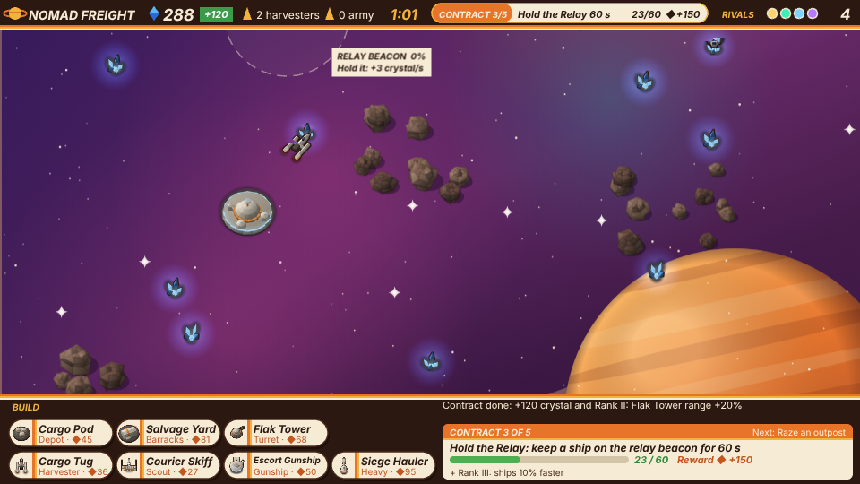

### The relay beacon

A warship (not a harvester) inside the beacon's ring holds it. A faction alone in the ring fills
the capture ring in 5 seconds, after first draining a rival's; when it is full the beacon is that
faction's. The owner earns 3 crystal every second while one of its warships stays in the ring, so
you choose between keeping ships out at the beacon and keeping them home to defend. A floating +3
rises from the beacon each time it pays you.

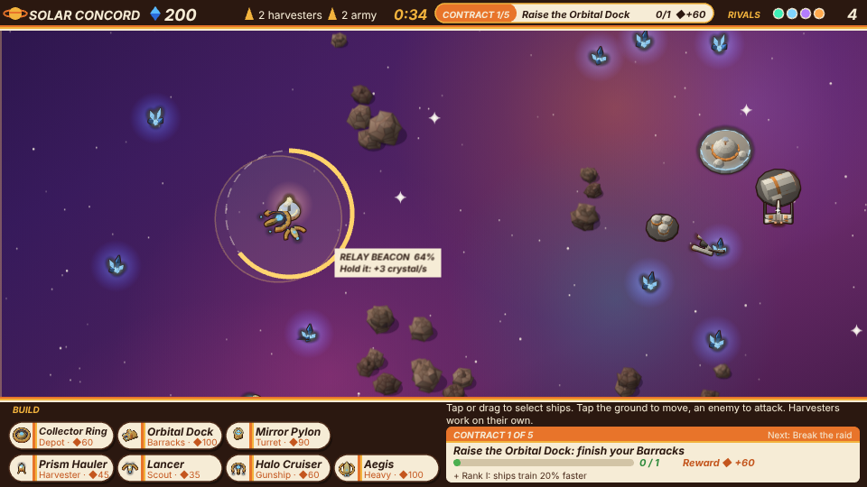

### Fog of war

You only see what your ships and buildings see. Space you have never seen is near black; space you
have seen before is dimmed, with rival buildings shown where you last saw them, and rival ships
show only while in sight. Scouts see furthest (1.6 times their weapon sight), other warships 1.2
times, harvesters 80 pixels, a hub 175 and other buildings 110 past their edge. The relay beacon
and the crystal fields show once you have seen them, and you can only build on ground you have
scouted. The rivals are not limited by the fog.

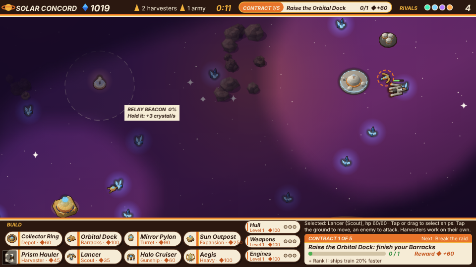

### Expansions

The Expansion button builds an outpost: a smaller copy of your hub (250 crystal, 18 s, 60% of the
hub's hit points). It must go within 120 pixels of a crystal node and at least 400 pixels from your
other hubs, on ground you have scouted. A finished outpost trains harvesters, which work the crystal
nearest it; every harvester drops its crystal at the nearest hub, outpost or Depot; and you can
build within 240 pixels of it. Losing an outpost does not end the battle.

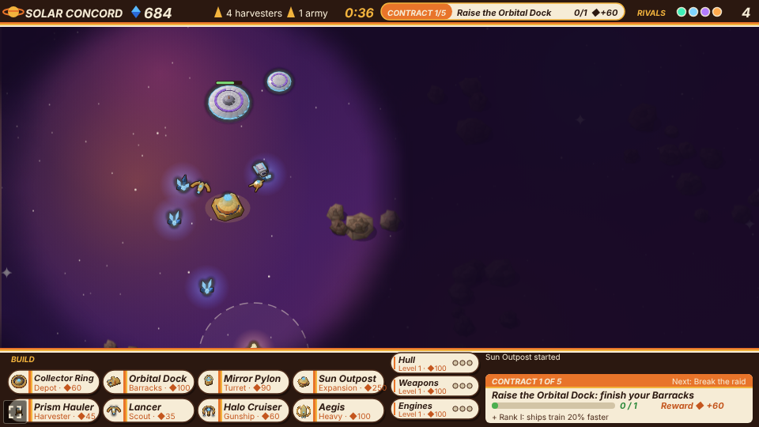

### Research

Three tracks are researched at your hub with crystal, one level at a time, 20 seconds each: Hull
(+10% hit points a level, ships already flying included), Weapons (+10% damage) and Engines (+10%
speed). Each track has three levels costing 100, 160 and 240 crystal (times the faction's cost
multiplier). The button fills while its level is researched, and its pips show the levels done.

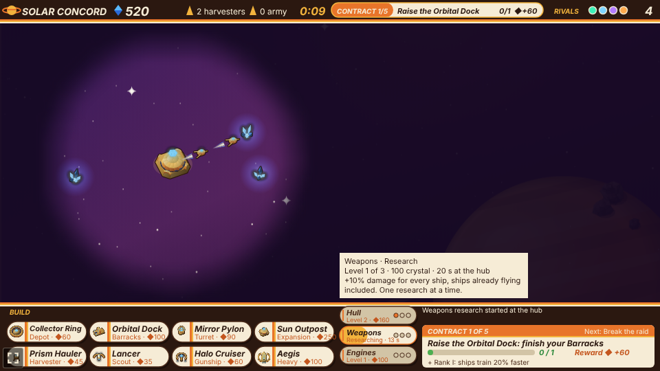

### Salvage

A ship destroyed by another faction (not a decoy) drops a glowing gold shard worth 8 crystal. The nearest of
your ships within 260 pixels pulls it in; when it reaches the ship, a +8 floats up over the spot and
a +8 flashes next to your crystal count. A shard nobody reaches fades after 45 seconds. Rivals'
shards work the same way for them, and their idle warships go to fetch them. Nomad
Freight's Salvage Yard still pays its own 8 crystal on top for enemy ships destroyed near it.

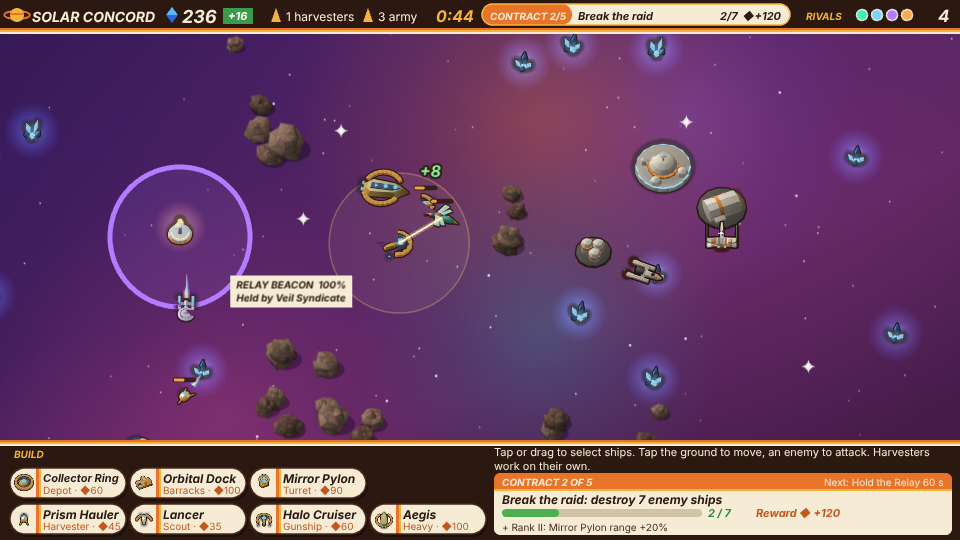

### The factions

Each faction's ships and stations are low-poly 3D models, rendered at 16 headings so they turn
smoothly, and keep the faction's colour on a stripe or a glow.

| Faction | Look | Barracks | Ships (cost) | Signature ability |
| --- | --- | --- | --- | --- |
| Solar Concord | Curved gold hulls round glowing blue crystals; arched carriers; pylons are floating crystals | Orbital Dock | Lancer (35), Halo Cruiser (60), Aegis (100) | Halo Cruiser's shield: friends within 70 px take half the damage |
| Ferrox Hive | Teal and bronze insects with glowing sacs; domed hives and spines | Brood Pit | Stinger (30), Brood Carrier (55), Carapace (90) | Brood Carrier spawns a Stinger every 12 s, up to 6 scouts |
| Iron Dominion | Dark iron warships with gold trim and ice-blue windows (a forge hauler with a cog crest and cranes, a winged assault gunship, a rounded strike cruiser with flight bays and a dorsal cannon, and a vast cathedral battleship with a ram prow and spires) | Forge Works | Ram Skiff (40), Siege Barge (70), Bulwark (115) | Siege Barge's shells splash enemies within 28 px of the target |
| Veil Syndicate | Pale starships with glowing blue nacelles (a boxy shuttle, a saucerless arrowhead escort, a saucer frigate with low nacelles and a rollbar, a ringed space station under way on warp nacelles); mushroom starbases and a spacedock | Cloak Works | Phantom Blade (35), Hack Frigate (60), Decoy Wraith (105) | Phantom Blade is hidden until it fires; Hack Frigate's hits disable a turret for 6 s, and 6 hits in a row take it over; Mine Lattice lays hidden mines; Decoy Wraith drops a decoy every 15 s |
| Nomad Freight | Off-white fighters with amber stripes (a fighter with four wings in an X, a twin-nacelle hauler, a saucer-cockpit freighter, a dagger-wedge destroyer with twin bridge towers); rounded modular bases | Salvage Yard | Courier Skiff (30), Escort Gunship (55), Siege Hauler (105) | Salvage Yard pays 8 crystal for each enemy unit destroyed within 200 px; Nomad carries 14 crystal a trip |

The Veil Syndicate's Mine Lattice lays a mine at a random spot within 130 pixels every 8 seconds
while it isn't hacked, up to 4 at a time. A rival's mine is hidden until one of your ships is within
60 pixels of it. An enemy ship that comes within 16 pixels sets it off: 45 damage to every enemy
ship within 40 pixels.

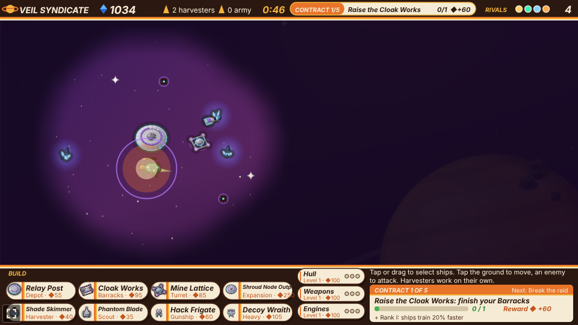

Each Hack Frigate hit puts a turret out for 6 seconds and fills a ring round it; 6 hits before it
comes back on take it over, and it becomes the hacker's own turret, as damaged as it was.

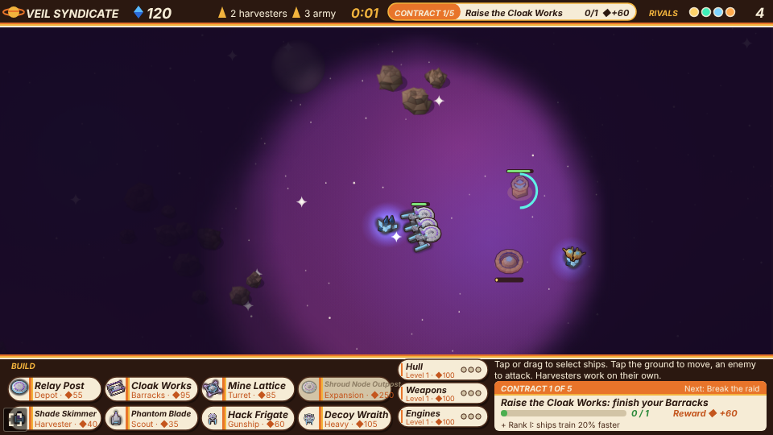

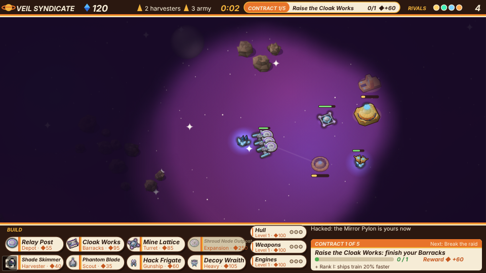

Rivals fight each other as well as you:

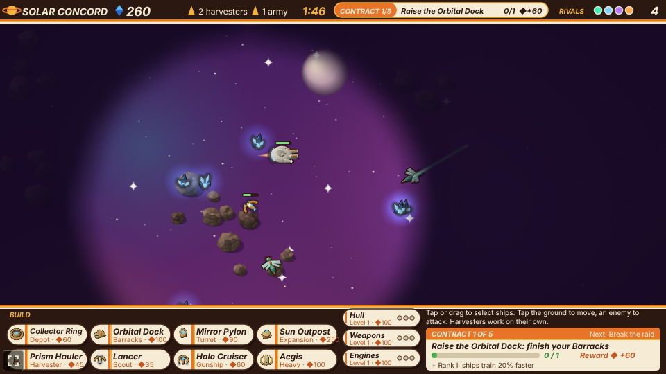

Each faction's stats are a few multipliers on the base game (hit points, damage, speed, cost, and
how much a harvester carries).

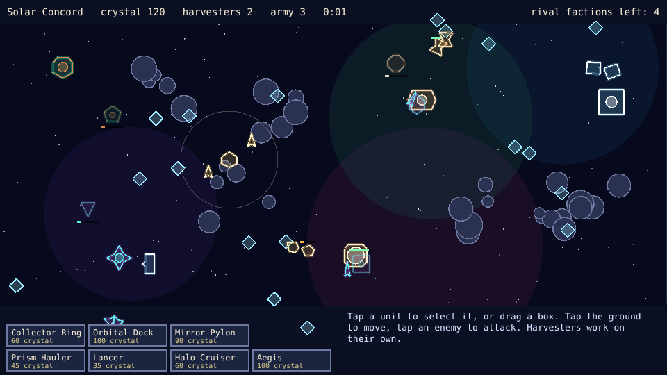

Every faction's four ships and four buildings:

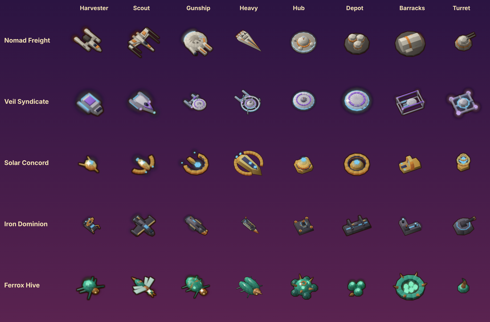

The same ships side by side at their true sizes; every faction's heavy is the same size, the biggest ships in the game:

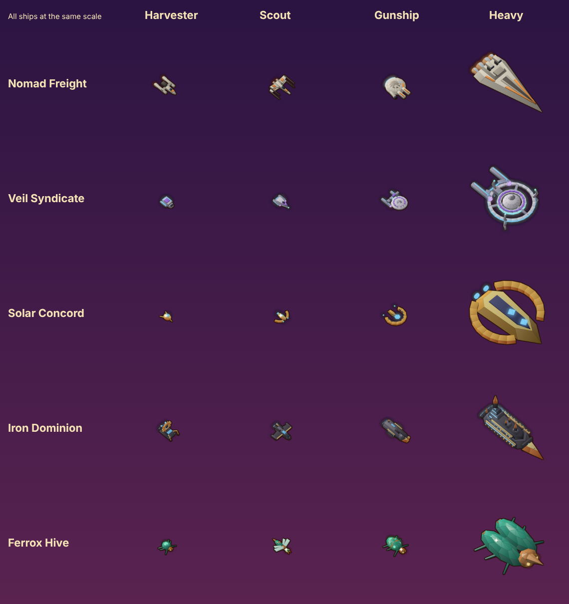

## Difficulty

The difficulty, set on the hub page's Settings, changes how big a rival's army gets before it
attacks.

| Difficulty | Army to attack |
| --- | --- |
| Easy | 9 combat units |
| Normal | 6 combat units |
| Hard | 4 combat units |

The map is 1600 by 1000 pixels. Each faction's hub starts at its own spot, the player's at the
bottom left, the other four at the other corners and in the middle, nudged a little at random.

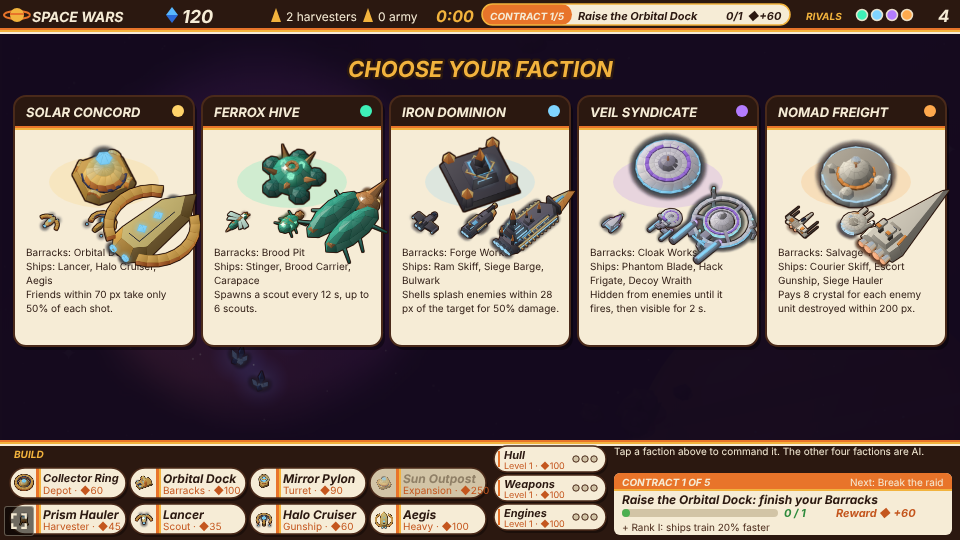

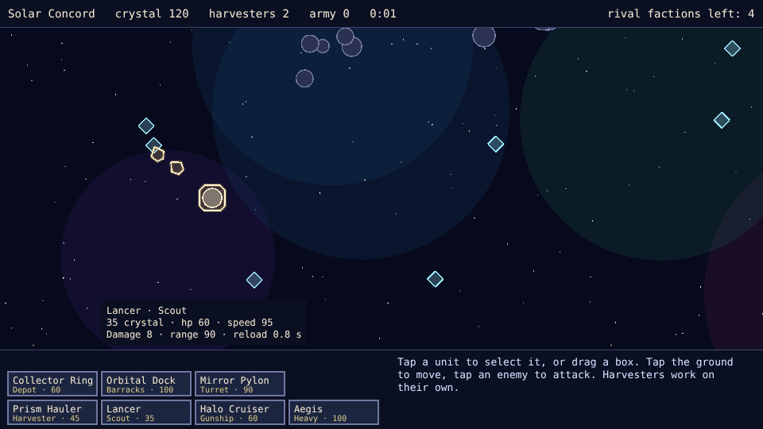

With Reduce motion on, the explosions are left out, shots stay at a steady brightness instead of
fading, exhaust flames, shards and the beacon's glow hold still, floating numbers fade in place
without rising and the Solar Concord's crystal pylons stop bobbing.

## Running locally

`npm run dev` at the repo root, then open `/games/space-wars/` (or pick Space Wars on the hub
page).

## Playthrough test

`e2e/playthrough.spec.ts` plays the first round in headless Chromium: it picks the Solar Concord,
waits for the harvesters to bring in crystal, raises a Barracks beside the hub (which completes the
first contract and pays its reward and perk), trains three Lancers, box-selects them, takes the
relay beacon (hidden in the fog at the start, so the test checks the wing finds it) until it pays, fights off the rival picket that comes to contest it and collects its
salvage shard, then attacks the nearest enemy base. It pans the map with the arrow keys to reach
what it taps. Run it with `npx playwright test --project space-wars`.

## Code layout

- `src/main.ts`: creates the Phaser game and calls `setupGame`.
- `src/game/factions.ts`: the five factions, their ship and building outlines and stats.
- `src/game/contracts.ts`: the contract chain, its rewards and the rank perks.
- `src/game/fog.ts`: the fog of war's grid of explored and in-sight cells.
- `src/game/research.ts`: the hull, weapons and engines research tracks.
- `src/game/map.ts`: random star maps: hub spots, crystal nodes, rock fields, nebulae and stars.
- `src/game/world.ts`: the battle (economy, expansions, production, research, orders, combat, mines
  and hacks, the AI, the relay beacon, salvage, the fog and contract progress), with no Phaser.
- `src/game/describe.ts`: the tooltip and faction-card text, from the faction data.
- `src/game/arena.ts`: the battlefield, the fixed start points and the placement and crystal distances.
- `src/scenes/GameScene.ts`: draws the battle each frame, scrolls the map and turns clicks into commands.
- `src/scenes/layout.ts`: the top bar, the command bar, its buttons, the role names and the font.
- `src/art/mesh.ts`: the low-poly modelling kit (boxes, tubes, ellipsoids, extruded outlines).
- `src/art/render3d.ts`: the software renderer that paints meshes with airbrushed and chrome shading.
- `src/art/models.ts`: every faction's ship and station models, and the crystal, beacon, shard and rock models.
- `src/art/textures.ts`: bakes the models into sprite frames and paints the map's backdrop at boot.
- `src/art/draw.ts` and `src/art/palette.ts`: health and progress pills, dashed rings, the HUD's stripes and colours.

See [AGENTS.md](AGENTS.md) for how the pieces fit and how to make common changes.
