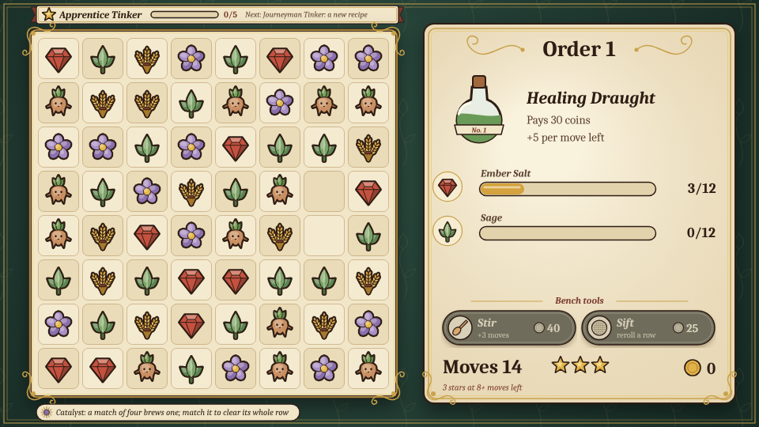
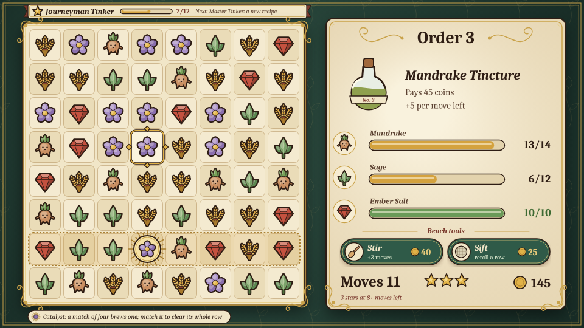
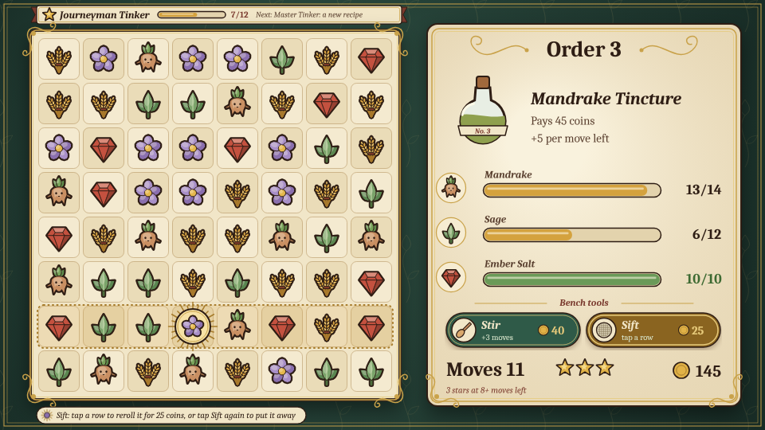
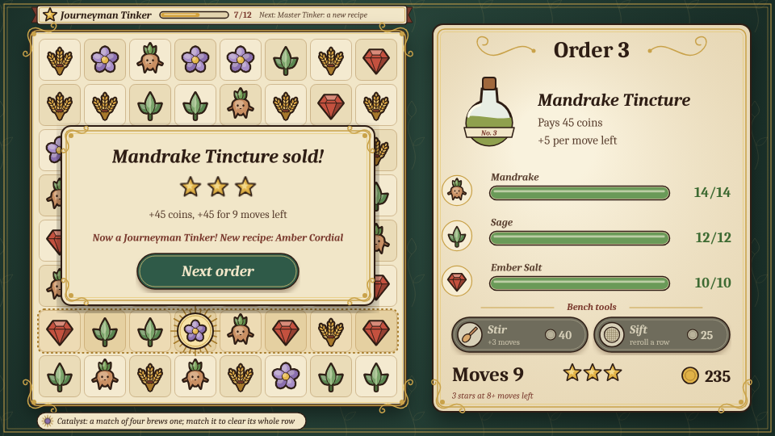

# TinctureTinker

A match-3 game built with [Phaser 4](https://phaser.io), TypeScript and Vite, part of the
[game hub](../../README.md), drawn like an old Art Nouveau apothecary label: flat muted inks with
bold sepia outlines on cream tiles, gold whiplash ornaments on bottle green and serif italics.

The board is an 8x8 grid of ingredients: wheat, mandrake, sage, ember salt and moonpetal. Each order
asks for a potion that takes so many of a few of them. Swap two neighbouring tiles to line up three
or more of a kind: the matched tiles are gathered for the order, the tiles above fall into the gaps
and new ones drop in from the top, which can set off more matches. Gather everything on the order
before the moves run out and the potion sells, for coins and one to three stars.


## How to play

| Control | Action |
| --- | --- |
| Tap a tile, then a neighbour | Swap the two |
| Drag a tile onto a neighbour | Swap the two |
| Tap the picked tile again | Let it go |
| Stir | Spend 40 coins on 3 more moves for this order |
| Sift, then a tile | Spend 25 coins to reroll that tile's row (tap Sift again to put it away) |
| Next order / Try again | After an order: start the next one, or the same one again |

1. **Swaps** only count when they make a match. A swap that doesn't slides back and costs no move.
2. **Matches** of three or more in a row or column, across or down, are gathered, every tile of
   every kind. Cascades after a swap are free.
3. **Catalysts**: a match of four or more leaves one of its tiles behind as a Catalyst, haloed in a
   sunburst (the tile you moved, when it can). A Catalyst matches like its ingredient, and when it is
   matched it clears its whole row, which is marked with a dotted gold band, and every tile in that
   row counts towards the order.
4. **Orders** list the ingredients the potion needs, the moves allowed and what it pays. Filling one
   pays its price plus 5 coins for every move left; running out of moves means trying it again on a
   new board.
5. **Bench tools** spend coins during an order: **Stir** gives 3 more moves for 40 coins, and **Sift**
   rerolls one row of the board for 25 coins (its Catalysts stay, and the new tiles never make a
   match by themselves). A tool you can't afford is greyed out.
6. **Stars**: a sold order earns 3 stars with 8 or more moves left, 2 with 4 to 7 and 1 otherwise.
   The stars next to the moves show what the order is worth right now.
7. **Tinker rank**: the stars add up on the ribbon above the board. Each rank unlocks a new recipe,
   which joins the round of orders:

   | Rank | Stars | Unlocks |
   | --- | --- | --- |
   | Apprentice Tinker | 0 | |
   | Journeyman Tinker | 5 | Amber Cordial |
   | Master Tinker | 12 | Starlight Elixir |
   | Grand Master Tinker | 24 | Philosopher's Draught |

8. **Hints**: after a few idle seconds, two tiles that would match swell and settle (with the hub's
   reduced motion on, they hold still, a little larger).
9. If the board is left with no move to make, its tiles are shuffled.

Progress (the next order, coins, potions sold and stars) is saved in the browser, after each sale
and each tool bought.



A Catalyst on row 7, its row marked with the gold band, and a tile picked to swap:



Sift picked up and waiting for a row; Stir is ready too:



A sale that earns three stars and reaches Journeyman Tinker, unlocking the Amber Cordial:



### Orders

The orders come round again with 3 more of each ingredient and 15 more coins every five orders.
Recipes unlocked by rank join the round after the first five.

| Order | Needs | Moves | Pays |
| --- | --- | --- | --- |
| Healing Draught | 12 ember salt, 12 sage | 15 | 30 |
| Sleeping Tonic | 15 moonpetal, 12 wheat | 16 | 35 |
| Mandrake Tincture | 14 mandrake, 12 sage, 10 ember salt | 18 | 45 |
| Golden Elixir | 16 wheat, 14 ember salt, 12 moonpetal | 20 | 55 |
| Moonlit Philter | 20 moonpetal, 16 mandrake, 14 sage | 20 | 70 |
| Amber Cordial (Journeyman) | 14 wheat, 12 mandrake, 12 ember salt | 18 | 60 |
| Starlight Elixir (Master) | 16 moonpetal, 14 sage, 12 wheat | 19 | 75 |
| Philosopher's Draught (Grand Master) | 18 ember salt, 16 moonpetal, 16 mandrake | 22 | 100 |


The favicon is the hub's bear with three potions lined up: a match of three.


The difficulty, set on the hub page's Settings, changes one thing: each order gives 5 more moves on Easy and 3 fewer on Hard.

## Running locally

`npm run dev` at the repo root, then open `/games/tincture-tinker/` (or pick TinctureTinker on the hub
page).

## Playthrough test

`e2e/playthrough.spec.ts` plays the first order in headless Chromium: it checks the new order and
board, taps a swap that makes no match and checks it slid back without costing a move, taps Stir
with no coins and checks it bought nothing, then makes the best match it can see, a tap on a tile
and a tap on its neighbour, checking each one spends a move, gathers at least what it matched (less
the tile a match of four keeps as a Catalyst) and brews a Catalyst for a match of four, until the
Healing Draught is sold for its price plus the bonus for the moves left and earns its stars. Like
the other games' tests it owns the game clock and plays at 4x speed (`PLAYTHROUGH_SPEED`). The
**Playthrough TinctureTinker** workflow (`.github/workflows/playthrough.yml`) runs it on pull
requests that change this folder or the workflow itself (not on pushes to main), and uploads the
video and screenshots as the `playthrough-tincture-tinker` artifact.

```sh
npx playwright test --project tincture-tinker
```

## Code layout

All paths are inside `games/tincture-tinker/`.

- `src/game/`: the rules in plain TypeScript with no Phaser dependency. `kinds.ts` lists the
  ingredients, `orders.ts` the potion orders and the recipes ranks unlock, `ranks.ts` the stars and
  ranks, `board.ts` finds runs, matches and moves, lets tiles fall and shuffles, `state.ts` holds the
  order being played, `sim.ts` plays a swap out step by step (Catalysts included) and runs the bench
  tools, and `save.ts` keeps the progress.
- `src/scenes/`: `BootScene` paints the textures, `GameScene` draws the board, the rank ribbon and
  the order label, animates each step of a swap and wires taps, drags and tools to the rules,
  `layout.ts` says where things are drawn.
- `src/art/`: `nouveau.ts`, the label toolkit (sepia contours, gold whiplashes, the ingredient
  shapes), and `textures.ts`, which paints every texture on 2D canvases at startup.
- `src/ui/`: the result card's button.

Adding an order is an entry in `ORDERS` in `src/game/orders.ts`; a new potion also needs its name
there and its colour in `BREWS` in `src/art/textures.ts`.
