# TinctureTinker

A match-3 game built with [Phaser 4](https://phaser.io), TypeScript and Vite, part of the
[game hub](../../README.md), drawn like an old Art Nouveau apothecary label: flat muted inks with
bold sepia outlines on cream tiles, gold whiplash ornaments on bottle green and serif italics.

The board is an 8x8 grid of ingredients: wheat, mandrake, sage, ember salt and moonpetal. Each order
asks for a potion that takes so many of a few of them. Swap two neighbouring tiles to line up three
or more of a kind: the matched tiles are gathered for the order, the tiles above fall into the gaps
and new ones drop in from the top, which can set off more matches. Gather everything on the order
before the moves run out and the potion sells, for coins and one to three stars.

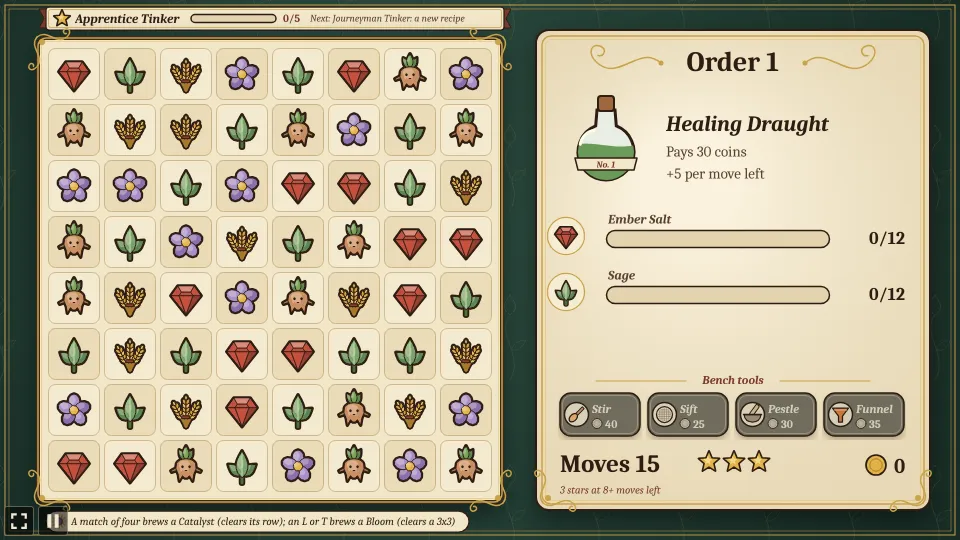

## How to play

| Control | Action |
| --- | --- |
| Tap a tile, then a neighbour | Swap the two |
| Drag a tile onto a neighbour | Swap the two |
| Tap the picked tile again | Let it go |
| Stir | Spend 40 coins on 3 more moves for this order |
| Sift, then a tile | Spend 25 coins to reroll that tile's row (tap Sift again to put it away) |
| Pestle, then a tile | Spend 30 coins to smash that tile, without a move |
| Funnel, then two tiles | Spend 35 coins to swap any two tiles, without a move |
| Next order / Try again | After an order: start the next one, or the same one again |
| Workbench, then Buy | After an order: spend coins on a lasting upgrade |

1. **Swaps** only count when they make a match. A swap that doesn't slides back and costs no move.
2. **Matches** of three or more in a row or column, across or down, are gathered. Only the
   ingredients the order asks for count (they fly to their row on the label); the others just pop,
   so aim for what the order needs. Cascades after a swap are free.
3. **Catalysts**: a match of four or more leaves one of its tiles behind as a Catalyst, haloed in a
   sunburst (the tile you moved, when it can). A Catalyst matches like its ingredient, and when it is
   matched it clears its whole row, which is marked with a dotted gold band, and every tile in that
   row counts towards the order.
   **Blooms**: an L or T of one kind leaves a Bloom, ringed in rose petals, where its two lines
   cross. Matched, it clears the 3x3 around it. **Two Catalysts swapped together** clear the row
   and the column where the moved one lands.
4. **Blockers**, from the second order on: a **corked jar** holds one ingredient. It can't be
   swapped and never matches; a match right next to it opens it and gathers what's inside.
   **Resin** (from the third order) holds a tile in place: it can't be swapped and the other tiles
   fall past it, and the first match it is in only melts the resin, leaving the tile free.
   **Mould** (from the fifth order, two patches, one more every five orders) holds its tile too and
   never matches, and it creeps: after every move it spreads to a neighbouring tile, unless a match
   touched some mould that move. A match right next to a mouldy tile (or a Catalyst row, a Bloom or
   the Pestle hitting it) scrubs it clean and frees the tile.
5. **Order twists**, from the third order on, in turn: a **rush order** gives 3 fewer moves and pays
   20 more coins; the next **forbids** one ingredient it doesn't need, and a swap that matches it
   costs an extra move; the one after is plain. The twist is written under the order's price.
6. **Orders** list the ingredients the potion needs, the moves allowed and what it pays. Filling one
   pays its price plus 5 coins for every move left; running out of moves means trying it again on a
   new board.
7. **Royal commissions**: every fifth order (5, 10, 15...) is brewed for the crown in three stages on
   one board: the next three recipes in the round, each at half strength, one after the other. When
   a stage is filled the label changes to the next potion and the moves left carry over (a
   commission has 12 moves on top of its first recipe's). It pays half of the three prices plus 40
   coins. Once every recipe is unlocked (Grand Master), the next commission is **the crown's last
   order**: filling it ends the game with the title Royal Apothecary and the total stars on the
   ribbon. You can keep tinkering after it.
8. **Two customers**, from Journeyman on: every fifth order after the second (7, 12, 17...) serves
   two customers on one board with one pool of moves. Each wants two ingredients (the two biggest of
   their recipe, at 60%), of different kinds, so the label has four rows, each marked with its
   potion. The customer whose rows fill first is served there and then and pays 20 coins for speed;
   the order sells when both are served. These orders have no twist.
9. **Pantry**: whatever was gathered over what an order (or a stage) needed is kept, up to 5 of a
   kind, and put towards the next order or stage that needs that ingredient when it starts, short of
   filling any row by one. The caption says what the pantry put in, and the pantry's contents sit at
   the foot of the label.
10. **Bench tools** spend coins during an order: **Stir** gives 3 more moves for 40 coins, **Sift**
   rerolls one row of the board for 25 coins (its specials, jars and resin stay, and the new tiles
   never make a match by themselves), **Pestle** smashes one tile for 30 coins (a jar opens, resin
   melts, a Catalyst or Bloom fires) and **Funnel** swaps any two tiles for 35 coins (not jars or
   resin), and neither of those spends a move. Hover a tool to read what it does in the caption. A
   tool you can't afford is greyed out.
11. **Workbench**: after an order, "Workbench: lasting upgrades" on the result card opens three
   upgrades that stay bought: **Steady hands** (+1 move on every order, three levels for 60, 100 and
   150 coins), **Potent Catalysts** (a fired Catalyst clears its column as well as its row, 120
   coins) and **Bloom starter** (every order's board starts with a Bloom, 90 coins).
12. **Stars**: a sold order earns 3 stars with 8 or more moves left, 2 with 4 to 7 and 1 otherwise.
   The stars next to the moves show what the order is worth right now.
13. **Tinker rank**: the stars add up on the ribbon above the board. Each rank unlocks a new recipe,
   which joins the round of orders:

   | Rank | Stars | Unlocks |
   | --- | --- | --- |
   | Apprentice Tinker | 0 | |
   | Journeyman Tinker | 5 | Amber Cordial |
   | Master Tinker | 12 | Starlight Elixir |
   | Grand Master Tinker | 24 | Philosopher's Draught |

14. **Hints**: after a few idle seconds, two tiles that would match swell and settle (with the hub's
   reduced motion on, they hold still, a little larger).
15. If the board is left with no move to make, its tiles are shuffled.

Progress (the next order, coins, potions sold, stars, the pantry, the workbench upgrades and the
royal title) is saved in the browser, after each sale and each tool or upgrade bought.

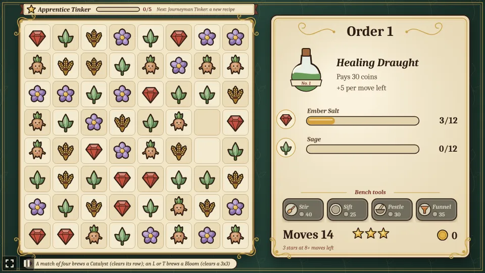

A Catalyst on row 7, its row marked with the gold band, and a tile picked to swap:

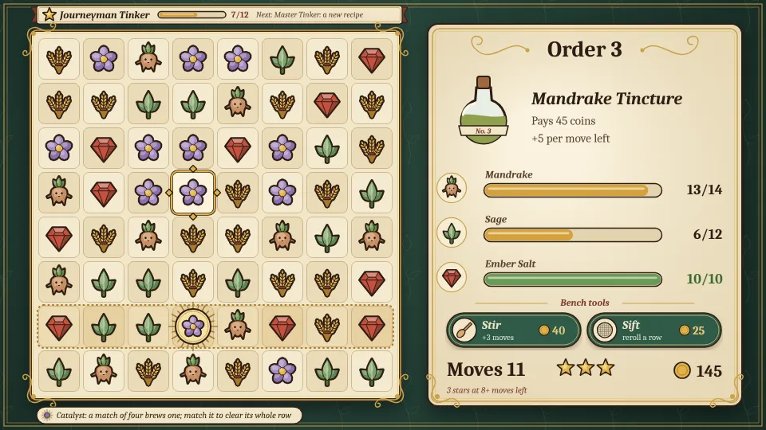

A rush order on a board with corked jars and resin-held tiles:

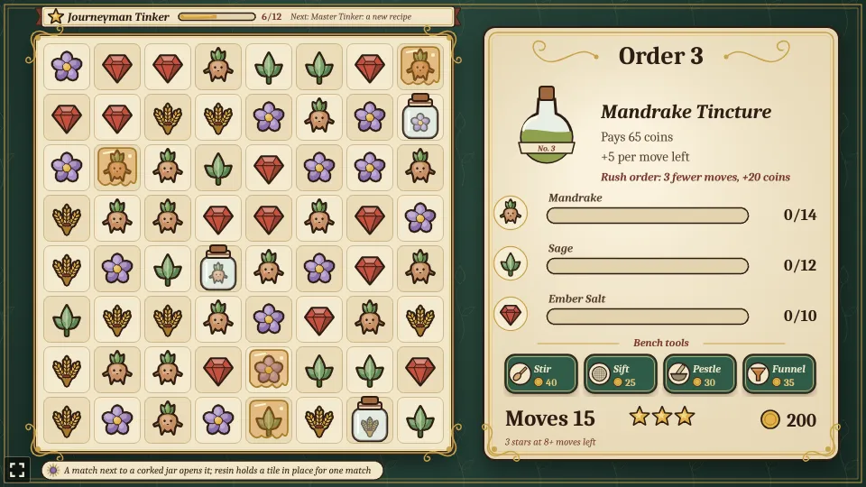

An order that forbids mandrake:

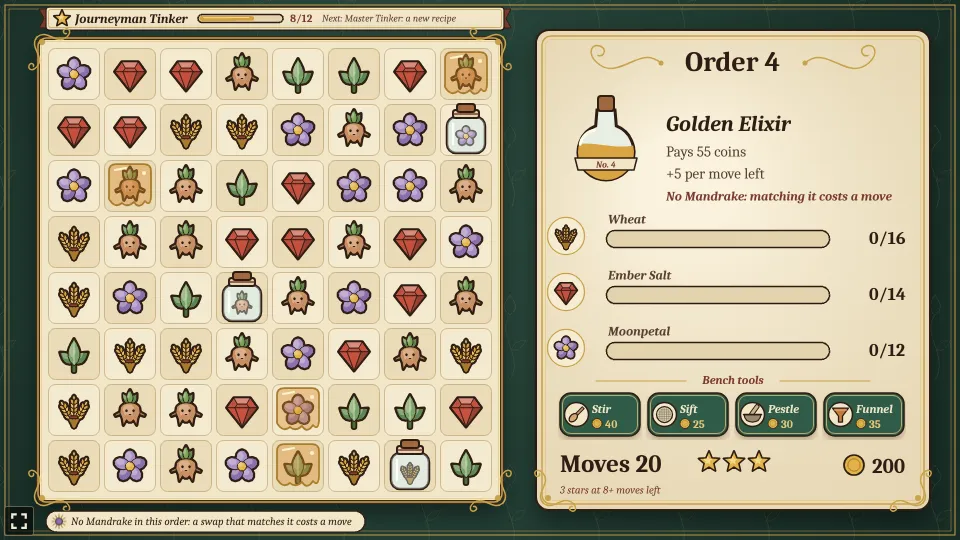

The four bench tools with the Pestle picked up, and a Bloom (bottom left) next to a Catalyst:

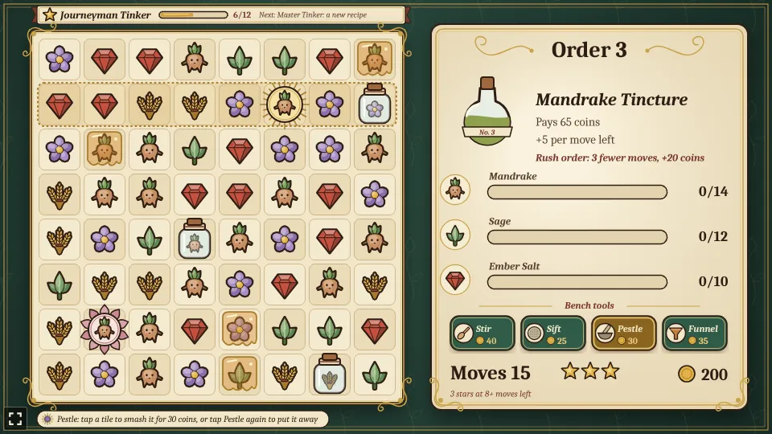

The Bloom smashed with the Pestle clears the 3x3 around it; the mandrake and sage it gathers fly to
the label, the wheat and moonpetal the order doesn't need just pop:

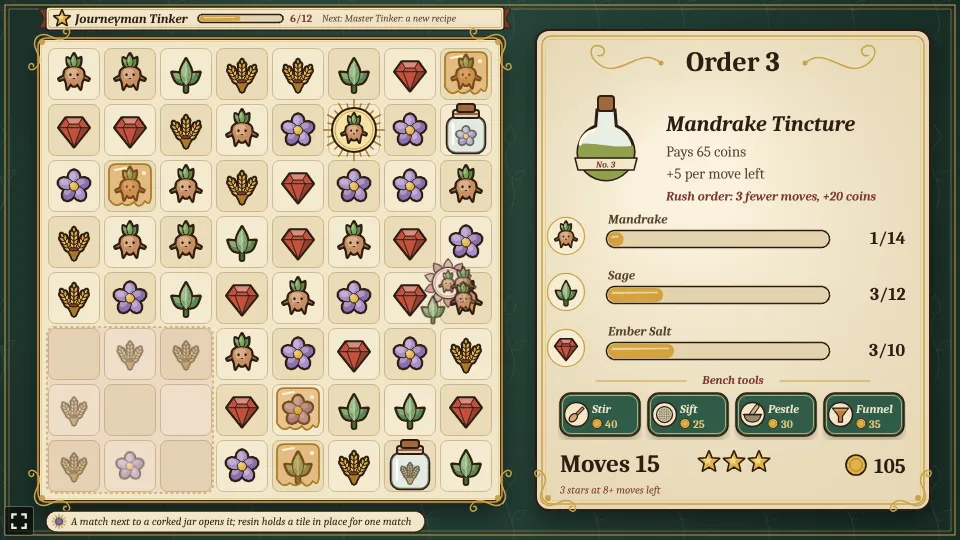

The Funnel with its first tile picked, waiting for the second:

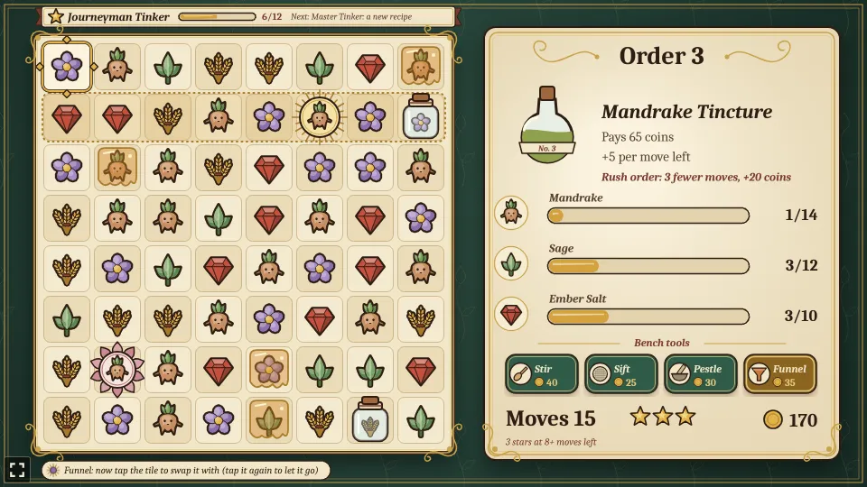

A sale that earns three stars and reaches Journeyman Tinker, unlocking the Amber Cordial:

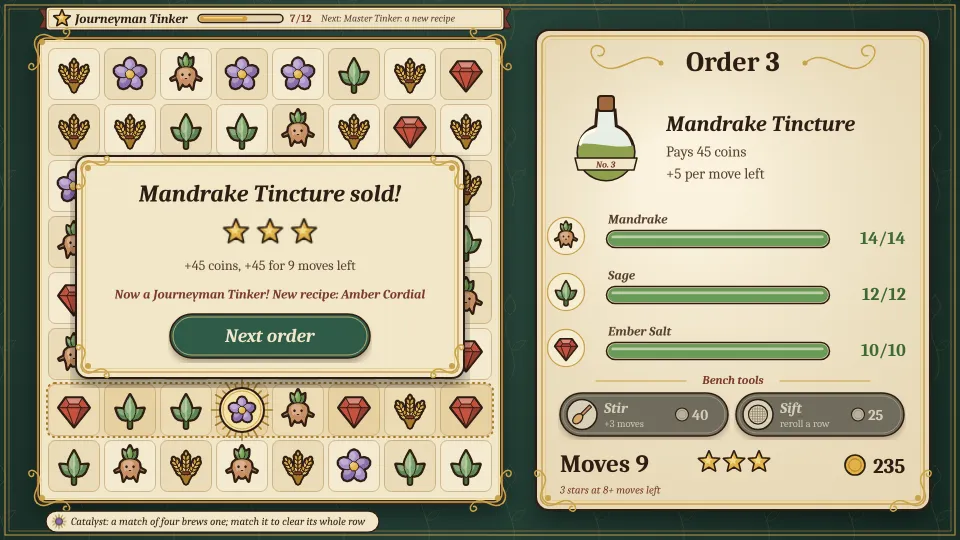

The fifth order is a royal commission: three potions in turn on one board, with two patches of mould
on it (bottom left):

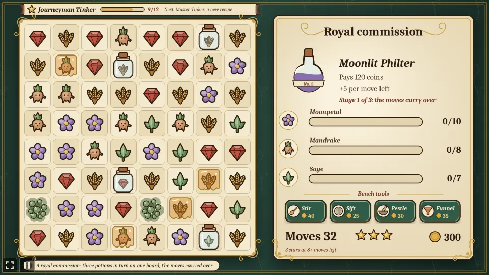

Its first stage filled: the label turns to the Amber Cordial, the 30 moves left carry over, and the
mould has crept to a third tile:

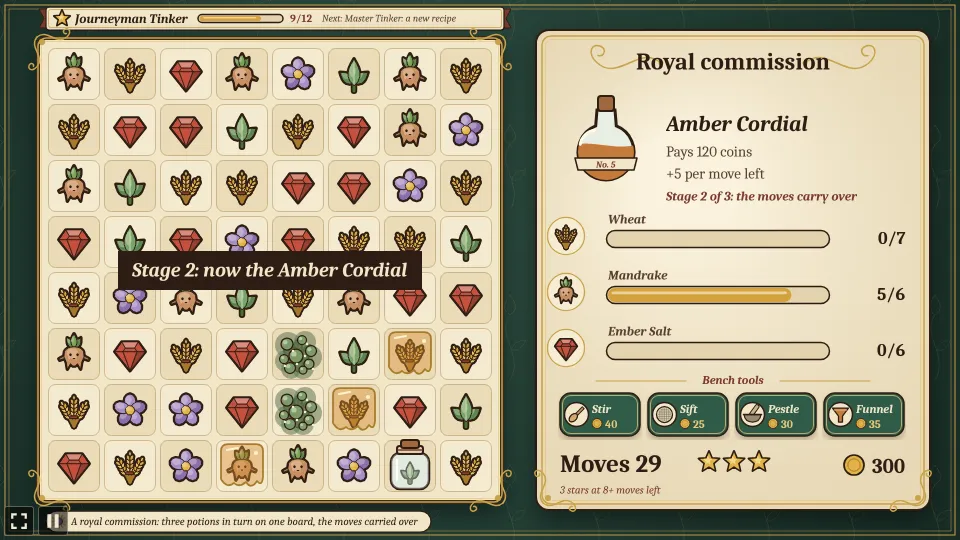

Two customers on order 7, a Healing Draught and a Sleeping Tonic, with four rows on the label; the
pantry put 4 sage and 5 wheat in to start, and the Bloom starter's Bloom sits bottom right:

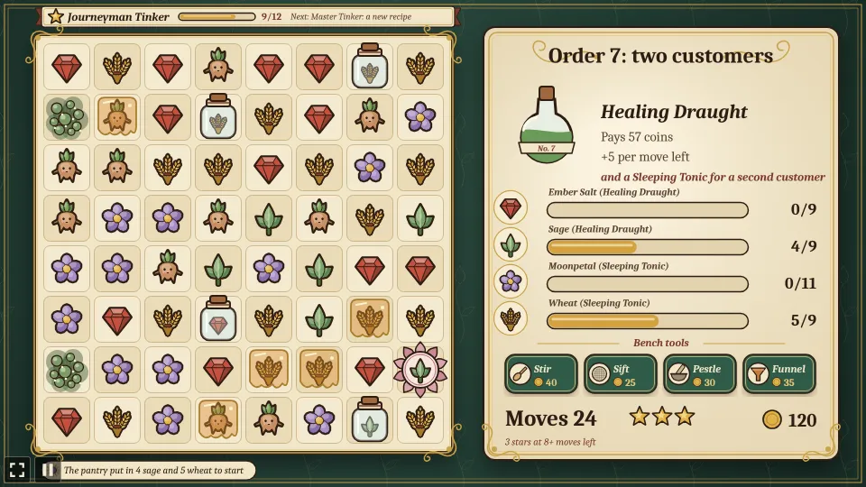

The Healing Draught's customer is served first and pays 20 coins more:

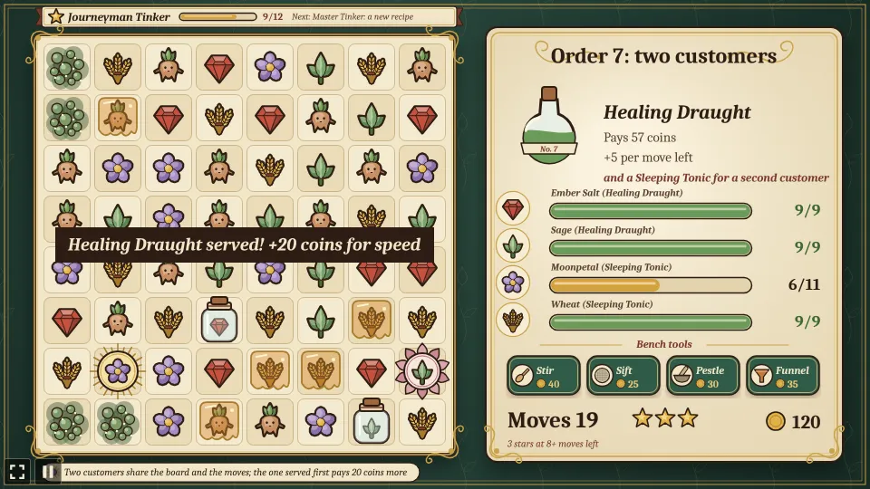

Both served: the result card lists the speed bonus and what went into the pantry (shown at the foot
of the label), while the mould has crept over much of the left side of the board:

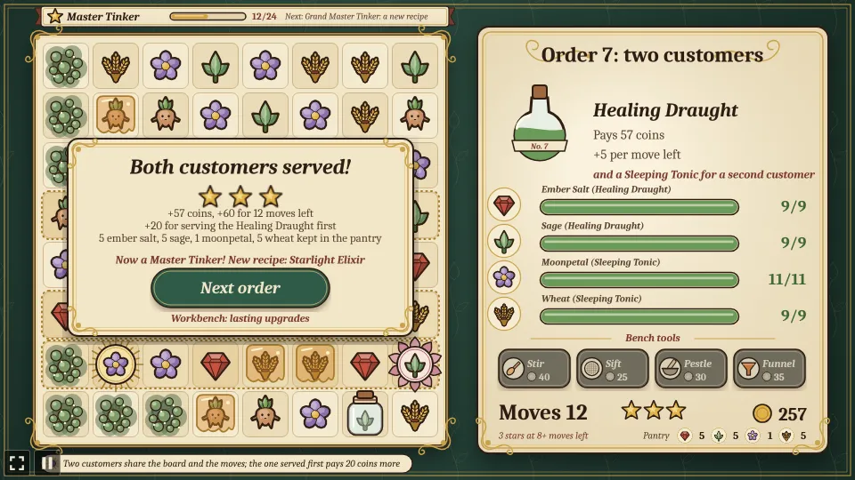

The workbench, with one level of Steady hands and the Bloom starter bought:

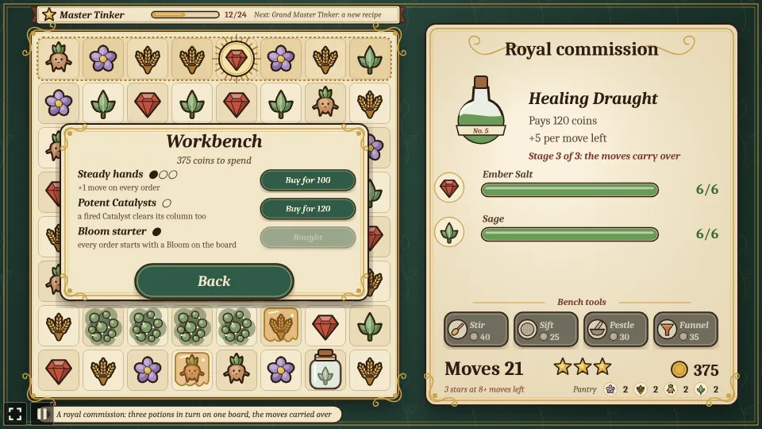

The crown's last order filled: Royal Apothecary, with the total stars on the ribbon:

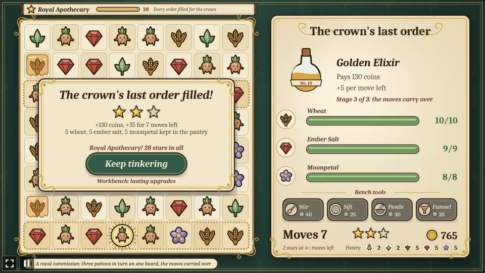

### Orders

The orders come round again with 3 more of each ingredient and 15 more coins every five orders.
Recipes unlocked by rank join the round after the first five. The second order has 3 corked jars,
and from the third on there are 4 resin tiles too; both grow by one every three orders (up to 8
jars and 10 resin). From the fifth on there are 2 patches of mould, one more every five orders (up
to 5). Every fifth order is a royal commission of the next three recipes at half strength, and from
Journeyman on every fifth order after the second serves two customers. The first order is always
plain.

| Order | Needs | Moves | Pays |
| --- | --- | --- | --- |
| Healing Draught | 12 ember salt, 12 sage | 15 | 30 |
| Sleeping Tonic | 15 moonpetal, 12 wheat | 16 | 35 |
| Mandrake Tincture | 14 mandrake, 12 sage, 10 ember salt | 18 | 45 |
| Golden Elixir | 16 wheat, 14 ember salt, 12 moonpetal | 20 | 55 |
| Moonlit Philter | 20 moonpetal, 16 mandrake, 14 sage | 20 | 70 |
| Amber Cordial (Journeyman) | 14 wheat, 12 mandrake, 12 ember salt | 18 | 60 |
| Starlight Elixir (Master) | 16 moonpetal, 14 sage, 12 wheat | 19 | 75 |
| Philosopher's Draught (Grand Master) | 18 ember salt, 16 moonpetal, 16 mandrake | 22 | 100 |

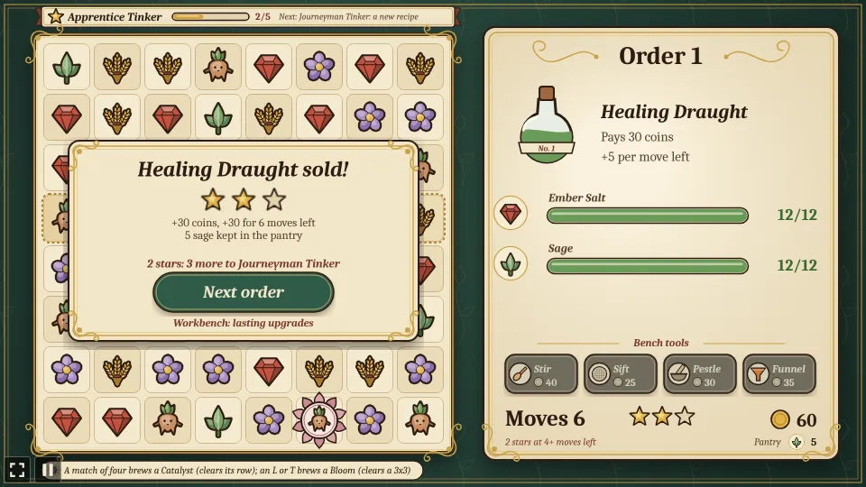

The favicon is the hub's bear with three potions lined up: a match of three.


The difficulty, set on the hub page's Settings, changes one thing: each order gives 5 more moves on Easy and 3 fewer on Hard.

## Running locally

`npm run dev` at the repo root, then open `/games/tincture-tinker/` (or pick TinctureTinker on the hub
page).

## Playthrough test

`e2e/playthrough.spec.ts` plays the first order in headless Chromium: it checks the new order and
board, taps a swap that makes no match and checks it slid back without costing a move, taps Stir
with no coins and checks it bought nothing, then makes the best match it can see, a tap on a tile
and a tap on its neighbour, checking each one spends a move, gathers at least what it matched of
the order's ingredients (less the tile a match of four keeps as a Catalyst, or an L or T as a
Bloom), counts nothing of the others and brews those specials, until the
Healing Draught is sold for its price plus the bonus for the moves left and earns its stars. Like
the other games' tests it owns the game clock and plays at 4x speed (`PLAYTHROUGH_SPEED`). The
**Playthrough TinctureTinker** workflow (`.github/workflows/playthrough.yml`) runs it on pull
requests that change this folder or the workflow itself (not on pushes to main), and uploads the
video and screenshots as the `playthrough-tincture-tinker` artifact.

```sh
npx playwright test --project tincture-tinker
```

## Code layout

All paths are inside `games/tincture-tinker/`.

- `src/game/`: the rules in plain TypeScript with no Phaser dependency. `kinds.ts` lists the
  ingredients, `orders.ts` the potion orders, the recipes ranks unlock, royal commissions and twin
  orders, `ranks.ts` the stars and ranks, `upgrades.ts` the workbench, `board.ts` finds runs,
  matches and moves, lets tiles fall, shuffles, places jars, resin and mould and lets mould creep,
  `state.ts` holds the order being played and the pantry, `sim.ts` plays a swap out step by step
  (Catalysts, Blooms, jars, resin, mould, stages and customers included) and runs the bench tools,
  and `save.ts` keeps the progress.
- `src/scenes/`: `BootScene` paints the textures, `GameScene` draws the board, the rank ribbon and
  the order label, animates each step of a swap and wires taps, drags and tools to the rules,
  `layout.ts` says where things are drawn.
- `src/art/`: `nouveau.ts`, the label toolkit (sepia contours, gold whiplashes, the ingredient
  shapes), and `textures.ts`, which paints every texture on 2D canvases at startup.
- `src/ui/`: the result card's button.

Adding an order is an entry in `ORDERS` in `src/game/orders.ts`; a new potion also needs its name
there and its colour in `BREWS` in `src/art/textures.ts`.
