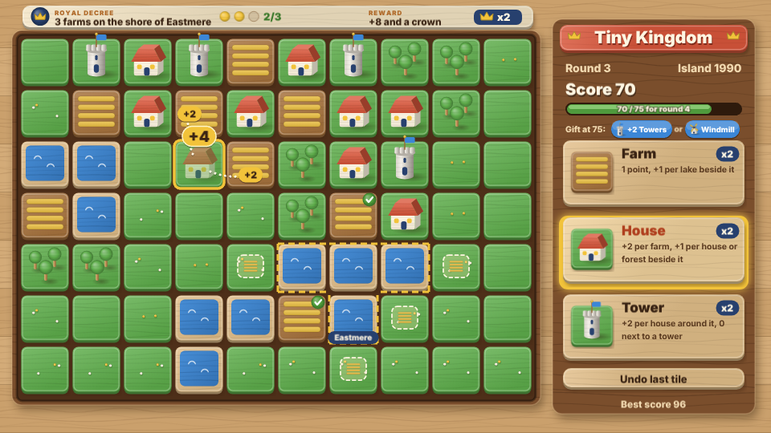
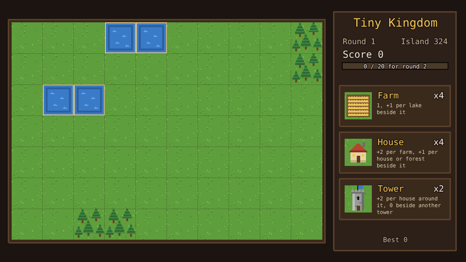
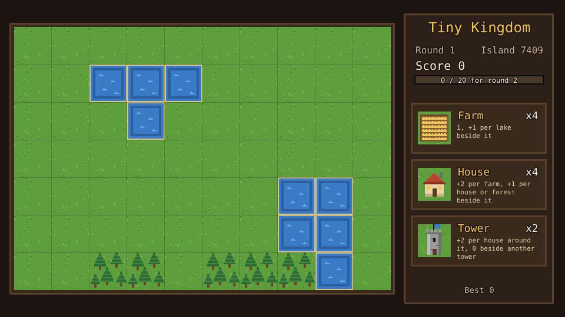
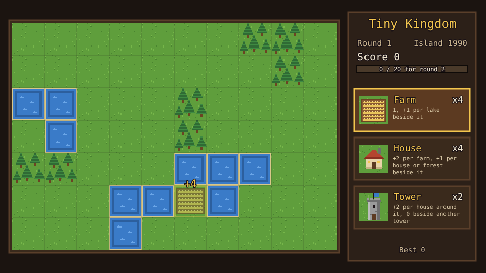
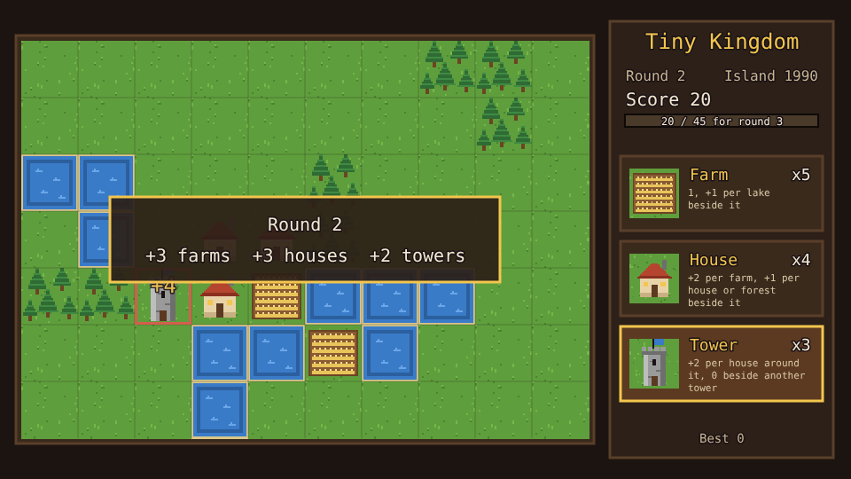
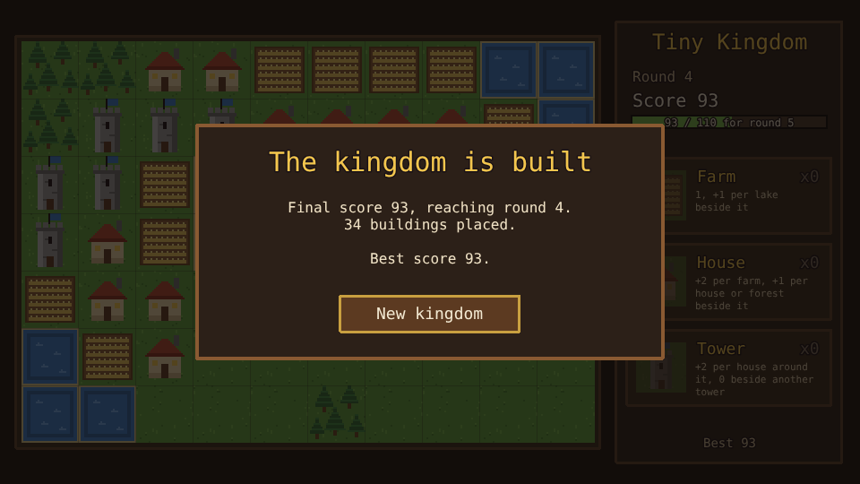

# Tiny Kingdom

A tile-placing puzzle prototype built with [Phaser 4](https://phaser.io), TypeScript and Vite,
part of the [game hub](../../README.md).

Build a kingdom on a small island of grass, lakes and forests, laid out at random for every new
kingdom (the panel shows its island number). Each round hands out a pouch of
farms, houses and towers, and every building scores against its neighbours, so where it goes
matters more than what it is. Reach the round's goal and the next round's tiles arrive; run out of
tiles or room first and the kingdom is finished.







## How to play

| Control | Action |
| --- | --- |
| Tap or click a tile button | Pick the building to place |
| Hover a cell | See what the picked building would score there |
| Tap or click a grass cell | Place the building there |
| New kingdom | After the game ends: start again on a new random island |

1. **Buildings go on grass.** Lakes and forests stay as they are, but buildings score from them.
2. **The score is the whole board's**: a placement also changes what the buildings next to it are
   worth, and the popups show each change.
3. **Rounds**: round 1 starts with 4 farms, 4 houses and 2 towers and a goal of 20. Reaching the
   goal adds 3 farms, 3 houses and 2 towers to what is left, and the goal rises (20, 45, 75, 110,
   ...).
4. **Islands** are random: two or three lakes and two or three woods scattered over the grass, so
   every kingdom is a new puzzle.
5. **The end** comes when the pouch is empty or the island has no grass left. The best final score
   is saved in the browser.



### Scoring

"Beside" means the four cells sharing an edge; "around" also counts the four diagonals.

| Building | Scores |
| --- | --- |
| Farm | 1, and 1 more per lake beside it |
| House | 2 per farm beside it, and 1 per house or forest beside it |
| Tower | 2 per house around it, but nothing while another tower is beside it |





The difficulty, set on the hub page's Settings, changes one thing: round goals are 20% lower on Easy and 20% higher on Hard.

## Running locally

`npm run dev` at the repo root, then open `/games/tiny-kingdom/` (or pick Tiny Kingdom on the hub
page).

## Playthrough test

`e2e/playthrough.spec.ts` plays the first round in headless Chromium: it seeds `Math.random` so
the game always picks the same island (1990), checks the new kingdom and its map,
picks the farm and hovers a cell to check the preview, checks a tap on a lake places nothing, then
places six buildings by tapping, checking the score each adds against the rules, until the goal
brings round 2 and its tiles. Like the other games' tests it owns the game clock and plays at 4x
speed (`PLAYTHROUGH_SPEED`). The **Playthrough Tiny Kingdom** workflow
(`.github/workflows/playthrough-tiny-kingdom.yml`) runs it on every PR and push to main that
touches this folder or a shared build file, and uploads the video and screenshots as the
`playthrough-tiny-kingdom` artifact.

```sh
npx playwright test --project tiny-kingdom
```

## Code layout

All paths are inside `games/tiny-kingdom/`.

- `src/game/`: the rules in plain TypeScript with no Phaser dependency. `tiles.ts` has the
  buildings and the random island generator, `state.ts` the scoring, rounds and placing, and `save.ts`
  the best score.
- `src/scenes/`: `BootScene` bakes textures, `GameScene` draws the board and the side panel and
  wires taps to the rules, `layout.ts` says where things are drawn.
- `src/art/`: the land and building tiles, drawn in code and baked into textures at startup.
- `src/ui/`: the button.

Changing a building's rule is its case in `cellScore` in `src/game/state.ts` and its line in
`INFO` in `src/game/tiles.ts`.
