# Tiny Kingdom

A tile-placing puzzle prototype built with [Phaser 4](https://phaser.io), TypeScript and Vite,
part of the [game hub](../../README.md).

Build a kingdom on a small island of grass, lakes and forests, laid out at random for every new
kingdom (the panel shows its island number). It looks like a wooden toy set: painted beech tiles
in a walnut tray, block houses, peg trees and towers with flags on dowels. Each round hands out a
pouch of farms, houses and towers, and every building scores against its neighbours, so where it
goes matters more than what it is. Each round also brings a royal decree, a side goal that pays a
crown, a season that makes some buildings score double, and reaching the round's goal earns a royal
gift, such as a new building: the windmill, the market, the harbor or the lumber camp. Two houses
side by side can merge into a manor. Play a random island, type in an island's number, try the
island of the day, or work through the eight-island campaign for up to three stars each. Run out of
tiles or room and the kingdom is finished.


## How to play

| Control | Action |
| --- | --- |
| Tap or click a tile button | Pick the building to place |
| Hover a cell | See what the picked building would score there, and which neighbours pay into it |
| Tap or click a grass cell | Place the building there |
| Tap a house with a house beside it, then that house | Merge the two into a manor (tap anything else to cancel) |
| Tap a gift | When the round's goal is reached: take one of the two gifts |
| Undo last tile | Take back the last placement or merge; once per round |
| Island button (next to the round) | Open the islands card: campaign levels, the island of the day, a random island, or type a number (keypad or keyboard digits, Enter to play, Esc to close) |
| New kingdom | After the game ends: start again on a new random island |

1. **Buildings go on grass.** Lakes and forests stay as they are, but buildings score from them.
2. **The score is the whole board's**, plus the decree bonuses won: a placement also changes what
   the buildings next to it are worth, and the popups show each change.
3. **Neighbour links**: while you hover a cell, a dotted link runs from each neighbour that adds
   points to the ghost tile, with its share at the neighbour's end (a lake +1, a farm beside a house
   +2, a tower that gains from a new house +2, ...), and the total sits over the ghost. The shares
   and the ghost's own base point always add up to the total.
4. **Rounds**: round 1 starts with 4 farms, 4 houses and 2 towers and a goal of 20. Reaching the
   goal adds 3 farms, 3 houses and 2 towers to what is left, and the goal rises (20, 45, 75, 110,
   ...).
5. **Royal decree**: each round has a side goal, shown in the banner above the board with its
   progress beads, such as "3 farms on the shore of Eastmere" or "2 houses by Northwood" or "A tower
   watching 3 houses". The board outlines the named lake or wood (with its name), ticks the
   buildings that already count and marks the open spots. Fulfilling it pays **+8 points and a
   crown** at once; crowns are counted in the banner and kept from kingdom to kingdom. A decree not
   fulfilled by the round's end lapses, and the next round brings a new one. Lakes and woods are
   named from where they lie on the island (Eastmere, Westpool, Northwood, ...).
6. **Royal gift**: the panel shows the two gifts on offer for reaching the goal ("Gift at 20: +2
   Towers or Windmill"). When the goal is reached, the board pauses on a card until you take one.
   Round 1 always offers +2 Towers or the Windmill; later rounds offer one new building you don't
   have yet (the Windmill, then the Market, the Harbor and the Lumber camp) beside +2 Towers, +3
   Houses or +3 Farms. Once all four are won, two of the tile packs and +2 of each new building.
7. **New buildings**, each won as a gift: the **market** scores 1 for each different kind of
   building around it; the **harbor** only goes on a lake's shore; the **lumber camp** only goes
   beside a forest and makes each house beside it score 1 more.
8. **Manors**: tap a house that has a house beside it, then tap that house. The second house
   becomes a manor (4 points and more per farm) and the first cell is grass again, free to build
   on. A merge takes no tile, counts for the decree and the goal, and can be undone like a tile.
9. **Seasons**: each round has one, in turn: Spring fair (markets and harbors score double),
   Harvest festival (farms), Timber season (houses and lumber camps) and Winter watch (towers and
   windmills). The strip under the gift row shows it. A doubled building scores its worth again
   as a bonus when you place it, and the preview shows a small "x2"; buildings already standing
   never change when the season does.
10. **Islands** are random: two or three lakes and two or three woods scattered over the grass, so
    every kingdom is a new puzzle. The island button opens the islands card, where you can type
    any island number from 1 to 9999 to play it (share the number to share the puzzle), play the
    **island of the day** (the same island for everyone that day, with its own best score), or
    play the **campaign**.
11. **Campaign**: eight islands, each with three star scores shown on the card and at the bottom
    of the panel. Your final score on a level earns one to three stars, and a star opens the next
    level. The best stars per level are saved.
12. **Undo** takes back the last tile placed or merge, once per round. A tile that fulfilled a
    decree or started a new round cannot be taken back.
13. **The end** comes when the pouch is empty or no tile has room left. If two houses could still
    merge to make room, the undo button reads "No room: merge houses or finish": merge, or tap it
    to finish the kingdom. The best final score and the crowns are saved in the browser.


### Scoring

"Beside" means the four cells sharing an edge; "around" also counts the four diagonals.

| Building | Scores |
| --- | --- |
| Farm | 1, and 1 more per lake beside it |
| House | 2 per farm beside it, and 1 per house, manor, forest or lumber camp beside it |
| Tower | 2 per house or manor around it, but nothing while another tower is beside it |
| Windmill (a gift) | 1 per farm around it; and each farm beside it scores 1 more |
| Market (a gift) | 1 for each different kind of building around it |
| Harbor (a gift) | Only on a lake's shore: 2 per lake and 1 per house or manor beside it |
| Lumber camp (a gift) | Only beside a forest: 2 per forest beside it; and each house beside it scores 1 more |
| Manor (two houses merged) | 4, plus 3 per farm and 1 per house, manor or forest beside it |

### The three loop changes


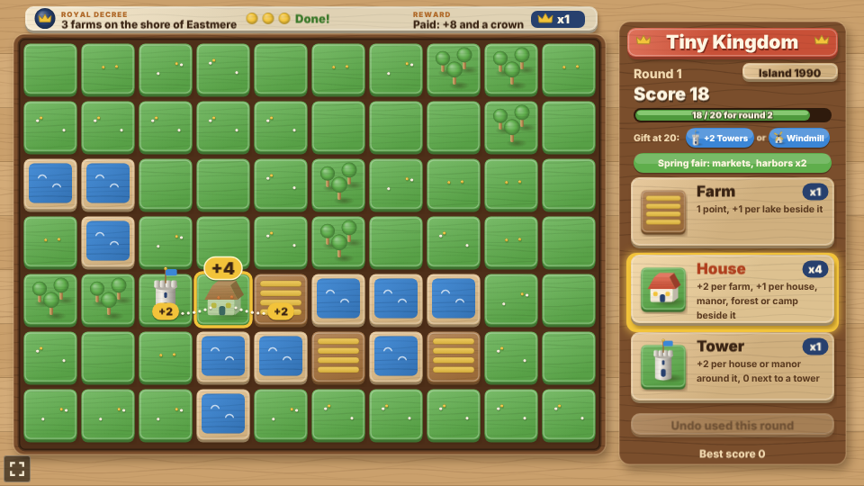

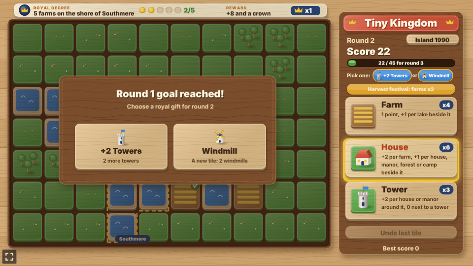

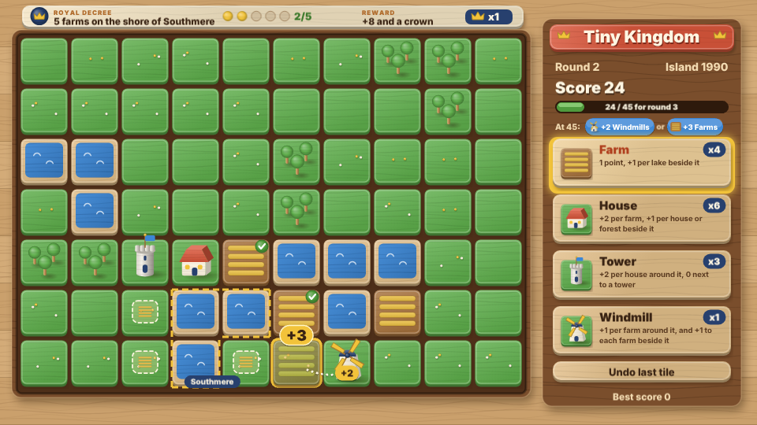


### New buildings, manors, seasons and islands

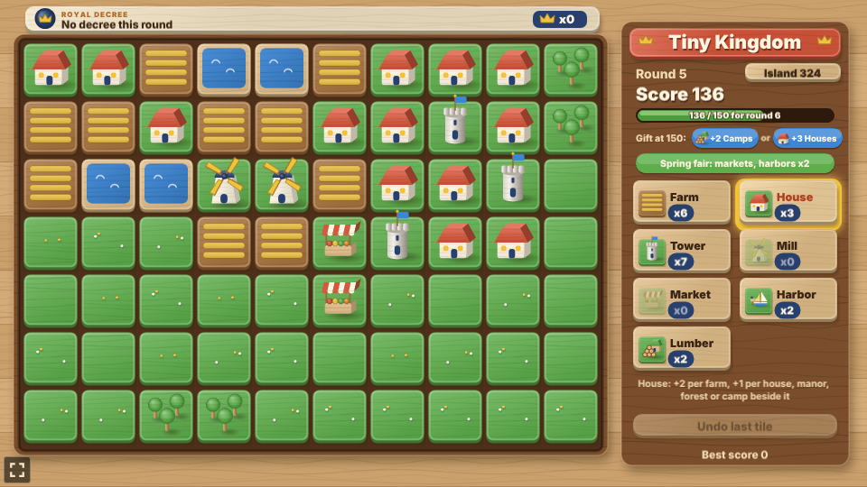

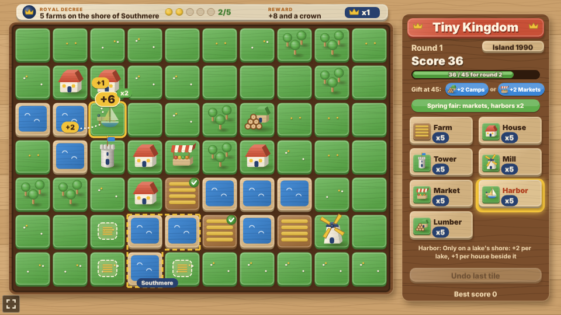

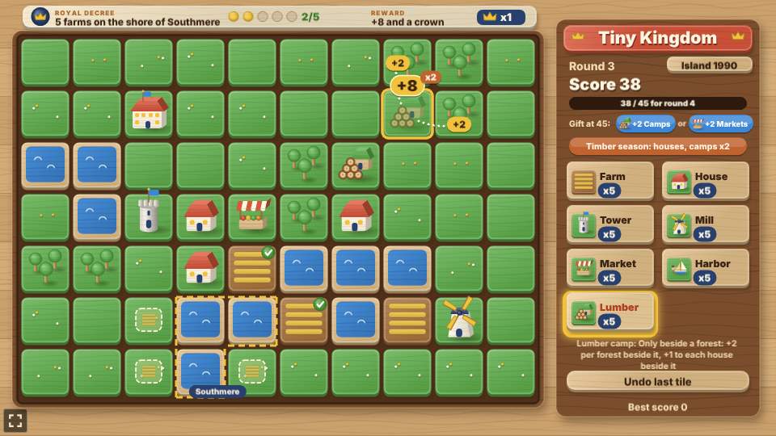

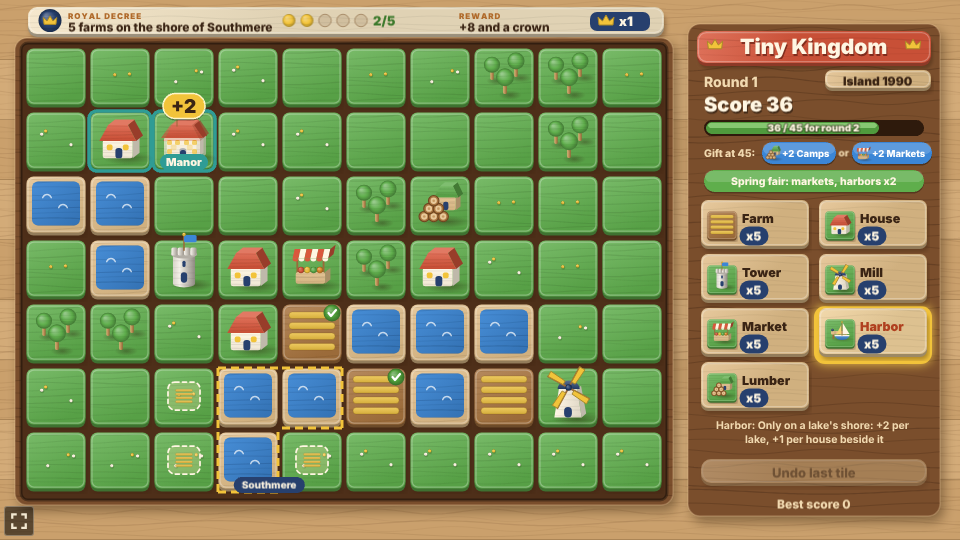

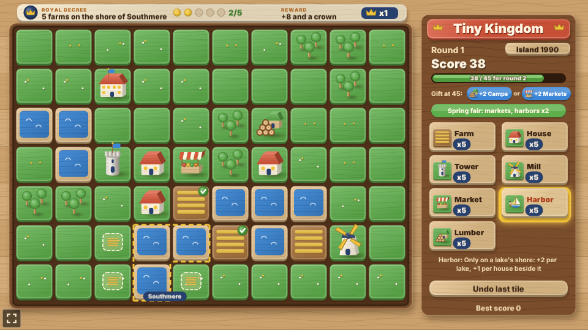

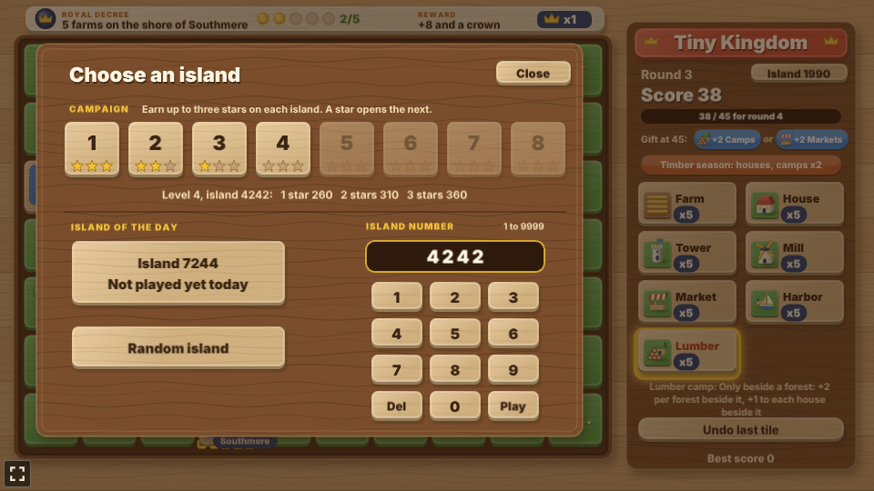

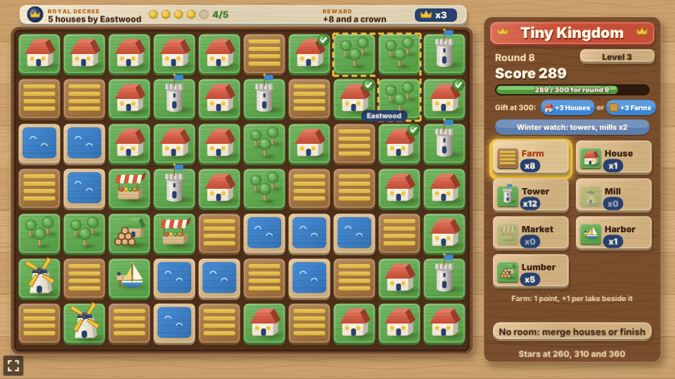

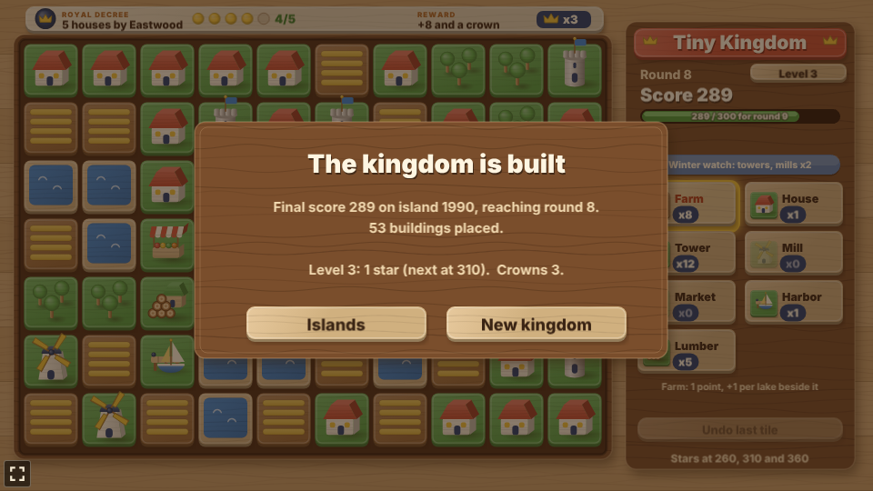

The difficulty, set on the hub page's Settings, changes one thing: round goals are 20% lower on Easy and 20% higher on Hard.

## Running locally

`npm run dev` at the repo root, then open `/games/tiny-kingdom/` (or pick Tiny Kingdom on the hub
page).

## Playthrough test

`e2e/playthrough.spec.ts` plays the first round in headless Chromium: it seeds `Math.random` so
the game always picks the same island (1990), checks the new kingdom, its map, its decree (3 farms
on the shore of Eastmere) and its gifts, picks the farm and hovers a cell to check the preview and
its lake links, checks a tap on a lake places nothing, then places five buildings by tapping,
checking the score each adds against the rules. After the second farm it tests undo: the undo takes
that farm back, a second undo in the round does nothing, and the farm goes back down. The third
farm fulfils the decree (+8, a crown, saved). Hovering the house before placing it checks its two
+2 links. The house reaches the goal: round 2 begins, nothing can be placed until the gift is taken,
and taking the Windmill adds its tiles and button. Like the other games' tests it owns the game
clock and plays at 4x speed (`PLAYTHROUGH_SPEED`). The **Playthrough Tiny Kingdom** workflow
(`.github/workflows/playthrough.yml`) runs it on every PR that changes this folder or the
workflow, and uploads the video and screenshots as the `playthrough-tiny-kingdom` artifact.

```sh
npx playwright test --project tiny-kingdom
```

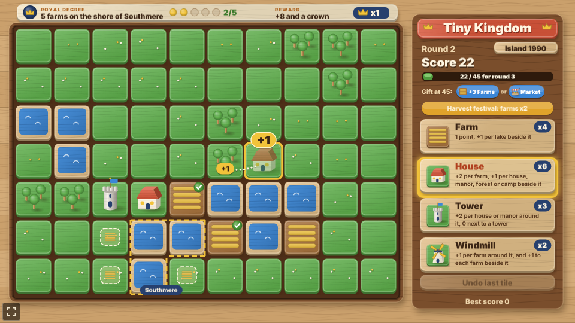

## Code layout

All paths are inside `games/tiny-kingdom/`.

- `src/game/`: the rules in plain TypeScript with no Phaser dependency. `tiles.ts` has the
  buildings and the random island generator, `state.ts` the scoring, previews, rounds, placing,
  merging and gifts taken, `decree.ts` the royal decrees and the lake and wood names, `gifts.ts` the
  gifts, `seasons.ts` the seasons, `islands.ts` the campaign, the island of the day and typed
  island numbers, and `save.ts` the best score, the crowns, the daily best and the stars.
- `src/scenes/`: `BootScene` paints the textures, `GameScene` draws the board, the decree banner,
  the side panel and the islands card and wires taps to the rules, `layout.ts` says where things
  are drawn.
- `src/art/`: the wooden toy set, painted on canvases in code at startup: `wood.ts` the toolkit and
  painters, `textures.ts` every texture.
- `src/ui/`: the button.

Changing a building's rule is its case in `cellParts` in `src/game/state.ts` and its line in
`INFO` in `src/game/tiles.ts`.
