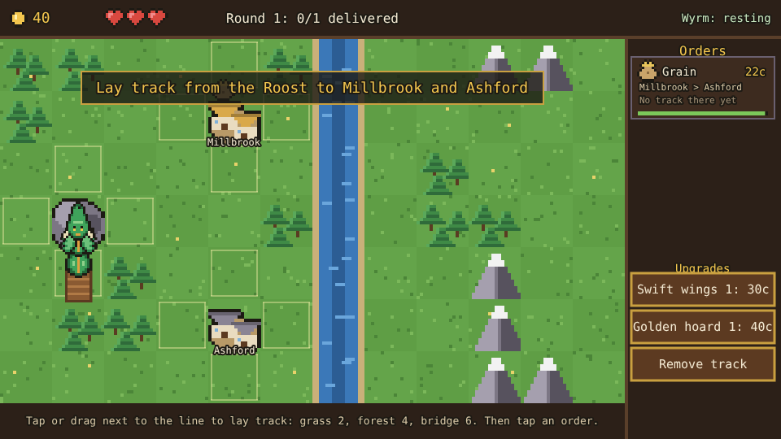
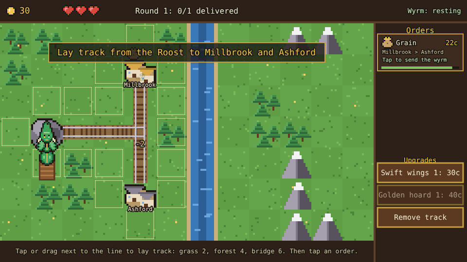
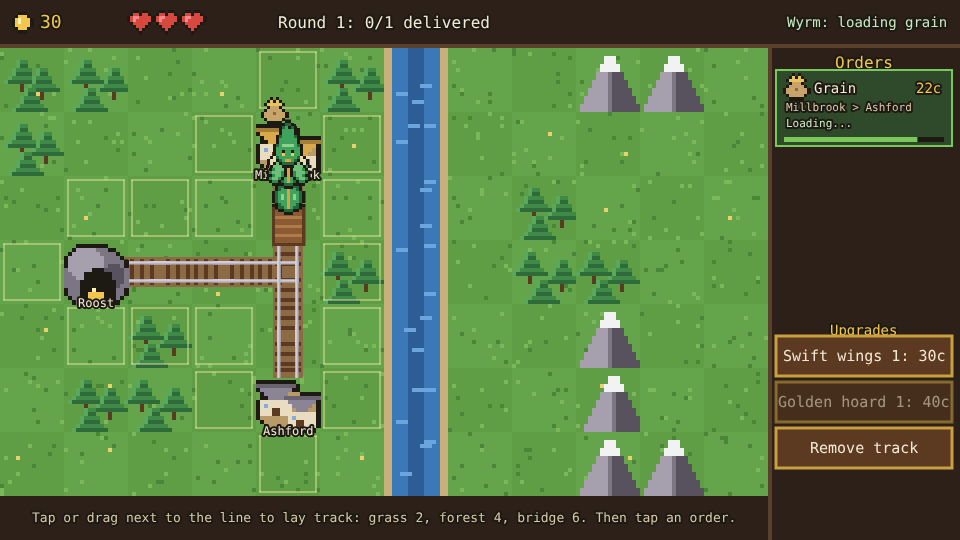
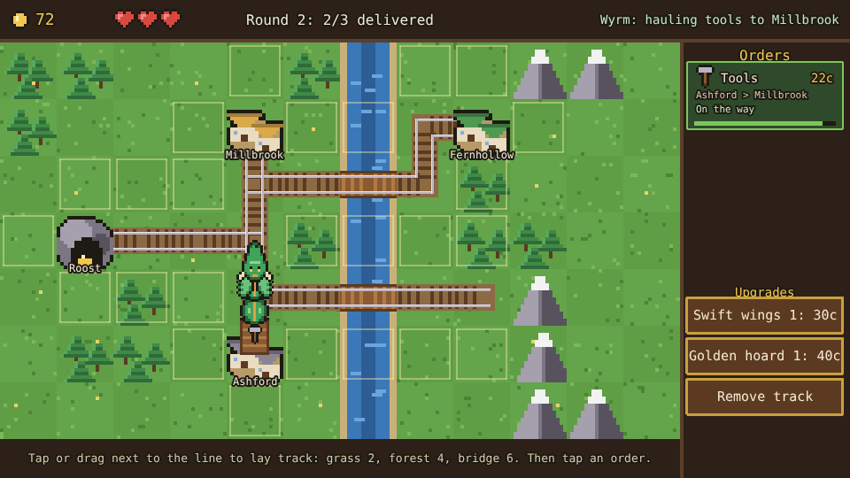
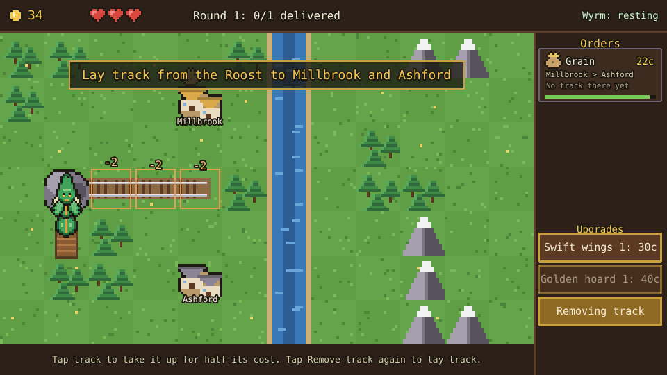
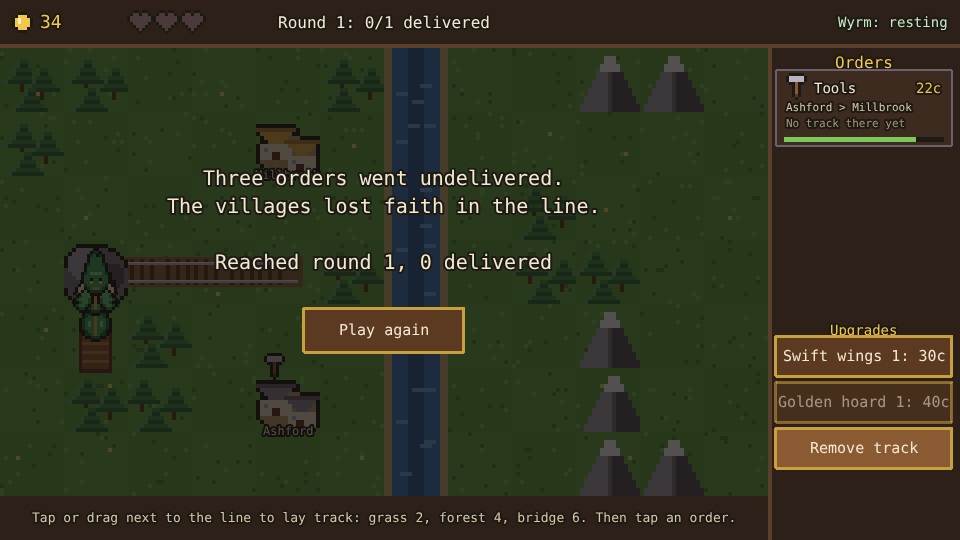

# Wyrmrail

A railway-building prototype built with [Phaser 4](https://phaser.io), TypeScript and Vite, part of
the [game hub](../../README.md).

A green wyrm sleeps in the Roost at the edge of a valley. Lay track from the Roost to the villages,
then send the wyrm along it, pulling its wagon, to carry each village's goods to another before the
order runs out of time. Every round a new village joins the line, further out across the river and
the mountains.



## How to play

| Control | Action |
| --- | --- |
| Tap or drag over tiles next to the line | Lay track there |
| Tap an order | Send the wyrm to fetch and deliver it |
| Remove track | Toggle: tap track to take it up for half its cost |
| Swift wings, Golden hoard | Buy an upgrade |

1. **Track** grows from the line: a tile can take track when it is next to track, the Roost or a
   village. Lit outlines show where. Grass costs 2 coins, forest 4 and a bridge over the river 6;
   mountains can't be built on. Track joins up with every piece and station next to it.
2. **Orders** come in on the panel on the right, up to three at a time: a cargo, the village it
   comes from, the one it goes to, the pay and a bar of time left. The first is always grain from
   Millbrook to Ashford. Goods waiting for the wyrm show over their village.
3. **The wyrm** works through the orders it is sent in turn: it flies along the track to the
   village with the goods, loads them, and carries them to the other village, which pays on
   arrival. An order it can't reach yet says "No track there yet".
4. **Deadlines**: an order that runs out of time leaves the board, cargo and all, and costs one of
   the three hearts. Losing all three ends the game.
5. **Rounds**: one delivery finishes round 1, then each round asks for one more than its number.
   Fernhollow joins in round 2, Stonereach in round 3 and Saltmere in round 4.





### Villages

| Village | Sends | Joins |
| --- | --- | --- |
| Millbrook | Grain | Round 1 |
| Ashford | Tools | Round 1 |
| Fernhollow | Timber | Round 2 |
| Stonereach | Ore | Round 3 |
| Saltmere | Fish | Round 4 |

An order pays 10 coins plus 3 per tile between the two villages (as the crow flies), and allows
20 seconds plus 5 per tile.

### Upgrades

| Upgrade | Levels | Cost | Effect |
| --- | --- | --- | --- |
| Swift wings | 3 | 30, 60, 100 | The wyrm flies 0.6 tiles a second faster (from 2) |
| Golden hoard | 3 | 40, 80, 140 | Every order pays 25% more |







The difficulty, set on the hub page's Settings, changes one thing: orders allow 50% more time on
Easy and 30% less on Hard.

## Running locally

`npm run dev` at the repo root, then open `/games/wyrmrail/` (or pick Wyrmrail on the hub page).

## Playthrough test

`e2e/playthrough.spec.ts` plays the first round in headless Chromium: it checks the new game (40
coins, three hearts, no track, the grain order from Millbrook to Ashford), checks the order can't be
sent before there is track, lays five pieces of track from the Roost to both villages by tapping
tiles and checks each costs 2 coins, then taps the order and follows the wyrm as it loads the grain
at Millbrook and delivers it to Ashford, which pays 22 coins and starts round 2. Like the other
games' tests it owns the game clock and plays at 4x speed (`PLAYTHROUGH_SPEED`). The **Playthrough
Wyrmrail** workflow (`.github/workflows/playthrough-wyrmrail.yml`) runs it on every pull request that
touches this folder or the workflow, and uploads the video and screenshots as the
`playthrough-wyrmrail` artifact.

```sh
npx playwright test --project wyrmrail
```

## Code layout

All paths are inside `games/wyrmrail/`.

- `src/game/`: the rules in plain TypeScript with no Phaser dependency. `map.ts` holds the valley
  (terrain, track costs, the Roost and the villages), `state.ts` the tuning numbers and the shape of
  a game, and `sim.ts` moves it on: laying and removing track, routes along it, orders, the wyrm's
  trips, upgrades and rounds. New orders are picked with `Math.random`.
- `src/scenes/`: `BootScene` bakes textures, `GameScene` draws the valley, the track, the wyrm,
  the HUD and the panel and wires taps to the rules, `layout.ts` says where things are drawn.
- `src/art/`: all the pixel art, drawn in code and baked into textures at startup: the valley, the
  villages and the Roost, the wyrm and its wagon, and the cargo and HUD icons.
- `src/ui/`: the buttons.
